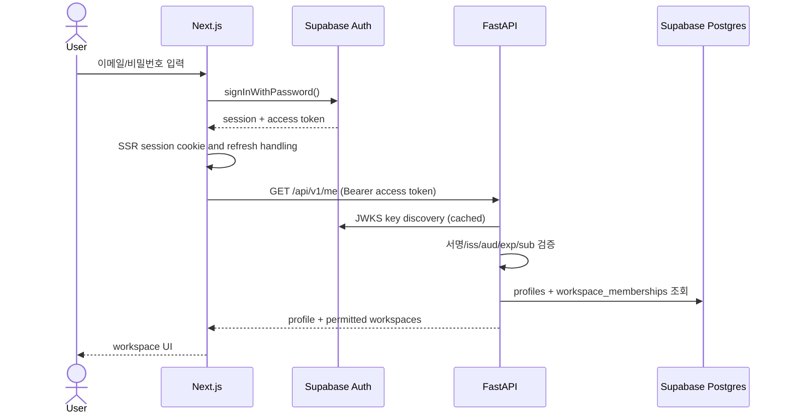

# Authentication & Authorization — Independent Implementation Plan v1.0 (Platform v1.2)

**상태:** 확정 구현 기준, 2026-10-16  
**연계:** `architecture.md`, `deployment.md`, `e2e-strategy.md`, `screens/auth-*.md`  
**핵심 결정:** 인증 제공자는 **Supabase Auth**; Next.js는 UI·SSR 세션 연동, FastAPI는 access token 검증·데이터 인가를 담당한다. Core Python 라이브러리는 사용자 인증을 모른다.

## 1. 범위

| MVP 필수 | 다음 단계 |
|---|---|
| 이메일/비밀번호 회원가입, 메일 인증, 로그인, 로그아웃 | OAuth(Google/Apple), 패스키, MFA |
| 비밀번호 재설정, 로그인 에러/만료 안내 | 세션·디바이스 목록, 강제 전체 로그아웃 |
| 인증 필수 라우트 보호, 세션 복구·갱신 | 초대·공유 Workspace의 editor/viewer 역할 UI |
| FastAPI JWT 검증, Workspace 권한 확인 | 계정 연동, 조직·팀 관리 |
| 사용자 프로필/개인별 문제 상태 분리 | 계정 삭제 셀프서비스 및 데이터 내보내기 |

가입 정책: MVP는 **이메일 확인 완료 후 서비스 접근 허용**, 공개 가입은 환경 설정으로 제어할 수 있다. 단일 사용자로 시작해도 접근 제어와 데이터 격리는 필수다.

## 2. 인증 화면과 라우트

| Screen ID | Path | 역할 |
|---|---|---|
| AUTH-01 | `/login` | 이메일/비밀번호 로그인, 가입·복구 링크, 유효성 검사 |
| AUTH-02 | `/signup` | 계정 생성, 비밀번호 확인, 약관·개인정보 처리방침 링크 |
| AUTH-03 | `/auth/verify` | 이메일 확인 대기, 메일 재전송, 메일 변경 안내 |
| AUTH-04 | `/auth/callback` | 확인·복구·향후 OAuth 코드 교환, return URL 검증 |
| AUTH-05 | `/forgot-password` | 재설정 이메일 요청, 계정 존재 여부 비노출 |
| AUTH-06 | `/reset-password` | 유효한 복구 세션만 신규 비밀번호 설정 허용 |
| AUTH-07 | `/auth/error` | 만료·잘못된 링크, 네트워크 오류와 재시도 UX |
| ACCOUNT-01 | `/settings/security` | 사용자 이메일, 비밀번호 변경, 로그아웃 |

보호 구역: `/workspaces/**`, `/documents/**`, `/questions/**`, `/settings/**`. 미인증 진입 시 `/login?next=<상대 경로>`로 이동하되 `next`는 반드시 내부 상대 경로 allowlist로 검증해 open redirect를 차단한다. 이미 로그인된 사용자는 auth 페이지 접근 시 마지막 workspace 또는 workspace 목록으로 이동한다.

## 3. 로그인/토큰 흐름



- Next.js에서 Supabase SSR adapter 사용. 프레임워크 버전에 따라 `proxy.ts`(Next 16+) 또는 `middleware.ts`(이전)로 세션 갱신. **서버에서는 cookie의 `getSession().user`만으로 인증 판단 금지**; `getClaims()` 또는 신뢰 가능한 Auth 서버 재확인 수행.
- 브라우저→FastAPI 요청은 `Authorization: Bearer <Supabase access token>` 사용. 토큰 자체는 로그/URL/analytics에 절대 기록하지 않는다. Frontend의 Supabase `publishable` key만 클라이언트에 허용한다.
- FastAPI는 프로젝트 JWT의 JWKS(비대칭 signing keys)로 signature, `kid`, 알고리즘 allowlist, 발급자(`iss`), 대상(`aud`), 만료(`exp`) 및 `sub`를 검증. `user_id`는 검증된 `sub`에서만 파생한다. 키 캐시·rotation·JWKS 오류 처리 및 관측성 추가. 레거시 HS256 프로젝트는 JWKS가 비어 있을 수 있으므로 신규 프로젝트는 비대칭 서명을 설정한다.
- 비밀번호/비밀번호 hash와 refresh token을 FastAPI DB에 복제하지 않는다. 사용자 등록은 Supabase Auth로 통일한다.
- 만료 access token은 정상적으로 refresh 후 재시도. refresh 실패는 로그인 화면으로 이동, 인증 오류와 서버 장애는 구분해서 처리.
- 이메일 확인/재설정 callback은 PKCE 코드 교환, 허용된 redirect URL, 오류/재시도를 지원. 비밀번호 reset은 유효한 복구 세션이 아니면 금지.

## 4. 사용자·인가 데이터 모델

```sql
-- user_id는 auth.users.id와 동일한 UUID
profiles(user_id uuid primary key references auth.users(id),
         display_name text, created_at timestamptz, updated_at timestamptz)

workspace_memberships(
  workspace_id uuid not null,
  user_id uuid not null references auth.users(id),
  role text not null check(role in ('owner','editor','viewer')),
  created_at timestamptz,
  primary key (workspace_id, user_id)
)
```

- MVP에서는 owner가 생성한 Workspace만 이용하더라도 `workspace_memberships`를 기준으로 인가한다.
- API는 **매 요청마다** `resource → workspace_id → membership`을 확인한다. 클라이언트에서 전달한 `workspace_id`가 해당 리소스의 소속과 일치하는지 DB에서 검증한다. archived는 쓰기 거부, soft-deleted는 접근 차단.
- 권한 초안: owner=모든 작업, editor=문서·문제 편집/풀이, viewer=조회·개인 풀이·개인별 즐겨찾기. MVP UI는 초대·역할 관리 기능 제외.
- `question_user_states`/`question_attempts`는 `user_id`를 서버에서 주입. 다른 사용자의 progress가 공유되지 않는다.
- Postgres direct connection을 FastAPI가 사용하는 경우 Supabase SDK의 RLS가 FastAPI 인가를 자동 보장하지 않는다. **Service API가 필수 인가 경계**이며, 브라우저의 자동생성 Data API 직접 CRUD는 MVP에서 금지. 권한 낮은 DB role, 최소 grants, RLS(노출 schema), service/admin key 비노출을 병행한다.
- Supabase Storage는 모두 private bucket. 다운로드·업로드 서명 URL 발급 전 서버가 Workspace membership과 file ownership을 검사한다. 서명 URL의 만료시간은 짧게 유지한다.

## 5. 보안 / 에러 / 운영

- 인증 에러 메시지는 과도한 계정 존재 여부 노출을 피한다. 로그인에는 일반화된 자격증명 오류; 비밀번호 복구 요청은 존재 여부와 무관하게 유사한 성공 안내.
- Supabase Auth rate limit과 CAPTCHA(Cloudflare Turnstile, §5.1)를 환경별로 설정 가능하게 하며, 인증 요청의 과도한 시도는 로그/알림으로 파악한다.
- 운영 메일(확인·복구)은 외부 SMTP를 설정. 기본 테스트 메일 발송만으로 운영하지 않는다.
- CSRF/세션 쿠키 설정, redirect allowlist, CORS origin allowlist, HTTPS, CSP, referrer 정책을 점검한다. 서버 인증 응답은 사용자간 공유 캐시 금지.
- 401=토큰 없음/만료/검증 실패; 403=인증은 됐으나 인가 실패. 사용자 화면에 두 경우의 행동을 다르게 안내한다.
- access-token 만료 전 refresh는 UI가 처리하지만, 계정 차단·즉시 회수처럼 최신 상태가 필요한 고위험 작업은 Auth 서버에서 사용자 상태를 재확인한다.
- `GET /api/v1/me`: 검증된 사용자 id 및 프로필. `GET /api/v1/me/workspaces`: 접근 가능한 Workspace 목록. 로그인, 가입, 비밀번호 변경 자체는 Supabase SDK/Auth API에서 처리한다.
- 계정 생성 후 프로필 초기화는 중복 호출에 안전한 `upsert`/재시도 방식으로 구현하고, `auth.users` 직접 수정은 하지 않는다.

### 5.1 CAPTCHA — Cloudflare Turnstile (A4)

봇 가입·자격증명 대입·메일 폭탄을 막기 위해 Supabase Auth의 CAPTCHA 기능(`[auth.captcha] provider = "turnstile"`)을 쓴다. **토큰 검증은 Supabase Auth 서버가** Turnstile secret으로 수행한다(secret은 Supabase 설정에만 존재, web·API·브라우저에 없음). web은 위젯으로 받은 토큰을 해당 Auth 호출에 붙여 보낼 뿐이다.

**토큰이 필요한 호출**(GoTrue가 CAPTCHA 활성 시 `captcha_token`을 요구하는 endpoint):

| 화면 | supabase-js 호출 | Auth endpoint |
|---|---|---|
| AUTH-01 로그인 | `signInWithPassword({ email, password, options: { captchaToken } })` (Server Action) | `POST /token?grant_type=password` |
| AUTH-02 회원가입 | `signUp({ …, options: { captchaToken } })` | `POST /signup` |
| AUTH-03 인증 메일 재전송 | `resend({ type: 'signup', …, options: { captchaToken } })` | `POST /resend` |
| AUTH-05 재설정 메일 요청 | `resetPasswordForEmail(email, { captchaToken })` | `POST /recover` |

필요 없는 호출: refresh token·PKCE code 교환(`/token?grant_type=refresh_token|pkce`), `verifyOtp`(callback), `updateUser`(AUTH-06·ACCOUNT-01 비밀번호 변경), `signOut`. `signInWithOtp`·익명 로그인은 MVP에서 쓰지 않는다(도입 시 같은 규칙으로 토큰 필수).

**환경별 설정**

| 환경 | web `NEXT_PUBLIC_TURNSTILE_SITE_KEY` | Supabase `[auth.captcha]` |
|---|---|---|
| local (`supabase start`) | `.env.example`: Turnstile 공식 테스트 키 `1x00000000000000000000AA`(항상 통과) | `enabled = false`(오프라인·결정론: 수백 개 Auth 호출이 Cloudflare에 의존하지 않음, fixture의 password grant 그대로) |
| test/E2E | 같은 테스트 키로 build, 브라우저의 `challenges.cloudflare.com` 요청은 Playwright fixture가 **결정론적 가짜 Turnstile**로 대체 | `enabled = false` |
| staging | 기본은 공식 테스트 키 쌍(site `1x00000000000000000000AA` + secret `1x0000000000000000000000000000000AA`): 실제 위젯·실제 Supabase 검증 경로를 타면서 smoke 계정 자동 로그인이 가능 | `enabled = true`, secret = `env(SUPABASE_AUTH_CAPTCHA_SECRET)` |
| production | 실제 Turnstile widget sitekey(`0x…`), 테스트 키 금지 | `enabled = true`, 실제 secret, 테스트 secret 금지 |

- `NEXT_PUBLIC_TURNSTILE_SITE_KEY`가 비어 있으면 CAPTCHA는 **꺼진 것**이다: 위젯·script를 로드하지 않고, CSP에 Turnstile origin을 넣지 않으며, 호출에 `captchaToken`을 붙이지 않는다(기존 동작). Supabase 측 `enabled`와 반드시 짝을 맞춘다(web만 꺼지면 Auth가 모든 가입·로그인을 거부). 이 짝은 `infra/deploy/env-manifest.toml`(staging/production 필수)과 runbook으로 관리한다.
- site key는 공개 값(`kind = public`, build 시 inline), secret은 `SUPABASE_AUTH_CAPTCHA_SECRET`으로 `supabase config push` 셸에만 둔다. 둘 다 로그·URL·trace에 남기지 않는다(토큰도 마찬가지: 토큰은 요청 body로만 전달).

**UI·토큰 규칙**(AUTH-01-AC05/06, AUTH-02-AC04/05, AUTH-03-AC04/05, AUTH-05-AC04/05)
- 공용 `TurnstileWidget`(apps/web): "보안 확인" 제목이 있는 group 안에 Turnstile을 explicit render(`language: 'ko'`, `theme: 'auto'`, `refresh-expired: 'manual'`)하고, 상태를 텍스트로 알리는 `role="status"` 영역(확인 중 / 확인 완료 / 실패 / 만료 / 불러오기 실패)을 둔다. 색만으로 상태를 표현하지 않는다.
- 토큰이 없으면 제출 버튼은 `aria-disabled="true"`이고 "보안 확인을 완료하면 …할 수 있습니다" 설명에 연결된다. Enter 등으로 제출해도 Auth 호출 없이 같은 사유를 표시하고 보안 확인 영역으로 focus를 옮긴다. 필드 검증 오류가 있으면 필드 오류가 먼저다(기존 AC 유지).
- 토큰은 **1회용**: Auth 호출을 한 번 할 때마다(성공·실패·네트워크 오류 무관) 위젯을 `reset`하고 보관한 토큰을 버린다. 같은 토큰으로 두 번 호출하지 않는다(AUTH-03의 짧은 throttle 자동 재시도는 새 토큰을 받은 뒤에만 수행).
- 실패 문구(한국어 우선, 계정 존재·원인 코드 비노출):
  - 위젯 오류(`error-callback`, 차단): "보안 확인을 완료하지 못했습니다. 다시 시도해 주세요."
  - 만료(`expired-callback`/`timeout-callback`): "보안 확인 시간이 지났습니다. 다시 확인해 주세요."
  - script 불러오기 실패: "보안 확인을 불러오지 못했습니다. 네트워크 연결을 확인한 뒤 다시 시도해 주세요."
  - Supabase가 CAPTCHA를 거부(`captcha_failed`, 400): form 오류 "보안 확인에 실패했습니다. 보안 확인을 다시 완료한 뒤 시도해 주세요."
  - 위 상태에서는 키보드로 조작 가능한 "보안 확인 다시 하기" 버튼(위젯 reset)을 제공한다.
- 접근성: Turnstile iframe 자체의 키보드·스크린리더 지원(Cloudflare 제공)에 더해, 위 status·버튼·설명은 모두 라벨이 있는 표준 요소다. 우리 쪽 표시는 애니메이션을 쓰지 않거나 `prefers-reduced-motion: reduce`에서 끈다. 위젯 영역 높이를 미리 확보해 로드 시 레이아웃이 밀리지 않게 한다.
- CSP(활성 시에만): `script-src`에 `https://challenges.cloudflare.com`(nonce + `'strict-dynamic'` 유지: api.js는 nonce가 붙은 우리 script가 삽입), `frame-src https://challenges.cloudflare.com`(그 외 `'none'` 유지). `connect-src`는 추가하지 않는다(pre-clearance 미사용). 상세: deployment.md §6.1.
- 테스트: 브라우저 E2E는 실제 Cloudflare를 부르지 않는다. `tests/e2e/fixtures/turnstile.ts`가 `https://challenges.cloudflare.com/turnstile/v0/api.js`를 route로 가로채 같은 API(`render/reset/remove/getResponse`, callback들)를 구현한 가짜 script와 iframe을 돌려준다(통과·실패·상호작용·만료·로드 실패 모드, 토큰은 테스트 키와 같은 `XXXX.DUMMY.TOKEN.XXXX`). 가짜는 테스트 디렉터리에만 있고 앱 build에는 들어가지 않는다. 서버 검증(Supabase가 토큰 없는/잘못된 요청을 거부)은 `enabled = true` + 테스트 secret인 별도 Supabase 스택에서 확인한다(구현 Task 보고·runbook).

## 6. 독립 Auth 개발 트랙

| 단계 | 구현 항목 | 테스트를 먼저 통과시킬 조건 |
|---|---|---|
| A0 Spec & RED | AUTH/ACCOUNT 화면 요구사항, E2E 계약/seed, 테스트 프로젝트 | 테스트가 예상대로 실패하고 fixture의 실패 원인을 추적 가능 |
| A1 Identity & API | Supabase local, Auth 설정, JWT 검증, profile/membership, permission dependency | 잘못된 토큰 401, 타인 Workspace 403/404, 정당 접근 200 |
| A2 UI | Login, Signup, Verify, Forgot, Reset, Callback, Security | 각 화면의 정상·오류·loading·keyboard/모바일 시나리오 통과 |
| A3 Release readiness | 메일 SMTP, 회수·만료·복구, redirect/CORS, migration, staging smoke | staging에서 가입~로그인~비밀번호 재설정~워크스페이스 접근 E2E 성공 |

**의존성:** M0와 A0 병행 가능. A1/A2는 M1/M2와 병렬 개발 가능. 하지만 **M3의 Workspace UI release 전에 A3 완료**를 요구한다. 이를 통해 Auth가 다른 도메인 개발의 블로커가 되는 상황을 줄인다.

## 7. Auth 필수 E2E 시나리오

- `AUTH-01-AC01`: 미인증 사용자가 `/workspaces`에 접근하면 로그인 페이지로 이동한다.
- `AUTH-01-AC02`: 정확한 인증정보로 로그인하면 원래 요청한 내부 경로로 복귀한다.
- `AUTH-01-AC03`: 오입력 시 비밀번호 노출이나 계정 존재 여부 노출 없이 오류 표시.
- `AUTH-02-AC01`: 가입 후 메일 확인이 필요할 경우 verify 화면에 머무른다.
- `AUTH-03-AC01`: 로컬 Mailpit에서 확인 메일을 받아 확인 처리할 수 있다.
- `AUTH-05-AC01`: 존재하는/존재하지 않는 이메일 모두 비밀번호 재설정 요청 시 사용자에게 동일한 안내를 한다.
- `AUTH-06-AC01`: 만료 링크는 password update를 허용하지 않는다.
- `AUTH-07-AC01`: 외부 사이트 redirect (`next=https://evil.example`)는 거부된다.
- `AUTH-01-AC05`·`AUTH-02-AC04`·`AUTH-03-AC04`·`AUTH-05-AC04`: CAPTCHA 활성 시 보안 확인 전 제출 차단, 토큰을 Auth 호출에 전달, 호출마다 위젯 reset(§5.1).
- `AUTH-01-AC06`·`AUTH-02-AC05`·`AUTH-03-AC05`·`AUTH-05-AC05`: 보안 확인 실패·만료·로드 실패·서버 거부 시 한국어 안내와 키보드로 다시 확인, 상태 텍스트 알림.
- `AUTH-API-AC01`: JWT 누락·위조·만료 → 401.
- `AUTH-API-AC02`: 다른 사용자의 Workspace/doc/question 접근 거부, 읽기뿐 아니라 upload URL·Qdrant 검색·SSE·다운로드 포함.
- `AUTH-API-AC03`: 로그아웃 뒤 refresh token 재사용 불가; 기존 짧은 수명의 access token은 만료시까지 유효할 수 있음을 명시하여 민감 작업 재검증.

### 공식 참조

- https://supabase.com/docs/guides/auth/server-side
- https://supabase.com/docs/guides/auth/jwts
- https://supabase.com/docs/guides/auth/redirect-urls
- https://supabase.com/docs/guides/database/postgres/row-level-security
- https://supabase.com/docs/guides/auth/passwords


## Workspace 공유 링크·Fork 인가 (v1.3 추가)
- 공유 링크는 **사용자 인증이 아닌 별도 제한된 조회 capability**로 취급한다. 로그인 없이 공유 전용 API로 공개된 revision만 조회할 수 있다. 기존 Workspace 멤버십으로 변환하지 않는다.
- 공유 세션은 JWT 사용자 세션과 분리한 단기 HttpOnly cookie를 사용한다. 만료·철회 시 활성 세션도 매 요청 검증으로 차단한다. 비밀값·서명 URL의 로그 유출을 금지한다.
- Fork 작업은 유효한 공유 세션과 실제 Supabase 사용자 JWT가 모두 필요하다. 요청 시 및 작업 완료 직전에 owner `allow_fork`와 링크 활성 상태를 재검증한다.
- 공유 화면은 Next.js `/share/:shareId` 에 두되 fragment secret을 1회 교환한 후 제거한다. 인증 후 Fork 흐름에서는 서버 측에서 공유 문맥을 안전하게 복원한다.
- 우회·타 Workspace ID 접근·권한 상승·CSRF·토큰 회수는 별도 E2E/보안 테스트로 검증한다. 상세: [workspace-sharing.md](workspace-sharing.md).
