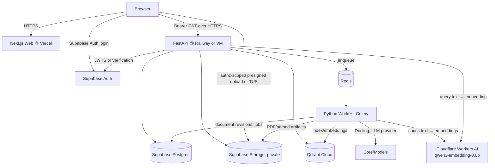

# Deployment & Operations — v1.0 (Platform v1.2)

**결론:** Supabase는 Auth, PostgreSQL, private Storage의 managed backbone으로 채택한다. Next.js/FastAPI/Python Worker/Qdrant/Redis까지 **Supabase 한 플랫폼에서 실행하지는 않는다**. 기존 기술 스택을 바꾸지 않는 최소 관리형 구성으로 배포한다.

## 1. Target topology



- Embedding(M7.4b, 사용자 결정 2026-10-18): staging/production은 `WORKER_EMBEDDER=workers_ai` — worker는 문서 chunk, API는 검색어만 Cloudflare Workers AI REST(`POST https://api.cloudflare.com/client/v4/accounts/{CLOUDFLARE_ACCOUNT_ID}/ai/run/@cf/qwen/qwen3-embedding-0.6b`, `Authorization: Bearer $CLOUDFLARE_API_TOKEN`)로 embedding한다. 그래서 API 이미지는 기본 빌드에서 torch/transformers를 넣지 않는다(`API_EXTRAS` 빈 값; 로컬 모델 이미지는 `--build-arg API_EXTRAS=models`). worker는 Docling 때문에 계속 torch를 가진다. Reranker는 꺼진 채 유지(Workers AI에 다국어 reranker 없음). 로컬 Qwen3와 Workers AI vector는 같은 collection에 섞지 않는다(`model_name`이 달라 물리 collection 분리, 전환은 reindex + alias).

- Frontend: Vercel의 Next.js 웹 호스팅(비상용·개인 프로젝트 여부에 따라 플랜 확인). API는 인증 외 비즈니스 데이터 요청을 FastAPI로 전달한다.
- Supabase: 사용자·메일 인증, Postgres metadata + canonical text/revisions, 비공개 `source-pdfs`와 `parsed-artifacts` 버킷을 제공한다.
- API: Railway 또는 Docker VM에 별도 FastAPI 컨테이너. Worker와 `packages/core` 코드 공유. 인증용 JWT만 받아 resource-scoped 권한 판단.
- Worker: `Celery + Redis`; 파싱/OCR/임베딩/LLM 추출/변형 처리. API 서버의 메모리를 무거운 모델이 차지하지 않도록 분리한다.
- Qdrant Cloud: `documents_v1`, `questions_v1`의 검색 인덱스. 원본이 아니므로 인덱스 재생성 가능.
- HTTPS/CORS: Web↔API 허용 origin을 production/preview 범위로 한정한다. localhost 제외하고 HTTP 금지.

## 2. Supabase 역할과 비역할

| 기능 | 결정 | 이유 |
|---|---|---|
| Supabase Auth | 채택 | 가입·로그인·이메일 확인·세션·재설정 |
| PostgreSQL | 채택 | Workspace, 문서/문제, revision, attempt, job, audit |
| Storage | 채택(private) | PDF/파싱 파일, 권한 있는 signed URL, TUS resume |
| Supabase Edge Functions | 기본 비사용 | Deno isolate의 CPU·메모리 제약과 Python 패키지/모델 실행 요구가 충돌 |
| Supabase pgvector / Vector buckets | MVP 미채택 | 현재 명시된 Qdrant BM25+Dense+RRF 설계를 유지; 대체 시 검색 품질·운영을 별도 비교 |
| Supabase Realtime | MVP 선택사항 | 작업 상태는 FastAPI SSE로 충분 |

### 파일 업로드·검색 세부 흐름

1. 브라우저가 FastAPI `POST /workspaces/{id}/documents/upload-intent` 호출; API가 user/workspace/파일명/크기/확장자 확인 후 안전한 object key와 짧은 수명의 업로드 URL을 발급.
2. 브라우저가 **private bucket**으로 직접 업로드(작은 파일 standard, 큰 PDF는 TUS resumable). UI에는 진행률·취소·재시도 표기.
3. 업로드 성공 시 `POST /documents/complete-upload`가 checksum·소유자·storage object 존재 여부를 재검증하고 `202/job_id` 반환. Storage 이벤트만으로 권한 결정을 하지 않는다.
4. Worker가 파일 내용을 검증하고 sandbox/cpu/memory/time 제한 내 파싱, canonical text 저장, 색인 작업을 수행. 작업 실패 시 이전 published revision 유지.
5. PDF 열람은 검증된 membership에 대한 서버 발급의 짧은 만료 signed read URL 사용; 만료되면 재발급.

## 3. 대안 비교

| 방안 | 장점 | 단점 | 용도 |
|---|---|---|---|
| **A. Vercel + Supabase + Railway + Qdrant Cloud** | 빠른 배포, 관리형 Auth/DB, API·Worker 분리 | 서비스가 여러 개, 추론 CPU 비용 측정 필요 | **추천 MVP/베타** |
| B. Supabase + Docker VM(API/Worker/Qdrant/Redis) + Vercel | 인프라 비용 예측·자원 통제 | 운영·백업·TLS·보안·모니터링 직접 관리 | 소수 사용자/자체 운영 선호 |
| C. 단일 VM에 Web/API/Qdrant/Redis + Supabase Auth/DB/Storage | 운영 서비스 수 적음 | 단일 장애점, 자체 서버 유지 관리 | 개인 용도/프로토타입 |
| D. Supabase만 사용하면서 pgvector로 전환 | 서비스 수 감소 | 별도 FastAPI/Worker 실행 불가, BM25 및 Qdrant 검색 전략 변경 | 현재 설계 변경을 수용할 때만 재검토 |

## 4. 운영 환경 / IaC

- `local`: `supabase start`(Postgres/Auth/Storage/Mailpit), Docker Compose(Qdrant/Redis), FastAPI/Worker/Next.js 로컬. 테스트 사용자/문서 fixture 및 비공개 모델 테스트용 adapter.
- `preview`: Vercel preview, 공유 또는 분기별 staging Supabase **주의: staging/production DB 분리**, Railway staging API/Worker, 테스트용 Qdrant. redirect URL allowlist 관리.
- `production`: 각 managed 서비스 production project, migration/health check, 모니터링, 알림 및 백업.
- DB schema migrations: **한 가지 owner 경로만 사용**. MVP는 `supabase/migrations`의 SQL을 기준으로 하고 SQLAlchemy는 query/model 매핑용으로 사용; Alembic으로 이중 마이그레이션 금지. Alembic 채택 시 `supabase/migrations`와 책임을 분리해 인증/RLS/schema 충돌을 방지해야 함.
- object key 예: `workspaces/{workspace_id}/documents/{document_id}/revisions/{revision_id}/source.pdf`(uuid 등 서버 생성 ID 사용). path 기반 URL 임의 조합 금지.
- Supabase local은 development 전용; production용 설정 없이 인터넷에 노출하지 않는다.

## 5. CI/CD 단계 (main 보호)

```text
PR opened
 → lint/typecheck/unit
 → schema/contracts validation
 → start supabase local + qdrant + redis
 → seed deterministic data and test accounts
 → Playwright E2E (screen acceptance IDs)
 → security isolation E2E + a11y + visual snapshots
 → build web/api/worker containers
 → preview deploy + smoke
 → merge to main
 → controlled SQL migration
 → API/Worker deploy → Web deploy
 → post-deploy smoke + alerts
```

- 변경사항은 screen requirements + E2E tests **먼저 작성**되어야 merge 가능한 PR로 본다. 테스트는 최초 RED 실행의 실패 이유를 PR에 기록한다.
- 스테이징·프로덕션 환경의 Auth redirect domain, JWKS issuer, CORS, secrets, SMTP, Storage 정책을 별도로 설정.
- 배포 시 API/schema 호환 기간을 유지하고 worker는 idempotent job 및 task schema version을 사용한다.
- SQL migration은 additive-first → 코드 deploy → cleanup 방식. 컬렉션 업그레이드는 `documents_v2`/`questions_v2` 구축 후 alias/active index 전환. 실패 시 rollback 경로 보존.

## 6. Secrets / Security

- Public: `NEXT_PUBLIC_SUPABASE_URL`, `NEXT_PUBLIC_SUPABASE_PUBLISHABLE_KEY`는 공개 가능한 값. 접근 권한 자체는 JWT/RLS/API에서 판정.
- Server only: `DATABASE_URL`, `SUPABASE_SECRET_KEY`, `QDRANT_API_KEY`, `REDIS_URL`, `LLM_API_KEY`, `AUTH_RECOVERY_MARKER_SECRET`(Next.js 서버, 비밀번호 재설정 recovery marker HMAC 키, `openssl rand -base64 32`), Storage 관리 권한. 절대로 `NEXT_PUBLIC_` 접두사 사용 금지.
- Qdrant API key와 Redis는 내부 서비스에서만 사용; 프론트가 Qdrant 직접 검색하지 않는다.
- 메일·파일 저장·LLM 공급자와 콘텐츠의 데이터 처리 지역, 기록·보존 정책을 점검. 저작권 있는 도서는 비공개 storage + 최소 권한 + 접근 로그.
- 로그에 검색 원문·비밀번호·JWT·원본 PDF 본문을 기본으로 남기지 않는다. 임베딩/LLM 외부 API로 책 원문을 전송할 때 프라이버시·저작권 조건을 확인한다.
- **외부 전송(M7.4b, 사용자 결정 2026-10-18)**: 책 원문 chunk와 검색어는 embedding 계산을 위해 Cloudflare Workers AI로 전송될 수 있다(`WORKER_EMBEDDER=workers_ai`). Cloudflare는 처리 수탁자(sub-processor)로 `/privacy`에 명시한다(최종 법률 문구는 사용자 몫). `CLOUDFLARE_API_TOKEN`은 server-only secret(api·worker; web 금지, `NEXT_PUBLIC_` 금지)이며 **Workers AI 권한만** 가진 account API token을 쓴다. 요청·오류 메시지·로그·job `last_error`에는 입력 텍스트·token·account id가 들어가지 않는다(오류는 `embedding_quota_exceeded` / `embedding_unavailable` 같은 code만).
- Rate limit: 인증 요청, 업로드 요청, 문제 생성 LLM 호출, 검색 및 공개 API 별도 제한.

### 6.1 Auth release readiness 설정 (A3, 로컬 범위 구현 · 배포 적용은 M7.4)

**API (FastAPI) — 시작 시 검증.** `APP_ENV=preview|production`이면 아래 조건을 어길 때 `InsecureConfigurationError`로 기동을 거부한다(메시지는 변수 이름만, 값은 출력하지 않음).

| 변수 | local/test 기본값 | preview/production 요구 |
|---|---|---|
| `APP_ENV` | `local` | `preview` 또는 `production` (HSTS 강제, `/api/v1/docs` 비활성은 production) |
| `SUPABASE_JWT_ISSUER` | `.env` | 필수, `https://<project>.supabase.co/auth/v1` |
| `SUPABASE_JWKS_URL` | `.env` | 필수, `https://…/auth/v1/.well-known/jwks.json` |
| `CORS_ALLOWED_ORIGINS` | `http://127.0.0.1:3000,http://localhost:3000` | 필수, 쉼표 구분 `https://host[:port]` 목록(웹 production 도메인 + 필요 시 고정 preview 도메인). `*`·wildcard·path 금지(모든 환경). **브라우저 ASCII 직렬화로만 기재**: 국제화 도메인은 punycode(`https://xn--fa-hia.example`, 브라우저에서 `new URL(origin).origin`이 출력하는 값). 비ASCII 값은 모든 환경에서 기동 거부 |
| `CORS_MAX_AGE_SECONDS` | `600` | 0–7200 (preflight cache 상한) |

- CORS: allowlist origin만 `Access-Control-Allow-Origin`으로 응답, `allow_credentials=false`(브라우저→API는 Bearer header, cookie 없음), 허용 header는 `Authorization, Content-Type, Idempotency-Key, X-Request-ID`, 노출 header는 `X-Request-ID`.
- Origin 비교: API는 IDNA 변환을 하지 않는다. 설정값과 들어오는 `Origin` 모두 scheme·host 소문자화, 기본 port(80/443) 제거, IPv6 bracket 유지만 하고 비교한다. 비ASCII `Origin` header는 거부(브라우저는 항상 punycode로 보냄).
- Origin guard: `Origin` header가 allowlist에도 API 자신의 host에도 없으면(`Origin: null` 포함) preflight·본 요청 모두 route 실행 전 `403 application/problem+json`. `Origin`이 없는 server-to-server 호출(Next.js 서버)은 영향 없음.
- 모든 응답 header: `X-Content-Type-Options: nosniff`, `Referrer-Policy: no-referrer`, `X-Frame-Options: DENY`, `Content-Security-Policy: default-src 'none'; frame-ancestors 'none'`(로컬 `/api/v1/docs` 제외), HTTPS 또는 preview/production에서 `Strict-Transport-Security: max-age=63072000; includeSubDomains`. `/api/v1/**`와 `Authorization` 요청 응답은 `Cache-Control: no-store`. `quiz_api.serve`가 uvicorn `Server` header를 끈다.
- Vercel preview URL은 배포마다 host가 바뀌므로 wildcard 대신 고정 preview alias 도메인을 `CORS_ALLOWED_ORIGINS`에 넣는다.

**Web (Next.js).**
- `src/proxy.ts`가 요청마다 nonce를 만들고 CSP를 응답(및 render용 request header)에 설정한다. 모든 page는 dynamic rendering(root layout `connection()`): 정적 page는 nonce를 가질 수 없다.
  `default-src 'self'; script-src 'self' 'nonce-…' 'strict-dynamic'; style-src 'self' 'unsafe-inline'; img-src 'self' data: blob:; font-src 'self' data:; connect-src 'self' <NEXT_PUBLIC_SUPABASE_URL origin> <NEXT_PUBLIC_API_BASE_URL origin>; frame-src 'none'; frame-ancestors 'none'; base-uri 'self'; object-src 'none'; form-action 'self'` (+ HTTPS에서 `upgrade-insecure-requests`, `next dev`에서만 `'unsafe-eval'`).
  `style-src 'unsafe-inline'`은 의도적: React/Radix가 SSR에서 `style="…"` attribute(Popper 위치, CSS 변수)를 출력하며 nonce는 attribute에 적용되지 않는다. script는 nonce 전용이므로 style 주입으로 script 실행은 불가.
- HTTPS(`x-forwarded-proto: https`)에서 `Strict-Transport-Security`. 정적 header(`next.config.ts`): `nosniff`, `X-Frame-Options: DENY`, `Referrer-Policy: strict-origin-when-cross-origin`, `Permissions-Policy`, `COOP: same-origin`; `/share/**`는 `no-store`, `no-referrer`, `noindex`.
- CSRF: Server Action은 Next 자체의 `Origin` ↔ host 검사로 보호되고(`serverActions.allowedOrigins` 미설정 유지), 추가로 proxy가 GET/HEAD/OPTIONS 외 요청 중 `Origin`이 자기 host(`x-forwarded-host` 우선)와 다르거나 `Origin` 없이 `Sec-Fetch-Site: cross-site`인 요청을 `403`으로 거부한다(route handler 포함).
- Supabase session cookie: 서버가 쓰는 모든 `sb-…-auth-token*` cookie는 `HttpOnly; SameSite=Lax; Path=/`, HTTPS에서 `Secure`. 브라우저 client는 session을 읽지 않는 호출(signUp/resend/resetPasswordForEmail)만 한다.
- `NEXT_PUBLIC_SUPABASE_URL`, `NEXT_PUBLIC_API_BASE_URL`은 production에서 `https://`여야 한다(CSP `connect-src`와 mixed content).

**Supabase Auth / 메일 (M7.4에서 적용).** `site_url` = 웹 production origin(HTTPS), `additional_redirect_urls` = `https://<web>/auth/callback`(및 고정 preview alias)만, wildcard 금지. 외부 SMTP(발신 도메인 SPF/DKIM), Auth rate limit·CAPTCHA, JWT signing key는 비대칭(ES256/RS256), access token 만료 ≤ 1h. `AUTH_RECOVERY_MARKER_SECRET`(32 byte random)은 환경별로 다르게.

**로그 검사.** `pnpm e2e:log-audit [--worker] -- <specs> --project …`는 API(INFO)·웹 서버(`--worker`면 Celery worker도) 로그를 캡처해 Playwright를 실행하고 JWT·Bearer/refresh/access token·session cookie 값·email 주소, 공유 session token·공유 링크 비밀값(`#k=`, `"secret"`)·signed Storage URL token·password 값이 있으면 실패한다(DEP-07 staging smoke에서도 같은 명령을 쓴다).

**Client 주소(S4).** `quiz_api.serve`는 uvicorn `proxy_headers=False`로 실행한다: `X-Forwarded-For`/`Forwarded`는 client 주소·scheme이 되지 않는다(uvicorn 기본값은 127.0.0.1 또는 `FORWARDED_ALLOW_IPS`에서 신뢰). per-client rate limit은 socket peer 또는 서명된 relay client id만 쓴다. 웹 `src/proxy.ts`의 matcher는 `/api/**`를 항상 포함한다(마지막 segment가 `.png` 등이어도 cross-site write guard를 건너뛰지 않음).

## 7. 가용성, 백업, 복원

- 매일 DB 백업(사용 플랜 지원/외부 `pg_dump` 점검), Supabase Storage 객체 version/별도 백업, 주요 workspace의 export 정기 검증.
- Qdrant는 파생 인덱스이므로 재색인 스크립트 제공. 대량 재생성 시간은 recovery 시간에 포함.
- Worker job은 at-least-once 실행될 수 있으므로 checksum/idempotency/dedup 적용. stuck/failed job 재시도·격리 큐 모니터링.
- API `/health/live`, `/health/ready`(DB, Redis, Qdrant 등 필수 의존성), readiness timeout, 일별 검색 smoke query.
- metrics: 인증 오류, PDF 성공률/시간, 검색 p50/p95, reranker latency, worker queue age, LLM 사용량, DB pool, storage·Qdrant 용량.
- 비용 알림: managed project당 예산 경고, Worker 최대 동시성 1부터 시작, 모델 지연/메모리 측정 후 scale.

## 8. 비용과 플랜 검토 (2026-10-16 기준 공개 문서 확인)

- Supabase Free는 저활동 시 프로젝트 pause 및 메일 제한 등이 있어 지속 운영 보장용으로 간주하지 않는다. Production에서는 Custom SMTP와 백업 가능 여부를 먼저 확인한다.
- Qdrant Cloud Free: 문서상 0.5 vCPU/1GB RAM/4GB 디스크, 비활성 시 pause 또는 삭제 정책이 있어 개발/테스트 한정 사용. 운영에는 유료 plan을 검토한다.
- Railway는 Hobby 최소 요금과 사용량 기반 추가 청구가 있다. **Embedding+Reranker Worker의 RAM/CPU가 실제 비용의 주요 변수**이므로 1~2권으로 측정한 뒤 확정.
- **Cloudflare Workers AI(M7.4b)**: Workers **Free** plan(사용자 결정 2026-10-18) — 하루 10,000 neurons 무료, 초과 요청은 오류로 거부된다(과금 없음). `qwen3-embedding-0.6b`는 공개 가격 $0.0118 / 1M input tokens(≈ $0.011 / 1,000 neurons 환산 시 하루 약 900만 token; 정확한 neuron 환산은 Cloudflare dashboard에서 첫 staging 색인 후 확인). quota 초과·429·5xx는 worker에서 재시도 가능한 job 실패(backoff), API 검색에서는 BM25 저하(SEARCH-01-AC06)로 처리한다.
- **Railway Hobby 업그레이드 보류**(2026-10-18): trial(서비스당 1 GB RAM)에서 시작한다. API는 hosted embedder를 써서 모델을 메모리에 올리지 않고, 남는 RAM 변수는 Docling worker다.
- Vercel Hobby는 개인·비상업 목적 제한이 있다. 외부 사용자에게 상용 서비스를 제공한다면 적절한 유료 플랜을 선택해야 한다.
- 월 비용은 서비스 조합, 사용량, 모델 배치에 따라 크게 달라지므로 고정 총액을 추정하지 않는다. 비용 게이트는 staging 7일 load test 후 확정한다.

## 9. 배포 수용 테스트 (DEP)

- `DEP-01`: HTTPS와 정확한 allowed origins/redirects로 로그인·재설정이 정상 작동.
- `DEP-02`: 비공개 PDF URL은 서명 또는 적법한 user auth 없이 접근 불가.
- `DEP-03`: API/Worker 재시작에도 job 상태·문제풀이·문서 revision 유지.
- `DEP-04`: 색인 실패/rollback 후 이전 published revision으로 검색 가능.
- `DEP-05`: 다른 사용자의 document upload/download/query/attempt API 차단.
- `DEP-06`: backup에서 Postgres/Storage 복원 후 재색인 가능한 절차 확인.
- `DEP-07`: secrets, direct DB/Qdrant access, CORS, redirect allowlist 노출 테스트 통과.

### 실행 절차 (M7.4a)

계정 생성·secret 생성 위치·첫 staging 배포 순서·롤백·smoke(DEP 자동/수동 구분)는 [runbook-deploy.md](runbook-deploy.md). 변수 목록의 기준은 `infra/deploy/env-manifest.toml`(검증: `make check-env`), 배포는 `.github/workflows/deploy.yml`(수동 실행, migration → API/Worker → Web → smoke). 2026-10-18 결정: 구성 A, staging 먼저(production은 7일 부하·비용 게이트 후), 환경별 Supabase project.

### 공식 참고

- https://supabase.com/docs/guides/functions/limits
- https://supabase.com/docs/guides/storage/buckets/fundamentals
- https://supabase.com/docs/guides/storage/uploads/resumable-uploads
- https://supabase.com/docs/guides/deployment/going-into-prod
- https://qdrant.tech/documentation/cloud/create-cluster/
- https://docs.railway.com/guides/fastapi
- https://vercel.com/legal/terms


## Workspace 공유·Fork 배포 및 운영 (v1.3 추가)
- 웹/ API 공개 주소에는 HTTPS를 강제한다. share link secret은 URL fragment로만 전달하고 요청 로그·분석·OpenGraph/메타 정보에 포함하지 않는다.
- 공유 페이지 및 PDF 프록시 응답에는 `Cache-Control: private, no-store`, `Referrer-Policy: no-referrer`, `robots=noindex,nofollow`를 적용한다.
- Supabase Storage PDF는 private bucket으로 유지하며, FastAPI에서 공유 session을 검증한 뒤 짧은 signed URL 또는 프록시 접근을 제공한다. 단순 접근 가능 URL을 영구 공개하지 않는다.
- Fork는 Celery 비동기 작업으로 immutable published snapshot을 독립 복제한다. 대상 Workspace는 완료 전 숨기고, 취소·실패 시 객체 스토리지 임시 복제본도 정리한다.
- CORS/CSRF, rate limit, 다운로드 비용 및 Fork quota, per-Workspace DB·Qdrant 필터를 검증한다. 공유 데이터의 저작권/재배포 책임을 Owner UI에 안내한다.
- staging E2E에 비로그인 읽기, revoke/expire, Fork ON/OFF, 재시도·동시성·Storage ID 격리 시나리오를 추가한다. 상세: [workspace-sharing.md](workspace-sharing.md).
