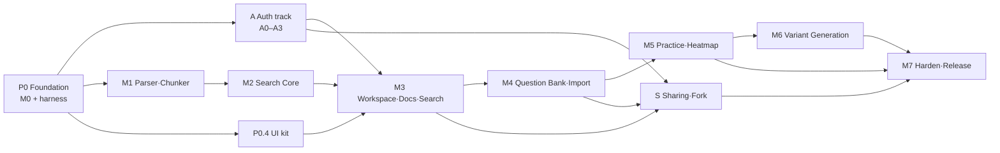
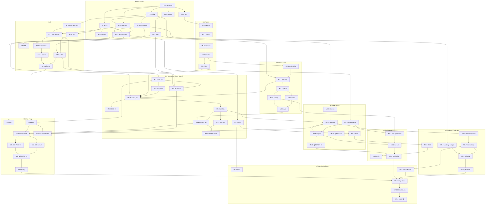

# 구현 계획 — Platform v1.3

**상태:** 실행 기준 계획 · 2026-10-17
**기준 문서:** [architecture](architecture.md) · [auth](auth.md) · [workspace-sharing](workspace-sharing.md) · [questions](questions.md) · [design-system](design-system.md) · [deployment](deployment.md) · [e2e-strategy](e2e-strategy.md) · [screens](screens/index.md)
**운영 규칙:** [`AGENTS.md`](../AGENTS.md) (orchestration·리뷰 게이트·코딩 규칙)

이 문서는 `docs/`의 확정 설계를 **실행 가능한 Task 계층과 의존 그래프**로 분해한다. 설계 내용과 충돌하면 설계 문서가 우선하며, 충돌은 이 문서 §7 "결정 기록"에 남긴다.

---

## 1. 계층 구조와 용어

```text
Phase  (P0, A, M1 … M7, S)        — architecture.md §8 마일스톤 / auth A트랙 / 공유 S트랙
 └─ Epic   (예: M3.2)              — 하나의 기능 경계(API+UI 또는 Core 모듈)
     └─ Task (예: M3.2a)           — subagent 1개가 한 번에 끝내는 작업 = **리뷰 단위**
```

- **Task = 리뷰 단위.** Task는 RED 증거(해당 시)·구현·GREEN·커밋까지 완결되어야 하며, 끝나면 `codex review`를 받는다 (AGENTS.md §4).
- **RED Task (`*.0`)** 는 각 Phase의 화면 AC를 Playwright/contract test로 먼저 작성하고, 실패 원인이 "미구현"임을 확인해 커밋한다. 구현 Task는 이 테스트를 GREEN으로 만든다.
- 상태 표기: `☐` 대기 · `◐` 진행 · `✅` 완료(GREEN + 리뷰 반영) · `⛔` 사람의 결정/계정 필요.

## 2. Phase 그래프



- **A3(교차 사용자 차단) 완료 전 M3 UI release 금지** (auth.md §6).
- 병렬 가능 구간: `A ∥ M1 ∥ P0.4` → `A ∥ M2 ∥ P0.4` → `M3` 이후 `M4 → M5 → M6` 와 `S` 병렬.

## 3. Task 계층 (전체)

열: **ID · 내용 · 의존 · 완료 조건(DoD)**. AC 범위는 `docs/screens/*.md`의 ID를 그대로 사용한다.

### P0 — Foundation (M0 + E2E harness)

| ID | 내용 | 의존 | DoD |
|---|---|---|---|
| P0.1 | Monorepo 골격: `pnpm-workspace.yaml`, root `package.json`(lint/typecheck/test 스크립트), uv workspace `pyproject.toml`, `.env.example`, ruff/mypy/eslint/prettier 설정, `Makefile`(또는 `justfile`) 공통 명령 | — | `pnpm install`, `uv sync` 성공, 빈 lint/typecheck 통과 |
| P0.2 | 로컬 인프라: `infra/compose.yaml`(Qdrant, Redis), Supabase CLI(devDependency `supabase`)로 `supabase init`, Mailpit 포함 local config | P0.1 | `make infra-up` 후 Qdrant/Redis/Supabase health OK |
| P0.3 | `packages/design-tokens`: `tokens.json` 단일 소스 → CSS 변수/TS 생성(light/dark), raw hex 금지 lint 규칙 | P0.1 | 생성물이 design-system.md §3 값과 일치하는 unit test |
| P0.4 | `packages/ui`: Storybook, Foundation primitives(`Button`, `IconButton`, `Input`, `Surface`, `GlassSurface`, `FocusRing`, `Tooltip`, `Popover`, `Toast` …), `FloatingSidePanel`(modal/non-modal), `AppShell` | P0.3 | Storybook build, Vitest + axe 통과, panel focus trap/return 테스트 |
| P0.5 | `apps/web`: Next.js App Router, AppShell 적용, 21개 화면 **stub route**(404가 아닌 "미구현" 화면), Supabase SSR client 자리 | P0.1, P0.3 | `pnpm --filter web build`, 모든 route 200 |
| P0.6 | `apps/api`: FastAPI 앱, settings, `/health/live`·`/health/ready`, SQLAlchemy 세션, 오류 형식, OpenAPI → `contracts/openapi.json` export, TS client 생성 파이프라인 | P0.1 | pytest 통과, openapi 생성 스크립트 동작 |
| P0.7 | `apps/worker`: Celery 앱, 멱등 task base(`async_jobs` 연동 인터페이스), 테스트용 eager 모드 | P0.6 | 샘플 task unit test |
| P0.8 | `packages/core`(`book_core`): 모듈 골격, Pydantic 계약(`ParsedDocument`, `DocumentRevision`, `SearchChunk`, `SearchHit`, `Excerpt`, `QuestionDraft`), Typer CLI stub, 모델/LLM **fake adapter 인터페이스** | P0.1 | 계약 직렬화 unit test, `core --help` |
| P0.9 | DB baseline migration(`supabase/migrations`): `profiles`, `workspaces`, `workspace_memberships`, `activity_events`, `async_jobs` + 최소 grants/RLS, seed 골격 | P0.2 | `supabase db reset` 성공, migration lint |
| P0.10 | E2E harness: Playwright 설치, `tests/e2e/fixtures/`(사용자·workspace 고유 fixture 팩토리), test-only seed 경로(production 빌드 제외), `e2e:trace` 스크립트(AC ↔ test title 대조, orphan 검출), CI workflow 골격(lint→unit→contract→e2e) | P0.5, P0.6, P0.9 | `pnpm e2e:trace` 동작. 기존 starter spec은 `tests/e2e/_pending/`(실행 제외)로 옮기고, 각 Phase RED Task가 화면 명세 경로로 가져와 확장 |

### A — Auth track (auth.md §6)

| ID | 내용 | 의존 | DoD |
|---|---|---|---|
| A0 | RED: `auth/*.spec.ts`(AUTH-01~07, ACCOUNT-01 = 24 AC) + API contract test(AUTH-API-AC01~03) | P0.10 | RED 증거 커밋, trace 통과 |
| A1.1 | Supabase Auth local 설정: 이메일 확인 필수, redirect allowlist, 비대칭 JWT signing key, Mailpit | P0.2 | 로컬 가입→메일 수신 수동/자동 확인 |
| A1.2 | FastAPI JWT/JWKS 검증(kid·alg allowlist·iss·aud·exp·sub, 키 캐시/rotation), `GET /me`, `GET /me/workspaces`, 401/403 구분 | P0.6, A1.1 | AUTH-API-AC01 GREEN |
| A1.3 | 인가 dependency: resource → workspace → membership, archived 쓰기 거부, soft-deleted 차단, profile upsert | A1.2, P0.9 | 교차 사용자 403/404 integration test |
| A2.1 | Next.js 세션: `proxy.ts`/`middleware.ts` refresh, `getClaims()` 기반 서버 판단, 보호 라우트, `next` 내부경로 allowlist, API client Bearer 주입 | P0.5, A1.1 | AUTH-01-AC01, open redirect AC GREEN |
| A2.2 | 화면 AUTH-01~07 (`AuthLayout`, `SignInForm`, `SignUpForm`, `PasswordResetForm`, `VerificationNotice`) | A2.1, P0.4 | AUTH-01~07 AC GREEN |
| A2.3 | ACCOUNT-01 보안 설정 화면 | A2.2 | ACCOUNT-01 AC GREEN |
| A3 | 릴리즈 준비(로컬 범위): AUTH-API-AC02/03, CORS·CSRF·쿠키 정책, 로그 마스킹. staging SMTP/도메인은 M7.4로 이월 | A1.3, A2.3 | Auth 전 AC + API AC GREEN |

### M1 — Parser·Chunker

| ID | 내용 | 의존 | DoD |
|---|---|---|---|
| M1.1 | 합성 PDF fixture(KO/EN 2~5p, 목차·표·문단·문제 포함) 생성 스크립트 | P0.8 | fixture 재생성 가능, 저작권 자료 없음 |
| M1.2 | `parser`: Docling → `ParsedDocument`(page, bbox, block 유형), OCR fallback 플래그, sha256 | M1.1 | 페이지·bbox 매핑 unit test |
| M1.3 | `structure`: 장·절 계층 복원 + canonical blocks + `DocumentRevision` | M1.2 | 목차 재현 test |
| M1.4 | `chunker`: HybridChunker + parent/child 계층 청킹, block/page provenance, stable id/hash | M1.3 | chunk 경계·provenance test |
| M1.5 | CLI `core parse` / `core chunk` | M1.4 | CLI e2e(pytest) |

### M2 — Search Core

| ID | 내용 | 의존 | DoD |
|---|---|---|---|
| M2.1 | `embedding`: Qwen3-Embedding adapter(optional extra) + 결정론적 fake | M1.4 | fake 결정성 test |
| M2.2 | `indexing`: Qdrant dense+BM25 sparse, workspace/document/revision payload, active revision 전환·rollback | M2.1, P0.2 | Qdrant 통합 test |
| M2.3 | `search`: keyword/semantic/hybrid, RRF, published-revision 필터 강제 | M2.2 | 필터 우회 불가 test |
| M2.4 | `reranker`: Qwen3-Reranker adapter + fake, 후보 수 설정 | M2.3 | 순위 계약 test |
| M2.5 | `ExcerptResolver`: 문단 경계 확장, page/bbox | M2.3 | 발췌 완결성 test |
| M2.6 | `evaluation` + `eval/`: ir-measures, KO↔EN 데이터셋 골격, `core eval`, `core index/search/excerpt` CLI | M2.4, M2.5 | 샘플 리포트 생성 (실모델 nightly) |

### M3 — Workspace·Docs·Search

| ID | 내용 | 의존 | DoD |
|---|---|---|---|
| M3.0 | RED: WS-01(6), DOC-01(4), DOC-02(5), SEARCH-01(5) | P0.10 | RED 증거 |
| M3.1a | Workspace API: CRUD/archive/restore/soft delete, 멱등 키, activity 기록 | A1.3 | contract test GREEN |
| M3.1b | WS-01 화면 (`WorkspaceSwitcher`, 탭 Active/Archived, 빈 상태) | M3.1a, A2.1, P0.4 | WS-01-AC01~05 GREEN (AC06은 S2) |
| M3.2a | 문서 schema(`documents`, `document_revisions`, `chapters`, `content_blocks`), upload-intent / complete-upload, private Storage 버킷 | M3.1a | 업로드 인가 integration test |
| M3.2b | Worker 파싱·색인 job, `GET /jobs/{id}`, SSE events, 실패 시 이전 revision 유지 | M3.2a, M1.5, M2.2, P0.7 | job 재시도·멱등 test |
| M3.3 | DOC-01 화면: 목록·업로드(TUS)·진행률·취소·재시도 | M3.2b | DOC-01 AC GREEN |
| M3.4 | outline/blocks/publish API, 교정 → 신규 revision → 재색인 → rollback | M3.2b | revision/재색인 test |
| M3.5 | DOC-02 화면: PDF.js viewer, `DocumentOutlineTree`, `TextBlockEditor`, signed read URL | M3.4 | DOC-02 AC GREEN |
| M3.6a | Search API: workspace/published 필터 서버 강제, 문서 hit + excerpt | M3.4, M2.6 | 교차 workspace 검색 차단 test |
| M3.6b | SEARCH-01 화면: 모드 전환, `SearchResultList`, `DocumentExcerptPanel`(non-modal), PDF jump | M3.6a, M3.5 | SEARCH-01 AC GREEN |

### M4 — Question Bank·Import

| ID | 내용 | 의존 | DoD |
|---|---|---|---|
| M4.0 | RED: QBANK-01(4), QIMPORT-01(4) | M3.0 | RED 증거 |
| M4.1 | 문제 schema: `questions`, `question_revisions`, `question_sources`, `question_user_states`, `question_attempts`, `question_lineage`, `question_drafts`, generation/import runs | P0.9 | migration + 제약 test |
| M4.2a | Question CRUD API(유형 MCQ/SHORT_ANSWER/ESSAY, 챕터·출처, revision) | M4.1, M3.4 | contract test |
| M4.2b | QBANK-01 화면 | M4.2a | QBANK-01 AC GREEN |
| M4.3 | Core `llm` adapter(structured output, fake 포함) + `extractor`(문제 PDF → `QuestionDraft`, 정답 생성 금지) | M1.5 | fake 기반 추출 test |
| M4.4a | Import run API/worker, drafts 격리, 승인분만 publish | M4.3, M4.2a, P0.7 | 미승인 미등록 test |
| M4.4b | QIMPORT-01 화면 + 공용 `QuestionDraftReview` | M4.4a | QIMPORT-01 AC GREEN |

### M5 — Practice·Heatmap

| ID | 내용 | 의존 | DoD |
|---|---|---|---|
| M5.0 | RED: QOV-01(6), QPLAY-01(5) + 정답 비노출 contract test | M4.0 | RED 증거 |
| M5.1 | `deriveDotStatus`(TS/Python 공통 규칙), overview API(CONFIRMED만, 상호배타 집계 + favorite overlap, 필터) | M4.2a | 우선순위 unit test |
| M5.2 | practice-session(정답·해설 미전송, option ID 순서 저장), submit, self-grade, `my-state`, viewed는 패널 open에서만 | M5.1 | 정답 유출·shuffle 100회 test |
| M5.3 | `QuestionMarker`/`QuestionDot`/`QuestionHeatmap`/`HeatmapLegend`/`QuestionPreviewPopover` + Storybook 5상태×favorite×hover/focus/selected, roving tabindex, visual regression | P0.4 | 스냅샷·axe 통과 |
| M5.4 | QOV-01 화면 (필터·URL state·집계 chips) | M5.2, M5.3 | QOV-01 AC GREEN |
| M5.5 | QPLAY-01 `QuestionPracticePanel`(modal, `?question=` 딥링크, 이전/다음, focus return) | M5.4 | QPLAY-01 AC GREEN |

### M6 — Variant Generation

| ID | 내용 | 의존 | DoD |
|---|---|---|---|
| M6.0 | RED: QGEN-01(4) + fake LLM valid/invalid 시나리오 | M5.0 | RED 증거 |
| M6.1 | Core `generation`: PARAPHRASE / INVERT_POLARITY / ANALOGOUS_CONCEPT, schema·정답 개수·중복 fingerprint·출처 검증 (OPTION_SHUFFLE은 M5.2에서 완료) | M4.3, M2.5 | validation unit test |
| M6.2 | generation run API/worker, drafts, 승인 → CONFIRMED + lineage | M6.1, M4.4a | 승인 전 dot 수 불변 test |
| M6.3 | QGEN-01 화면(`QuestionGenerationForm`, `VariationDiffViewer`, ≥600px drawer) | M6.2, M4.4b | QGEN-01 AC GREEN |

### S — Workspace Sharing·Fork (workspace-sharing.md)

| ID | 내용 | 의존 | DoD |
|---|---|---|---|
| S0 | RED: WS-SHARE-01(5), WS-VIEW-01(6), WS-FORK-01(6) + 보안 contract test, owner/guest/recipient fixture | P0.10 | RED 증거 |
| S1a | `workspace_share_links` + owner API(발급·조회·PATCH·revoke·rotate), digest 저장 | A3, M3.1a | 비밀값 미저장 test |
| S1b | shared session 교환(fragment → HttpOnly cookie), shared read API(문서/PDF/검색/문제), 매 요청 재검증, no-store/no-referrer 헤더 | S1a, M3.6a, M4.2a | revoke 즉시 차단 test |
| S2a | WS-SHARE-01 화면(`WorkspaceSharingPanel`) + WS-01-AC06 | S1a, M3.1b | WS-SHARE-01 AC GREEN |
| S2b | WS-VIEW-01 화면(`SharedWorkspaceView`, 읽기 전용) | S1b | WS-VIEW-01 AC GREEN |
| S3a | `workspace_forks` + Fork worker: snapshot manifest, ID remap, 개인 데이터 제외, 커밋 직전 재검증, 취소 정리 | S1b, P0.7 | 복제·격리·경쟁 integration test |
| S3b | WS-FORK-01 화면(`ForkWorkspaceDialog`) | S3a, S2b | WS-FORK-01 AC GREEN |
| S4 | 보안 검증 묶음: 우회·권한 상승·CSRF·rate limit·로그 유출 | S3b | 보안 test GREEN |

### M7 — Harden·Release

| ID | 내용 | 의존 | DoD |
|---|---|---|---|
| M7.0 | RED: HISTORY-01(3) | M3.0 | RED 증거 |
| M7.1 | activities/attempts/jobs 조회 API + HISTORY-01 화면 | M7.0, M5.2 | HISTORY-01 AC GREEN |
| M7.2 | 전 화면 a11y(axe)·visual baseline(light/dark, desktop/iPad)·WebKit/모바일 smoke, 성능 점검 | M5.5, M6.3, S4 | 전체 E2E GREEN, `e2e:trace` orphan 0 |
| M7.3 | 컨테이너화(web/api/worker Dockerfile), CI 전체 파이프라인, 색인 재생성·백업 복원 스크립트 | M7.2 | CI GREEN |
| M7.4 ⛔ | Staging/Production 배포(Vercel·Supabase·Railway·Qdrant Cloud), SMTP, DEP-01~07 | M7.3 | **사용자 계정·비용 승인 필요** |

## 4. Task 의존 그래프



## 5. 실행 Wave (orchestration 순서)

같은 Wave 안의 Task는 파일 범위가 겹치지 않으면 병렬 subagent로 실행한다 (worktree 격리).

| Wave | Task | 비고 |
|---|---|---|
| W1 | P0.1 | 단독 (모든 Task의 기반) |
| W2 | P0.2 · P0.3 · P0.6 · P0.8 | 서로 다른 디렉터리 |
| W3 | P0.4 · P0.5 · P0.7 · P0.9 · M1.1 | |
| W4 | P0.10 · A1.1 · M1.2 | |
| W5 | A0 · A1.2 · M1.3 | Auth RED는 Auth 트랙 시작 시점 |
| W6 | A1.3 · A2.1 · M1.4 · M5.3 | M5.3은 순수 UI 컴포넌트라 선행 가능 |
| W7 | A2.2 · M1.5 · M2.1 | |
| W8 | A2.3 · M2.2 · M3.0 · M4.1 · M4.3 | M3 RED는 M3 착수 직전 |
| W9 | A3 · M2.3 · M3.1a | |
| W10 | M3.1b · M2.4 · M2.5 · M3.2a | M3.1b는 A3 이후 |
| W11 | M2.6 · M3.2b · S0 | |
| W12 | M3.3 · M3.4 · S1a | |
| W13 | M3.5 · M3.6a · M4.0 · S2a | |
| W14 | M3.6b · M4.2a · M4.4a | |
| W15 | M4.2b · M4.4b · M5.0 · M5.1 · S1b | |
| W16 | M5.2 · M6.0 · M6.1 · S2b · S3a · M7.0 | |
| W17 | M5.4 · M6.2 · S3b · M7.1 | |
| W18 | M5.5 · M6.3 · S4 | |
| W19 | M7.2 → M7.3 → M7.4⛔ | |

Wave는 권장 순서이며, 실제로는 §4 그래프의 의존이 충족된 Task를 즉시 착수한다.

## 6. 리뷰 단위와 게이트 요약

- Task 하나 = 리뷰 단위. RED Task도 리뷰 대상(테스트가 AC를 정확히 반영하는지).
- 게이트 순서: `RED 증거 → 구현 → 로컬 검증(lint/typecheck/unit/관련 E2E) → 커밋 → codex review → 지적 반영 커밋 → 상태 ✅`.
- 리뷰 실행: `scripts/codex-review.sh --commit <sha>` 또는 `--base <ref>` (herdr의 `codex-review` pane 재사용). 세부는 AGENTS.md §4.

## 7. 결정 기록

| 날짜 | 결정 | 근거 |
|---|---|---|
| 2026-10-17 | E2E 파일명은 `docs/screens/*.md`의 "테스트" 경로를 기준으로 한다. 기존 starter(`questions/overview.spec.ts` 등)는 RED Task에서 해당 경로로 이동·확장한다. | e2e-strategy.md 표와 화면 명세의 파일명이 다름; 화면 명세가 AC의 Source of Truth |
| 2026-10-17 | AUTH-API-AC01~03은 브라우저 E2E가 아닌 `tests/integration` API contract test로 작성한다. | auth.md §7, e2e-strategy.md §4 계층 |
| 2026-10-17 | Supabase CLI는 전역 설치 대신 root devDependency(`supabase`)로 고정하고 `pnpm exec supabase`로 실행한다. | 로컬 환경에 CLI 미설치, 버전 고정 |
| 2026-10-17 | 실모델(Docling OCR 대형 모델, Qwen3)은 Python optional extra로 두고 E2E/CI는 fake adapter를 사용한다. | e2e-strategy.md §3 |
| 2026-10-17 | 모든 Task 커밋은 통합 브랜치 `develop`에 쌓는다(병렬 Task는 `task/<id>` worktree 브랜치 → `develop` merge). `main`은 `develop`의 **존재하는 모든 테스트가 GREEN**일 때만 fast-forward한다. 그래서 RED Task는 해당 Phase 착수 직전에 작성한다(일괄 선작성 금지). | e2e-strategy.md §1: main에 의도적 RED 금지 |

## 8. 진행 현황

| Task | 상태 | 커밋 | 리뷰 |
|---|---|---|---|
| (계획 수립) | ✅ | — | — |

Task 착수/완료 시 orchestrator(main thread)가 이 표에 행을 추가·갱신한다.
