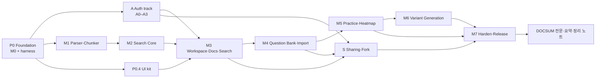
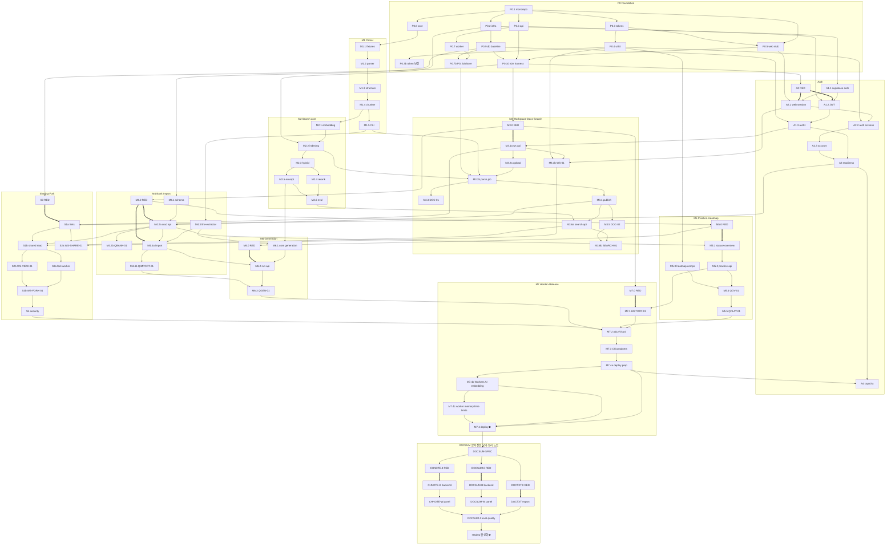

# 구현 계획 — Platform v1.3

**상태:** 실행 기준 계획 · 2026-10-17
**기준 문서:** [architecture](architecture.md) · [auth](auth.md) · [workspace-sharing](workspace-sharing.md) · [questions](questions.md) · [design-system](design-system.md) · [deployment](deployment.md) · [e2e-strategy](e2e-strategy.md) · [screens](screens/index.md)
**운영 규칙:** [`AGENTS.md`](../AGENTS.md) (orchestration·리뷰 게이트·코딩 규칙)

이 문서는 `docs/`의 확정 설계를 **실행 가능한 Task 계층과 의존 그래프**로 분해한다. 설계 내용과 충돌하면 설계 문서가 우선하며, 충돌은 이 문서 §7 "결정 기록"에 남긴다.

---

## 1. 계층 구조와 용어

```text
Phase  (P0, A, M1 … M7, S)        — architecture.md §8 마일스톤 / auth A트랙 / 공유 S트랙
 └─ Epic   (예: M3.2)              — 하나의 기능 경계(API+UI 또는 Core 모듈)
     └─ Task (예: M3.2a)           — subagent 1개가 한 번에 끝내는 작업 = **리뷰 단위**
```

- **Task = 리뷰 단위.** Task는 RED 증거(해당 시)·구현·GREEN·커밋까지 완결되어야 하며, 끝나면 `codex review`를 받는다 (AGENTS.md §4).
- **구현 Task는 자기 Phase의 RED Task에 반드시 의존한다** (그래프의 굵은 화살표 `==>`). RED 없이 구현 착수 금지.
- **RED Task (`*.0`)** 는 각 Phase의 화면 AC를 Playwright/contract test로 먼저 작성하고, 실패 원인이 "미구현"임을 확인해 커밋한다. 구현 Task는 이 테스트를 GREEN으로 만든다.
- 상태 표기: `☐` 대기 · `◐` 진행 · `✅` 완료(GREEN + 리뷰 반영) · `⛔` 사람의 결정/계정 필요.

## 2. Phase 그래프



- **A3(교차 사용자 차단) 완료 전 M3 UI release 금지** (auth.md §6).
- 병렬 가능 구간: `A ∥ M1 ∥ P0.4` → `A ∥ M2 ∥ P0.4` → `M3` 이후 `M4 → M5 → M6` 와 `S` 병렬.

## 3. Task 계층 (전체)

열: **ID · 내용 · 의존 · 완료 조건(DoD)**. AC 범위는 `docs/screens/*.md`의 ID를 그대로 사용한다.

### P0 — Foundation (M0 + E2E harness)

| ID | 내용 | 의존 | DoD |
|---|---|---|---|
| P0.1 | Monorepo 골격: `pnpm-workspace.yaml`, root `package.json`(lint/typecheck/test 스크립트), uv workspace `pyproject.toml`, `.env.example`, ruff/mypy/eslint/prettier 설정, `Makefile`(또는 `justfile`) 공통 명령 | — | `pnpm install`, `uv sync` 성공, 빈 lint/typecheck 통과 |
| P0.2 | 로컬 인프라: `infra/compose.yaml`(Qdrant, Redis), Supabase CLI(devDependency `supabase`)로 `supabase init`, Mailpit 포함 local config | P0.1 | `make infra-up` 후 Qdrant/Redis/Supabase health OK |
| P0.3 | `packages/design-tokens`: `tokens.json` 단일 소스 → CSS 변수/TS 생성(light/dark), raw hex 금지 lint 규칙 | P0.1 | 생성물이 design-system.md §3 값과 일치하는 unit test |
| P0.4 | `packages/ui`: Storybook, Foundation primitives(`Button`, `IconButton`, `Input`, `Surface`, `GlassSurface`, `FocusRing`, `Tooltip`, `Popover`, `Toast` …), `FloatingSidePanel`(modal/non-modal), `AppShell` | P0.3 | Storybook build, Vitest + axe 통과, panel focus trap/return 테스트 |
| P0.5 | `apps/web`: Next.js App Router, AppShell 적용, 21개 화면 **stub route**(404가 아닌 "미구현" 화면), Supabase SSR client 자리 | P0.1, P0.3 | `pnpm --filter web build`, 모든 route 200 |
| P0.6 | `apps/api`: FastAPI 앱, settings, `/health/live`·`/health/ready`, SQLAlchemy 세션, 오류 형식, OpenAPI → `contracts/openapi.json` export, TS client 생성 파이프라인 | P0.1 | pytest 통과, openapi 생성 스크립트 동작 |
| P0.7 | `apps/worker`: Celery 앱, 멱등 task base(`async_jobs` 연동 인터페이스), 테스트용 eager 모드 | P0.6 | 샘플 task unit test |
| P0.8 | `packages/core`(`book_core`): 모듈 골격, Pydantic 계약(`ParsedDocument`, `DocumentRevision`, `SearchChunk`, `SearchHit`, `Excerpt`, `QuestionDraft`), Typer CLI stub, 모델/LLM **fake adapter 인터페이스** | P0.1 | 계약 직렬화 unit test, `core --help` |
| P0.9 | DB baseline migration(`supabase/migrations`): `profiles`, `workspaces`, `workspace_memberships`, `activity_events`, `async_jobs` + 최소 grants/RLS, seed 골격 | P0.2 | `supabase db reset` 성공, migration lint |
| P0.3b | 토큰 보강: feedback(danger/success/warning, 텍스트 대비 충족), on-accent, scrim, typography scale, breakpoint 토큰 추가 후 `packages/ui` 내부 alias 교체 | P0.4 | 토큰 test + ui test/axe 통과, alias 제거 |
| P0.7b | Postgres `JobStore` + `async_jobs` 정합 migration(max_attempts, lease/locked_by, cancel_requested_at, publication 상태, idempotency 범위 결정) | P0.7, P0.9 | 실 DB 통합 test(claim 경쟁·lease 회수·reconciler), pgTAP 갱신 |
| P0.10 | E2E harness: Playwright 설치, `tests/e2e/fixtures/`(사용자·workspace 고유 fixture 팩토리), test-only seed 경로(production 빌드 제외), `e2e:trace` 스크립트(AC ↔ test title 대조, orphan 검출), CI workflow 골격(lint→unit→contract→e2e) | P0.5, P0.6, P0.9 | `pnpm e2e:trace` 동작. 기존 starter spec은 `tests/e2e/_pending/`(실행 제외)로 옮기고, 각 Phase RED Task가 화면 명세 경로로 가져와 확장 |

### A — Auth track (auth.md §6)

| ID | 내용 | 의존 | DoD |
|---|---|---|---|
| A0 | RED: `auth/*.spec.ts`(AUTH-01~07, ACCOUNT-01 = 24 AC) + API contract test(AUTH-API-AC01~03) | P0.10 | RED 증거 커밋, trace 통과 |
| A1.1 | Supabase Auth local 설정: 이메일 확인 필수, redirect allowlist, 비대칭 JWT signing key, Mailpit | P0.2 | 로컬 가입→메일 수신 수동/자동 확인 |
| A1.2 | FastAPI JWT/JWKS 검증(kid·alg allowlist·iss·aud·exp·sub, 키 캐시/rotation), `GET /me`, `GET /me/workspaces`, 401/403 구분 | A0, P0.6, A1.1 | AUTH-API-AC01 GREEN |
| A1.3 | 인가 dependency: resource → workspace → membership, archived 쓰기 거부, soft-deleted 차단, profile upsert | A1.2, P0.9 | 교차 사용자 403/404 integration test |
| A2.1 | Next.js 세션: `proxy.ts`/`middleware.ts` refresh, `getClaims()` 기반 서버 판단, 보호 라우트, `next` 내부경로 allowlist, API client Bearer 주입 | A0, P0.5, A1.1 | AUTH-01-AC01, open redirect AC GREEN |
| A2.2 | 화면 AUTH-01~07 (`AuthLayout`, `SignInForm`, `SignUpForm`, `PasswordResetForm`, `VerificationNotice`) | A2.1, P0.4 | AUTH-01~07 AC GREEN |
| A2.3 | ACCOUNT-01 보안 설정 화면 | A2.2 | ACCOUNT-01 AC GREEN |
| A3 | 릴리즈 준비(로컬 범위): AUTH-API-AC02/03, CORS·CSRF·쿠키 정책, 로그 마스킹. staging SMTP/도메인은 M7.4로 이월 | A1.3, A2.3 | Auth 전 AC + API AC GREEN |
| A4 | Auth CAPTCHA(Cloudflare Turnstile via Supabase Auth captcha): spec(auth.md §5.1, AUTH-01-AC05/06·AUTH-02-AC04/05·AUTH-03-AC04/05·AUTH-05-AC04/05) → RED → 공용 `TurnstileWidget` + 4개 폼 `captchaToken` 전달·호출마다 reset, CSP, `[remotes.*.auth.captcha]`, env manifest, runbook | A3, M7.4a | 신규 8 AC GREEN(chromium·webkit), 기존 Auth AC 회귀 없음, a11y·trace strict, 별도 Supabase 스택에서 서버 검증 확인 |

### M1 — Parser·Chunker

| ID | 내용 | 의존 | DoD |
|---|---|---|---|
| M1.1 | 합성 PDF fixture(KO/EN 2~5p, 목차·표·문단·문제 포함) 생성 스크립트 | P0.8 | fixture 재생성 가능, 저작권 자료 없음 |
| M1.2 | `parser`: Docling → `ParsedDocument`(page, bbox, block 유형), OCR fallback 플래그, sha256 | M1.1 | 페이지·bbox 매핑 unit test |
| M1.3 | `structure`: 장·절 계층 복원 + canonical blocks + `DocumentRevision` | M1.2 | 목차 재현 test |
| M1.4 | `chunker`: HybridChunker + parent/child 계층 청킹, block/page provenance, stable id/hash | M1.3 | chunk 경계·provenance test |
| M1.5 | CLI `core parse` / `core chunk` | M1.4 | CLI e2e(pytest) |

### M2 — Search Core

| ID | 내용 | 의존 | DoD |
|---|---|---|---|
| M2.1 | `embedding`: Qwen3-Embedding adapter(optional extra) + 결정론적 fake | M1.4 | fake 결정성 test |
| M2.2 | `indexing`: Qdrant dense+BM25 sparse, workspace/document/revision payload, active revision 전환·rollback | M2.1, P0.2 | Qdrant 통합 test |
| M2.3 | `search`: keyword/semantic/hybrid, RRF, published-revision 필터 강제 | M2.2 | 필터 우회 불가 test |
| M2.4 | `reranker`: Qwen3-Reranker adapter + fake, 후보 수 설정 | M2.3 | 순위 계약 test |
| M2.5 | `ExcerptResolver`: 문단 경계 확장, page/bbox | M2.3 | 발췌 완결성 test |
| M2.6 | `evaluation` + `eval/`: ir-measures, KO↔EN 데이터셋 골격, `core eval`, `core index/search/excerpt` CLI | M2.4, M2.5 | 샘플 리포트 생성 (실모델 nightly) |

### M3 — Workspace·Docs·Search

| ID | 내용 | 의존 | DoD |
|---|---|---|---|
| M3.0 | RED: WS-01(6), DOC-01(4), DOC-02(5), SEARCH-01(5) | P0.10 | RED 증거 |
| M3.1a | Workspace API: CRUD/archive/restore/soft delete, 멱등 키, activity 기록 | M3.0, A1.3 | contract test GREEN |
| M3.1b | WS-01 화면 (`WorkspaceSwitcher`, 탭 Active/Archived, 빈 상태) | M3.1a, A2.1, P0.4 | WS-01-AC01~05 GREEN (AC06은 S2) |
| M3.2a | 문서 schema(`documents`, `document_revisions`, `chapters`, `content_blocks`), upload-intent / complete-upload, private Storage 버킷 | M3.1a | 업로드 인가 integration test |
| M3.2b | Worker 파싱·색인 job, `GET /jobs/{id}`(DB 기준, Celery result 미사용), SSE events, 실패 시 이전 revision 유지 | M3.2a, M1.5, M2.2, P0.7b | job 재시도·멱등 test |
| M3.3 | DOC-01 화면: 목록·업로드(TUS)·진행률·취소·재시도 | M3.2b | DOC-01 AC GREEN |
| M3.4 | outline/blocks/publish API, 교정 → 신규 revision → 재색인 → rollback | M3.2b | revision/재색인 test |
| M3.5 | DOC-02 화면: PDF.js viewer, `DocumentOutlineTree`, `TextBlockEditor`, signed read URL | M3.4 | DOC-02 AC GREEN |
| M3.6a | Search API: workspace/published 필터 서버 강제, 문서 hit + excerpt | M3.4, M2.6 | 교차 workspace 검색 차단 test |
| M3.6b | SEARCH-01 화면: 모드 전환, `SearchResultList`, `DocumentExcerptPanel`(non-modal), PDF jump | M3.6a, M3.5 | SEARCH-01 AC GREEN |

### M4 — Question Bank·Import

| ID | 내용 | 의존 | DoD |
|---|---|---|---|
| M4.0 | RED: QBANK-01(4), QIMPORT-01(4) | M3.0 | RED 증거 |
| M4.1 | 문제 schema: `questions`, `question_revisions`, `question_sources`, `question_user_states`, `question_attempts`, `question_lineage`, `question_drafts`, generation/import runs | P0.9 | migration + 제약 test |
| M4.2a | Question CRUD API(유형 MCQ/SHORT_ANSWER/ESSAY, 챕터·출처, revision) | M4.0, M4.1, M3.4 | contract test |
| M4.2b | QBANK-01 화면 | M4.2a | QBANK-01 AC GREEN |
| M4.3 | Core `llm` adapter(structured output, fake 포함) + `extractor`(문제 PDF → `QuestionDraft`, 정답 생성 금지) | M1.5 | fake 기반 추출 test |
| M4.4a | Import run API/worker, drafts 격리, 승인분만 publish | M4.0, M4.3, M4.2a, P0.7 | 미승인 미등록 test |
| M4.4b | QIMPORT-01 화면 + 공용 `QuestionDraftReview` | M4.4a | QIMPORT-01 AC GREEN |

### M5 — Practice·Heatmap

| ID | 내용 | 의존 | DoD |
|---|---|---|---|
| M5.0 | RED: QOV-01(6), QPLAY-01(5) + 정답 비노출 contract test | M4.0 | RED 증거 |
| M5.1 | `deriveDotStatus`(TS/Python 공통 규칙), overview API(CONFIRMED만, 상호배타 집계 + favorite overlap, 필터) | M5.0, M4.2a | 우선순위 unit test |
| M5.2 | practice-session(정답·해설 미전송, option ID 순서 저장), submit, self-grade, `my-state`, viewed는 패널 open에서만 | M5.1 | 정답 유출·shuffle 100회 test |
| M5.3 | `QuestionMarker`/`QuestionDot`/`QuestionHeatmap`/`HeatmapLegend`/`QuestionPreviewPopover` + Storybook 5상태×favorite×hover/focus/selected, roving tabindex, visual regression | P0.4 | 스냅샷·axe 통과 |
| M5.4 | QOV-01 화면 (필터·URL state·집계 chips) | M5.2, M5.3 | QOV-01 AC GREEN |
| M5.5 | QPLAY-01 `QuestionPracticePanel`(modal, `?question=` 딥링크, 이전/다음, focus return) | M5.4 | QPLAY-01 AC GREEN |

### M6 — Variant Generation

| ID | 내용 | 의존 | DoD |
|---|---|---|---|
| M6.0 | RED: QGEN-01(4) + fake LLM valid/invalid 시나리오 | M5.0 | RED 증거 |
| M6.1 | Core `generation`: PARAPHRASE / INVERT_POLARITY / ANALOGOUS_CONCEPT, schema·정답 개수·중복 fingerprint·출처 검증 (OPTION_SHUFFLE은 M5.2에서 완료) | M4.3, M2.5 | validation unit test |
| M6.2 | generation run API/worker, drafts, 승인 → CONFIRMED + lineage | M6.0, M6.1, M4.4a | 승인 전 dot 수 불변 test |
| M6.3 | QGEN-01 화면(`QuestionGenerationForm`, `VariationDiffViewer`, ≥600px drawer) | M6.2, M4.4b | QGEN-01 AC GREEN |

### S — Workspace Sharing·Fork (workspace-sharing.md)

| ID | 내용 | 의존 | DoD |
|---|---|---|---|
| S0 | RED: WS-SHARE-01(5), WS-VIEW-01(6), WS-FORK-01(6) + 보안 contract test, owner/guest/recipient fixture | P0.10 | RED 증거 |
| S1a | `workspace_share_links` + owner API(발급·조회·PATCH·revoke·rotate), digest 저장 | S0, A3, M3.1a | 비밀값 미저장 test |
| S1b | shared session 교환(fragment → HttpOnly cookie), shared read API(문서/PDF/검색/문제), 매 요청 재검증, no-store/no-referrer 헤더 | S1a, M3.6a, M4.2a | revoke 즉시 차단 test |
| S2a | WS-SHARE-01 화면(`WorkspaceSharingPanel`) + WS-01-AC06 | S1a, M3.1b | WS-SHARE-01 AC GREEN |
| S2b | WS-VIEW-01 화면(`SharedWorkspaceView`, 읽기 전용) | S1b | WS-VIEW-01 AC GREEN |
| S3a | `workspace_forks` + Fork worker: snapshot manifest, ID remap, 개인 데이터 제외, 커밋 직전 재검증, 취소 정리 | S1b, P0.7 | 복제·격리·경쟁 integration test |
| S3b | WS-FORK-01 화면(`ForkWorkspaceDialog`) | S3a, S2b | WS-FORK-01 AC GREEN |
| S4 | 보안 검증 묶음: 우회·권한 상승·CSRF·rate limit·로그 유출 | S3b | 보안 test GREEN |

### M7 — Harden·Release

| ID | 내용 | 의존 | DoD |
|---|---|---|---|
| M7.0 | RED: HISTORY-01(3) | M3.0 | RED 증거 |
| M7.1 | activities/attempts/jobs 조회 API + HISTORY-01 화면 | M7.0, M5.2 | HISTORY-01 AC GREEN |
| M7.2 | 전 화면 a11y(axe)·visual baseline(light/dark, desktop/iPad)·WebKit/모바일 smoke, 성능 점검 | M5.5, M6.3, S4 | 전체 E2E GREEN, `e2e:trace` orphan 0 |
| M7.3 | 컨테이너화(web/api/worker Dockerfile), CI 전체 파이프라인, 색인 재생성·백업 복원 스크립트 | M7.2 | CI GREEN |
| M7.4a | 계정 없는 배포 준비: platform config as code, env manifest·검사기, deploy workflow, DEP smoke runner, runbook | M7.3 | 오프라인 검증 GREEN, `make smoke-local` GREEN |
| M7.4b | Hosted embedding: Cloudflare Workers AI `@cf/qwen/qwen3-embedding-0.6b` adapter(`WORKER_EMBEDDER=workers_ai`, API·worker 공용), 색인 재시도 오류 code, 검색 BM25 저하 + 안내(SEARCH-01-AC06), 모델 없는 API 이미지, env manifest, parity/eval scaffolding(실행은 계정 생성 후) | M7.4a | SEARCH-01-AC06 GREEN, adapter contract test(HTTP mock) GREEN, slim API 이미지 boot, `workers_ai` marker test는 자격 없이 실패 |
| M7.4c | Worker 메모리·시간 한도: Docling in-flight page queue 제한, embedding model 지연 로드(dimension 선언), `document.parse` 전용 시간 한도·lease, pool process 사망(OOM 등) 시 즉시 재큐, thread 수 = container CPU quota, pool process 재활용 설정 | M7.4b | worker·core unit test(설정 전달·무로드·lease 유도·SIGKILL prefork) GREEN, env manifest·check-env GREEN |
| M7.4 ✅ | Staging 배포(구성 A) → 7일 부하·비용 게이트 → Production, SMTP, DEP-01~07 | M7.4a | **사용자 계정·비용 승인 필요** |
| UX1 | 사용자 피드백 UI 다듬기(2026-10-19): glass 불투명·tint, 상태 배경 token(hover/pressed/selected)·전환 token, toggle off 무테두리, 테두리 축소, 메뉴·선택지 설명 → Tooltip, 계정 버튼 = 이메일, WS-01 설명 문구 삭제·빈 상태 헤더 CTA 숨김·탭 수 badge 제거, DOC-01 빈 상태 헤더 업로드 버튼 숨김 | M7.2 | token·contrast test, lint·typecheck·test GREEN, 영향 E2E(WS-01·DOC-01·ACCOUNT-01·SEARCH-01·QOV·QBANK·A11Y·SMOKE) GREEN, visual baseline 재생성 |

### DOCSUM — 문서 전문·요약·챕터 정리 노트 (DOCSUM-SPEC 2026-10-29)

사용자 요청 "document to text and summary — 문서 전문 텍스트 변환 / 내용 요약 제공 — 문서 내용 변경될 때마다 새로 요약 생성 및 저장 / 문제 및 해설로부터 챕터별 내용 정리 생성 — 추가한 내용은 문제 출처를 주석에 명시". 화면 명세: [DOC-03](screens/documents-text-export.md)(3 AC), [DOCSUM-01](screens/documents-summary.md)(8 AC), [CHNOTE-01](screens/chapter-notes.md)(6 AC); 결정은 §7(2026-10-29). 브랜치 `feature/doc-summary`, Task마다 `task/<ID>-<slug>`. RED Task는 그 트랙의 구현 착수 직전에 쓴다. 새 phase(`DOCTXT.0`·`DOCSUM.0`·`CHNOTE.0`, `scripts/e2e-trace.ts` PHASES)는 구현 Task가 GREEN을 확인한 뒤 orchestrator가 CI `E2E_PHASES`에 추가한다.

| ID | 내용 | 범위(디렉터리) | 의존 | DoD |
|---|---|---|---|---|
| DOCTXT.0 | RED: DOC-03-AC01~AC03 E2E + 계약 DOC-03-C01~C03(pytest `red` marker) | `tests/e2e/documents/documents-export.spec.ts`, `tests/e2e/fixtures`, `tests/integration/documents` | DOCSUM-SPEC | RED 증거(메뉴·`/text` endpoint 없음이 원인), `pnpm e2e:trace --strict --phase DOCTXT.0`의 orphan AC 0, `make test-infra` GREEN(red 제외) |
| DOCTXT | `book_core.export.render_revision`(Markdown·텍스트, golden fixture), `GET /documents/{id}/text`(인가·no-store·attachment·파일 이름), DOC-01 행 `텍스트 내보내기` 메뉴, DOC-02 header 메뉴(초안 그룹·전체 복사), `make contracts` | `packages/core/src/book_core/export`, `packages/core/tests`, `apps/api`, `contracts`, `packages/api-client`, `apps/web`(documents) | DOCTXT.0 | DOC-03 AC01~AC03 GREEN(chromium·webkit), C01~C03 GREEN(`red` 제거), DOC-01·DOC-02 E2E 회귀 없음, log/artifact audit 0 |
| DOCSUM.0 | RED: DOCSUM-01-AC01~AC08 E2E + 계약 DOCSUM-01-C01~C07(pytest `red`, pgTAP 자리) + E2E fixture(요약 opt-in 문서, `E2E-FAIL-SUMMARY` marker, 기능 꺼짐 stack 설정 방법) | `tests/e2e/documents/documents-summary.spec.ts`, `tests/e2e/fixtures`, `tests/integration/documents` | DOCSUM-SPEC | RED 증거(요약 API·panel 없음), trace `--phase DOCSUM.0` orphan 0 |
| DOCSUM-B | migration: `documents.summary_enabled_at/by`, `document_summary_runs`·`document_summary_units`·`document_summary_run_units`, SECURITY DEFINER `worker_start_document_summary`(발행·복원 publish 트랜잭션 follow-up), grants·RLS, pgTAP. core `summary`(map/reduce, 장 분할, 쪽 범위 검증, 결정적 fake). worker `document.summarize`(advisory lock, unit 재사용, supersession, 한도·오류 코드, counts-only 결과). API `GET/POST /documents/{id}/summary`, `POST …/summary/retry`, `DELETE …/summary/auto`(자동 갱신 끄기, `summary_disabled_at/by`, 멱등), 공유 `GET /shared/{shareId}/documents/{docId}/summary`. Fork 복제, 활동 기록(id만; `document.summary_enabled`·`document.summary_auto_disabled` 포함), 설정 `WORKER_DOCUMENT_SUMMARY`·`WORKER_SUMMARY_CHAPTER_CHARS`·`WORKER_SUMMARY_MAX_INPUT_CHARS`(env manifest·check-env), `make contracts` | `supabase/migrations`, `supabase/tests`, `packages/core/src/book_core/summary`, `apps/worker`, `apps/api`, `contracts`, `packages/api-client`, `scripts/check_env.py`·env manifest | DOCSUM.0 | DOCSUM-01-C01~C07 GREEN(자동 갱신 꺼진 문서의 발행·복원은 run·LLM 호출 0 포함), pgTAP GREEN, migration은 롤백 트랜잭션으로 검증(orchestrator가 적용), `make test`·`make test-infra` GREEN, 본문 미기록 log test |
| DOCSUM-W | 문서 관리 행 `요약` 버튼·"요약 중", `DocumentSummaryPanel`(`FloatingSidePanel`, `?panel=document-summary&document=`), 상태·stale·오류·`다시 시도`, 자동 갱신 줄(`자동 갱신 끄기` + `ConfirmDialog`, 꺼짐 상태·`요약 만들기`로 다시 켜기), DOC-02 header `요약` 링크, 공유 화면 `요약`, 이력 label(활동 `document.summary_*`, 작업 "문서 요약"), Storybook | `apps/web`, `packages/ui`(필요 시 Disclosure) | DOCSUM-B | DOCSUM-01 AC01~AC08 GREEN(chromium·webkit), axe, log/artifact audit 0, `E2E_PHASES`에 `DOCSUM.0` 추가 |
| CHNOTE.0 | RED: CHNOTE-01-AC01~AC06 E2E + 계약 CHNOTE-01-C01~C07(pytest `red`) + `tests/fixtures/llm/chapter-note-scenarios.json`(정상·`Q99` 인용·각주 없는 항목·실패) | `tests/e2e/questions/chapter-notes.spec.ts`, `tests/e2e/fixtures`, `tests/integration/questions`, `tests/fixtures/llm` | DOCSUM-SPEC | RED 증거(정리 노트 API·버튼 없음), trace `--phase CHNOTE.0` orphan 0 |
| CHNOTE-B | migration `chapter_notes`(버전, partial unique 진행 1개, grants·RLS, pgTAP). core `notes`(입력 tag, 인용 검증·1회 재요청·항목 제거, 큰 장 묶음·병합, scenario fake). worker `chapter_note.generate`(고정 `question_refs`만 읽음, counts-only 결과). API `GET /workspaces/{id}/chapter-notes`, `GET/POST /chapters/{chapterId}/note`(stale 계산, `version=`), 공유 노트 API, practice API 노트 미포함 test, Fork 복제(문제 id 재매핑), 설정 `WORKER_CHAPTER_NOTES`, `make contracts` | `supabase/migrations`, `supabase/tests`, `packages/core/src/book_core/notes`, `apps/worker`, `apps/api`, `contracts`, `packages/api-client`, env manifest | CHNOTE.0 | CHNOTE-01-C01~C07 GREEN(인용 property test 포함), pgTAP GREEN, `make test`·`make test-infra` GREEN |
| CHNOTE-W | Heatmap 챕터 그룹 header `정리 노트`(grid shift 없음, "챕터 없음" 제외), `ChapterNotePanel`(`?panel=chapter-note&chapter=`, "정답·해설 포함" disclosure, 각주 목록·링크, `버전`, stale, 동작), 풀이 panel이 열리면 노트 접기, 공유 화면 `정리 노트` 카드, 이력 label | `apps/web`, `packages/ui` | CHNOTE-B | CHNOTE-01 AC01~AC06 GREEN(chromium·webkit), QOV-01·QPLAY-01 E2E 회귀 없음, 영향 visual baseline 재생성, `E2E_PHASES`에 `CHNOTE.0` 추가 |
| DOCSUM-X | 교차 마무리: `eval/summaries`(요약 쪽 인용 유효율·장 coverage, 노트 각주 precision/coverage; 합성 fixture만), `make test-llm`에 요약·노트 smoke(합성 텍스트만), 새 panel A11Y·VISUAL(light/dark, desktop·iPad), runbook(LLM 비용·키·기능 플래그), 전체 `pnpm e2e:trace --strict` orphan 0 확인, 문서 갱신. **staging·production 활성화(`WORKER_DOCUMENT_SUMMARY`·`WORKER_CHAPTER_NOTES` on, LLM 키)는 ⛔ 사용자 승인 후** | `eval`, `tests/e2e/quality`, `docs`, `.github/workflows/ci.yml`, `Makefile` | DOCTXT, DOCSUM-W, CHNOTE-W | quality suite GREEN, `pnpm e2e:trace --strict`(전체) OK, eval 리포트 생성, CI GREEN |

- 병렬: `DOCTXT ∥ DOCSUM-B ∥ CHNOTE-B`, `DOCSUM-W ∥ CHNOTE-W`. 공유 파일(`apps/api` router 등록, `apps/worker` job 등록·celery 설정, `contracts/openapi.json`, `packages/api-client`, migration timestamp, env manifest)은 충돌이 예상되며 orchestrator가 merge 후 `make contracts`로 재생성한다.
- 비용 위험: 350쪽 교재의 첫 요약은 입력 0.3–0.5M token 수준(이후 발행은 바뀐 장만). 750문제 장은 노트 묶음 생성(C04). 그래서 요약은 opt-in, 노트는 요청 시에만 만든다.

## 4. Task 의존 그래프



## 5. 실행 Wave (orchestration 순서)

같은 Wave 안의 Task는 파일 범위가 겹치지 않으면 병렬 subagent로 실행한다 (worktree 격리).

| Wave | Task | 비고 |
|---|---|---|
| W1 | P0.1 | 단독 (모든 Task의 기반) |
| W2 | P0.2 · P0.3 · P0.6 · P0.8 | 서로 다른 디렉터리 |
| W3 | P0.4 · P0.5 · P0.7 · P0.9 · M1.1 | |
| W4 | P0.10 · A1.1 · M1.2 | |
| W5 | A0 · M1.3 | Auth RED는 Auth 구현 직전 |
| W6 | A1.2 · A2.1 · M1.4 · M5.3 | M5.3은 순수 UI 컴포넌트(Storybook)라 선행 가능 |
| W7 | A1.3 · A2.2 · M1.5 · M2.1 | |
| W8 | A2.3 · M2.2 · M3.0 · M4.1 · M4.3 | M3 RED는 M3 착수 직전 |
| W9 | A3 · M2.3 · M3.1a | |
| W10 | M3.1b · M2.4 · M2.5 · M3.2a | M3.1b는 A3 이후 |
| W11 | M2.6 · M3.2b · S0 | |
| W12 | M3.3 · M3.4 · S1a | |
| W13 | M3.5 · M3.6a · M4.0 · S2a | |
| W14 | M3.6b · M4.2a · M4.4a | |
| W15 | M4.2b · M4.4b · M5.0 · S1b | |
| W16 | M5.1 · M6.0 · M6.1 · S2b · S3a · M7.0 | |
| W17 | M5.2 · M6.2 · S3b | |
| W18 | M5.4 · M6.3 · M7.1 · S4 | |
| W19 | M5.5 | |
| W20 | M7.2 → M7.3 → M7.4a → M7.4b → M7.4c → M7.4⛔ | |
| W21 | DOCTXT.0 → DOCTXT · DOCSUM.0 · CHNOTE.0 | DOCSUM-SPEC 이후. 세 RED는 서로 다른 spec·fixture 파일 |
| W22 | DOCSUM-B · CHNOTE-B (· DOCTXT 진행 중이면 계속) | migration·core 모듈은 분리, api/worker 등록·contracts는 orchestrator가 병합 |
| W23 | DOCSUM-W · CHNOTE-W | DOC-01 행(요약)과 Heatmap header(노트)로 web 파일 범위가 다름 |
| W24 | DOCSUM-X → staging 활성화⛔ | LLM 키·비용 사용자 승인 필요 |

Wave는 권장 순서이며, 실제로는 §4 그래프의 의존이 충족된 Task를 즉시 착수한다.

## 6. 리뷰 단위와 게이트 요약

- Task 하나 = 리뷰 단위. RED Task도 리뷰 대상(테스트가 AC를 정확히 반영하는지).
- 게이트 순서: `RED 증거 → 구현 → 로컬 검증(lint/typecheck/unit/관련 E2E) → 커밋 → codex review → 지적 반영 커밋 → 상태 ✅`.
- 리뷰 실행: `scripts/codex-review.sh --commit <sha>` 또는 `--base <ref>` (herdr의 `codex-review` pane 재사용). 세부는 AGENTS.md §4.

## 7. 결정 기록

| 날짜 | 결정 | 근거 |
|---|---|---|
| 2026-10-17 | E2E 파일명은 `docs/screens/*.md`의 "테스트" 경로를 기준으로 한다. 기존 starter(`questions/overview.spec.ts` 등)는 RED Task에서 해당 경로로 이동·확장한다. | e2e-strategy.md 표와 화면 명세의 파일명이 다름; 화면 명세가 AC의 Source of Truth |
| 2026-10-17 | AUTH-API-AC01~03은 브라우저 E2E가 아닌 `tests/integration` API contract test로 작성한다. | auth.md §7, e2e-strategy.md §4 계층 |
| 2026-10-17 | Supabase CLI는 전역 설치 대신 root devDependency(`supabase`)로 고정하고 `pnpm exec supabase`로 실행한다. | 로컬 환경에 CLI 미설치, 버전 고정 |
| 2026-10-17 | 실모델(Docling OCR 대형 모델, Qwen3)은 Python optional extra로 두고 E2E/CI는 fake adapter를 사용한다. | e2e-strategy.md §3 |
| 2026-10-17 | 모든 Task 커밋은 통합 브랜치 `develop`에 쌓는다(병렬 Task는 `task/<id>` worktree 브랜치 → `develop` merge). `main`은 `develop`의 **존재하는 모든 테스트가 GREEN**일 때만 fast-forward한다. 그래서 RED Task는 해당 Phase 착수 직전에 작성한다(일괄 선작성 금지). | e2e-strategy.md §1: main에 의도적 RED 금지 |
| 2026-10-17 | 생성된 TS API client는 별도 패키지 `packages/api-client`(openapi-typescript + openapi-fetch)로 둔다. | P0.5(web) 이전에 생성 파이프라인이 필요; web·share 화면 등 여러 소비처 공유 |
| 2026-10-17 | TypeScript는 `~6.0.3`으로 고정한다(7.x 미사용). | typescript-eslint 8.x가 `<6.1.0`만 지원 |
| 2026-10-17 | Supabase Studio는 local에서 비활성화(`[studio] enabled = false`). CLI 업데이트로 정상 이미지가 나오면 재활성화한다. | CLI 2.119.0이 고정한 arm64 Studio 이미지의 node가 segfault → `supabase start` health check 실패 |
| 2026-10-17 | API는 `python -m quiz_api.serve`로만 실행한다(uvicorn access log 비활성, 로그 redaction 일원화). | uvicorn 기본 access log가 query string의 토큰을 기록(codex P1) |
| 2026-10-17 | 비밀번호 정책: 최소 10자, 문자 종류 규칙 없음(NIST 800-63B). A2.2 폼 검증도 동일 규칙. | auth.md에 수치 없음 |
| 2026-10-17 | 인증 메일 링크는 `token_hash` 방식(`/auth/callback?token_hash&type`), callback은 `token_hash`(verifyOtp)와 `code`(PKCE/OAuth) 모두 처리하고 `next`는 내부 경로 allowlist로 검증. | Supabase SSR 권장, 다른 브라우저에서 열어도 동작 |
| 2026-10-17 | 웹/UI React는 19.2.8로 통일(Next 16.3 라인). | P0.4·P0.5 버전 불일치 해소 |
| 2026-10-17 | 실모델(Docling) test는 `models` marker로 분리해 `make test-models`로만 실행하고, CI는 nightly(또는 parser 변경 시)로 HF cache와 함께 돌린다. PR CI의 `make test`는 오프라인·모델 미사용. | AGENTS.md 실모델 경계, 오프라인 재현성 |
| 2026-10-17 | test-only seed endpoint는 만들지 않는다. E2E fixture는 local Auth admin API(로컬 loopback만 허용)와 이후 공개 API로 데이터를 만든다. CI의 `E2E_PHASES`에는 GREEN이 된 phase만 추가한다. | AGENTS.md §5, develop의 RED spec이 CI를 깨지 않게 |
| 2026-10-17 | API·worker 공용 로그 redaction은 `book_core.log_redaction`에 둔다. | 두 앱이 이미 book_core에 의존, 신규 member 불필요 |
| 2026-10-17 | Chunker는 Docling HybridChunker를 쓰지 않고 canonical DocumentRevision 기반 자체 parent/child chunker로 구현한다(구조 우선·토큰 기반 분할/병합·표 행 단위 직렬화는 계승). | 입력이 사용자 교정 revision이라 DoclingDocument로 재구성하면 block id/provenance 손실, 기본 설치에 docling-core·HF tokenizer 의존 |
| 2026-10-17 | 로컬 Supabase stack은 orchestrator가 main checkout에서 상시 기동하고, subagent는 `infra-up/down`·`db-reset`을 하지 않고 공유해 쓴다(per-test 사용자로 격리). migration을 바꾸는 Task만 orchestrator 승인 후 reset. | 병렬 Task 간 stack 재시작·초기화 충돌 방지 |
| 2026-10-17 | 공유 stack에 migration을 적용할 때는 `supabase migration up`(비파괴)을 쓰고 `db reset`은 쓰지 않는다. | 병렬 Task 데이터 보존 |
| 2026-10-17 | 로그인은 server action으로 처리(비밀번호가 브라우저 JS를 거치지 않음), signup/recover는 브라우저 supabase-js 호출(A0 test의 실패 주입 방식과 일치). `next` allowlist: /workspaces, /documents, /questions, /settings, /reset-password, /share. | A2.1 구현, A0 가정 확정 |
| 2026-10-17 | 인가 응답: 미존재·비회원·soft-deleted·workspace 불일치 → 404(동일 본문, 존재 여부 비노출). 회원이지만 role 부족 → 403 `insufficient-role`, archived에 쓰기 → 403 `workspace-archived`. 권한은 `authz/permissions.py`의 단일 표. | auth.md §4–5, 존재 여부 탐색 방지 |
| 2026-10-17 | archived Workspace에서는 개인 풀이 기록(practice)도 쓰기로 보고 거부한다(엄격한 read-only). | "archived는 쓰기 거부" 해석; 변경 시 표의 flag 하나 |
| 2026-10-17 | 프로필은 `/me` 호출 시 `insert … on conflict do nothing`으로 생성한다. 삭제된 사용자의 토큰은 401. | 멱등·경합 안전 |
| 2026-10-17 | Worker는 별도 최소권한 role `quiz_worker`(async_jobs 상태 컬럼만 UPDATE, DELETE 없음)로 접속한다. 이후 job이 다루는 테이블 권한은 각 Task의 migration이 추가한다. | auth.md 최소 권한 |
| 2026-10-17 | Job 멱등 범위는 `(workspace_id, created_by, job_type, idempotency_key)`(key nullable)로 유지하고 API는 `created_by`=JWT sub로 insert, envelope에도 같은 값을 싣는다. NULLS NOT DISTINCT는 사용자 삭제 시 충돌 위험으로 미사용. | P0.9/P0.7 정합 |
| 2026-10-17 | pytest RED test는 `red` marker를 달아 `make test-infra`에서 제외하고 `make test-red`로 실행한다(구현 Task가 marker 제거). | develop의 infra gate를 GREEN으로 유지 |
| 2026-10-17 | migration은 subagent가 rolled-back transaction에서만 검증하고, 공유 DB 적용은 merge 후 orchestrator가 한다. | 미merge migration이 공유 DB에 적용돼 다른 Task를 막은 사고(P0.7b) |
| 2026-10-17 | LLM provider는 SDK 없이 httpx로 Anthropic Messages API를 직접 호출한다(모델 id는 설정 필수, 기본값 없음). | SDK가 httpx2를 끌어와 기존 test 타입 깨짐 + DEBUG 로그에 원문 노출 |
| 2026-10-17 | 문제 PDF는 문서 업로드 경로를 재사용하고 `documents.type='question_paper'`로 구분한다(책 검색 기본 제외). | architecture §5 `documents.type`, 업로드/파싱 경로 단일화 |
| 2026-10-17 | E2E·contract test의 결정론적 실패 주입은 `APP_ENV=test`에서만 동작하는 fake adapter가 파일명/내용 marker(`E2E-FAIL-…`)로 수행한다. production 코드 경로에는 test-only endpoint를 두지 않는다. | DOC-02-AC04, QIMPORT-01-AC04 재현성 |
| 2026-10-17 | Workspace 생성/보관/복원 POST는 `Idempotency-Key`를 지원(사용자·route·key 범위, 24h, 다른 body 재사용 409). | architecture §6 |
| 2026-10-17 | Reranker는 대화형 검색에서 기본 off(`SearchLimits.rerank`), 평가·배치에서 `top_k`(20). GPU/bf16 측정 후 재검토. | CPU 지연 ~7s/query(부하 중), architecture §2 "지연 측정 후 운영 모드 구성" |
| 2026-10-17 | CORS origin 설정은 브라우저 ASCII 직렬화(IDN은 punycode)만 허용하고 API는 IDNA 변환을 하지 않는다. | IDNA2003/2008·UTS46 차이로 반복 회귀 |
| 2026-10-17 | 공유 링크 비밀값은 256-bit 랜덤, DB에는 SHA-256 digest만 저장(pepper 없음). 발급 응답에서만 평문 제공, idempotent replay는 비밀값 없이 metadata만 반환. | workspace-sharing.md §2, pepper 회전 시 전체 링크 무효화 위험 |
| 2026-10-17 | 문서 publish는 DB transaction이 권위 있는 전환이고, Qdrant activation/GC는 mirror로서 실패 시 지속 재시도하는 후속 의무로 처리한다. | 검색은 DB published revision id로 범위를 정함 |
| 2026-10-17 | Job 진행 상태 SSE는 EventSource 대신 fetch streaming + Bearer header를 사용한다(토큰을 URL에 넣지 않음). | auth.md 토큰 비노출 |
| 2026-10-17 | 브라우저는 FastAPI를 직접 호출하지 않고 Next.js 같은 출처 route handler/server action(BFF)을 거친다. 서버가 `getClaims()`로 세션을 검증하고 Bearer로 API에 전달한다. 인가는 여전히 FastAPI가 판단. | A3에서 session cookie를 HttpOnly로 고정 → 브라우저 JS에 access token 미노출 |
| 2026-10-17 | 문서 업로드: 6 MiB 이하는 단일 PUT, 초과는 TUS(`tus-js-client` 고정, 재개 상태는 메모리만). sha256은 Web Worker에서 계산(CSP `worker-src 'self'`). | deployment.md §2 |
| 2026-10-17 | 즐겨찾기/다시 풀기 변경 이력은 `activity_events`(`question.study_state_changed`, `visibility: actor`)에 남기고 History(M7.1)는 본인에게만 보여준다. | questions.md §4.7 + 개인 학습 상태 비공개 |
| 2026-10-18 | 검색 범위는 DB가 결정(삭제되지 않은 문서의 published active revision만), Qdrant에는 그 revision id만 전달. 검색 rate limit은 process 내 token bucket(임시). 배포 API image는 `book-core[models]` 필요. | M3.6a |
| 2026-10-18 | 공유 세션은 무상태 HMAC cookie(`v1.<link>.<exp>.<HMAC>`, link digest 포함 → rotate 시 무효), 매 요청 DB 재검증. PDF는 API proxy로 전달(signed URL 비노출). | S1b, workspace-sharing.md |
| 2026-10-18 | Guest 공유 rate limit은 relay 뒤 client별: relay가 edge client 주소의 SHA-256을 `RELAY_CLIENT_SECRET` HMAC으로 서명해 전달, FastAPI는 서명 검증 시에만 신뢰(아니면 socket peer, `X-Forwarded-For` 불신). link별 300/min 상한. preview/production은 secret 없으면 `/shared` 503. 공유 검색 `chapter_ids`는 published active revision outline id만 허용. | S1b review |
| 2026-10-18 | Practice 중에는 server action revalidate를 하지 않고 panel open→closed 전이에서 overview를 refresh한다(pushState와 RSC refetch race). | M5.5 |
| 2026-10-18 | 생성 LLM model 기본값 없음(`LLM_MODEL` 필수) 유지. 인용 조작 후보는 통째로 reject. | M6.1 |
| 2026-10-18 | Fork(S3a): `workspace_forks.target_workspace_id`는 COMPLETED 전까지 NULL(문서 스케치의 `not null`과 다름, 대상 Workspace는 커밋 시에만 생성). 복제 DB 쓰기는 SECURITY DEFINER `worker_fork_commit` 한 트랜잭션에서 링크·원본 Workspace를 FOR SHARE로 잠근 뒤 재검증하고 수행(취소·실패 시 DB 잔여물 없음, Storage/Qdrant는 job cleanup이 삭제). ID는 `md5(salt:원본 id)`로 결정적 재매핑(재시도 멱등). Fork job은 원본 Workspace의 `async_jobs`에 두되 `/jobs`에서는 숨기고 `/me/forks/{id}`로만 조회. Fork 요청의 공유 세션 누락은 403 `share-session-required`(401은 JWT 의미). | quiz_worker에 workspaces·questions 등 쓰기 권한을 주지 않음, revoke와 커밋의 직렬화, 원본 owner에게 fork 존재 비노출 |
| 2026-10-18 | S4: API launcher는 `proxy_headers=False`(uvicorn이 `X-Forwarded-For` 신뢰하지 않음), rate limit key는 정규화된 link UUID, web proxy matcher는 `/api/**` 전체 포함(확장자 경로 우회 방지), 500 응답도 no-store. `e2e:log-audit --worker`로 worker log까지 검사. 인가 matrix는 OpenAPI에서 생성되어 새 route는 규칙 없이 통과 불가. | S4 |
| 2026-10-18 | M7.3(컨테이너·CI)은 M7.2와 파일 범위가 겹치지 않아 병렬 착수. CI GREEN 판정은 M7.2 merge 후 전체 E2E 포함으로 수행. | 진행 속도, 의존성 목적(전체 GREEN 후 CI 확정) 유지 |
| 2026-10-18 | M7.2: app 기본 테마는 OS 설정(prefers-color-scheme)을 따르고 명시적 `data-theme`가 우선. `--color-text-secondary` light 값 `#667085`→`#636D82`(muted surface 대비 4.67:1, design-system v1.1.2). Visual baseline은 pinned Playwright Linux image 렌더 하나로 통일(플랫폼별 baseline 없음). | M7.2 axe |
| 2026-10-18 | M7.3: API image는 `quiz-api[models]`, worker는 `quiz-worker[models]`(parser·models·llm). Model weight는 image에 굽지 않고 `HF_HOME` volume에 최초 사용 시 적재. CI E2E는 목록에 없는 phase의 screen spec만 제외하고 전부 실행. Restore는 같은 migration 상태의 빈 target에 data-only load. | deployment.md |
| 2026-10-18 | M7.3 follow-up: restore의 "빈 target"은 사용자 데이터가 없는 상태. migration이 넣는 행(`storage.buckets`)은 load 트랜잭션 안에서 backup 행으로 교체하되 timestamp 외 정의가 다르면 rollback. 그 밖에 data.sql의 어떤 table이라도 행이 있으면 거부. | DEP-06, CI rehearsal |
| 2026-10-18 | **사용자 결정**: 배포 구성 A(Vercel web + Supabase + Railway api/worker/Redis + Qdrant Cloud). staging 먼저, production은 staging 7일 부하·비용 게이트 후(workflow는 `PRODUCTION_DEPLOY_ENABLED=true` 전까지 production 거부). Supabase는 환경별 별도 project(지금 staging만), branching 미사용. | deployment.md §3·§8, 비용 미확정 |
| 2026-10-18 | M7.4a: Railway는 workflow가 GHCR에 push한 이미지를 **digest로** 실행(소스 빌드 없음). Railway config-as-code(railway.json)는 소스 빌드 서비스에만 적용되므로 배포 설정은 `infra/deploy/railway-services.toml`에 두고 `railway_deploy.py`가 GraphQL로 매 rollout 적용. API rollout은 `/health/ready`로 gate, worker는 HTTP 없음 → restart ALWAYS. | 재현 가능한 rollout, digest 고정 |
| 2026-10-18 | M7.4a: Vercel git 자동 배포 끔(`vercel.json`) → 모든 배포는 workflow에서 migration(`supabase db push`) 뒤에. 첫 migration·`quiz_api`/`quiz_worker` login 설정·`supabase config push`는 운영자 수동(access token을 CI에 두지 않음). | deployment.md §5 순서, 최소 권한 |
| 2026-10-18 | M7.4a 문서 충돌: deployment.md §6.1은 Auth CAPTCHA를 요구하지만 web에 CAPTCHA 위젯이 없어 켜면 가입·로그인이 깨진다 → `[remotes.*]`에서 CAPTCHA off 유지, hosted rate limit만 적용. CAPTCHA는 별도 Task(위젯 + token 전달) 후 활성화. | 보수적 선택(동작하는 인증 우선) |
| 2026-10-18 | M7.4a: Railway volume이 uid 10001에 쓰기 불가하면 `RAILWAY_RUN_UID=0`(root 실행) 대신 volume 없이 운영(env manifest가 그 변수를 금지). staging 첫 배포에서 확인. | 비root 이미지 불변식(M7.3) |
| 2026-10-18 | M7.4a: staging smoke는 traces/스크린샷/report 없이 실행하고 합성 smoke 계정 2개(사전 가입)를 쓴다. production은 `@readonly` 점검만. DEP-04·DEP-06은 CI(`APP_ENV=test` 실패 marker, restore rehearsal)로 자동 검증하고 staging에서는 runbook 수동 절차. | 실제 JWT·비밀번호가 artifact에 남지 않음 |
| 2026-10-18 | **사용자 결정**: staging Supabase project = ref `jpyupavjpmlxtuolrvvs`, 지역 Singapore(`ap-southeast-1`) → `[remotes.staging] project_id`. production ref는 비용 게이트 후 새 project로. | 환경별 project 결정의 staging 적용 |
| 2026-10-18 | **사용자 결정**: Railway 지역 Singapore(`asia-southeast1-eqsg3a`)로 api·worker·Redis 모두(Tokyo 없음, Supabase와 같은 지역). Region은 dashboard에서 서비스별로 설정하고 `railway-services.toml` `[project] region`에 기록·test로 고정; 배포 script는 region을 바꾸지 않는다(API field 미확인). | 지연·egress 최소화 |
| 2026-10-18 | **사용자 결정**: Auth CAPTCHA를 지금 구현(A4), provider = Cloudflare Turnstile. 토큰 검증은 Supabase Auth(`[auth.captcha]`)가 하고 web은 `signInWithPassword`·`signUp`·`resend`·`resetPasswordForEmail`에 `captchaToken`만 붙인다. M7.4a의 'CAPTCHA off' 결정을 대체. | deployment.md §6.1, 사용자 |
| 2026-10-18 | A4: local/test Supabase는 `[auth.captcha] enabled = false` 유지(수백 개 Auth 호출·fixture password grant가 Cloudflare 네트워크에 의존하지 않음, 공유 스택 재시작 불필요). web은 `NEXT_PUBLIC_TURNSTILE_SITE_KEY`가 있으면 켜지고(E2E build는 테스트 키 `1x00000000000000000000AA`), 브라우저의 Turnstile script는 E2E fixture의 결정론적 가짜로 대체(`tests/e2e/fixtures/turnstile.ts`, 앱 build에 미포함). 서버 측 검증은 테스트 secret을 켠 별도 Supabase 스택에서 확인. | auth.md §5.1, e2e-strategy.md §3 결정론 |
| 2026-10-18 | A4: staging 기본은 Cloudflare 공식 '항상 통과' 테스트 키 쌍(실제 위젯·실제 Supabase 검증 경로, smoke 계정의 password grant가 dummy token으로 통과). production은 실제 키만(env manifest가 테스트 키 거부). staging에 실제 키를 쓰면 DEP smoke의 로그인 단계는 수동이 된다. | DEP smoke 자동화, 봇 방어는 production 대상 |
| 2026-10-18 | A4: CAPTCHA AC는 기존 Auth 화면 명세(AUTH-01/02/03/05)에 추가했으므로 trace phase는 A0에 속한다(CI `E2E_PHASES`에 이미 포함). 따라서 A4의 RED 커밋은 단독으로 develop에 merge하지 않고 GREEN 커밋과 함께 merge한다. | e2e-trace PHASES는 화면 단위 |
| 2026-10-18 | A4: 제출 차단은 `disabled` 대신 `aria-disabled` + 설명 연결(focus 가능, 스크린리더가 사유를 읽음). 토큰은 1회용: 매 Auth 호출 후 reset, AUTH-03 짧은 throttle 자동 재시도는 새 토큰을 받은 뒤에만. | auth.md §5.1, Turnstile token 단일 사용 |
| 2026-10-18 | **사용자 결정(M7.4b)**: 책 원문 chunk를 Cloudflare Workers AI로 보내 embedding해도 된다. `/privacy`에 Cloudflare를 처리 수탁자로 명시한다(placeholder 페이지에 수탁자 목록 초안을 넣음; 최종 법률 문구는 사용자). | 배포 메모리 제약(Railway trial)에서 query embedding을 API 밖으로 |
| 2026-10-18 | **사용자 결정(M7.4b)**: Cloudflare Workers **Free** plan(10,000 neurons/day, 초과 시 오류). → worker: quota·429·5xx·timeout은 재시도 가능한 job 실패(`embedding_quota_exceeded` / `embedding_unavailable`, backoff); 모든 chunk가 embedding된 경우에만 발행(READY), 부분 vector로 발행하지 않음. | 비용 0 유지, revision 일관성 |
| 2026-10-18 | **사용자 결정(M7.4b)**: Railway Hobby 업그레이드 보류(trial 1 GB RAM/service). → API 이미지 기본 빌드는 `models` extra 없음(torch/transformers 제외, `API_EXTRAS=models`로 로컬 모델 이미지 빌드 유지); worker는 Docling 유지. 배포 환경에서 `WORKER_EMBEDDER`가 로컬 모델(`auto`/`qwen3`)인데 transformers가 없으면 API가 기동을 거부한다. | 1 GB 안에서 API 동작 |
| 2026-10-18 | **사용자 결정(M7.4b)**: Reranker는 계속 off(Workers AI에 다국어 reranker 없음). 변경 없음. | §7 기존 결정 유지 |
| 2026-10-18 | **사용자 결정(M7.4b)**: 검색 시 embedding 장애 → BM25만으로 계속 + 경고. 해석: 응답 `degraded: ["dense_unavailable"]`(code 목록, `warnings`와 별개), UI는 `role="status"` 비차단 안내 "의미 검색을 일시적으로 사용할 수 없어 키워드 결과만 표시합니다", 서버 WARNING(검색어 없음). `semantic` 모드도 BM25 결과로 대체하고 같은 안내. Qdrant 장애는 503 유지. SEARCH-01-AC06 추가. | 검색 가용성 우선 |
| 2026-10-18 | M7.4b: Workers AI 요청 형식은 공개 schema 기준 가정 — 문서는 `{"documents": [...]}`, query는 `{"queries": [q], "instruction": DEFAULT_QUERY_INSTRUCTION}`(로컬 Qwen3와 같은 instruction), 응답 `result.data`(1024차원, 첫 응답에서 검증). `model_name = cloudflare-workers-ai:@cf/qwen/qwen3-embedding-0.6b` → 로컬 Qwen3와 다른 물리 collection. 실제 parity(`make test-workers-ai`)는 계정 생성 후 첫 staging 배포 때 실행. | 계정 없음: 실제 API 호출 금지 |
| 2026-10-19 | M7.4c: 시간 한도는 page 수에 비례시키지 않고 **job type별 고정 한도**로 한다. Celery hard limit은 task 시작 시 정해지고 page 수는 handler가 PDF를 받은 뒤에야 알 수 있으며, API가 publish 시 page 수를 모르기 때문(per-message limit은 API·reconciler 변경 필요). → `document.parse`만 `WORKER_DOCUMENT_TASK_SOFT/TIME_LIMIT_SECONDS`(기본 6900/7200 s), lease = 그 hard + grace; 나머지 job은 1500/1800 s 유지. broker visibility timeout·reconciler stale-after·cleanup lease는 가장 긴 lease를 따른다. `WORKER_PARSE_TIMEOUT_SECONDS` 기본 1200 → 3600(< document soft 한도, 검증). document soft 한도는 0(끄기) 불가: per-task `None`은 전역 soft 한도로 떨어진다. | RAM 측정: 300쪽 ingest 약 45분(8 vCPU) |
| 2026-10-19 | M7.4c: pool process 사망 감지는 worker 주 프로세스의 `JobRequest.on_failure`(WorkerLostError만)에서 `JobStore.release_lost`로 그 attempt를 즉시 정리(재큐 시 published 표시, 마지막 attempt면 `worker_lost: attempts exhausted` + cleanup, cancel 요청이면 cancelled) → Celery가 message를 재큐하면 바로 다음 attempt. 펜스: `locked_by = <OS host>:<pid>`(spawn child는 Celery node 이름을 모름) — 죽은 child의 claim만 해제. 재큐에는 backoff 없음(OOM이 결정적이면 max_attempts 3회 안에 실패로 끝남). lease 만료·reconciler 경로는 그대로 fallback. hard time limit(`TimeLimitExceeded`)은 billiard가 child를 kill하기 **전에** 보고하므로 정리하지 않고 lease 경로(hard + grace)로 둔다(Codex P2: 살아 있는 child 옆에서 재전달 attempt가 돌 수 있고 store 왕복이 kill을 늦춤). | at-least-once·attempt fencing 유지 |
| 2026-10-19 | M7.4c: 로컬 Qwen3 embedder의 `dimension`은 pinned 모델의 알려진 hidden size(1024)로 답한다(`Qwen3EmbedderConfig.hidden_size`, `select_embedder`가 설정, 로드 시 검증). `model_name`·collection 이름은 그대로. Docling queue 기본값은 book_core에서는 Docling 기본(재현성 유지), worker 설정에서만 8. pool process 재활용(`WORKER_MAX_TASKS_PER_CHILD`/`_MEMORY_PER_CHILD_MB`)은 기본 off, Railway 상주 메모리 과금 시 1 권장(runbook). | 측정: Qwen3 선로드 ~2.9 GB, queue 100→8: 4.5→2.6 GB |
| 2026-10-19 | **사용자 결정(UX1)**: glass를 더 불투명하게(`.78/.79`→`.9`) 하고 순백 대신 아주 옅은 tint(`#F6F8FC`/dark `#1E2633`)를 쓴다. 불투명 fallback(reduced transparency·blur 미지원·모바일 sheet)은 같은 색의 새 token `--color-glass-solid`. | design-system.md v1.1의 `rgba(255,255,255,.78)`와 충돌 → 사용자 결정 우선, §3·v1.2 노트 갱신 |
| 2026-10-19 | **사용자 결정(UX1)**: 버튼 hover와 선택(active/pressed)은 서로 다른 배경 — 새 token `--color-state-hover`/`-pressed`/`-selected`. toggle(`aria-pressed`, StudyToggle `data-state`)은 꺼짐 상태에 테두리·배경 없음, 켜짐은 selected 배경 + 굵기/아이콘/label(색만으로 구분하지 않음). 선택 시에만 생기던 테두리(상태 필터 chip, 즐겨찾기·다시 풀기 toggle, 문제 버전 버튼) 제거. 메뉴·Select 항목의 focus ring은 `:focus-visible`(키보드)에서만, pointer hover는 배경만. | design-system.md §4.1 신설. forced-colors에서는 켜진 toggle에 Highlight outline |
| 2026-10-19 | **사용자 결정(UX1)**: 테두리 축소 — `--color-border` 더 옅게(`#DEE3EB`→`#E6E9EF`, dark `#364251`→`#2D3745`), Badge·상태 요약 chip 테두리 삭제, radio 선택 테두리 2px→1px(+가운데 점), toast 강조선 4px→3px. 입력 필드·체크박스·라디오·스위치의 경계(`--color-border-strong`, 3:1)와 오류 입력 2px는 유지(필수 경계, WCAG 1.4.11). 상태 전환은 `--duration-state`(120ms)·`--easing-standard`, reduced-motion에서는 즉시. | design-system.md §3/§4 갱신 |
| 2026-10-19 | **사용자 결정(UX1)**: 메뉴·선택지 설명은 상시 텍스트 대신 Tooltip. 공통 `RadioGroup optionDescriptions="tooltip"`(행 hover·키보드 focus에 Radix Tooltip, 설명은 숨김 텍스트로 `aria-describedby` 유지, `(hover: none)` 기기에서는 인라인 표시). 적용: SEARCH-01 "검색 방식". 정답/오답 표시(QPLAY)·변형 유형 비활성 사유(QGEN)처럼 필수 정보는 인라인 유지. | AGENTS.md 키보드·터치 parity, design-system.md §4.1 |
| 2026-10-19 | **사용자 결정(UX1)**: 앱 헤더의 "계정" 버튼 텍스트를 로그인 이메일로 바꾼다(길면 말줄임, `title`과 접근성 이름 "계정 <이메일>"에 전체 값 — 보이는 텍스트를 포함해 WCAG 2.5.3 충족, 테스트는 `/^(계정\|account)/` 접두로 찾음). | account-security.md ACCOUNT-01-AC01에 추가 |
| 2026-10-19 | **사용자 결정(UX1)**: WS-01 헤더 설명 "자료와 문제를 Workspace 단위로 모아 관리합니다." 삭제, 활성/보관됨 탭 수의 원형 badge 제거(숫자 텍스트, 탭 이름에 포함). 빈 상태에서 생성 버튼이 두 개 보이던 문제: 활성 탭이 빈 상태(생성 CTA 포함)를 보이는 동안 헤더 "Workspace 만들기"를 숨긴다(보관됨 탭·목록 오류 시에는 헤더 버튼 유지, 로딩 skeleton 중에는 숨김). 같은 규칙을 DOC-01에 적용: 문서가 없어 빈 상태 "PDF 업로드" CTA가 보이는 동안 헤더 "PDF 업로드"를 숨긴다(목록 오류·업로드 중에는 헤더 버튼). 취소 후 focus는 그때 보이는 업로드 버튼으로. | workspaces.md WS-01-AC01, documents-library.md DOC-01-AC01 갱신, E2E에 CTA 1개 단언 추가 |
| 2026-10-19 | **사용자 결정(M7.4)**: Railway Hobby로 업그레이드(2026-10-18 보류 결정 번복). 근거: trial 1 GB worker에서 Docling이 합성 fixture PDF도 OOM(SIGKILL, queue 1·batch 1·threads 1에서도 동일; M7.4c fail-fast로 3회 후 failed). → worker 메모리 한도 4 GB·api 1 GB로 상한을 두고 DEP-03 진행. | §8 M7.4 |
| 2026-10-19 | **사용자 결정(M7.4)**: Cloudflare Containers 전환 검토 후 **Railway 유지**. Containers는 Workers Paid($5) 필수이고 $5 하나로 끝내려면 api·Redis까지 옮겨 Celery를 Queues로 재설계해야 함(M7.4c 수명주기 재검증). worker만 보면 포함량(25 GiB-h·375 vCPU-분)으로 월 수십 권 파싱이 가능할 수 있어 production 전 후속 spike 후보(amd64 파싱 시간·메모리 실측 먼저). | 비용·공수 비교 |
| 2026-10-19 | **사용자 결정(M7.4)**: 7일 부하·비용 게이트는 **실사용 위주**(사용자가 staging에서 직접 사용, 합성 cron 부하 없음). 측정은 Railway usage API·Supabase/Qdrant 대시보드로 시작(10-19)과 판정(10-26)에 기록. | 부하량은 들쭉날쭉할 수 있음 |
| 2026-10-19 | **사용자 결정(M7.4p)**: 7일 비용 게이트를 건너뛰고 production을 바로 배포한다. staging은 `develop` 전용 — develop push에서 CI 필수 job GREEN 후 자동 배포(`ci.yml` `deploy-staging` → `deploy.yml` `workflow_call`), 수동 dispatch도 develop만. production은 `main`만, 수동 + 승인자. production 구성: web `https://quiz.red-10-proto.xyz`(**별도 Vercel project** — staging alias가 기존 project의 기본 production 도메인이라, Codex P1), Railway 같은 project의 새 environment `production`(빈 environment, staging 복제 금지), Qdrant 기존 free cluster + `QDRANT_COLLECTION_PREFIX=prod_`(production 필수), Supabase 새 project(Singapore). | runbook §6, deployment.md §5·§8 갱신 |
| 2026-10-20 | **사용자 결정(UX3c)**: Workspace 내부 탭(문서/검색/문제/이력/공유 설정)을 하나의 Workspace 홈으로 합치고 **Workspace sidebar를 완전히 없앤다**. 홈 = `/workspaces/:id`(QOV-01): 최상단 Workspace header(통합 검색창, `문서 n`·`문제은행`·`이력`(아이콘)·`공유하기`(Owner)) → 문제 Heatmap. 이전 route(`/documents`, `/search`, `/questions`, `/history`, `/settings/sharing`)는 홈으로 redirect하며 `?panel=documents|history|share`·검색 query로 같은 상태를 연다(링크·딥링크 유지). 실제 페이지로 남는 것: DOC-02, 문제은행, 문제 PDF 가져오기(검토), 문제 변형 출제(검토) — 뒤로가기 + breadcrumb. | 사용자 피드백. DOC-01·SEARCH-01·HISTORY-01·WS-SHARE-01 route가 홈 query state로 바뀜(screens/index.md) |
| 2026-10-20 | **사용자 결정(UX3c)**: 문제 검색 + 원문 검색 → 통합 검색창(검색 아이콘 버튼, 아래 작은 "검색 옵션" 버튼이 tooltip 같은 popover 토글; 검색 대상 체크박스 문제·내용, 최소 하나). 해석: 검색 옵션 popover에 기존 원문 검색 옵션(방식·문서·장·문제지)과 문제 필터(챕터·유형)를 모두 옮긴다. 기본 대상은 둘 다. URL: `q`, `scope`(생략=모두), 원문 `mode`·`document`·`section`·`papers`, 문제 `chapter`·`type`·`status`·`favorite`·`retry`; 원문의 장 필터는 문제 `chapter`와 겹쳐 `section`으로 이름을 바꿨다(이전 `/search?chapter=`는 redirect가 옮김). 내용 결과는 header 아래 섹션 + "검색 결과 닫기". | SEARCH-01-AC07 |
| 2026-10-20 | **사용자 결정(UX3c)**: 문제 영역의 상태 범례·상태 요약 삭제, 상태 필터는 범례 자리에서 접기/펼치기(기본 접힘, 위/아래 chevron). design-system.md의 '상시 범례' 규칙과 충돌 → 사용자 결정 우선, 상태는 marker label·preview·필터 텍스트로 계속 전달(색만으로 전달하지 않음). | QOV-01-AC08, design-system.md §3.1·§6 갱신 |
| 2026-10-20 | **사용자 결정(UX3c)**: 문서·문제 PDF·이력·공유·문제 생성은 floating dialog(공통 `FloatingSidePanel`, **non-modal** — 여러 개를 동시에 열고 나중에 연 것이 위, UX3b stacking). URL `?panel=`(여러 개면 반복, 연 순서)로 딥링크. dialog는 Workspace 홈 `<main>` 안에 portal(landmark 유지). 문제 PDF는 책과 다른 목록: 문서 관리 dialog = `book`만(배지 없음), 문제 PDF 관리 dialog = `question_paper`만 + `PDF 가져오기` + Dropzone(빈 목록 문구 "등록된 문제 pdf가 없습니다."). 문서 종류는 기존 `document_type`으로 client에서 나눈다(API 변경 없음). | DOC-01-AC06, QIMPORT-01-AC05 |
| 2026-10-20 | UX3c 해석: 문제 PDF의 추출 검토(초안 편집·원본 비교 drawer·승인)와 변형 출제 검토(diff·검증·등록·비교 drawer)는 dialog 안에 다시 dialog를 겹쳐야 해서 페이지로 남긴다. 문제 생성 dialog = 원본 문제 선택 + 생성 form → run 시작 후 검토 페이지(`?source=&run=`)로 이동; 보기 섞기는 홈의 풀이 panel. 문제 PDF 관리 Dropzone에 놓은 파일은 client 메모리로 가져오기 페이지에 넘겨 바로 업로드를 시작한다(파일을 URL·storage에 두지 않음). | QGEN-01-AC05, QIMPORT-01-AC05 |
| 2026-10-20 | UX3c 해석: 이력 dialog는 변경·작업·풀이 세 API를 따로 페이지로 읽어 하나의 최신순 목록으로 병합(종류 badge). 순서가 어긋나지 않도록 아직 다음 페이지가 남은 목록의 가장 오래된 항목보다 새 항목만 보이고 "더 보기"가 남은 목록을 더 읽는다. API 변경 없음. 화면 전환 즉시 반응: route `loading.tsx`(홈은 route group `(home)` 안에 두어 DOC-02 404 status에 Suspense 경계가 걸리지 않게), dialog는 즉시 열고 client fetch 동안 skeleton. WS-01 탭은 이미 서버 왕복 없이 바뀐다(변경 없음). | QOV-01-AC09, HISTORY-01-AC04 |
| 2026-10-21 | **사용자 결정(WRK-BAKE)**: production worker에 HF_HOME volume이 없어(M7.4a, uid 10001) 배포·재시작마다 Docling 모델을 다시 받던 cold start를 없애려고 Docling parser 모델(layout-heron 고정 commit, TableFormer accurate v2.3.0)만 worker image `/opt/docling-models`에 굽는다(M7.3의 "weight는 image에 굽지 않음"을 이 모델에 한해 변경, image +384 MB). Qwen3 embedding/reranker는 계속 HF_HOME lazy. `WORKER_EMBEDDER=workers_ai`에서는 volume 불필요, `WORKER_MODELS_OFFLINE=true` 권장. Docling upgrade 시 build-time assert가 재고정을 강제. | deployment.md |
| 2026-10-21 | WRK-RECYCLE: `WORKER_MAX_TASKS_PER_CHILD`는 job task(`quiz.jobs.*`)만 센다. Celery 기본 max-tasks는 매분 beat의 `reconcile_jobs`까지 세어 production에서 pool process와 parser warm-up이 매분 반복됐다(로그 40분에 38회). 자체 prefork pool(`quiz_worker.recycle:TaskPool`)이 N개 job 뒤 billiard와 같은 지점·exit code로 교체. | deployment.md §7 |
| 2026-10-21 | **사용자 결정(UX4)**: 홈 header = `문서 n · 문제 · 문제은행` + 오른쪽 `이력 · 공유하기`(아이콘). `문제` 메뉴 = PDF 관리(`?panel=question-pdfs`) · 직접 추가(문제 등록, `/questions/bank?create=1`) · 변형 출제(`?panel=generate`). 모든 버튼에서 선택 표시 border(왼쪽/아래) 제거(aria 상태 + 배경으로 표시), 버튼 문구 줄바꿈 금지. 검색 옵션은 섹션 없이 한 목록, 선택한 대상에 해당하는 설정만 보이고 문제지 검색은 `문제` 대상을 따른다(토글 제거; 내용만이면 선택된 문제지 필터도 해제). 문제은행 PDF 가져오기 = 홈과 같은 문제 PDF 관리 dialog(문제은행 filter가 query를 다시 써서 `?panel=` 대신 local state), 검색·필터는 접기(기본 접힘). | QOV-01-AC11, QBANK-01-AC06, SEARCH-01-AC07 |
| 2026-10-21 | QIMP-FIX: 문제은행형 PDF(`01 …? ( )` 마침표 없는 번호, 문항마다 `정답: ②` + 해설, 장마다 번호 재시작)를 지원. 번호 없는 점은 heading 또는 질문 단서가 있을 때만 문항 시작, inline 정답 줄은 그 문항의 인쇄된 정답(정답표 감지 끔), 뒤의 해설은 draft explanation. 해설 안의 번호 줄은 같은 segmenter를 그 구간에 dry-run해 문항 여부를 정한다(감지 로직 이중화 금지). 원문 jump highlight는 섹션 블록 전체(페이지별 box). 사용자 PDF(316쪽) 0 → 750문항. | questions.md §6, QIMPORT-01 |
| 2026-10-21 | **사용자 결정(QIMP-AUTO)**: 문제 추출은 서버가 시작한다. staging에서 316쪽 문제 PDF의 처리(9분 22초) 중 페이지를 떠나 브라우저의 `POST /question-imports`가 영영 오지 않아 추출이 시작되지 않았다. 구현: worker의 `document.parse` publish 트랜잭션이 `question_paper`이면 SECURITY DEFINER `public.worker_start_question_import`(quiz_worker 전용; 20261021120000)를 호출해 run(`started_by='system'`) + 첫 `question.import` job(key `question_import:<run>:1`, 미발행) + activity를 업로더(parse job 사용자) 이름으로 문서의 Workspace에 만든다. outbox 성격: job은 parse job 성공 후 Celery task가 발행(`JobDefinition.follow_ups`), 놓치면 reconciler. quiz_worker에 run INSERT 권한은 주지 않는다(20261018100000 원칙 유지). 해석: 문서당 한 번(이미 run이 있으면 시작 안 함 — 교정 revision의 재추출로 초안이 중복되지 않게), 보관·삭제·권한 상실 Workspace는 시작 안 함(publish 자체도 실패). `POST`는 활성 revision의 run이 있으면 그 run을 돌려준다(attach; 문서 행 FOR UPDATE로 직렬화). 기존 처리 완료 PDF는 문제 PDF 관리 행의 `문제 추출`(run 있으면 `문제 검토`), 가져오기 페이지 `?document=`. | QIMPORT-01-AC06, questions.md §6 |
| 2026-10-22 | **사용자 결정(QIMP-BULK)**: "pdf 문제 가져오기 → 전체 승인 체크 필요, 개별 체크는 단순 체크 → 모아서 승인 및 등록 처리". 실제 PDF의 초안 750개를 하나씩 승인(PATCH)하는 흐름을 없앤다. 초안 체크는 화면 상태만 바꾸고, `전체 선택 (n개)`(등록되지 않고 승인 불가가 없고 정답이 있고 warning 검증이 없고 제외되지 않은 초안 전체, 일부면 indeterminate)과 `선택한 문제 승인 및 등록 (k)`로 처리한다. 서버: N번의 PATCH 대신 `POST /question-imports/{id}/publish`에 `approve: true`를 추가해 batch(200개)마다 한 트랜잭션에서 승인(reviewed_by = 호출자)과 등록을 한다. AC03의 "사람이 고른 초안만 등록"은 선택=승인으로 유지(보낸 version만 승인 — 다른 사람이 바꾼 초안은 `stale-draft`로 거절). 해석: 대량 처리이므로 `approve` 요청은 all-or-nothing이 아니라 초안별로 거절(`refused`: `stale-draft`/`not-publishable`)하고 나머지를 등록한다(거절 초안은 화면에서 선택 유지 + 번호 안내); 다른 import의 id는 기존대로 요청 전체 404. 서버 규칙상 정답 없는 주관식·서술형은 확정 가능(answer_missing은 warning)하므로 API는 그대로 두고, 화면의 전체 선택이 정답 없음·warning 검증(예: answer_key_unmapped)·제외(rejected) 초안을 빼서 조용히 일괄 등록되지 않게 한다 — 개별 선택하면 승인·등록된다(명시적 사람 선택). 기존 all-or-nothing 계약(`approve` 없음)과 변형 출제 publish는 그대로. 새 AC 없이 QIMPORT-01-AC03 문구 개정(화면 AC 110 유지). | QIMPORT-01-AC03, questions.md §6 |
| 2026-10-23 | PERF-1: 요청당 DB 왕복을 줄인다. pool은 매 checkout ping(`pool_pre_ping`) 대신 30초 이상 idle 연결만 ping, GET/HEAD 요청 session은 같은 pool의 autocommit(BEGIN/ROLLBACK 없음; 이 route들은 row lock 없는 읽기이고 READ COMMITTED에서는 transaction 안에서도 statement마다 snapshot이 새로움, `GET /me`의 profile insert는 단일 idempotent statement), resource 인가는 resource→workspace→membership을 한 query로(같은 filter·같은 workspace/membership lock·같은 404/403). web 서버의 자체 API 호출은 server-only `API_INTERNAL_BASE_URL`(선택, 미설정 = `NEXT_PUBLIC_API_BASE_URL`). | 사용자 보고(문제 로딩·제출·페이지 이동 느림). Mac staging: web→API 공개 Funnel ~1000 ms/호출(Docker network 4 ms), API→Supabase RTT ~141 ms |
| 2026-10-23 | CHAPTER-FIX: 실제 은행 연수 교재(1·2권 362/346쪽, 3권 문제은행 316쪽)에서 장이 하나도 제대로 복원되지 않았다(목차 페이지의 `제N장` 3~5개만 최상위, 본문 전체가 마지막 목차 항목 아래). 원인과 규칙: (1) 목차 leader `・`(U+30FB/FF65)를 leader로 인정해 "Contents" 제목 없는 목차 페이지도 목차로 뺀다. (2) 장 표지의 `제1 장`처럼 parser가 text로 읽은 Part/Chapter label(40자 이하)을 heading으로 올리되, 현재 장과 같은 번호의 반복(thumb index·running header·parser heading의 text 사본)은 text로 둔다. 표지가 그림 영역이면 Docling adapter가 그림 안 text 중 Part/Chapter label과 그 제목 줄만 남긴다(adapter v2, 나머지 그림 text는 계속 버림). (3) 같은 쪽의 bare label + 제목 줄(`제1절`+`수신 총칙`)은 한 heading. (4) 쪽 끝 문단은 다음 쪽의 장·절 label과 이어 붙이지 않는다. (5) 숫자 사이 U+00AD는 인쇄된 `-`(`1-1.` = NUM2), `① 장 …`은 장 번호가 아님. (6) 번호 있는 본문의 번호 없는 heading(상자 제목)은 여전히 장 한 단계 아래지만 번호 heading의 부모가 되거나 열린 번호 절을 닫지 않는다. 인쇄된 목차로 tree를 만들지 않는다는 M1.3 규칙은 유지. 이미 처리된 문서는 다시 올려야 새 outline을 얻는다(재처리 API 없음). | 사용자 보고 "챕터가 아무것도 인식이 안 됨"; 실제 PDF 진단(사본은 로컬 scratch에서만, 커밋 안 함) |
| 2026-10-23 | **사용자 결정(QGEN-MULTI)**: "여러 문제를 선택하거나, 자동으로 임의의 문제를 선택해서 변형 출제하는 기능이 필요." 해석: 묶음(batch)은 새 테이블 없이 원본마다 만든 보통의 generation run 묶음(run `params.batch_id/batch_mode/batch_position/batch_seed`, migration 없음)이고 초안 검토·승인·등록은 원본별 run의 기존 검토 페이지에서 한다(승인 전 등록 없음 유지). `POST /workspaces/{id}/question-generation-batches` `selection.mode = selected`(question_ids ≤ 20) | `random`(count ≤ 20, chapter·question_type·Heatmap 상태·즐겨찾기 필터, 요청자 풀이 상태 기준, `random.Random(seed).sample` — seed 없으면 서버가 정해 기록); `GET …/question-generation-batches/{batch_id}`. 한도: 원본 ≤ 20, 원본 × 유형 × 후보 ≤ 60(422), Workspace 진행 중 run + 새 원본 > 40이면 409 `generation-busy`(Workspace advisory lock으로 직렬화), 사용자별 분당 6회(429). 선택 id 중 하나라도 다른 Workspace·삭제·없음이면 요청 전체 404(단일 run과 같은 본문), 초안·보관이면 409 — 일부만 만들지 않는다. 임의 선택 후보 0개는 409 `no-matching-questions`. UI: 문제은행 확정 문제마다 선택 checkbox + 선택 막대 `선택한 문제 변형 출제 (n)`(같은 페이지 form dialog), 홈 `변형 출제` dialog에 tab `한 문제`(기본, 기존)·`여러 문제`·`임의 선택`; 묶음 결과 페이지 `?batch=`(ProgressBar = 끝난 원본 / 전체, 원본별 그룹 → `초안 검토` = `?source=&run=&batch=`, 검토 페이지에 `묶음 결과로`). Heatmap 다중 선택은 두지 않는다(점 클릭 = 풀이 panel 계약 유지). 묶음에는 보기 섞기 없음. 화면 AC 110 → 113(QGEN-01-AC06~AC08). | questions-generation.md, questions-bank.md, questions.md §5 |
| 2026-10-23 | **사용자 결정(QIMP-JOB)**: "문제 등록하고 화면을 끄거나 페이지를 벗어나도 서버에서 선택한 모든 문제가 등록처리되어야 함". QIMP-BULK의 브라우저 주도 200개 batch를 서버 job으로 옮긴다. 구현: `POST /question-imports/{id}/registrations`가 선택 전체(최대 5000)를 `question_import_registration_items`(보낸 version·등록 챕터·상태)와 `question.import_register` job(호출자 이름, run의 `registration_job_id`)으로 한 트랜잭션에 기록하고, worker는 SECURITY DEFINER `worker_register_import_drafts(job, 100)`를 반복한다(20261023120000). 해석: 등록 로직(문제·revision·출처·activity)을 SQL 함수에 두는 것은 fork commit(20261018170000)과 같은 원칙 — quiz_worker에 초안·문제 쓰기 권한을 주지 않는다. 확정 가능 여부(question_rules)는 제출 시 API가 Python으로 판정하고, 함수는 version 일치(= 그 뒤 변경 없음)만 확인한다. 항목 행이 진행 상태이자 멱등 기준(재시도는 `pending`만, 이미 연결된 초안은 `skipped`). batch마다 Workspace 재확인(보관 → `workspace_unavailable`, 남은 항목 미등록). 동시 제출은 409 `import-registration-running`(화면은 진행 중 등록에 붙음). 기존 `publish`(`approve` 포함) 계약은 그대로 둔다(API 클라이언트·변형 출제 호환). 새 AC QIMPORT-01-AC07(화면 AC 113 → 114, QGEN-MULTI 이후). | QIMPORT-01-AC07, questions.md §6 |
| 2026-10-23 | **사용자 결정(CHAPTER-MAP)**: "교재 챕터에 자동 매칭 + 수정 가능". import 문제가 `chapter_id = null`로 등록되던 것을 바꾼다. 구현: 초안의 문제 PDF 장(첫 출처 블록의 `content_blocks.chapter_id`와 상위 장)을 Workspace 책들의 현재 revision 챕터와 정규화 제목(번호 접두·공백·문장부호 제거, 번호는 동명 후보를 좁힐 때만)으로 비교, 정확히 하나면 추천, 없거나 여럿이면 없음 + 이유(`chapter_match`). 해석: 추천은 저장하지 않고 읽을 때 계산(나중에 올린 교재 반영, worker 변경 없음); 검토자 선택만 `question_drafts.chapter_id/chapter_manual`(20261023130000)에 저장하고 승인을 되돌리지 않는다(메타데이터). 옛 revision 챕터는 등록 시 section_key로 현재 revision에 해석. 등록된 문제의 챕터 변경은 기존 문제 편집기로 충분(변경 없음). CHAPTER-FIX(PR #22)의 문제 PDF 장 복원 코드에 의존하지 않고 `content_blocks.chapter_id`만 읽는다. 새 AC QIMPORT-01-AC08(화면 AC 114 → 115). | QIMPORT-01-AC08, questions.md §6 |
| 2026-10-28 | **사용자 결정(UX6-UPLOAD)**: "복수의 pdf 같이 올릴 수 있도록 변경 / 문제, 본문 구분 없이 pdf를 올리면 알아서 추출 / 문제 수동 등록은 유지" + 선택 "통합 업로드 1곳", "`문서 n`은 본문 있는 PDF만". 업로드는 문서 관리 한 곳(여러 PDF, `document_type=auto`). 서버가 첫 revision을 규칙 기반 `classify_content`(segment 기반, LLM 없음)로 `content_kind` book/question_paper/mixed로 분류. `document_type`은 '본문인가'(mixed → book)로 유지해 검색·출제 근거·챕터 매칭은 book·mixed를 쓴다. 문제지와 확신 높은 교재+문제는 추출 자동 시작, 낮은 교재+문제는 `문제 추출` 대기. 사람이 고른 종류(명시 업로드 종류, `PATCH /documents/{id}`)와 교정 revision은 재분류하지 않는다. book → question_paper는 문제·등록 대기 초안·출처가 쓰면 409 `document-in-use`, run·초안·문제는 지우지 않는다. 문제 PDF 관리·가져오기 화면은 업로드하지 않는다(`검토할 PDF` 전환). 기존 book/question_paper 업로드 경로는 호환용으로 유지. 설계 메모와 차이: 열 이름 `content_kind`(유효 종류), 원 분류 출력은 `detection`, worker 쓰기는 column grant 대신 `worker_classify_document`. |
| 2026-10-28 | **사용자 결정(UX6-BANK)**: "문제은행 페이지 제목도 '전체 문제'로 변경". 페이지·링크 이름은 '전체 문제', 개념을 말하는 문장은 '문제은행' 유지. |
| 2026-10-29 | **사용자 결정(DOCSUM Q1)**: 문서 요약은 문서마다 opt-in(`요약 만들기`, 편집 권한). 요청의 "문서 내용 변경될 때마다 새로 요약 생성 및 저장"과 맞추는 해석: 한 번 요약을 만든 문서(`summary_enabled_at`)는 이후 모든 발행(교정 발행·revision 복원)에서 서버가 자동으로 새 요약을 만들어 revision별로 저장하고(바뀐 장만 다시 요약, 입력 hash로 unit 재사용), 만드는 동안·실패한 동안 이전 요약을 "이전 발행본 기준"으로 보인다. opt-in하지 않은 문서는 본문을 LLM에 보내지 않는다. 초안은 요약하지 않는다. 환경 플래그 `WORKER_DOCUMENT_SUMMARY`(기본 off)와 LLM 설정이 있어야 하며 staging·production의 LLM 키·비용은 별도 승인(⛔). | DOCSUM-01-AC01~AC03·AC05, 설계 초안 Q1의 "설정되면 자동" 권고를 대체 |
| 2026-10-29 | **사용자 결정(DOCSUM Q4·Q6·Q7)**: 챕터 정리 노트는 CONFIRMED 문제 + 해설만 입력(본문은 참고만), 모든 항목에 문제 출처 각주 필수(지어낸 출처는 저장·표시하지 않음). 모든 구성원과 공유 링크 게스트가 보고, 승인 없이 바로 `AI 생성` 표시, 읽기 전용·다시 만들기만(버전 유지), 본문은 "정답·해설 포함" 뒤에 접어 두고 풀이 panel에는 넣지 않는다. | CHNOTE-01, questions.md §9 |
| 2026-10-29 | **사용자 결정(DOCSUM Q10)**: "모두 홈에서 볼 수 있게". 요약은 문서 관리 dialog 행 `요약` → 홈 위 `FloatingSidePanel`(`?panel=document-summary&document=`), 정리 노트는 Heatmap 챕터 header `정리 노트` → `?panel=chapter-note&chapter=`. DOC-02는 같은 요약 panel로 가는 링크만 둔다(설계 초안의 DOC-02 `원문 | 요약` 전환을 대체). 묻지 않고 정한 기본값: Q2 문서 + 최상위 장 요약, Q5 노트는 장마다 요청 시 생성 + stale 표시("모든 챕터 정리"는 v1 제외), Q8 원문 언어로 출력, Q9 전문 내보내기 Markdown·텍스트 + 쪽 marker, 모든 구성원(초안은 편집 권한), 공유 게스트 제외, DOC-02 header와 홈 문서 행 메뉴. | DOC-03, DOCSUM-01, CHNOTE-01 |
| 2026-10-29 | DOCSUM-SPEC 해석(공유 게스트): 요약은 게스트가 읽는 현재 발행 revision의 성공 요약만 준다(이전 revision 요약은 이미 바뀐 원문을 담을 수 있어 404). 노트는 장마다 최신 성공 버전만, 각주는 발행된 확정 문제만 링크. 생성 상태·오류·usage·이전 버전은 비공개. 근거: workspace-sharing.md §1 "발행된 것만 읽기" — 요약·노트는 이미 게스트에게 열린 발행 원문·문제·정답·해설의 파생물. | workspace-sharing.md §8, DOCSUM-01-AC06, CHNOTE-01-AC04 |
| 2026-10-29 | DOCSUM-SPEC 해석(화면 ID): 내보내기·요약·노트 AC를 DOC-01·DOC-02·QOV-01에 넣지 않고 새 화면 DOC-03·DOCSUM-01·CHNOTE-01과 새 RED phase(DOCTXT.0·DOCSUM.0·CHNOTE.0)로 둔다. `scripts/e2e-trace.ts`는 화면마다 spec 파일 하나를 쓰고 M3.0·M5.0은 CI `E2E_PHASES`에 있어, 기존 화면에 테스트 없는 AC를 더하면 CI strict trace가 구현 전까지 실패한다(ci.yml: 새 RED phase는 구현 Task가 추가할 때까지 CI 밖). 기존 화면 명세에는 진입점 설명과 링크만 더했다. | index.md, 화면 AC 118 → 134 |
| 2026-10-29 | DOCSUM-SPEC 해석(범위): 성공한 요약의 수동 "다시 생성"은 두지 않는다(같은 입력은 unit 재사용으로 같은 결과; 실패 시 `다시 시도`만). 정리 노트 단위는 Heatmap 그룹(정확히 같은 `chapter_id`)이고 `(document_id, section_key)`로 revision을 넘어 이어진다; "챕터 없음" 그룹은 노트 없음. 풀이 panel은 제출 후에도 노트를 보이지 않는다. 공유 게스트 각주는 조회 전용 문제 panel로 연다. 노트 생성 플래그는 요약과 따로 `WORKER_CHAPTER_NOTES`(기본 off). | DOCSUM-01, CHNOTE-01 |
| 2026-10-29 | **사용자 결정(DOCSUM 자동 갱신 끄기)**: v1에 문서별 자동 요약 갱신 끄기를 넣는다(위 해석 행의 열린 질문을 대체). 편집 권한자가 요약 panel의 `자동 갱신 끄기`(확인 dialog)로 끄면 `summary_enabled_at = null`·`summary_disabled_at/by`, 이후 발행은 run·LLM 호출 없음, 기존 요약은 남고 다음 발행 뒤 "이전 발행본 기준". 끌 때 진행 중인 run은 취소하지 않는다(이후 발행만 막음). `요약 만들기`가 다시 켜고 현재 발행 revision을 요약(장 unit 재사용). API `DELETE /documents/{id}/summary/auto`(멱등 204), 켜기·끄기 활동 기록(id만). 보기 권한·보관 Workspace는 버튼 없음·403, 공유 게스트 영향 없음. Fork는 설정을 그대로 복제. | DOCSUM-01-AC08(화면 AC 134 → 135), DOCSUM-01-C02·C05·C07 |
| 2026-10-29 | Codex P1(DOCSUM-SPEC): 공유 게스트·Fork는 정리 노트가 **출처 일치**(모든 `question_refs` 문제가 살아 있고 CONFIRMED이며 active revision = 고정된 `question_revision_id`)일 때만 받는다. 인용 문제가 삭제·보관·수정되면 노트 본문에 더는 공개 범위가 아닌 정답·해설이 남을 수 있어서, 다시 만들 때까지 게스트는 본문 없는 "정리 노트가 갱신 중이거나 없습니다."(API 404, 목록 제외). 문제 추가만의 stale은 막지 않는다(인용 내용은 여전히 공개). Fork는 snapshot 기준 출처 일치인 최신 노트만 복제하고 이전 버전으로 대체하지 않는다(가장 단순하고 공유 규칙과 같은 판정). Codex P2: 각주는 접힌 본문 안에 있어 풀이 panel을 닫으면 focus는 "정답·해설 포함" disclosure 버튼으로 돌아온다. | CHNOTE-01-AC02·AC04, C05·C07·C08, workspace-sharing.md §8 |
| 2026-10-29 | DOCTXT 구현: 내보내기 형식 query는 RED 테스트(가정 D1)대로 `format=md\|txt`이고 architecture.md의 `markdown\|plain`은 별칭으로 받는다(architecture.md 갱신). `전체 복사`는 DOC-02가 보이는 revision을 복사해야 하므로(Codex P2) `revision`이 `published\|draft` 외에 이 문서의 revision id도 받는다 — blocks API와 같은 규칙: 발행 revision은 모든 구성원, draft는 owner·editor(viewer 403), 다른 문서의 revision id는 404. 보관된 Workspace에서는 편집 권한자도 DOC-02 메뉴에 `교정 중 초안` 그룹이 없다(보관 = 읽기 전용 UI와 일관; API는 역할만 본다). | DOC-03, architecture.md §6 |
| 2026-10-29 | DOCSUM-B Codex P2(요약 가능 여부): API의 `available`·`요약 만들기`는 `WORKER_DOCUMENT_SUMMARY`와 LLM 설정이 둘 다 있을 때만 켠다. API는 LLM 비밀 키를 받지 않고 비밀이 아닌 `LLM_MODEL`이 설정됐는지로 판단한다(`APP_ENV=test`는 결정적 fake). env manifest는 `WORKER_DOCUMENT_SUMMARY=true`일 때 worker의 `LLM_API_KEY`·`LLM_MODEL`과 API의 `LLM_MODEL`(worker와 동일 값)을 필수로 검사한다(`scripts/check_env.py`). 함께 Codex P1: 요약 job은 LLM 호출 전·unit 쓰기마다·commit 직전(행 잠금)에 Workspace 쓰기 가능 여부를 다시 확인하고, 보관·삭제되면 `workspace_unavailable`로 끝나며 그 뒤 unit을 쓰지 않는다. 재리뷰 P2: 발행으로 시작한 run·job은 발행한 사용자(parse job의 사용자)에게 귀속한다 — architecture §5의 `worker_start_document_summary(document_id, revision_id, enabled)`에 `user`를 더해 `(document, revision, user, enabled)`로 구현(요약을 켠 편집자가 권한을 잃어도 다른 편집자의 발행은 요약됨; `summary_enabled_by`는 켠 사람 기록일 뿐). | DOCSUM-01-AC02·AC05, C02·C04·C05 |
| 2026-10-29 | CHNOTE-W 해석(URL `chapter`): 노트 panel route `?panel=chapter-note&chapter=`의 `chapter`는 Heatmap 챕터 필터(`?chapter=`, QOV-01)와 같은 이름이다. 노트 panel이 열려 있는 동안 `chapter`는 노트의 장이고 Heatmap 챕터 필터로 쓰지 않는다(서버·클라이언트 모두). 챕터 필터가 걸린 상태에서 노트를 열면 필터를 해제하고, 노트가 열린 상태에서 챕터 필터를 고르면 노트 panel을 닫으며, 그 밖의 필터 변경은 노트의 장을 유지한다(`apps/web/src/lib/workspaces/home.ts`). 열린 노트 panel은 다른 장의 `정리 노트`를 눌러도 장이 바뀌면서 맨 위로 올라온다(Codex P2). | CHNOTE-01, QOV-01 |
| 2026-10-29 | DOCSUM-W 해석(URL `document` key): DOCSUM-01 route `?panel=document-summary&document=:id`의 `document`는 홈 본문 검색의 문서 filter(`?q=&document=&section=`)와 같은 key다. 요약 panel이 열려 있는 동안 `document`·`section`은 panel의 것으로 보고 본문 검색은 읽지 않으며(`withoutSummaryDocument`; 이미 실행한 검색의 문서 filter는 panel이 열릴 때 URL에서 빠짐), panel을 닫으면 `document`도 지운다. 공유 게스트는 `/share/:id?panel=document-summary&document=:id`에서 문서 화면을 열지 않고 공유 홈 위에 panel만 연다(쪽 링크가 `?document=&page=` 문서 화면으로 이동). 문서 관리 행의 "요약 중"은 dialog가 열린 동안 Workspace 작업 첫 page(`document.summarize` queued/running)와 열린 panel의 상태로 정한다(문서 목록 API에 요약 상태 없음). 공유 화면의 `요약` 버튼은 책마다 공유 요약 API를 한 번 읽어 200인 문서에만 둔다. Storybook: 요약 panel은 app component라 `@quiz/ui` Storybook 대상이 아니다(다른 app panel과 같음). | DOCSUM-01, workspace-sharing.md §8 |

## 8. 진행 현황

| Task | 상태 | 커밋 | 리뷰 |
|---|---|---|---|
| PLAN (계획·AGENTS.md·리뷰 스크립트) | ✅ | 7f11b19 · e223735 · fix 2건 | 4회 리뷰: P2×3 반영(RED 의존 edge, exit status, 원자적 lock) → P2 lock 수명 반영 → P2 상태 경합 반영(status file) → 지적 없음 |
| P0.1 monorepo 골격 | ✅ | 704c61a | 지적 없음 |
| P0.2 로컬 인프라 | ✅ | 5cfce1a (merge 73c5a13) | 지적 없음. Studio 비활성(결정 기록) |
| P0.3 design tokens | ✅ | e1c4fc3 | 지적 없음 |
| P0.6 API 골격·OpenAPI client | ✅ | ce575fe · d17018a (merge a8b5d80) · 02b4e0e | P1×2(예외 traceback·uvicorn access log 토큰 노출) → 반영 → 지적 없음. 실행 순서 의존 로그 테스트 수정 → 지적 없음 |
| P0.5 web stub routes | ✅ | c28cc7a · 40a9aed · d074397 | P2(root .env 미로딩) → 반영 → P1(확장자 없는 config import, native TS loader) → 반영 → 지적 없음. `agentRules: false`(next dev가 apps/web/AGENTS.md 생성 방지) |
| P0.9 DB baseline | ✅ | 0e1d8c0 (merge a78f172) · ac9fa6a | P2(quiz_api LOGIN 시 db-test 실패) → 반영 → 지적 없음 |
| M1.1 PDF fixtures | ✅ | eea3957 | 지적 없음. Noto Sans KR subset(OFL) 임베드 |
| P0.4 UI kit | ✅ | 66f6466 (merge 7bc9440, React 19.2.8로 정렬) · 12158b7 | P1(RSC client boundary 누락)·P2(숨김 요소로 Tab handoff) → 반영(RSC build fixture 추가) → 지적 없음 |
| A1.1 Supabase Auth local | ✅ | e8768f3 | 지적 없음 |
| P0.3b 토큰 보강 | ✅ | 9df4496 | 지적 없음. 대비 test 추가(light unseen/retry marker는 outline 필요 → M5.3) |
| M1.2 Docling parser | ✅ | 9cd16d6 · 408a015 · 1eda859 | P2×2 → 반영(`make test-models` 분리, RapidOCR 명시) → P2(OCR extra 설치 시 test 실패) → 반영 → 지적 없음 |
| P0.7 worker | ✅ | 981a1bf · bf6f99d · 2ef82be · e93724a · 3fc8089 | P1×2·P2 → reconciler/published_at/공용 redaction → P2(terminal cleanup 복구) → cleanup_pending 영속·재시도 → P2(SQLite 스키마 업그레이드) → 반영 → 지적 없음 |
| P0.10 E2E harness | ✅ | 776afac · a5a58e8 | P2×2(빈 spec 목록, 주석 test coverage 인정) → 반영(TS parser 기반) → 지적 없음 |
| M1.3 structure | ✅ | 1134994 · 21c35ce · a4bb8c1 · ea6fe4e · 54053a9 | P2×3 → 국소 규칙 수정이 회귀를 반복 → 전역 최소비용 할당 → 성능 회귀 → 구간 분할 DP(선형, brute force 동치 검증) → 지적 없음 |
| M1.4 chunker | ✅ | 1d77e08 · ac0c667 | P2×3(parent 문맥 누락, 문자 분할 복원 시 공백 삽입, breadcrumb가 max 초과) → 반영 → 지적 없음 |
| M5.3 heatmap 컴포넌트 | ✅ | aa1b2c5 · a05a82c | P2(단독 QuestionDot 모바일 32px 미적용) → 반영 → 지적 없음. visual test(darwin baseline) 포함 |
| A0 Auth RED | ✅ | c01a1e1 · 7c0c398 | RED 확인(24 AC + API 3 AC, 모두 기능 누락 원인). P2×2(로그인 재시도 이메일, 비-recovery reset) → 반영 → 지적 없음 |
| P0.8 core 골격 | ✅ | 163e9ea · bc78ce6 · 1c56c17 | P2(LLM 검증 오류에 원문 노출) → 반영 → P2(식별자형 key 노출) → 반영 → 지적 없음 |
| M1.5 core CLI | ✅ | da574d0 · ad9fd77 · b5b7493 · ab93574 | P2×2 → 반영 → P2(label 예외) → 반영 → P2(backslash userinfo 노출) → 원칙 변경: `--source-path`는 진단에 절대 출력하지 않음 → 지적 없음 |
| A1.2 JWT/JWKS·/me | ✅ | ad853a7 · 6183e77 · b8f7b8c | P2×2(JWKS 무제한 다운로드, 비정상 JWK로 500) → 반영 → 지적 없음. AUTH-API-AC01~03 GREEN(23 infra test) |
| M2.1 Qwen3 embedding | ✅ | 29022f4 | 지적 없음. seed KO↔EN 12/12 top-1, CPU ~0.94s/chunk(batch 8) |
| A2.1 web session | ✅ | 4fd7d51 · b44a7ec | AUTH-01·04·07 GREEN(44 E2E). P2(손상 cookie로 getClaims 예외) → 반영 → 지적 없음 |
| A1.3 authz layer | ✅ | 64db317 | 지적 없음. 권한 matrix 단일 표, 37 infra test |
| P0.7b PG JobStore | ✅ | 82dd792 · cca0e21 | P2(updated_at trigger가 고정 clock 덮어씀) → transaction-local 명시 signal + test 격리(scan 범위) → 지적 없음 |
| M2.2 Qdrant indexing | ✅ | 4833cb4 · 17c64b9 · e594988 | P1(alias 전환 미추종)·P2(BM25 설정 미반영) → 반영 → P2×2(해석 경합 retry, 수치 정규화) → 반영 → 지적 없음 |
| A2.2 auth screens | ✅ | ee64ec2 · 3507767 | AUTH-01~07 GREEN. P2×2(recovery marker 위조 가능, 미확인 주소 재전송 대상) → HMAC 서명 marker 등 → 지적 없음 |
| M4.1 question schema | ✅ | 00e6f21 · c9a1bea | P2×3(job FK workspace 범위, NULL 의미로 CHECK 우회 2건) → 반영 → 지적 없음. migration 170000·180000 orchestrator 적용 |
| M3.0 RED | ✅ | 71343ac · 0a454d1 | RED 확인(E2E 44, contract 10, `red` marker). P2×3(Hangul `\b`, 언어 판정 범위, 서버 chapter filter) → 반영 → 지적 없음 |
| A2.3 account security | ✅ | 1342644 | 지적 없음. **A0 phase GREEN** → CI `E2E_PHASES=P0.10,A0` |
| M2.3 hybrid search | ✅ | 4618c72 | 지적 없음. Qwen3 hybrid R@5 0.667 / semantic 0.917(양 책 동시 검색 시 RRF가 교차언어를 밀어냄 → M2.4/M2.6 튜닝) |
| M3.1a workspace API | ✅ | ad8d6f6 · 9d7634a | migration 190000 적용. P2(archive/restore idempotency) → 반영 → 지적 없음. WS-01-AC03~05 contract는 문서/검색 route 대기로 red |
| M4.0 RED | ✅ | e5a51e1 · 7f8ee11 · d8a5341 | RED 확인(M4 endpoint 미구현). P2×2 → 반영 → P2(부분 저장 전제) → 반영 → 지적 없음 |
| M2.5 ExcerptResolver | ✅ | dd296d7 · 7440a26 | P2(word window가 match 끝을 자름) → 반영 → 지적 없음 |
| A3 auth readiness | ✅ | e38a507 · 8d1147f · 9654171 · 34a75df | CORS allowlist·CSP nonce·보안 header·prod guard. P2×2 → 반영 → IDNA 회귀 2회 → ASCII 직렬화 원칙으로 전환 → 지적 없음. **Auth 트랙(A0~A3) 완료** |
| M3.1b workspace UI | ✅ | 4453ab4 · e30392e · ff50592 | WS-01 AC01~05 GREEN(AC06은 S1a 대기). P2×3 → 반영 → P2(이전 dialog 응답이 새 dialog 덮음) → session 범위화 → 지적 없음 |
| M2.4 reranker | ✅ | 0b92ab4 | 지적 없음. rerank 시 hybrid R@5 1.0/MRR 0.917, CPU ~7s/query(부하 중) → 대화형 기본 off |
| M3.2a documents·upload | ✅ | 7f3fa1e · 88c108f | migration 200000·210000 적용. P2×2(publish와 content 변경 경합, provenance NULL CHECK) → 반영(FOR SHARE lock, 2-session test) → 지적 없음 |
| M5.0 RED | ✅ | cbc05fb | 지적 없음(현재 RED 원인은 M4.2a question API 미구현) |
| S0 RED | ✅ | 3dc280c · dcefffc | P2×2(trace에 공유 비밀값, 미발행 문제 격리) → artifact off + artifact-audit script, DRAFT/ARCHIVED/삭제/import draft seed → 지적 없음 |
| M4.2a question bank API | ✅ | b996a29 · 9353c09 | QBANK contract GREEN. P2×2(cursor 500, NUL option id 500) → TypeAdapter·제어문자 거부·DataError→422 + property test → 지적 없음 |
| S1a share links owner API | ✅ | 8a4a469 · 12a51a2 | migration 224000 적용. SHA-256 digest만 저장. P2(replay 전 만료 검사) → 반영 → 지적 없음 |
| M3.2b parse/index job | ✅ | e61447c · aa7d181 | job API·SSE. P1(workspace 재검사)·P2(publish 후 Qdrant 복구) → SECURITY DEFINER 함수로 재검사 + `document.index_sync` 의무 job → 지적 없음. migration 230000 적용 |
| M5.1 overview API | ✅ | 10ff24d · 2bc9049 | 지적 없음. counts는 chapter/type/q만 반영, chapter 번호는 제목 parse, TS/Python 상태 규칙 공유 truth table. EXPLAIN test를 index 이름 무관 검사로 수정 |
| M4.2b question bank UI | ✅ | 55dd56d · 8f192ea | AC01·03·04 GREEN(AC02는 M3.4 outline 대기). P2×2(편집 시 출처 재고정, 오래된 page 응답) → 반영 → 지적 없음 |
| M3.3 documents library UI | ✅ | 8b823b5 · f270647 | DOC-01 AC01~04 GREEN(chromium·webkit). P2×2(만료 intent 재시도 중복, TUS 로딩 중 취소) → 반영 → 지적 없음 |
| M5.2 practice API | ✅ | d3ea842 · 67a1aa9 | QPLAY 10 + QOV AC02·03·05 contract GREEN. P2(첫 my-state 동시 갱신) → upsert 후 lock → 지적 없음 |
| M3.4 outline·교정·publish | ✅ | b354564 · 3171d3c · c4c875b | migration 003400 적용. DOC-02 contract GREEN. P2(lock 역전 deadlock) → document 먼저 lock + savepoint retry → P2(출처 revision을 lock 전에 해석) → lock 안에서 해석 → 지적 없음 |
| M4.4a question import | ✅ | e5efe21 · 5999cc2 · 1fc2fe8 | migration 100000·120000 적용. QIMPORT·QOV-AC01 GREEN. P1(검토 version과 다른 내용 발행)·P2(서술형 모범답안) → 승인 version만 publish + rubric 매핑 → P2(E2E helper 구 body) → approve-then-publish → 지적 없음 |
| M5.4 heatmap 화면 | ✅ | e22a1e9 · f20d787 · b4f433c | **QOV-01 AC01~06 GREEN**(chromium·webkit). P2×3 → 반영 → P2(일시 실패 lookup 재시도 불가) → 일시 실패 marker 제거 → 지적 없음 |
| M3.6a search API | ✅ | 5463bc3 | DB가 published active revision만 scope로 결정(Qdrant는 그 revision id만 조회). chapter filter용 `SearchScope.document_sections` 추가. 리뷰 지적 없음. 배포 시 API image에 models extra 필요(M7 결정), rate limit은 in-process stopgap |
| (통합) E2E harness 갱신 | ✅ | 350a62b 반영 | 구현된 화면은 stub 기대 제거. 지적 없음 |
| M6.1 core generation | ✅ | 48e35f9 · 8ffba22 | PARAPHRASE/INVERT_POLARITY/ANALOGOUS_CONCEPT + schema·정답 수·fingerprint·인용 검증, never-raise sweep. P2(원본 evidence와 같은 인용 미집계) → 반영 → 지적 없음. LLM model default 없음(§7 유지) |
| M3.6b search 화면 | ✅ | 0df2934 · 9407384 · 5c8f1be | SEARCH-01 AC01~05 + DOC-02 AC02~05 GREEN(chromium·webkit). PDF jump 위치는 브라우저에서 첫 query term block으로 보정(서버측 개선은 follow-up). P2×2(revision 미유지, stale chapter) → 반영 → P2(지연 초기 검색 race) → 반영 → 지적 없음 |
| M6.0/M7.0 RED | ✅ | 9ad03b7 | QGEN-01 4 + HISTORY-01 3 E2E, contract 10 RED(404). ScenarioLLMClient fake. 지적 없음 |
| S2b shared view 화면 | ✅ | a1ff998 · b9472b4 | WS-VIEW-01 AC01~06 + WS-SHARE-01 AC02~05 GREEN(chromium·webkit), artifact-audit 0. PdfViewer는 byte loader 주입으로 변경(share cookie). Fork는 placeholder(S3b). P2(PDF 요청의 share 실패 미전파) → 반영 → 지적 없음 |
| M7.1 history | ✅ | 5b245a7 · d6db2cd | HISTORY-01 AC01~03 + contract GREEN. migration 160000(keyset index) 적용. `/attempts`의 `user_id`는 422, `visibility=actor` 이벤트는 본인만. P2(retry가 다른 교정본 publish) → job의 `target_revision_id`로 고정 → 지적 없음 |
| M6.2 generation API/worker | ✅ | 8a82421 · 97b863d | migration 150000·190000 적용. QGEN contract 7 + DoD(승인 전 dot 수 불변) GREEN. P2×3(publish 시 중복 미검사, 상속 evidence 미고정, 유사 개념 semantic 검색 누락) → workspace advisory lock 하 fingerprint 재검사(409 duplicate-question), run별 source_evidence snapshot, hybrid 검색 passage → 지적 없음 |
| S3a fork worker | ✅ | 0c0a806 · 886925c · c338e85 | migration 170000·200000 적용. fork contract 8 + worker integration GREEN. P2×2(재시도 시 Qdrant 재활성화, source 가변 읽기) → document lock 하 active revision 확인, manifest에 source snapshot → P2(manifest 크기) → `pg_column_size` + 제약 위반 409 → 지적 없음 |
| S3b fork dialog | ✅ | bf295cb · 5cb99ab | WS-FORK-01 AC01~06 GREEN(chromium·webkit, repeat 3), artifact-audit 0. 상태 조회는 `/api/me/forks/{id}`. P2(닫을 때 focus 미복귀) → 반영 → 지적 없음. CI `E2E_PHASES`에 S0 미추가(CI에 worker 없음 → M7.3) |
| M6.3 generation 화면 | ✅ | 86c56f9 · 909195f · ca10afb | QGEN-01 AC01~04 GREEN. 공용 QuestionDraftReview 재사용. P2×2(pinned revision 대비 diff, 이전 run 접근) + M6.2 fix 반영 → P2(publish 중 run 전환 race) → run별 scope + 전환 잠금 → 지적 없음 |
| S4 security 검증 | ✅ | fac8c44 · 35dafb6 | 취약점 4건 발견·수정(share id 표기 변형 rate limit 우회, uvicorn XFF 신뢰, 500 캐시 가능, 확장자 경로 CSRF guard 우회). OpenAPI 기반 authz matrix 236+, share 공격, leak test, HARNESS-13~15. test-infra 555 GREEN, log/artifact audit 0. 지적 없음 |
| M7.2 a11y·visual·perf | ✅ | d149be5 · 3fabcf9 | axe(WCAG 2.2 AA) 21개 화면 light/dark, visual baseline 48(desktop·iPad, pinned Linux renderer), WebKit/모바일 smoke, perf(LCP ≤160ms, API p95 ≤25ms). 수정: dark theme 미적용, secondary text 대비, 중복 landmark. P2(visual이 CI 미연결) → M7.3 fix에서 연결. 전체 E2E 259/259 + visual 10 + UI visual 8 GREEN, e2e:trace orphan 0 |
| M7.3 컨테이너·CI | ✅ | 1fec1cc · 3075270 · 6c19edf · d92343b | web/api/worker image(non-root, pinned digest) build·boot 확인, CI: checks·images·integration(worker E2E 전체 phase, visual, log/artifact audit, backup/restore rehearsal)·nightly perf/models, actionlint 0. reindex·backup·restore script. P1×2(restore 설정, rehearsal seed)·P2×2(storage inventory 일관성, visual gate) → 반영 → P2(probe의 Qdrant 원격 검사) → 반영 → 지적 없음. 실제 GitHub CI 첫 GREEN: run 39101748833 (`623b26a`). 그 전 실패 4회 → 수정: Node 24.x 의존 단언(7f6f855), CI ANSI 출력·Celery 종료 경쟁(61bf5d3), 모바일 헤더 overflow(d62a542)·스크롤 영역 키보드 접근(b4744b9), reset 대상 restore(3fd66b9·ca6270b·d50d8b2) — Codex 지적 없음 |
| M7.4a 배포 준비(계정 없음) | ✅ | 9677554 · b7c08f9 · 1302835 · c3d4b1e · 4d06a6a · b5acd9e | platform config(vercel.json, railway-services.toml, supabase `[remotes.*]`) + 불변식 test, env manifest(`make check-env`, 값 비출력), deploy workflow(수동·digest·migration 선행·smoke, production gate), Railway rollout script(mock API test), DEP smoke(`make smoke-local` 12/12 + DEP-03 seed/verify 재시작 GREEN, log audit 0), `e2e:log-audit --scan`, runbook. actionlint 0, lint·typecheck·test GREEN. Codex 리뷰 대기 |
| M7.4b Workers AI embedding | ✅ | 6119b84 · 6e35965 · 31e4e10 · 131d3f4 · 89aebc7 · c2c68e8 · ba6576f (merge develop 66576a3) | Codex 리뷰 P2 3건 수정(f6f11ab · 1921514 · 1ec0f15), develop CI GREEN(run 39111753151). SEARCH-01-AC06 GREEN(chromium·webkit), A11Y 전체·share-public GREEN, log audit 0. adapter contract(HTTP mock)·degrade·worker 재시도·check_env test GREEN; lint·typecheck·test(1674+600)·contracts-check GREEN. API 이미지 1.26 GB → 373 MB(non-root, healthcheck, boot smoke). 실제 Workers AI 호출 없음: `make test-workers-ai`/`make eval-workers-ai`는 계정 생성 후(runbook §3 9단계). 후속: 검색 버튼 loading 중 Enter 미제출(모드 전환 재검색과 경합, 기존 동작) |
| M7.4c worker 메모리·시간 한도 | ✅ | 7641be2 · a59eac9 · 6bece20 · eec7a0e · 87e5b21 · da0e228 · 237d86b · d3d8798 · ea7277b · c4a0795 · 94d01f7 | Codex 리뷰 P2 1건(hard timeout 시 child 종료 전 settle) → 94d01f7에서 WorkerLostError만 즉시 settle, 재리뷰 clean. 재검증: lint·typecheck GREEN, make test 1713, test-infra 566, worker 352. 새 설정: `WORKER_PARSE_QUEUE_MAX_SIZE=8`·`WORKER_PARSE_PAGE_BATCH_SIZE=4`, `WORKER_DOCUMENT_TASK_SOFT/TIME_LIMIT_SECONDS=6900/7200`(`WORKER_PARSE_TIMEOUT_SECONDS` 1200→3600), `WORKER_MAX_TASKS_PER_CHILD=0`·`WORKER_MAX_MEMORY_PER_CHILD_MB=0`, `WORKER_NUM_THREADS`(미설정 = cgroup CPU quota). Qwen3 `dimension`은 무로드(1024), pool process 사망 시 `release_lost`로 즉시 재큐(real prefork SIGKILL test: lease 20분인데 attempt 2가 수 초 내 성공). fmt-check·lint·typecheck·contracts-check GREEN, `make test` 1713 passed, `pytest apps/worker packages/core` 1166 passed(실패 5 = 자격 필요한 LLM·Workers AI live test, 설계상 실패), `make test-infra` 566 passed. 메모리 spot-check(macOS native, 309쪽 합성 책, Docling만): queue 100 → peak RSS 4.72 GB / 138 s, queue 8 → 4.07 GB / 135 s(RSS는 mmap weight 포함; Docker anon 기준 측정은 4.5 → 2.6 GB). 후속: Qwen3 embed batch 설정(`WORKER_EMBED_BATCH_SIZE`, 로컬 embedder 사용 시), API 쪽 thread 수, amd64 target에서 시간 재측정 |
| M7.4 배포 | ✅ | c64169a · 3dbbfa6 · f6dd670 | **staging 1차 배포 완료**(deploy run 39138438654, bootstrap): Supabase `jpyupavjpmlxtuolrvvs`(Singapore, migration 17개, role login), Railway api·worker·Redis(Singapore, `/health/ready` db·redis·qdrant ok), Vercel `quiz-workspace-stg.vercel.app`(sin1, Deployment Protection off), Qdrant Cloud, Workers AI embedding. @readonly smoke 10/10 GREEN(DEP-01·02·07). 실제 Workers AI: `make test-workers-ai` 3/3 GREEN(round trip·로컬 Qwen3 parity), `make eval-workers-ai`(seed) semantic R@10 1.000·nDCG@10 0.888, hybrid R@10 0.917·nDCG@10 0.759, keyword R@10 0.500. 배포 workflow 수정: db push 전 로컬 signing key 생성(c64169a), staging alias는 Vercel REST(team token은 `vercel alias` 불가, 3dbbfa6). SMTP: Resend `mail.red-10-proto.xyz`(DKIM·SPF CNAME·DMARC, 가비아 DNS), `config push`로 Auth만 반영(SMTP·site_url·redirect·Turnstile 테스트 키·rate limit·메일 제목·비밀번호 정책; JWKS ES256 확인). Storage vector diff는 push하지 않음(staging 미사용), pooler 크기는 Management API 미지원(대시보드 기본값 유지). 정식 배포 GREEN(run 39162711752, smoke 15/15; 첫 시도는 CLI가 가린 secret key를 넣어 upload-intent 500 → `--reveal`로 교체, check-env가 비ASCII 값 거부 95b8302, Codex P2(유니코드 비밀번호 거부) → f44f0ed에서 `password` check는 제어 문자만 거부, 재리뷰 clean). DEP-03 seed: trial 1 GB worker Docling OOM → Hobby 업그레이드 결정. Hobby 활성 후 Railway 한도 api 1 GB/1 vCPU·worker 4 GB/2 vCPU, worker 실험 knob(queue·batch·threads 1) 제거(`WORKER_MAX_TASKS_PER_CHILD=1` 유지) → **DEP-03 GREEN**(seed 43 s → api·worker 재배포 → verify 통과, `/health/ready` ok). 전체 smoke 재실행 15/15. **DEP-07 수동(Railway)**: api·worker 최근 deployment 4개 로그 export(1604줄) → `e2e:log-audit` 0건, Redis·worker TCP proxy·도메인 없음(api만 service domain). Vercel runtime log는 team token으로 export 불가(CLI `logs`·REST stream 모두 user 필요) → 대시보드 export(CSV 307행, smoke 15/15 직후 1시간 창)로 보완 → `e2e:log-audit` web·api·worker **0건** = **DEP-07 수동 GREEN**. **7일 게이트 시작 2026-10-19 → 판정 2026-10-26**(사용자 결정: 실사용 위주, 합성 cron 부하 없음). 기준선(Railway `usage`, Hobby 활성 직후 billing period): worker 메모리 38.5 GB-분·CPU 1.70 vCPU-분, api 15.0 GB-분·0.22, Redis 3.3 GB-분·0.41; period 추정 메모리 324 GB-분·CPU 11.1 vCPU-분(≈ $0.08). 판정 시 같은 query + Supabase·Qdrant 대시보드 사용량·검색 지연(api 로그) 기록. **DEP-04 GREEN**(API 기준 운영 스크립트, scratch): worker `CLOUDFLARE_AI_TIMEOUT_SECONDS=0.001` 임시 설정 → 교정 publish의 reindex job `failed`(embedding_unavailable, 3/3) 동안 이전 published revision만 active·keyword/hybrid 검색, 새 token 0건, draft 유지 → 설정 제거·재배포 후 같은 draft 재publish(새 job) 성공, 새 revision만 검색 → workspace 삭제. **DEP-06 백업**: staging `scripts/backup` 성공(pg dump 48 s, Storage 7개 2 s, missing 0); **DEP-06 수동 GREEN**: 빈 임시 project `zgzvapywhdvtlbnhbgij`(사용자 생성, Mumbai)에 `supabase db push`(17개) → `scripts/restore --yes --reindex`: verify 2 s, postgres data 9 s(56 table 행 수 일치), Storage 7개 1 s(missing·corrupt 0), Qdrant reindex 15 s(별도 prefix `dep06r_`, 문서 1 indexed·failed 0) → RTO ≈ 27 s + 백업 50 s. `dep06r_` collection 삭제; 임시 project 삭제는 사용자. **DEP-01 수동**: 비밀번호 재설정 메일 → 링크 → 새 비밀번호 로그인(사용자 확인) → smoke 계정 A secret 갱신 후 전체 smoke 15/15. 남은 것: smoke 계정 2개(완료) → non-bootstrap 배포(DEP-01 sign-in·02 upload·05), DEP-03 재시작·DEP-04/06 수동 확인, 7일 부하·비용 게이트. RAM 측정(로컬 모델 구성): worker 300쪽 ingest는 Docling만 ~4.5 GB·시간 한도 1800s 초과 → Railway trial 1 GB worker는 소형 PDF만; 후속 M7.4c 후보(Docling queue 크기·task 시간 한도·OOM fail-fast). production은 게이트 후 **Production 배포 GREEN(2026-10-19, 7일 게이트는 사용자 결정으로 생략)**: deploy run 39227868964(main `ebd684d`, CI 39225179503 필수 job GREEN, 승인 후) → `@readonly` smoke 10/10. 구성: Supabase `tvviozfacsxpxkmvbevu`(Singapore, migration 17개 첫 적용은 운영자, `quiz_api`·`quiz_worker` login, Auth `config push`(SMTP·site_url·redirect·실제 Turnstile, Storage vector diff 제외), JWKS ES256), Railway 같은 project의 `production` environment(api 1 GB/1 vCPU·worker 4 GB/2 vCPU·Redis, 모두 Singapore, api `api-production-a7d0.up.railway.app`, `APP_ENV=production`, `QDRANT_COLLECTION_PREFIX=prod_`, 예전 `quiz-workspace` 서비스 삭제), Vercel 별도 project `quiz-workspace`(`sin1`, `https://quiz.red-10-proto.xyz`, 가비아 CNAME), Turnstile production widget, GitHub `production` environment(main만, 승인자), `PRODUCTION_DEPLOY_ENABLED=true`. 확인: web `/login` 200, api `/health/ready` db·redis·qdrant ok. main = develop(`ebd684d`, 예전 PR #1 merge 커밋을 develop에 merge). 후속: Qdrant cluster가 호주(GCP australia-southeast1)라 Singapore api와 왕복 ~90 ms — 가까운 지역 cluster 검토, CI flake `test_killed_worker_process_is_retried_without_waiting_for_the_lease`(SIGKILL 후 job timeout까지 hang, 재실행 GREEN), production smoke 계정 없음(설계상 `@readonly`) |
| UX1 UI 다듬기(사용자 피드백) | ✅ | 03ed68e · cea2a2b · 6825b67 · db5acb6 · 417c795 · 794c0b7 | Codex 리뷰 clean(지적 없음), orchestrator 재검증 lint·typecheck·make test GREEN. fmt-check·lint·typecheck GREEN, `make test` GREEN(design-tokens 100, ui 267, web 606, scripts 26, pytest 1715; scripts/e2e-log-audit의 1MB 로그 test는 1회 timing flake 후 단독·재실행 GREEN), web build·Storybook build GREEN, `@quiz/ui` visual 8/8(baseline 변화 없음). 영향 E2E(`e2e:log-audit --worker`, APP_ENV=test): WS-01·DOC-01·ACCOUNT-01·SEARCH-01·QOV-01·QBANK-01·A11Y·SMOKE(mobile chrome·iPhone WebKit) GREEN, log audit 0. App visual baseline 40개 재생성(pinned renderer, header 이메일 mask), 재비교 10/10 GREEN. `e2e:trace --strict` OK |
| M7.4p staging 자동 배포·production 준비 | ✅ | b2cb1ce · 087fe89 | staging ref = develop만(main 거부), CI push(develop)에서 필수 job(checks·images·integration·visual-ui) 후 자동 배포, 수동 dispatch의 CI 확인은 전체 결론 대신 필수 job 결론(자동 배포 실패가 복구 dispatch를 막지 않음), production = main만. `[remotes.production]` = staging과 동일(ref placeholder), production prefix 필수. Codex P1(같은 Vercel project에서 `--prod` 시 staging alias 이동) → 별도 project · P2(CI 전체 결론 의존) → job 단위 확인 → 재리뷰 clean. `uv run pytest infra/deploy scripts` 123, actionlint 0, lint·fmt-check GREEN |
| DS-FOCUS focus 경계 하나(사용자 피드백) | ✅ | 4928ce1 | 테두리 있는 요소는 `:focus-visible`에서 테두리를 `--color-focus`로 바꾸고 2px ring을 겹침: 입력·Select·탭·secondary 버튼·편집기 입력 등은 inset(`outline-offset:-2px`), checkbox·radio·switch는 바깥 flush(0, 켜진 accent 채움 위에서 ring이 묻히지 않게), heatmap dot도 자기 테두리 위. 오류 입력은 focus 중 ring 우선(오류 문구·아이콘 유지). design-system.md §4.1 갱신. fmt-check·lint·typecheck·make test GREEN, UI visual 8/8·app visual 10(focus 상태 baseline 6쌍 갱신, diff 확인), A11Y axe 10/10. Codex 지적 없음. 후속: 켜진 checkbox·switch의 focus 신호가 약함(`--color-focus`≈`--color-accent`) — token 결정 필요 |
| UX2 문서 빈 상태 문구·버튼 hover(사용자 피드백) | ✅ | 0e3bf03 · 668c9ac | DOC-01 빈 상태 설명 자리에 드래그 안내(이전 설명 문구 삭제, 빈 상태에서는 목록 위 hint 중복 없음, drag-over 시 "놓으면 업로드를 시작합니다."), DOC-01-AC01 spec·E2E 갱신. 모든 버튼 종류 hover: 새 token `--color-accent-hover`/`-pressed`/`--color-state-selected-hover`(AA 대비·구분도 test), primary/secondary/ghost/toggle on·off/icon/tab/checkbox·radio·switch hover·pressed 구분, `@media (hover: hover)`·disabled 제외, app module 버튼 정리. design-system.md v1.2.1. fmt-check·lint·typecheck·make test GREEN, UI visual 8/8·app visual 10/10, documents·a11y·share·smoke E2E 35/35, log audit 0. Codex 지적 없음. 후속: hover visual baseline 없음(Storybook story·수동 스크린샷으로 확인) |
| UX3-JOB 처리 진행·cold start 표시(사용자 피드백) | ✅ | 4c37705 · 53cbf4b · bab1a78 (merge 31cfe13) | 원인: 문서 목록 API가 job을 주지 않아 실시간으로 따라가지 않는 행(새로고침·다른 탭)은 실행 중에도 "처리 대기 중". 목록·상세에 `processing_job`(status·stage·progress·created_at·started_at, 최신 parse job DISTINCT ON, 권한 경계 그대로), worker `preparing` 단계(parser가 cold일 때만)·prefork child 시작 시 background warm-up(`WORKER_WARM_PARSER`, preview/production 기본 on, fake parser에서는 off), UI '처리 준비 중'·30초 넘으면 경과 시간과 안내 문구. DOC-01-AC05 신설(AC 97개). make fmt-check·lint·typecheck·test GREEN(web 611·ui 267·pytest 1758), worker 289, infra 17, documents E2E 14/14(log audit 0), e2e-trace strict OK. Codex 지적 없음. 후속: OCR pipeline은 여전히 lazy 로딩 |
| UX3a CSS 계층형 class 이름(사용자 결정) | ✅ | 2e9d636 (merge fb98ec9) | BEM 폐기: 블록만 `qz-` 접두사, 자식은 짧은 class를 실제 DOM을 따르는 `>` 중첩으로, 변형은 `data-*`(예: `data-multiline`). portal 콘텐츠는 별도 블록(`qz-select-content`). 다중 블록 규칙은 기존 specificity 승자 유지. design-system.md §2.1. fmt-check·lint·typecheck·test GREEN(web 611·ui 267·pytest 1758), web build·Storybook build OK, UI visual 8/8·app visual 10/10 baseline 무변경, Storybook 90개 story 3242 상태 computed style 전후 동일. Codex 지적 없음. 후속: forced-colors에서 field·tab·secondary focus `Highlight` 테두리가 원래부터 적용 안 됨 |
| UX3b 디자인 시스템 조정(사용자 피드백) | ✅ | 05a33d0…eb3ea9a 13 commits (merge 9982623) | captcha 확인 문구는 visually hidden(스크린리더 안내 유지), switch track token 4종(테두리가 채움보다 연함, 경계 3:1), Tooltip `delayDuration`(설명 tooltip 700ms), DropdownMenuGroup/Label·메뉴 링크 밑줄 없음·글자색 유지·workspace 목록과 '모든 Workspace 보기' 구분, compact density(`--control-height-md/sm` 36/28, header 56, 여백 축소, 대상 ≥24px, heatmap 크기 유지, design-system v1.2.2), `Dropzone`·`Breadcrumb`·`BackLink`, `useFloatingLayer`(나중에 연 floating layer가 위, modal은 항상 위). make fmt-check·lint·typecheck·test GREEN, UI visual 14/14, app visual 10/10(46장 갱신·diff 확인), a11y·smoke·search·documents·workspaces·questions E2E GREEN, auth·harness E2E :3000에서 114/114. Codex P2(비활성 Dropzone에서 브라우저 기본 drop 이동) → eb3ea9a 수정, 재리뷰 지적 없음. 후속: `ux3b.visual.ts`는 make test 밖 |
| UX3c Workspace 홈 개편(사용자 피드백) | ✅ | 0519806 · 51f3dc1 · 773a9c6 · 402d936 · e69a758 · b3f0580 · ae16879 · 2900c5a · fd8bb70 (merge 669f875) | 사이드바 제거, `/workspaces/:id` 단일 홈(문제 영역), workspace header(통합 검색·검색 옵션 popover·문서 n·문제은행·이력·공유하기), 옛 route는 `?panel=`·`?q=`로 redirect. 상태 범례·요약 삭제, 상태 필터 접기(기본 접힘). 문서 관리·문제 PDF 관리(Dropzone, 책/문제지 분리)·이력(단일 목록)·공유하기·문제 생성 floating dialog(비모달, 나중 연 것이 위, 버튼으로 다시 위로). 문서 행: 휴지통 아이콘, `날짜 · 용량`, 파일명은 tooltip, 상태 badge 제목 오른쪽. 하위 페이지 BackLink·Breadcrumb, route skeleton. AC 97→107(§7 결정 6건). make fmt-check·lint·typecheck·test·contracts-check GREEN(ui 286·web 629·pytest 1758), web·Storybook build OK, E2E 226/229 + 수정 후 반복 통과(실패 3건은 :3000 필요 HARNESS-09·webkit race 수정), auth·harness :3000 114/114, e2e-trace strict OK. Codex P2 2건(Back 시 검색 상태, raise 후 Escape) → 2900c5a·ae16879, 재리뷰 지적 없음. 후속: route skeleton에 h1 없음, 처리 전 문서 제목 tooltip은 키보드로 열 수 없음 |
| (통합) 전체 E2E 회귀 | ✅ | 909195f | worker 포함 234/234 GREEN(chromium·webkit) |
| M4.4b import 화면 | ✅ | 9a263df · c02d89a | QIMPORT-01 AC01~04 GREEN. 공용 `QuestionDraftReview`. P2×2(초기 로드 재시도, publish 200 제한) → 상태 직접 갱신 + 200개 batch → 지적 없음 |
| S2a sharing 화면 | ✅ | bbcbc21 · 27c0039 | WS-SHARE-01 AC01~05 + WS-01-AC06 GREEN(chromium·webkit), artifact-audit 0. P2×2(21+ link revoke, 만료 link 정책 편집) → 반영 → 지적 없음 |
| S1b shared API | ✅ | bb611bc · 8693117 | share contract 14 GREEN. 무상태 HMAC session cookie, PDF는 API proxy. P2×2(relay 뒤 rate limit key, 미발행 chapter oracle) → 서명된 relay client id + link별 상한, published chapter만 허용 → 지적 없음 |
| M5.5 practice panel | ✅ | e29ae2d · f45f8c9 | QPLAY-01 AC01~05 GREEN(3회 반복 92/92). practice action revalidate 제거(pushState race) → panel open→closed 전이에서 refresh. P2×2(Back 닫기 stale, flag 변경 시 채점대기 유실) → 반영 → 지적 없음. leak capture는 다른 화면 router prefetch 제외(Chromium reload 시 body 미반환 hang) |
| M2.6 eval·CLI | ✅ | 8f605ce · 8ef75a4 | seed: Qwen3 hybrid R@5 0.667→rerank 1.0, sweep상 depth 10/k=0 최적(데이터 6 query라 기본값 변경 보류). P1·P2×2 → 반영 → 지적 없음 |
| M3.5 PDF viewer·교정 UI | ✅ | 353277e · f01356a · 57bbf68 | DOC-02 AC01 GREEN(AC02~05는 M3.6a 후 재확인). P2×2 → 반영 → P2(지연 refresh가 새 저장 덮음) → generation counter → 지적 없음 |
| M4.3 LLM·extractor | ✅ | d104c02 · 9b335a6 · a6cb4a2 | P1(보기 swap)·P2(세로 정답표) → 반영 → P1(원문자 숫자 crash 회귀) → decimal-only + never-raise property test(600 seed) → 지적 없음 |
| (통합) worktree 제외 설정 | ✅ | 6704d1c | 사소한 설정 수정, 리뷰 생략 |
| A4 Auth CAPTCHA(Turnstile) | ✅ | 6967985 · a9f80b1 · ed21a68 · 7282f2e · 1847000 · a98109d | Codex 리뷰 지적 없음(2026-10-18), merge 892a613. staging은 테스트 키 쌍, production은 실제 widget(`quiz.red-10-proto.xyz`)으로 배포(M7.4). 신규 8 AC + HARNESS-16 GREEN(chromium·webkit), auth·harness·a11y·smoke 130/130(log-audit 0), VISUAL-01 baseline 갱신. CAPTCHA를 켠 별도 Supabase 스택(테스트 secret)에서 토큰 없는 signup/password/recover/resend → `captcha_failed`, auth 폼 E2E 19/19 통과, 항상 실패 secret에서는 모두 거부 확인. merge 후: `.env`에 `NEXT_PUBLIC_TURNSTILE_SITE_KEY` 추가(재사용하는 웹 서버 재build) |
| WRK-RECYCLE maintenance가 pool 교체 안 함 | ✅ | 3f162d9 | Codex 리뷰 지적 없음(2026-10-21), merge 3a02572. fakeredis prefork test GREEN, 실제 Redis infra 변형은 Docker 장애 전 4회 GREEN(최종 commit은 재실행 필요) |
| WRK-BAKE Docling 모델 image 내장 | ✅ | 1c496bb | Codex 리뷰 지적 없음(2026-10-21), merge 40cc191. `--network none` 컨테이너에서 warm-up·fixture 4종 파싱 성공, HF 접속 0 |
| UX4 홈·검색 옵션·문제 PDF dialog·문제은행 다듬기 | ✅ | 3c1d0fe · a192926 · 9f008a9 · f0252c3 | Codex P2(문제 해제 시 문제지 필터 잔존) → 반영 → 지적 없음. E2E questions·documents·search·workspaces·a11y 177/177(log-audit 0), visual baseline 갱신. AC 107 → 109 |
| QIMP-FIX 문제은행형 PDF 추출·문항 전체 highlight | ✅ | ebca1c2 · 14c98b6 · d530870 · 150b42a · f437ddf · 98aec6f · b7fe272 | Codex P2×2(번호 해설·분할 표) → P2(줄바꿈 stem) → P2×2(heading·caption) → P2(continuation inline 보기) → segmenter dry-run으로 일원화 → 지적 없음. 사용자 PDF 0 → 750문항(정답 749) |
| WRK-FORKDB fork된 pool child가 부모 DB 연결 공유 안 함 | ✅ | 117a09e | Codex 리뷰 지적 없음(2026-10-21). fork 강제 infra test: hook 있으면 child backend PID가 다르고 부모 연결 유지, 없으면 같음(대조군). Linux container 확인 |
| QIMP-AUTO 서버 측 문제 추출 시작·문제 추출/검토 행 동작 | ✅ | 8a0fffa · 34d5bb8 · 75f9bb7 · e524290 · 05e8155 | 2026-10-21. migration 20261021120000(공유 DB 적용됨), pgTAP 14 16/16. infra pytest 578 GREEN, E2E questions·workspaces·smoke·a11y 146/146(log-audit 0), visual 10/10(baseline 변경 없음). AC 109 → 110. Codex: P2(행 동작이 최근 200 run 목록으로 추출 여부 판단) → 05e8155 문서별 `latest_import_id`로 수정, 재리뷰 지적 없음 |
| QIMP-BULK 문제 가져오기 선택·전체 선택·일괄 승인 및 등록 | ✅ | 797b9eb · 74feb8e · 29ce443 | 2026-10-22. migration 없음. infra pytest import 21/21, `make test` GREEN, E2E questions·a11y·smoke GREEN(log-audit 0; A11Y-05 1회 job timeout 후 재실행 GREEN). visual: VISUAL-04 document-editor-light가 이 변경과 무관하게 실패(parser 출력 차이, baseline 갱신 안 함). 화면 AC 110 유지. Codex: 지적 없음 |
| UX5-UI heatmap 간격·진행률 막대·보기 번호·breadcrumb 여백·dialog 높이 전환 | ✅ | d2911dd · e022705 · 9bb967e · 294aa5e · 335a2f8 | 2026-10-23. (1) heatmap 셀 24px(touch 32px)·grid gap 0, marker를 셀 크기로 그려 보이는 간격 = marker 폭의 1/3(6px/8px), 선택·focus ring은 셀 바깥 outline (2) 공통 `ProgressBar`(5곳 교체), `--duration-progress` 600ms 전환, reduced-motion 즉시 (3) 문제 풀이 panel 객관식 보기에 표시 순서 번호 `1.`(aria-hidden, 채점은 option ID) (4) PageHeader 뒤로가기·breadcrumb 줄 아래 12px (5) ModalDialog·ConfirmDialog·모바일 sheet 내용 높이 변화 전환(`useAnimatedHeight`). `make lint`·`make typecheck`·`make test` GREEN, E2E questions·smoke·a11y·overview 114/114(log-audit 0), app visual 10/10·Storybook visual GREEN. baseline: overview·search-options(heatmap 줄), practice-panel, question-bank·document-editor(8px 이동; document-editor는 기존 VISUAL-04 로컬 차이 포함). 화면 AC 수 변화 없음. Codex: 지적 없음 |
| PERF-1 문제 로딩·제출·페이지 이동 지연 | ✅ | 868dfdf · 26d9119 · 9072fa2 | 2026-10-23. DB 왕복(전→후): GET workspace/overview/documents 5→2, 연습 시작(Idempotency-Key) 13→8, 제출 10→5, 재개 7→3, my-state 10→7(`test_round_trips.py`가 budget 고정). 141 ms RTT 모의: 연습 시작 2.0 s→1.2 s, 제출 1.5 s→0.74 s, 홈 render 0.81 s→0.47 s(공개 Funnel 경유 시 호출당 ~1 s 추가 — `API_INTERNAL_BASE_URL`로 제거). 문제은행 API 호출 5→4, DOC-02·QGEN-01·QIMPORT-01 page의 순차 호출 제거. migration 없음. Codex: 지적 없음 |
| CHAPTER-FIX 실제 교재 장(chapter) 복원 | ✅ | b20fb95 · 32ebcb3 | 2026-10-23. 실제 PDF 진단(로컬 scratch, 커밋 안 함): 1권 수정 전 최상위 5개(목차 페이지의 제3~6장, 본문 전체가 "제6장" 아래) → 수정 후 제1~6장(p14~304), 2권 3개 → 제1~6장, 3권(문제은행) 문항 739개가 최상위 → 제1~13장 아래 문항. `make lint`·`make typecheck`·`make test` GREEN, `pytest -m models packages/core` 51/51, E2E documents·search·questions overview/import/bank 104/104(log-audit 0). migration 없음. Codex P2(문장 "Chapter 2 describes …"가 장으로 승격) → 32ebcb3(장 표지 근거 요구, 실제 교재 결과 동일). 남은 결정: 가져온 문제의 챕터 연결(현재 항상 null, 보고서의 선택지 참고), 기존 문서 재처리 경로 없음 Codex: P2(문장형 장 참조) → 32ebcb3 수정, 재리뷰 지적 없음. 사용자 결정(2026-10-23): 가져온 문제는 교재 장 제목 자동 매칭 + 수정 가능(후속 Task), 기존 문서는 재업로드. |
| QGEN-MULTI 여러 문제·임의 선택 묶음 변형 출제 | ✅ | fcefe81 · aa7ad80 · 69d6bad · 4dc5ef2 | 2026-10-23. migration 없음. 화면 AC 110 → 113(QGEN-01-AC06~AC08). infra pytest security+questions 357 GREEN, `make test` GREEN, E2E questions·a11y·smoke 108/108(log-audit 0), visual: 문제은행 baseline 4장 갱신(선택 checkbox 열, 의도), VISUAL-04 document-editor는 이전부터 실패(변경 무관, 갱신 안 함). Codex P2×2(묶음 첫 로드 실패 후 다시 불러오기가 상태 갱신 안 함, 삭제·보관한 문제가 선택에 남음) → 4dc5ef2 Codex: P2 2건 → 4dc5ef2 수정, 재리뷰 지적 없음. |
| QIMP-JOB 서버 측 등록(선택 전체를 job이 승인·등록, 재방문 시 진행 재연결) | ✅ | 038f900 · 19fd00c · 28ceaa7 · eb01ae6 · 9667882 (r2 merge f893f62 · 74d34be) | 2026-10-23. migration 20261023120000(공유 DB 적용됨; 적용 전 롤백 트랜잭션에서 pgTAP 15 25/25 확인). 화면 AC 113 → 114(QIMPORT-01-AC07). r2(develop 위 merge): make test·test-infra 616·db-test·E2E questions+a11y+smoke 112/112(log-audit 0)·app visual 10/10(baseline 변경 없음). 실DB에서 드러난 등록 항목 insert/집계 버그 수정(eb01ae6). Codex P2(페이지 로드 중 끝난 등록 무시) → 9667882. Codex 재리뷰 지적 없음. |
| CHAPTER-MAP 가져온 문제의 교재 챕터 자동 매칭·검토 화면에서 수정 | ✅ | 015c7d0 · 79c711d · 0ae42bc · 1896895 | 2026-10-23. migration 20261023130000(공유 DB 적용됨; pgTAP 16 5/5). 화면 AC 114 → 115(QIMPORT-01-AC08). Codex P2(제출 시 추천 재계산으로 보인 챕터와 다르게 등록 가능) → 선택에 보인 `chapter_id` 동봉, 다르면 409 `chapter-changed`(1896895). Codex 재리뷰 지적 없음. |
| UX4-EMAIL 계정 메뉴 이메일 잘림 | ✅ | 9c0211f · 66b6daa | 2026-10-24. 사용자 피드백 "프로필 이메일 글씨가 잘리는 현상". 재현: iPhone 14 header의 계정 버튼이 일반 이메일도 `peace.chee…`로 잘림(switcher도 `알고…`), 1280px·iPad는 일반 이메일은 전체 표시되나 280px 상한 때문에 긴 이메일이 잘림. 계정 메뉴·계정 보안 화면은 이미 줄바꿈. 수정: 768px 이상은 폭 상한 제거(공간 부족 시에만 말줄임), 768px 미만은 계정 아이콘 버튼(`AccountIcon`, 접근성 이름 "계정 <이메일>"·title 유지). ACCOUNT-01-AC01 문구 갱신. `make lint`·`make test` GREEN, E2E smoke·auth·a11y 100/100(log-audit 0). Codex P2(반응형 동작 회귀 테스트 없음) → ACCOUNT-01-AC01 header E2E(1280·834px 전체 표시·280px 초과, 390px 정사각 아이콘·접근성 이름·switcher 안 잘림, 780px 공간 부족 시만 말줄임·page overflow 없음, chromium·webkit)와 SMOKE-02 phone/태블릿 분기 추가, 수정 전 user-menu에서 4건 실패 확인. visual: header 계정 버튼 mask 폭 변경으로 baseline 26장 갱신(기존 baseline에 새 mask 영역만 합성, 나머지 픽셀 유지), VISUAL-04 document-editor 4장은 로컬 parse 차이 때문에 갱신 안 함(CI render로 재생성 필요) 재리뷰 지적 없음. |
| UX6-SELECT 문제 가져오기 전체 선택 즉시 반응 | ✅ | 31bde54 (merge 7c7f525) | 2026-10-28. 사용자 피드백 "전체 선택을 누를 때 즉각적인 동작이 없는 경우". 원인: 선택은 이미 화면 상태였으나 체크 하나가 모든 초안 행(닫힌 챕터 Select의 전체 목록 포함)을 다시 그림 → 512개에서 클릭당 170~200ms. 행 memo + 체크박스별 selection store(`useSyncExternalStore`) → 체크 1개 ~3ms, 전체 선택 60~80ms(Chromium). API는 승인 및 등록 시 `POST /registrations` 1회(변경 없음). 화면 AC 115 → 116(QIMPORT-01-AC09). E2E import·A11Y-05 27/27(chromium·webkit). Codex 리뷰 지적 없음. 후속: QIMP-JOB 450개 unit test ~12s(부하 시 30s 초과 가능), 첫 로드 직후 클릭 지연(Select 비용) |
| UX6-PROGRESS 진행률 단계 UI·부드러운 막대·전체 문제 메뉴 | ✅ | e5942c6 (merge e23a3b2) | 2026-10-28. 사용자 피드백 3건. 공용 `StepProgress`(packages/ui, 단계 목록 완료/진행 중/대기를 아이콘·글자로 + 단계별 칸으로 나눈 progressbar, 되돌아가지 않음, `--duration-progress` transition, reduced-motion 시 없음). 문서 행 업로드→분석→색인(worker 0–50% 분석·50–100% 색인), 가져오기 업로드→PDF 분석→문제 추출. ProgressBar indeterminate = sweep. 홈 `문제은행` 버튼 삭제 → `문제` 메뉴 첫 항목 `전체 문제`(보기 권한 포함, prefetch). E2E 82 GREEN(chromium·a11y). Codex 리뷰 지적 없음. 후속: VISUAL-03 baseline Linux 재생성, 문제은행 페이지 제목 유지(사용자 확인 대기) |
| UX6-SEARCH 문제/본문 검색 범위 분리·on/off | ✅ | 9c0c924 · 9da3a86 (merge a8190e9) | 2026-10-28. 사용자 피드백. 검색창 아래 `문제`·`본문` checkbox + 각 "설정" Radix Popover(문제 검색 설정/본문 검색 설정). 검색 불가 시 submit disabled + `role=status` 문구(범위 없음/둘 다 없음/문제 없음/본문 없음), 한쪽만 있으면 그쪽만 검색 + 안내. URL `scope=none` 추가. API 변경 없음. Codex P2(본문 가용성 변화 시 stale `papers` flag) → 9da3a86 → 지적 없음. E2E search·overview·workspaces·a11y GREEN(chromium; webkit 미실행). 후속: visual baseline Linux 재생성 |
| UX6-BANK 문제은행 페이지 이름 '전체 문제' | ✅ | 1ae2b82 (merge 4160ab2) | 2026-10-28. 사용자 요청 "문제은행 페이지 제목도 '전체 문제'로 변경". h1·metadata·breadcrumb·skeleton·다른 화면의 링크/버튼 문구를 '전체 문제'로. route `/questions/bank`·식별자·QBANK-01 유지, 개념 문장("문제은행에 등록")은 유지. E2E 49 GREEN(chromium·webkit·a11y). Codex 리뷰 지적 없음. 후속: question-bank visual baseline 4개 Linux 재생성 |
| UX6-UPLOAD-B PDF 종류 자동 분류(core·DB·API·worker) | ✅ | 92d7109 · 511112b · ee27fc9 · 2217169 · a89bd34 · ce4387c · 6b0f568 · 24ee5f8 · 54a601a · b528890 · 1abedcf · ab91abc · 5fa64d9 · 9bebd88 (merge b383e2c · 6317559) | 2026-10-28. migration 20261028120000(공유 DB 적용됨; pgTAP 17 27/27, 18 4/4). `classify_content`(segment 기반 규칙, LLM 없음) → `content_kind` book/question_paper/mixed, `PATCH /documents/{id}`(409 `document-in-use`/`document-not-ready`), upload `auto`, `POST /question-imports` 모든 준비 완료 문서. 챕터별 segmentation을 분류·추출이 공유. infra pytest 623 + authz/kinds 266 GREEN. Codex P2×2(mixed 추출 누락, 등록 대기 중 종류 변경) → P2×3(부록 정답 챕터 제목, 실패 job, 캡션 순서) → P2(빈칸 문제 흡수) → P2(3개 이상 packed 정답) → P2(여러 줄 문제) → 반영. 마지막 P2(챕터 제목으로 나뉜 부록의 단답형 정답 `1. 42`가 초안이 되고 정답 누락)는 **후속**: 검토 화면에서 보이고 고칠 수 있음, 실제 PDF 보정 시 함께. 실제 PDF 보정(2026-10-28, `eval/classify_pdfs.py`, 은행 연수 교재 1·2권 + 3권 문제은행): 3/3 정답 — 1권 book(strong 0, high), 2권 book(strong 1, coverage 0.067, low — 임계값 3 미만이라 교재), 3권 question_paper(strong 750, coverage 0.977, high); 임계값 변경 없음. mixed 실제 표본은 아직 없음. 후속: fork는 `document_type`만 복사(교재+문제 → 교재), `make db-lint`의 기존 `worker_fork_commit` pg_temp 오탐 |
| UX6-UPLOAD-W 한 곳 여러 PDF 업로드·종류 badge·종류 변경(web) | ✅ | 7c34514 · baf0fa0 · 3480c4b · fbf3baa · 46c49fa · 8b0ea17 (merge 72c824f) | 2026-10-28. 문서 관리 dialog에서 여러 PDF를 `auto`로 업로드, 모든 PDF + 종류 badge(교재/문제지/교재+문제/분석 중), `종류 변경` Radix 메뉴(저장 중 비활성화, 실패 시 행 재조회), `문서 n` = 교재+교재+문제. 문제 PDF 관리·가져오기 화면은 업로드 없음(`문서 관리 열기`), `검토할 PDF` 전환(모든 `latest_import_id` 기준). 화면 AC 118(DOC-01-AC07·AC08). E2E 171 GREEN(chromium·webkit·a11y). Codex P2×2(전환 목록 200 run 한계, 연속 선택) → queue P2 → queue P2 → 비활성화 방식으로 단순화 → P2(문서별 저장 상태) → 지적 없음. 후속: `@quiz/ui` `DropdownMenuRadioItem`, documents visual baseline Linux 재생성 |
| DOCSUM-SPEC 문서 전문·요약·챕터 정리 노트 명세·계획 | ✅ | 9bcff3d · ae92a54 | 2026-10-29. docs만(+`scripts/e2e-trace.ts` PHASES·AC 수 test). 새 화면 DOC-03(3 AC)·DOCSUM-01(8 AC, 자동 갱신 끄기 AC08 포함)·CHNOTE-01(6 AC), 화면 AC 118 → 135, 24개 화면. 9bcff3d 후 Codex P1(공유·Fork 노트 출처 일치)·P2(각주 focus 복귀) 반영 + 사용자 결정(자동 갱신 끄기). architecture §4·§5·§6, questions.md §9, workspace-sharing.md §1·§5·§8, Task 표 §3 DOCSUM. CI trace(`--phase $E2E_PHASES`) OK, 전체 `--strict`는 새 17 AC orphan(각 RED Task 전까지 예상). Codex: P1(공유·Fork 노트 출처 일치)·P2(각주 focus 복귀) → ae92a54, 재리뷰 지적 없음 |
| DOCTXT.0 RED: DOC-03 전문 텍스트 내보내기 | ✅ | 30337b9 · 4bda9c9 (merge e7e4b2d) | 2026-10-29. E2E DOC-03-AC01~AC03 + 계약 C01~C03(pytest `red`), 모두 기능 부재로 실패(버튼 없음·route 404·`book_core.export` 없음). Codex P2(실패 첨부에 문서 본문) → 4bda9c9 `attachPageTextOnFailure: false`, 재리뷰 지적 없음. |
| DOCTXT 전문 텍스트 내보내기 | ✅ | c8e9aa1 · 13973ce (merge 262210d) | 2026-10-29. `book_core.export.render_revision`(GFM 표·`[그림 p.N]`·쪽 표시, golden), `GET /documents/{id}/text?format=md\|txt&revision=published\|draft\|<id>`(READ, 초안 editor+, 409/403/404, private no-store attachment, 기록 없음), 문서 관리 행·DOC-02 header 메뉴·전체 복사. `NoStoreMiddleware`가 route의 no-store Cache-Control 유지. `E2E_PHASES`에 DOCTXT.0. make test(pytest 2060, web 751)·infra 270·E2E 38(log/artifact audit 0) GREEN, merge 후 make test·trace 재확인. Codex P2(고정된 이전 revision 복사) → 13973ce, 재리뷰 지적 없음. 남김: 보관 Workspace DOC-02 초안 그룹 미표시(읽기 전용 UI와 일관). |
| DOCSUM.0 RED: DOCSUM-01 문서 요약 | ✅ | 82a518d · 2983540 · 133efbf · 08533ca (merge 7fd532f) | 2026-10-29. E2E DOCSUM-01-AC01~AC08 + 계약 C01~C07 11개(pytest `infra red`, `tests/integration/documents/summary/` — DOC-03 conftest와 fixture 충돌을 피해 merge 때 하위 폴더로 이동), 모두 기능 부재로 실패. 테스트 전용 marker `E2E-FAIL-SUMMARY`·`E2E-SLOW-SUMMARY`·`E2E-HOLD-SUMMARY-<token>`(D7) 수락. 기능 꺼짐 stack은 실행마다 OS 포트 + 예약 Redis DB 10~15 중 하나(main broker DB 제외, TCP listener로 점유). Codex P2×3(off-stack 포트 충돌, running supersession false GREEN, not-ready 타이밍) → 2983540, P2(stale lock 회수) → 133efbf, P2(main broker DB) → 08533ca, 재리뷰 지적 없음. C04의 `activity_events.payload` → `metadata` 수정은 DOCSUM-B. |
| CHNOTE.0 RED: CHNOTE-01 챕터 정리 노트 | ✅ | 38aafbc · c0d0512 (merge 이 커밋 직전) | 2026-10-29. E2E CHNOTE-01-AC01~AC06 + 계약 C01~C08 11개(`tests/integration/questions/chapter_notes/`, `infra red`) + offline scenario fixture test, 모두 기능 부재로 실패. `tests/fixtures/llm/chapter-note-scenarios.json`(OK·MIXED(Q99·각주 없음·BADQUOTE)·INVALID·FAIL), hold barrier `E2E-HOLD-NOTE-<token>`, 묶음 규칙 N10(연속, 묶음당 ≤120문제·≤60,000자, 최소 묶음 수). Codex P2×2(singleton 묶음, Fork 최신 판 구분) → c0d0512, 재리뷰 지적 없음. |
| DOCSUM-B 문서 요약 백엔드(core·DB·worker·API) | ✅ | 21382ce · 380c60b · 69762d0 · 518bbdf · 160cf8b · 1a60c58 (merge b190bbd) | 2026-10-29. migration 20261029120000_document_summaries(공유 DB 적용됨; pgTAP 19 41/41). `book_core.summary`(최상위 장 단위 map·reduce, 입력 hash로 unit 재사용, mixed는 문제 구간 제외, ExtractiveFake + FAIL/SLOW/HOLD marker), `document.summarize` job(Workspace 쓰기 가능 재확인 3회, superseded run은 쓰지 않음, 시도 간 usage 누적), 발행 트랜잭션의 `worker_start_document_summary(doc, rev, publisher, enabled)`, API GET/POST `/documents/{id}/summary`·`/retry`·DELETE `/summary/auto`·공유 GET, Fork 복사. `available` = 플래그 + (APP_ENV=test 또는 `LLM_MODEL`). DOCSUM 계약 12/12, make test·db-test 789·test-infra GREEN. Codex P1(Workspace 재확인)·P2×2(usage 누적, provider 준비) → 518bbdf, P2(발행자 귀속) → 160cf8b, test-infra/db-test 목록 → 1a60c58, 재리뷰 지적 없음. 후속: E2E stack에 `WORKER_DOCUMENT_SUMMARY=true`(DOCSUM-W), Fork가 `content_kind`를 복사하지 않음(UX6 이전부터), `test_history_page_queries_are_served_by_their_keyset_index`가 전체 test-infra 부하에서 실행 계획에 따라 가끔 실패(단독 재실행 통과). |
| CHNOTE-B 챕터 정리 노트 백엔드(core·DB·worker·API) | ✅ | efbe25b · e784cda (merge 이 커밋 직전) | 2026-10-29. migration 20261029130000_chapter_notes(공유 DB 적용됨; pgTAP 19_chapter_notes 34/34). `book_core.notes`(묶음 N10, 인용 검증·1회 재요청·무출처 항목 제거), `chapter_note.generate` job, API `GET /workspaces/{id}/chapter-notes`·`GET/POST /chapters/{chapterId}/note`·공유 route(출처 일치 최신 판만), Fork는 `workspace_forks` 완료 trigger로 복사(worker_fork_commit 미변경). 서술형 `rubric`을 입력에 포함. `available`은 요약과 같은 규칙, env manifest `required_when` list. CHNOTE 계약 + S4 보안 325 passed, db-test 823, test-infra 694 GREEN. Codex P2(서술형 모범 답안) → e784cda, 재리뷰 지적 없음. 후속: E2E stack `WORKER_CHAPTER_NOTES=true`·이력 label(CHNOTE-W). |
| DOCSUM-W 문서 요약 화면 | ✅ | e60d454 · 608549e · fc626a9 (merge 2f947a3) | 2026-10-29. 문서 관리 행 `<제목> 요약`, `DocumentSummaryPanel`(`?panel=document-summary&document=`, AI 생성·대기·k/n·실패·stale·다시 시도·자동 갱신 끄기 ConfirmDialog, 안전한 Markdown 렌더), DOC-02 `요약` 링크, 공유 화면 읽기 전용 요약, 이력 label. E2E stack·CI에 `WORKER_DOCUMENT_SUMMARY=true`, `E2E_PHASES`에 DOCSUM.0. 요약 패널이 열려 있는 동안 `document`/`section`은 패널 소유(검색 쓰기·읽기 모두), 현재 Workspace·공유의 문서만 요청. E2E 212(log/artifact audit 0), web 806, visual 10/10(baseline 변경 없음). Codex P2×2(검색이 document 키 삭제, 다른 Workspace 문서) → 608549e, P2(목록 실패 ≠ 없음) → fc626a9, 재리뷰 지적 없음. |
| CHNOTE-W 챕터 정리 노트 화면 | ✅ | aec434f · c48b75f (merge a610d28) | 2026-10-29. Heatmap 챕터 header `정리 노트`(높이 고정, grid shift 없음), `ChapterNotePanel`(`?panel=chapter-note&chapter=`, AI 생성·문제 n개 기준·버전·stale·"정답·해설 포함" disclosure·각주 → 풀이 panel, 닫으면 disclosure로 focus), 공유 화면 `정리 노트` 카드, 이력 label, `FloatingSidePanel.staysExposedUnderModal`. E2E stack·CI에 `WORKER_CHAPTER_NOTES=true`, `E2E_PHASES`에 CHNOTE.0. visual baseline(questions-overview, search-options ipad, shared-view ipad) Linux renderer로 재생성. E2E questions 112 + 회귀 94(audit 0). Codex P2×2(polling 실패 후 멈춤, 장 전환 시 panel raise) → c48b75f, 재리뷰 지적 없음. |
| DOCSUM-X 문서 요약·정리 노트 교차 마무리 | ✅ | d38f10a · f725737 · e880645 · a3f6234 · docs 이 커밋 | 2026-10-29. 품질 suite: `a11y-docsum.spec.ts` A11Y-11(내보내기 메뉴 행·DOC-02 초안 그룹, 요약 panel 없음·만드는 중·완료+장 펼침·자동 갱신 끄기 확인·실패+stale)·A11Y-12(Heatmap `정리 노트`, 노트 없음·만드는 중·접힘·펼침+각주·각주 풀이 panel·버전·실패; trace/screenshot/video·page text 첨부 끔), VISUAL-06(내보내기 메뉴·완료 요약·본문 접힌 노트, light/dark × desktop/iPad, 새 baseline 12장 Linux renderer, 2회 재실행 12/12 안정). A11Y-12가 찾은 각주 줄 target-size(WCAG 2.5.8, 16px 높이) → `chapter-note.module.css` 24px(d38f10a, 범위 밖 `apps/web` 한 줄 수정). `eval/summaries`(요약 쪽 인용 유효율·지지율·장 coverage, 노트 각주 precision·coverage·인용 유효율; 합성 fixture만, `make eval-summaries`/`eval-summaries-llm`, sample fake report). `make test-llm`에 요약·노트 smoke(`test_llm_live_docsum.py`, 키 없으면 실패). runbook 9장(플래그·`LLM_MODEL` api=worker·`LLM_PRICE_*`·비용·켜는 순서, ⛔ 승인). 전체 `pnpm e2e:trace --strict` OK(orphan 0). make test(pytest 2159, web 806), quality a11y+smoke 21/21(log audit 0), artifact audit 0, 전체 E2E(CI 프로젝트 전부, visual/perf 제외, web :3000·API :8000, log audit 0) 2회 374 passed · 1 failed: CHNOTE-01-AC02(chromium, 부하에서 풀이 panel이 열린 직후 Escape가 닫지 못함 — 단독 8/8 통과, DOCSUM-X 이전 CSS로도 부하 재현 6/12 실패: 기존 flake, 후속). staging·production 활성화는 하지 않음(⛔ 사용자 승인). Codex P2×2(eval 쪽별 근거, 실패 장 집계) → f282a60, 재리뷰 지적 없음. 각주 링크 target-size(24px) 수정 d38f10a 포함. 남은 것: CHNOTE-01-AC02 부하 시 flaky(별도 수정 중). |

Task 착수/완료 시 orchestrator(main thread)가 이 표에 행을 추가·갱신한다.
