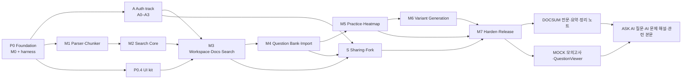

# 구현 계획 — Platform v1.3

**상태:** 실행 기준 계획 · 2026-10-17
**기준 문서:** [architecture](architecture.md) · [auth](auth.md) · [workspace-sharing](workspace-sharing.md) · [questions](questions.md) · [design-system](design-system.md) · [deployment](deployment.md) · [e2e-strategy](e2e-strategy.md) · [screens](screens/index.md)
**운영 규칙:** [`AGENTS.md`](../AGENTS.md) (orchestration·리뷰 게이트·코딩 규칙)

이 문서는 `docs/`의 확정 설계를 **실행 가능한 Task 계층과 의존 그래프**로 분해한다. 설계 내용과 충돌하면 설계 문서가 우선하며, 충돌은 이 문서 §7 "결정 기록"에 남긴다.

---

## 1. 계층 구조와 용어

```text
Phase  (P0, A, M1 … M7, S)        — architecture.md §8 마일스톤 / auth A트랙 / 공유 S트랙
 └─ Epic   (예: M3.2)              — 하나의 기능 경계(API+UI 또는 Core 모듈)
     └─ Task (예: M3.2a)           — subagent 1개가 한 번에 끝내는 작업 = **리뷰 단위**
```

- **Task = 리뷰 단위.** Task는 RED 증거(해당 시)·구현·GREEN·커밋까지 완결되어야 하며, 끝나면 `codex review`를 받는다 (AGENTS.md §4).
- **구현 Task는 자기 Phase의 RED Task에 반드시 의존한다** (그래프의 굵은 화살표 `==>`). RED 없이 구현 착수 금지.
- **RED Task (`*.0`)** 는 각 Phase의 화면 AC를 Playwright/contract test로 먼저 작성하고, 실패 원인이 "미구현"임을 확인해 커밋한다. 구현 Task는 이 테스트를 GREEN으로 만든다.
- 상태 표기: `☐` 대기 · `◐` 진행 · `✅` 완료(GREEN + 리뷰 반영) · `⛔` 사람의 결정/계정 필요.

## 2. Phase 그래프



- **A3(교차 사용자 차단) 완료 전 M3 UI release 금지** (auth.md §6).
- 병렬 가능 구간: `A ∥ M1 ∥ P0.4` → `A ∥ M2 ∥ P0.4` → `M3` 이후 `M4 → M5 → M6` 와 `S` 병렬.

## 3. Task 계층 (전체)

열: **ID · 내용 · 의존 · 완료 조건(DoD)**. AC 범위는 `docs/screens/*.md`의 ID를 그대로 사용한다.

### P0 — Foundation (M0 + E2E harness)

| ID | 내용 | 의존 | DoD |
|---|---|---|---|
| P0.1 | Monorepo 골격: `pnpm-workspace.yaml`, root `package.json`(lint/typecheck/test 스크립트), uv workspace `pyproject.toml`, `.env.example`, ruff/mypy/eslint/prettier 설정, `Makefile`(또는 `justfile`) 공통 명령 | — | `pnpm install`, `uv sync` 성공, 빈 lint/typecheck 통과 |
| P0.2 | 로컬 인프라: `infra/compose.yaml`(Qdrant, Redis), Supabase CLI(devDependency `supabase`)로 `supabase init`, Mailpit 포함 local config | P0.1 | `make infra-up` 후 Qdrant/Redis/Supabase health OK |
| P0.3 | `packages/design-tokens`: `tokens.json` 단일 소스 → CSS 변수/TS 생성(light/dark), raw hex 금지 lint 규칙 | P0.1 | 생성물이 design-system.md §3 값과 일치하는 unit test |
| P0.4 | `packages/ui`: Storybook, Foundation primitives(`Button`, `IconButton`, `Input`, `Surface`, `GlassSurface`, `FocusRing`, `Tooltip`, `Popover`, `Toast` …), `FloatingSidePanel`(modal/non-modal), `AppShell` | P0.3 | Storybook build, Vitest + axe 통과, panel focus trap/return 테스트 |
| P0.5 | `apps/web`: Next.js App Router, AppShell 적용, 21개 화면 **stub route**(404가 아닌 "미구현" 화면), Supabase SSR client 자리 | P0.1, P0.3 | `pnpm --filter web build`, 모든 route 200 |
| P0.6 | `apps/api`: FastAPI 앱, settings, `/health/live`·`/health/ready`, SQLAlchemy 세션, 오류 형식, OpenAPI → `contracts/openapi.json` export, TS client 생성 파이프라인 | P0.1 | pytest 통과, openapi 생성 스크립트 동작 |
| P0.7 | `apps/worker`: Celery 앱, 멱등 task base(`async_jobs` 연동 인터페이스), 테스트용 eager 모드 | P0.6 | 샘플 task unit test |
| P0.8 | `packages/core`(`book_core`): 모듈 골격, Pydantic 계약(`ParsedDocument`, `DocumentRevision`, `SearchChunk`, `SearchHit`, `Excerpt`, `QuestionDraft`), Typer CLI stub, 모델/LLM **fake adapter 인터페이스** | P0.1 | 계약 직렬화 unit test, `core --help` |
| P0.9 | DB baseline migration(`supabase/migrations`): `profiles`, `workspaces`, `workspace_memberships`, `activity_events`, `async_jobs` + 최소 grants/RLS, seed 골격 | P0.2 | `supabase db reset` 성공, migration lint |
| P0.3b | 토큰 보강: feedback(danger/success/warning, 텍스트 대비 충족), on-accent, scrim, typography scale, breakpoint 토큰 추가 후 `packages/ui` 내부 alias 교체 | P0.4 | 토큰 test + ui test/axe 통과, alias 제거 |
| P0.7b | Postgres `JobStore` + `async_jobs` 정합 migration(max_attempts, lease/locked_by, cancel_requested_at, publication 상태, idempotency 범위 결정) | P0.7, P0.9 | 실 DB 통합 test(claim 경쟁·lease 회수·reconciler), pgTAP 갱신 |
| P0.10 | E2E harness: Playwright 설치, `tests/e2e/fixtures/`(사용자·workspace 고유 fixture 팩토리), test-only seed 경로(production 빌드 제외), `e2e:trace` 스크립트(AC ↔ test title 대조, orphan 검출), CI workflow 골격(lint→unit→contract→e2e) | P0.5, P0.6, P0.9 | `pnpm e2e:trace` 동작. 기존 starter spec은 `tests/e2e/_pending/`(실행 제외)로 옮기고, 각 Phase RED Task가 화면 명세 경로로 가져와 확장 |

### A — Auth track (auth.md §6)

| ID | 내용 | 의존 | DoD |
|---|---|---|---|
| A0 | RED: `auth/*.spec.ts`(AUTH-01~07, ACCOUNT-01 = 24 AC) + API contract test(AUTH-API-AC01~03) | P0.10 | RED 증거 커밋, trace 통과 |
| A1.1 | Supabase Auth local 설정: 이메일 확인 필수, redirect allowlist, 비대칭 JWT signing key, Mailpit | P0.2 | 로컬 가입→메일 수신 수동/자동 확인 |
| A1.2 | FastAPI JWT/JWKS 검증(kid·alg allowlist·iss·aud·exp·sub, 키 캐시/rotation), `GET /me`, `GET /me/workspaces`, 401/403 구분 | A0, P0.6, A1.1 | AUTH-API-AC01 GREEN |
| A1.3 | 인가 dependency: resource → workspace → membership, archived 쓰기 거부, soft-deleted 차단, profile upsert | A1.2, P0.9 | 교차 사용자 403/404 integration test |
| A2.1 | Next.js 세션: `proxy.ts`/`middleware.ts` refresh, `getClaims()` 기반 서버 판단, 보호 라우트, `next` 내부경로 allowlist, API client Bearer 주입 | A0, P0.5, A1.1 | AUTH-01-AC01, open redirect AC GREEN |
| A2.2 | 화면 AUTH-01~07 (`AuthLayout`, `SignInForm`, `SignUpForm`, `PasswordResetForm`, `VerificationNotice`) | A2.1, P0.4 | AUTH-01~07 AC GREEN |
| A2.3 | ACCOUNT-01 보안 설정 화면 | A2.2 | ACCOUNT-01 AC GREEN |
| A3 | 릴리즈 준비(로컬 범위): AUTH-API-AC02/03, CORS·CSRF·쿠키 정책, 로그 마스킹. staging SMTP/도메인은 M7.4로 이월 | A1.3, A2.3 | Auth 전 AC + API AC GREEN |
| A4 | Auth CAPTCHA(Cloudflare Turnstile via Supabase Auth captcha): spec(auth.md §5.1, AUTH-01-AC05/06·AUTH-02-AC04/05·AUTH-03-AC04/05·AUTH-05-AC04/05) → RED → 공용 `TurnstileWidget` + 4개 폼 `captchaToken` 전달·호출마다 reset, CSP, `[remotes.*.auth.captcha]`, env manifest, runbook | A3, M7.4a | 신규 8 AC GREEN(chromium·webkit), 기존 Auth AC 회귀 없음, a11y·trace strict, 별도 Supabase 스택에서 서버 검증 확인 |

### M1 — Parser·Chunker

| ID | 내용 | 의존 | DoD |
|---|---|---|---|
| M1.1 | 합성 PDF fixture(KO/EN 2~5p, 목차·표·문단·문제 포함) 생성 스크립트 | P0.8 | fixture 재생성 가능, 저작권 자료 없음 |
| M1.2 | `parser`: Docling → `ParsedDocument`(page, bbox, block 유형), OCR fallback 플래그, sha256 | M1.1 | 페이지·bbox 매핑 unit test |
| M1.3 | `structure`: 장·절 계층 복원 + canonical blocks + `DocumentRevision` | M1.2 | 목차 재현 test |
| M1.4 | `chunker`: HybridChunker + parent/child 계층 청킹, block/page provenance, stable id/hash | M1.3 | chunk 경계·provenance test |
| M1.5 | CLI `core parse` / `core chunk` | M1.4 | CLI e2e(pytest) |

### M2 — Search Core

| ID | 내용 | 의존 | DoD |
|---|---|---|---|
| M2.1 | `embedding`: Qwen3-Embedding adapter(optional extra) + 결정론적 fake | M1.4 | fake 결정성 test |
| M2.2 | `indexing`: Qdrant dense+BM25 sparse, workspace/document/revision payload, active revision 전환·rollback | M2.1, P0.2 | Qdrant 통합 test |
| M2.3 | `search`: keyword/semantic/hybrid, RRF, published-revision 필터 강제 | M2.2 | 필터 우회 불가 test |
| M2.4 | `reranker`: Qwen3-Reranker adapter + fake, 후보 수 설정 | M2.3 | 순위 계약 test |
| M2.5 | `ExcerptResolver`: 문단 경계 확장, page/bbox | M2.3 | 발췌 완결성 test |
| M2.6 | `evaluation` + `eval/`: ir-measures, KO↔EN 데이터셋 골격, `core eval`, `core index/search/excerpt` CLI | M2.4, M2.5 | 샘플 리포트 생성 (실모델 nightly) |

### M3 — Workspace·Docs·Search

| ID | 내용 | 의존 | DoD |
|---|---|---|---|
| M3.0 | RED: WS-01(6), DOC-01(4), DOC-02(5), SEARCH-01(5) | P0.10 | RED 증거 |
| M3.1a | Workspace API: CRUD/archive/restore/soft delete, 멱등 키, activity 기록 | M3.0, A1.3 | contract test GREEN |
| M3.1b | WS-01 화면 (`WorkspaceSwitcher`, 탭 Active/Archived, 빈 상태) | M3.1a, A2.1, P0.4 | WS-01-AC01~05 GREEN (AC06은 S2) |
| M3.2a | 문서 schema(`documents`, `document_revisions`, `chapters`, `content_blocks`), upload-intent / complete-upload, private Storage 버킷 | M3.1a | 업로드 인가 integration test |
| M3.2b | Worker 파싱·색인 job, `GET /jobs/{id}`(DB 기준, Celery result 미사용), SSE events, 실패 시 이전 revision 유지 | M3.2a, M1.5, M2.2, P0.7b | job 재시도·멱등 test |
| M3.3 | DOC-01 화면: 목록·업로드(TUS)·진행률·취소·재시도 | M3.2b | DOC-01 AC GREEN |
| M3.4 | outline/blocks/publish API, 교정 → 신규 revision → 재색인 → rollback | M3.2b | revision/재색인 test |
| M3.5 | DOC-02 화면: PDF.js viewer, `DocumentOutlineTree`, `TextBlockEditor`, signed read URL | M3.4 | DOC-02 AC GREEN |
| M3.6a | Search API: workspace/published 필터 서버 강제, 문서 hit + excerpt | M3.4, M2.6 | 교차 workspace 검색 차단 test |
| M3.6b | SEARCH-01 화면: 모드 전환, `SearchResultList`, `DocumentExcerptPanel`(non-modal), PDF jump | M3.6a, M3.5 | SEARCH-01 AC GREEN |

### M4 — Question Bank·Import

| ID | 내용 | 의존 | DoD |
|---|---|---|---|
| M4.0 | RED: QBANK-01(4), QIMPORT-01(4) | M3.0 | RED 증거 |
| M4.1 | 문제 schema: `questions`, `question_revisions`, `question_sources`, `question_user_states`, `question_attempts`, `question_lineage`, `question_drafts`, generation/import runs | P0.9 | migration + 제약 test |
| M4.2a | Question CRUD API(유형 MCQ/SHORT_ANSWER/ESSAY, 챕터·출처, revision) | M4.0, M4.1, M3.4 | contract test |
| M4.2b | QBANK-01 화면 | M4.2a | QBANK-01 AC GREEN |
| M4.3 | Core `llm` adapter(structured output, fake 포함) + `extractor`(문제 PDF → `QuestionDraft`, 정답 생성 금지) | M1.5 | fake 기반 추출 test |
| M4.4a | Import run API/worker, drafts 격리, 승인분만 publish | M4.0, M4.3, M4.2a, P0.7 | 미승인 미등록 test |
| M4.4b | QIMPORT-01 화면 + 공용 `QuestionDraftReview` | M4.4a | QIMPORT-01 AC GREEN |

### M5 — Practice·Heatmap

| ID | 내용 | 의존 | DoD |
|---|---|---|---|
| M5.0 | RED: QOV-01(6), QPLAY-01(5) + 정답 비노출 contract test | M4.0 | RED 증거 |
| M5.1 | `deriveDotStatus`(TS/Python 공통 규칙), overview API(CONFIRMED만, 상호배타 집계 + favorite overlap, 필터) | M5.0, M4.2a | 우선순위 unit test |
| M5.2 | practice-session(정답·해설 미전송, option ID 순서 저장), submit, self-grade, `my-state`, viewed는 패널 open에서만 | M5.1 | 정답 유출·shuffle 100회 test |
| M5.3 | `QuestionMarker`/`QuestionDot`/`QuestionHeatmap`/`HeatmapLegend`/`QuestionPreviewPopover` + Storybook 5상태×favorite×hover/focus/selected, roving tabindex, visual regression | P0.4 | 스냅샷·axe 통과 |
| M5.4 | QOV-01 화면 (필터·URL state·집계 chips) | M5.2, M5.3 | QOV-01 AC GREEN |
| M5.5 | QPLAY-01 `QuestionPracticePanel`(modal, `?question=` 딥링크, 이전/다음, focus return) | M5.4 | QPLAY-01 AC GREEN |

### M6 — Variant Generation

| ID | 내용 | 의존 | DoD |
|---|---|---|---|
| M6.0 | RED: QGEN-01(4) + fake LLM valid/invalid 시나리오 | M5.0 | RED 증거 |
| M6.1 | Core `generation`: PARAPHRASE / INVERT_POLARITY / ANALOGOUS_CONCEPT, schema·정답 개수·중복 fingerprint·출처 검증 (OPTION_SHUFFLE은 M5.2에서 완료) | M4.3, M2.5 | validation unit test |
| M6.2 | generation run API/worker, drafts, 승인 → CONFIRMED + lineage | M6.0, M6.1, M4.4a | 승인 전 dot 수 불변 test |
| M6.3 | QGEN-01 화면(`QuestionGenerationForm`, `VariationDiffViewer`, ≥600px drawer) | M6.2, M4.4b | QGEN-01 AC GREEN |

### S — Workspace Sharing·Fork (workspace-sharing.md)

| ID | 내용 | 의존 | DoD |
|---|---|---|---|
| S0 | RED: WS-SHARE-01(5), WS-VIEW-01(6), WS-FORK-01(6) + 보안 contract test, owner/guest/recipient fixture | P0.10 | RED 증거 |
| S1a | `workspace_share_links` + owner API(발급·조회·PATCH·revoke·rotate), digest 저장 | S0, A3, M3.1a | 비밀값 미저장 test |
| S1b | shared session 교환(fragment → HttpOnly cookie), shared read API(문서/PDF/검색/문제), 매 요청 재검증, no-store/no-referrer 헤더 | S1a, M3.6a, M4.2a | revoke 즉시 차단 test |
| S2a | WS-SHARE-01 화면(`WorkspaceSharingPanel`) + WS-01-AC06 | S1a, M3.1b | WS-SHARE-01 AC GREEN |
| S2b | WS-VIEW-01 화면(`SharedWorkspaceView`, 읽기 전용) | S1b | WS-VIEW-01 AC GREEN |
| S3a | `workspace_forks` + Fork worker: snapshot manifest, ID remap, 개인 데이터 제외, 커밋 직전 재검증, 취소 정리 | S1b, P0.7 | 복제·격리·경쟁 integration test |
| S3b | WS-FORK-01 화면(`ForkWorkspaceDialog`) | S3a, S2b | WS-FORK-01 AC GREEN |
| S4 | 보안 검증 묶음: 우회·권한 상승·CSRF·rate limit·로그 유출 | S3b | 보안 test GREEN |

### M7 — Harden·Release

| ID | 내용 | 의존 | DoD |
|---|---|---|---|
| M7.0 | RED: HISTORY-01(3) | M3.0 | RED 증거 |
| M7.1 | activities/attempts/jobs 조회 API + HISTORY-01 화면 | M7.0, M5.2 | HISTORY-01 AC GREEN |
| M7.2 | 전 화면 a11y(axe)·visual baseline(light/dark, desktop/iPad)·WebKit/모바일 smoke, 성능 점검 | M5.5, M6.3, S4 | 전체 E2E GREEN, `e2e:trace` orphan 0 |
| M7.3 | 컨테이너화(web/api/worker Dockerfile), CI 전체 파이프라인, 색인 재생성·백업 복원 스크립트 | M7.2 | CI GREEN |
| M7.4a | 계정 없는 배포 준비: platform config as code, env manifest·검사기, deploy workflow, DEP smoke runner, runbook | M7.3 | 오프라인 검증 GREEN, `make smoke-local` GREEN |
| M7.4b | Hosted embedding: Cloudflare Workers AI `@cf/qwen/qwen3-embedding-0.6b` adapter(`WORKER_EMBEDDER=workers_ai`, API·worker 공용), 색인 재시도 오류 code, 검색 BM25 저하 + 안내(SEARCH-01-AC06), 모델 없는 API 이미지, env manifest, parity/eval scaffolding(실행은 계정 생성 후) | M7.4a | SEARCH-01-AC06 GREEN, adapter contract test(HTTP mock) GREEN, slim API 이미지 boot, `workers_ai` marker test는 자격 없이 실패 |
| M7.4c | Worker 메모리·시간 한도: Docling in-flight page queue 제한, embedding model 지연 로드(dimension 선언), `document.parse` 전용 시간 한도·lease, pool process 사망(OOM 등) 시 즉시 재큐, thread 수 = container CPU quota, pool process 재활용 설정 | M7.4b | worker·core unit test(설정 전달·무로드·lease 유도·SIGKILL prefork) GREEN, env manifest·check-env GREEN |
| M7.4 ✅ | Staging 배포(구성 A) → 7일 부하·비용 게이트 → Production, SMTP, DEP-01~07 | M7.4a | **사용자 계정·비용 승인 필요** |
| UX1 | 사용자 피드백 UI 다듬기(2026-10-19): glass 불투명·tint, 상태 배경 token(hover/pressed/selected)·전환 token, toggle off 무테두리, 테두리 축소, 메뉴·선택지 설명 → Tooltip, 계정 버튼 = 이메일, WS-01 설명 문구 삭제·빈 상태 헤더 CTA 숨김·탭 수 badge 제거, DOC-01 빈 상태 헤더 업로드 버튼 숨김 | M7.2 | token·contrast test, lint·typecheck·test GREEN, 영향 E2E(WS-01·DOC-01·ACCOUNT-01·SEARCH-01·QOV·QBANK·A11Y·SMOKE) GREEN, visual baseline 재생성 |

### DOCSUM — 문서 전문·요약·챕터 정리 노트 (DOCSUM-SPEC 2026-10-29)

사용자 요청 "document to text and summary — 문서 전문 텍스트 변환 / 내용 요약 제공 — 문서 내용 변경될 때마다 새로 요약 생성 및 저장 / 문제 및 해설로부터 챕터별 내용 정리 생성 — 추가한 내용은 문제 출처를 주석에 명시". 화면 명세: [DOC-03](screens/documents-text-export.md)(3 AC), [DOCSUM-01](screens/documents-summary.md)(8 AC), [CHNOTE-01](screens/chapter-notes.md)(6 AC); 결정은 §7(2026-10-29). 브랜치 `feature/doc-summary`, Task마다 `task/<ID>-<slug>`. RED Task는 그 트랙의 구현 착수 직전에 쓴다. 새 phase(`DOCTXT.0`·`DOCSUM.0`·`CHNOTE.0`, `scripts/e2e-trace.ts` PHASES)는 구현 Task가 GREEN을 확인한 뒤 orchestrator가 CI `E2E_PHASES`에 추가한다.

| ID | 내용 | 범위(디렉터리) | 의존 | DoD |
|---|---|---|---|---|
| DOCTXT.0 | RED: DOC-03-AC01~AC03 E2E + 계약 DOC-03-C01~C03(pytest `red` marker) | `tests/e2e/documents/documents-export.spec.ts`, `tests/e2e/fixtures`, `tests/integration/documents` | DOCSUM-SPEC | RED 증거(메뉴·`/text` endpoint 없음이 원인), `pnpm e2e:trace --strict --phase DOCTXT.0`의 orphan AC 0, `make test-infra` GREEN(red 제외) |
| DOCTXT | `book_core.export.render_revision`(Markdown·텍스트, golden fixture), `GET /documents/{id}/text`(인가·no-store·attachment·파일 이름), DOC-01 행 `텍스트 내보내기` 메뉴, DOC-02 header 메뉴(초안 그룹·전체 복사), `make contracts` | `packages/core/src/book_core/export`, `packages/core/tests`, `apps/api`, `contracts`, `packages/api-client`, `apps/web`(documents) | DOCTXT.0 | DOC-03 AC01~AC03 GREEN(chromium·webkit), C01~C03 GREEN(`red` 제거), DOC-01·DOC-02 E2E 회귀 없음, log/artifact audit 0 |
| DOCSUM.0 | RED: DOCSUM-01-AC01~AC08 E2E + 계약 DOCSUM-01-C01~C07(pytest `red`, pgTAP 자리) + E2E fixture(요약 opt-in 문서, `E2E-FAIL-SUMMARY` marker, 기능 꺼짐 stack 설정 방법) | `tests/e2e/documents/documents-summary.spec.ts`, `tests/e2e/fixtures`, `tests/integration/documents` | DOCSUM-SPEC | RED 증거(요약 API·panel 없음), trace `--phase DOCSUM.0` orphan 0 |
| DOCSUM-B | migration: `documents.summary_enabled_at/by`, `document_summary_runs`·`document_summary_units`·`document_summary_run_units`, SECURITY DEFINER `worker_start_document_summary`(발행·복원 publish 트랜잭션 follow-up), grants·RLS, pgTAP. core `summary`(map/reduce, 장 분할, 쪽 범위 검증, 결정적 fake). worker `document.summarize`(advisory lock, unit 재사용, supersession, 한도·오류 코드, counts-only 결과). API `GET/POST /documents/{id}/summary`, `POST …/summary/retry`, `DELETE …/summary/auto`(자동 갱신 끄기, `summary_disabled_at/by`, 멱등), 공유 `GET /shared/{shareId}/documents/{docId}/summary`. Fork 복제, 활동 기록(id만; `document.summary_enabled`·`document.summary_auto_disabled` 포함), 설정 `WORKER_DOCUMENT_SUMMARY`·`WORKER_SUMMARY_CHAPTER_CHARS`·`WORKER_SUMMARY_MAX_INPUT_CHARS`(env manifest·check-env), `make contracts` | `supabase/migrations`, `supabase/tests`, `packages/core/src/book_core/summary`, `apps/worker`, `apps/api`, `contracts`, `packages/api-client`, `scripts/check_env.py`·env manifest | DOCSUM.0 | DOCSUM-01-C01~C07 GREEN(자동 갱신 꺼진 문서의 발행·복원은 run·LLM 호출 0 포함), pgTAP GREEN, migration은 롤백 트랜잭션으로 검증(orchestrator가 적용), `make test`·`make test-infra` GREEN, 본문 미기록 log test |
| DOCSUM-W | 문서 관리 행 `요약` 버튼·"요약 중", `DocumentSummaryPanel`(`FloatingSidePanel`, `?panel=document-summary&document=`), 상태·stale·오류·`다시 시도`, 자동 갱신 줄(`자동 갱신 끄기` + `ConfirmDialog`, 꺼짐 상태·`요약 만들기`로 다시 켜기), DOC-02 header `요약` 링크, 공유 화면 `요약`, 이력 label(활동 `document.summary_*`, 작업 "문서 요약"), Storybook | `apps/web`, `packages/ui`(필요 시 Disclosure) | DOCSUM-B | DOCSUM-01 AC01~AC08 GREEN(chromium·webkit), axe, log/artifact audit 0, `E2E_PHASES`에 `DOCSUM.0` 추가 |
| CHNOTE.0 | RED: CHNOTE-01-AC01~AC06 E2E + 계약 CHNOTE-01-C01~C07(pytest `red`) + `tests/fixtures/llm/chapter-note-scenarios.json`(정상·`Q99` 인용·각주 없는 항목·실패) | `tests/e2e/questions/chapter-notes.spec.ts`, `tests/e2e/fixtures`, `tests/integration/questions`, `tests/fixtures/llm` | DOCSUM-SPEC | RED 증거(정리 노트 API·버튼 없음), trace `--phase CHNOTE.0` orphan 0 |
| CHNOTE-B | migration `chapter_notes`(버전, partial unique 진행 1개, grants·RLS, pgTAP). core `notes`(입력 tag, 인용 검증·1회 재요청·항목 제거, 큰 장 묶음·병합, scenario fake). worker `chapter_note.generate`(고정 `question_refs`만 읽음, counts-only 결과). API `GET /workspaces/{id}/chapter-notes`, `GET/POST /chapters/{chapterId}/note`(stale 계산, `version=`), 공유 노트 API, practice API 노트 미포함 test, Fork 복제(문제 id 재매핑), 설정 `WORKER_CHAPTER_NOTES`, `make contracts` | `supabase/migrations`, `supabase/tests`, `packages/core/src/book_core/notes`, `apps/worker`, `apps/api`, `contracts`, `packages/api-client`, env manifest | CHNOTE.0 | CHNOTE-01-C01~C07 GREEN(인용 property test 포함), pgTAP GREEN, `make test`·`make test-infra` GREEN |
| CHNOTE-W | Heatmap 챕터 그룹 header `정리 노트`(grid shift 없음, "챕터 없음" 제외), `ChapterNotePanel`(`?panel=chapter-note&chapter=`, "정답·해설 포함" disclosure, 각주 목록·링크, `버전`, stale, 동작), 풀이 panel이 열리면 노트 접기, 공유 화면 `정리 노트` 카드, 이력 label | `apps/web`, `packages/ui` | CHNOTE-B | CHNOTE-01 AC01~AC06 GREEN(chromium·webkit), QOV-01·QPLAY-01 E2E 회귀 없음, 영향 visual baseline 재생성, `E2E_PHASES`에 `CHNOTE.0` 추가 |
| DOCSUM-X | 교차 마무리: `eval/summaries`(요약 쪽 인용 유효율·장 coverage, 노트 각주 precision/coverage; 합성 fixture만), `make test-llm`에 요약·노트 smoke(합성 텍스트만), 새 panel A11Y·VISUAL(light/dark, desktop·iPad), runbook(LLM 비용·키·기능 플래그), 전체 `pnpm e2e:trace --strict` orphan 0 확인, 문서 갱신. **staging·production 활성화(`WORKER_DOCUMENT_SUMMARY`·`WORKER_CHAPTER_NOTES` on, LLM 키)는 ⛔ 사용자 승인 후** | `eval`, `tests/e2e/quality`, `docs`, `.github/workflows/ci.yml`, `Makefile` | DOCTXT, DOCSUM-W, CHNOTE-W | quality suite GREEN, `pnpm e2e:trace --strict`(전체) OK, eval 리포트 생성, CI GREEN |

- 병렬: `DOCTXT ∥ DOCSUM-B ∥ CHNOTE-B`, `DOCSUM-W ∥ CHNOTE-W`. 공유 파일(`apps/api` router 등록, `apps/worker` job 등록·celery 설정, `contracts/openapi.json`, `packages/api-client`, migration timestamp, env manifest)은 충돌이 예상되며 orchestrator가 merge 후 `make contracts`로 재생성한다.
- 비용 위험: 350쪽 교재의 첫 요약은 입력 0.3–0.5M token 수준(이후 발행은 바뀐 장만). 750문제 장은 노트 묶음 생성(C04). 그래서 요약은 opt-in, 노트는 요청 시에만 만든다.

### DOCVIEW-PORT — PDF 열람 보기 설정 이식 (사용자 결정 2026-11-02 "제 배치로 교체")

PR #43(이 계획의 "DOCVIEW", DOC-02-AC06–AC11)과 병렬로 만든 DOCVIEW-01 배치(이전 로컬 브랜치 `local/pdf-view-layout-pre43`의 DOCVIEW-SPEC·DOCVIEW.0·DOCVIEW-UI·DOCVIEW-W·DOCVIEW-X, 모두 Codex 리뷰 통과)를 develop 위로 옮긴다. #43의 쪽 넘김 속도·동기화·쪽 묶음·문제 카드(AC07·AC08·AC09·AC11)는 유지하고, #43의 목차 panel(AC06)·폭 조정 구분선(AC10)은 DOCVIEW-01 배치로 바꿔 폐기한다. 화면 명세: [DOCVIEW-01](screens/documents-viewer-layout.md)(12 AC, phase `DOCVIEW.0`; 화면 ID·phase는 #43의 Task 이름 "DOCVIEW"와 겹치지 않는다). 결정은 §7(2026-11-02 DOCVIEW-PORT). 브랜치 `task/DOCVIEW-PORT-onto-43`(`feature/pdf-view-layout` = develop fd44a44에서). API·DB 변경 없음.

| ID | 내용 | 범위(디렉터리) | 의존 | DoD |
|---|---|---|---|---|
| DOCVIEW-PORT | (1) 문서: DOCVIEW-01 명세를 DOC-02 v1.4에 맞춰 옮김(변환본 pane = 원문 텍스트 영역, 쪽 묶음·문제 카드는 모든 배치, 숨은 pane을 다시 보이면 현재 쪽·블록으로 맞춤), DOC-02-AC06·AC10 폐기(폐기 표), index·AGENTS·trace AC 159 → 169·화면 23 → 24, design-system의 `FloatingSidePanel` API 하나(`side` start/end·`size`·`placement="docked"`·`dockMode`·`id`)와 `SplitView`, token `--outline-panel-width`(20rem). (2) RED: `documents-viewer-layout.spec.ts`·`fixtures/document-viewer.ts`를 develop DOM에 맞춤, DOC-02-AC06·AC10 E2E 제거. (3) `@quiz/ui` `SplitView` + docked `FloatingSidePanel`(keyed pane, 명시 `id`의 trigger `aria-controls`, 복원 mount focus 없음, Escape는 focus가 안에 있을 때만). (4) `apps/web`: 보기 설정 막대·docked 목차·`SplitView`·pane header 끌기·좁은 화면 `보기 선택`·`quiz.documentViewer.v1`·viewport fit을 `document-editor.tsx`·`shared-document-view.tsx`에, 연속 스크롤 `PdfViewer`는 drag 중 다시 그리기 미룸·숨은 동안의 이동을 다시 보일 때 반영; #43의 `outline-panel.tsx`·`pane-splitter.tsx`·`viewer-preferences.ts` 삭제(이전 저장 key는 무시). (5) 품질 `A11Y-16`·`VISUAL-08`, VISUAL-04 document editor baseline 재생성(Linux renderer). (6) CI `E2E_PHASES += DOCVIEW.0` | `docs`, `scripts/e2e-trace*`, `.github/workflows/ci.yml`, `packages/ui`, `packages/design-tokens`, `apps/web/src/components/documents/editor`, `apps/web/src/components/shared`, `apps/web/src/lib/documents`, `apps/web/test`, `tests/e2e` | PR #43(DOCVIEW), UX7 | DOCVIEW-01 AC01–AC12 GREEN(chromium·webkit), DOC-02 남은 AC(AC07·AC08·AC09·AC11 포함)·WS-VIEW-01·SEARCH-01·내보내기·요약 E2E GREEN, A11Y 전체·SMOKE(iPad·iPhone·Pixel)·`pnpm e2e:visual` GREEN, `make lint`·`typecheck`·`test`·`contracts-check`, `pnpm e2e:trace --strict`(전체·CI `E2E_PHASES`) |

### MOCK — 모의고사·통합 QuestionViewer (MOCK-SPEC 2026-11-01)

사용자 요청 "변형 출제 -> '문제 생성' 삭제 / 대신 '모의고사' 기능 추가 … 정해진 범위의 문제에서 하나씩 팝업 위에서 문제를 보여주는 기능 추가(랜덤 여부는 시작 전 체크) … 공통 컴포넌트로 개발"과 추가 결정 "통합 QuestionViewer로 하고, 기존 문제를 보여줄 때도 이 컴포넌트를 사용". 화면 명세: [MOCK-01](screens/mock-exams.md)(8 AC), [QVIEW-01](screens/question-viewer.md)(8 AC), 폐지 [QGEN-01](screens/questions-generation.md)(8 AC → QGEN-RM에서 제거); 결정은 §7(2026-11-01). 브랜치 `feature/mock-exams`, Task마다 `task/<ID>-<slug>`. **전제:** 병렬 진행 중인 UX7-CACHE·UX7-BANK(전체 문제 페이지 QBANK-01 폐지, 문제 편집·삭제를 홈 문제 상세로)가 먼저 `develop`에 merge되어야 QVIEW.0·QVIEW-W·QGEN-RM을 시작한다(같은 문제 상세·풀이 panel·`문제` 메뉴를 고친다). → **MOCK-SYNC(2026-11-02)로 충족:** `feature/mock-exams`는 UX7 전체가 든 `feature/ux7-feedback`(6e7b8ba)에서 잘렸고 MOCK-SPEC을 그 위에 merge해 명세를 UX7이 만든 화면(풀이 panel `문제 관리`/`문제 정보` 메뉴와 modal "문제 상세" dialog, 보관·초안 문제·중복 문제 정리 dialog, `requiresEdit` 메뉴, 뒤로가기 규칙, cache·결과 테두리·`displayStem`)에 맞췄다(QVIEW-01 호출 위치 표, §7). §7의 MOCK-SPEC 제안은 모두 사용자가 확인했다(2026-11-01) — RED는 각 Task의 의존이 충족되면 시작한다. 새 phase `MOCK.0`·`QVIEW.0`(`scripts/e2e-trace.ts` PHASES)는 구현 Task가 GREEN을 확인한 뒤 orchestrator가 CI `E2E_PHASES`에 넣는다 — `QVIEW.0`은 MOCK-W 이후(QVIEW-01-AC05가 모의고사 `풀기`에서 시작), `MOCK.0`은 QGEN-RM 이후(MOCK-01-AC01이 `변형 출제` 없음을 확인). 그 전까지 아직 RED인 AC는 CI 밖에 둔다. **Gate 원칙:** 각 Task의 DoD는 그 Task와 선행 Task만으로 GREEN이 될 수 있는 AC·계약만 요구한다 — QVIEW-B·QVIEW-W는 등록 문제(`bank`) 출처만, 모의고사(`mock`) 출처의 확인은 MOCK-P·MOCK-W가 맡는다.

| ID | 내용 | 범위(디렉터리) | 의존 | DoD |
|---|---|---|---|---|
| QVIEW.0 | RED: QVIEW-01-AC01~AC08 E2E + 계약 QVIEW-01-C01~C05(pytest `infra red`) + fixture(두 장 확정 문제·초안, 서술형, 고정 seed; C07용 보관 문제와 중복 정리로 합친 묶음 — 합친 상태로만 `틀린 문제` 필터에 걸리는 남길 문제) | `tests/e2e/questions/question-viewer.spec.ts`, `tests/e2e/fixtures`(새 `practice-runs.ts`), `tests/integration/questions/practice_runs` | MOCK-SPEC, UX7-BANK | RED 증거(`문제 풀기` 메뉴·`/practice-runs` 없음이 원인), `pnpm e2e:trace --strict --phase QVIEW.0` orphan AC 0, `make test-infra` GREEN(red 제외) |
| MOCK.0 | RED: MOCK-01-AC01~AC08 E2E + 계약 MOCK-01-C01~C09(pytest `infra red`, pgTAP 자리) + `tests/fixtures/llm/generation-scenarios.json`에 모의고사 묶음 시나리오(정상 묶음·항목 하나만 정오 반전 복수 정답·해석할 수 없는 묶음·출력 예산에서 잘린 묶음·전부 실패·두 번째 생성 실패) + fake 호출 수 확인 방법 + LLM 꺼짐 stack 설정 방법 | `tests/e2e/questions/mock-exams.spec.ts`, `tests/e2e/fixtures`(새 `mock-exams.ts`), `tests/integration/questions/mock_exams`, `tests/fixtures/llm` | MOCK-SPEC | RED 증거(`모의고사` 메뉴·API 없음), trace `--phase MOCK.0` orphan 0. QGEN-01 테스트는 그대로 GREEN |
| QVIEW-B | migration: `practice_runs`, `practice_sessions.practice_run_id`·`run_position`(additive, partial unique), grants·RLS(만든 사용자만), pgTAP. API `quiz_api.question_ranges`(범위 resolver: Workspace 살아 있는 확정 문제(보관·초안 제외)·필터(`question_merged_user_states`, overview와 같은 판정 — UX7-DEDUP)·Heatmap 순서, MOCK-B와 공용), `POST /workspaces/{id}/practice-runs`(`source=bank`), `GET /practice-runs/{id}`·`/items/{position}`(정답 비노출, 제출 후 결과), `POST …/finish`, 기존 practice session·submit에 묶음 연결(문제마다 1회), `make contracts` | `supabase/migrations`, `supabase/tests`, `apps/api`(새 `api/practice_runs.py`·`question_ranges.py`, `api/practice.py`의 묶음 연결만), `contracts`, `packages/api-client` | QVIEW.0 | `bank` 출처 계약만 GREEN: QVIEW-01-C01·C02·C05·**C07**(보관·중복 정리 문제 제외, `question_merged_user_states`로 필터 판정 — overview와 같은 결과), C03·C04의 `bank` 경우(`red` marker는 그 test에서만 제거; C03·C04의 `mock` 경우는 MOCK-P까지 `red` 유지), 정답 비노출 schema test, pgTAP GREEN, migration은 롤백 트랜잭션으로 검증(orchestrator가 적용), `make test`·`make test-infra` GREEN |
| QVIEW-W | `QuestionViewer`(방식 `practice`·`sequence`·`manage`·`read-only`) + `QuestionRangePicker`(tri-state `전체 선택`)·`QuestionBody`를 만들고 **기존 호출 위치를 모두 옮긴다**(QVIEW-01 호출 위치 표, MOCK-SYNC): Heatmap `?question=` 풀이 panel(`PracticePanel` 본문 대체, `문제 관리`/`문제 정보` 메뉴·session cache·결과 테두리 유지), 이력·정리 노트 링크, 풀이 panel 메뉴와 보관·초안 문제 행이 여는 modal "문제 상세" dialog(`manage`; `QuestionDetailDialog`·`RevisionView` 본문 대체), 공유 게스트 미리보기(`read-only`, non-modal 유지). 중복 문제 정리 묶음 행·Heatmap preview는 범위 밖(정답 없음 유지). `문제` 메뉴 › `문제 풀기`, `?practice=` URL state, 진행·결과 요약, Storybook(방식별·light/dark), Vitest(QVIEW-01-C06) | `apps/web/src/components/questions/viewer`(새), `apps/web/src/components/questions/practice`·`detail`·`inactive`(상세 opener만)·`overview`·`notes`·`question-detail.tsx`, `apps/web/src/components/shared/shared-questions.tsx`, `apps/web/src/components/workspaces`(메뉴 항목), `packages/ui`(mixed Checkbox 등 필요 시) | QVIEW-B, UX7-CACHE, UX7-BANK | `bank` 출처 AC만 GREEN: QVIEW-01-AC01~AC04·AC06~AC08(chromium·webkit; AC05는 모의고사 `풀기`가 필요해 MOCK-W에서), QVIEW-01-C06 Vitest(`sequence(mock)` 방식 렌더링은 단위 test로). **회귀:** QPLAY-01(AC06 cache·AC09~AC11 메뉴·문제 상세·보관·AC12 결과 테두리·AC13 표시 포함)·QOV-01(AC14 뒤로가기·AC15 보관·초안 문제·AC16·AC17 중복 정리 포함)·CHNOTE-01·WS-VIEW-01·HISTORY-01 E2E 그대로 GREEN(테스트 의미 변경 없음), `?practice=` URL state의 뒤로가기가 QOV-01-AC14 규칙을 따름(QVIEW-01 E2E에 단계 포함), 이전 panel 구현 제거, axe. `QVIEW.0`은 아직 CI `E2E_PHASES`에 넣지 않는다(AC05가 아직 RED라 phase 전체를 켜지 않음; AC01~AC04·AC06~AC08은 로컬 실행으로 GREEN 확인) |
| MOCK-B | migration: `mock_exams`·`mock_exam_revisions`·`mock_exam_generations`·`mock_exam_questions`·`mock_exam_question_revisions`·`mock_exam_practice_sessions`·`mock_exam_attempts`(append-only trigger, 진행 회차 1개 partial unique, grants·RLS), pgTAP. `mock_exam_generation_items`(묶음 checkpoint). core `book_core.mock_exam`(plan·seed 재현, `OPTION_SHUFFLE` 복사, **호출 묶기** `pack_batches`(token 예산 `MOCK_EXAM_MAX_PROMPT_TOKENS`·`MOCK_EXAM_MAX_OUTPUT_TOKENS`, 상한 `MOCK_EXAM_SOURCES_PER_CALL`, passage 공유 원본끼리·passage 한 번만, 결정적), 묶음 prompt·schema `mock_exam.generate/v1`, 항목별 검증 통과 판정(`generation.validation` 재사용), 결정적 fake LLM의 묶음 응답·호출 수 기록). worker: `question.generate`의 원본·passage·근거 helper를 공용 모듈로 옮기고 `mock_exam.generate`(advisory lock, 묶음을 `MOCK_EXAM_GENERATION_CONCURRENCY`까지 동시 호출, 묶음마다 checkpoint, 실패 항목 모아 재요청 1회, 해석 불가 묶음 반으로 나눔, 진행, 취소·삭제 재확인, 시간 한도 설정 검사, counts-only 결과). API: 모의고사 CRUD·`generations`·문제 목록·문제 PATCH/DELETE(`question_ranges` 재사용), 한도·rate limit·idempotency, 활동 기록(`mock_exam.*` id·개수만), 설정(env manifest·check-env에 추가): `WORKER_MOCK_EXAMS`, `MOCK_EXAM_MAX_PROMPT_TOKENS`(60,000), `MOCK_EXAM_MAX_OUTPUT_TOKENS`(16,000), `MOCK_EXAM_SOURCES_PER_CALL`(40, 상한), `MOCK_EXAM_GENERATION_CONCURRENCY`(2), `MOCK_EXAM_MAX_RUNNING_PER_WORKSPACE`(5), `MOCK_EXAM_GENERATION_RATE_LIMIT_PER_MINUTE`(6) — 기본값은 eval로 조정, 예산이 model context를 넘으면 check-env 실패. `make contracts` | `supabase/migrations`, `supabase/tests`, `packages/core/src/book_core/mock_exam`, `packages/core/src/book_core/llm`(fake 묶음 응답), `packages/core/tests`, `apps/worker`(새 `mock_exam_job.py`·`mock_exam_store.py`, 공용 helper 이동), `apps/api`(새 `api/mock_exams.py`), `contracts`, `packages/api-client`, `scripts/check_env.py`·env manifest | MOCK.0, QVIEW-B(`question_ranges`) | 생성·편집 계약만 GREEN: MOCK-01-C02·C03·C05·C06·C07·**C09**(fake 호출 수: 20문항 1번·100문항 기본 예산 3번, 항목 하나 실패 → 재요청 1번, 깨진 묶음 → 그 묶음만 반으로, checkpoint 재실행, 동시 수 상한), C01·C04·C08의 생성·편집 부분(풀이 기록·"그대로 풀 수 있다" 확인은 MOCK-P까지 `red` 유지), 은행 격리 행 수 test, pgTAP GREEN, QGEN 계약 test 회귀 없음(helper 이동), `make test`·`make test-infra` GREEN, 본문 미기록 log test |
| MOCK-P | 모의고사 풀이: `POST /mock-exam-questions/{id}/practice-sessions`, `POST /mock-practice-sessions/{id}/submit`·`/self-grade`(option ID 채점, `practice_grading` 재사용), `practice-runs`의 `source=mock`(현재 회차·뺀 문제 제외), 결과 요약에 mock 포함, `make contracts` | `apps/api`(새 `api/mock_practice.py`, `api/practice_runs.py`의 mock source), `contracts`, `packages/api-client`, `tests/integration/questions` | MOCK-B, QVIEW-B | 남은 계약 GREEN(`red` 모두 제거): MOCK-01-C01·C04·C08의 풀이 부분, QVIEW-01-C03·C04의 `mock` 경우, `question_*` 행 수 불변 test |
| MOCK-W | `모의고사` dialog(`?panel=mock-exams`, DOC-01 목록 dialog 패턴): 목록·`추가`·빈 상태, 만들기 2단계(`StepProgress`, 변형 유형·문항 수·난이도 → `QuestionRangePicker`), 상세(진행·실패·일부만 만듦·회차·문제 목록), 이름 바꾸기·설정 바꾸기·다시 만들기·삭제(`ConfirmDialog`), 문제 `manage`(QuestionViewer + 문제 편집 field 재사용)·빼기, `풀기` → QuestionViewer `sequence(mock)`, `문제` 메뉴 `모의고사` 항목, 이력 label(`mock_exam.*`, 작업 "모의고사 생성"), Storybook | `apps/web/src/components/questions/mock-exams`(새), `apps/web/src/components/workspaces`(메뉴 항목·dialog 등록), `apps/web/src/components/history`(label) | MOCK-P, QVIEW-W | MOCK-01 AC02~AC08 GREEN(chromium·webkit; AC01은 QGEN-RM 뒤), QVIEW-01-AC05 GREEN, QOV-01·QVIEW-01 E2E 회귀 없음, axe, `E2E_PHASES`에 `QVIEW.0` 추가(QVIEW-01 AC01~AC08 모두 GREEN 확인 후; `MOCK.0`은 QGEN-RM에서) |
| QGEN-RM | 변형 출제 폐지: `문제` 메뉴 `변형 출제`·풀이 panel `문제 관리` 메뉴의 `변형 출제`(UX7-BANK)·"문제 생성" dialog·검토/묶음 페이지·`PracticePanel` 미리보기 제거, `?panel=generate`·`/questions/generate?…` → 홈 redirect(`?panel=mock-exams`), 홈 문제 상세에 `변형 출제`가 남지 않음 확인. API `generations`·`question-generations/*`·`question-generation-batches*` router 제거(404), worker `question.generate` 등록 제거(MOCK-B 공용 helper만 남김), 테이블·기존 행 보존(drop migration 없음). 테스트: `questions-generation.spec.ts`·fixture QGEN 부분 삭제, QOV-01-AC10·AC11 test와 명세 문구 `변형 출제` → `모의고사`, QOV-01-AC09(하위 페이지 skeleton test가 `문제 관리` › `변형 출제` → QGEN 검토 페이지를 씀, UX7-FLAKE-AC09)·AC13(하위 페이지 목록에 `문제 변형 출제`)은 남는 하위 페이지(QIMPORT-01 검토·DOC-02)로 바꿈, QOV-01-AC11의 UX7-DOCS-2 비활성 항목 확인에서 `변형 출제` 제거, questions-generation.md tombstone(명세의 폐지 처리 표), index "폐지된 화면", `scripts/e2e-trace.ts` PHASES `M6.0` 제거·AC 수 test(175 − 8 = 167, 24 screens — MOCK-SYNC 기준), CI `E2E_PHASES`에서 `M6.0` 제거·`MOCK.0` 추가, `make contracts` | `apps/web`(generate 디렉터리, 메뉴, redirect), `apps/api`(generation router·tests), `apps/worker`(job 등록), `tests/e2e/questions`, `tests/e2e/fixtures/generation.ts`, `tests/integration/questions`(QGEN 계약), `docs/screens`, `scripts/e2e-trace*.ts`, `.github/workflows/ci.yml`, `contracts`, `packages/api-client` | MOCK-W, UX7-BANK | MOCK-01-AC01 GREEN, 전체 E2E GREEN(지운 QGEN 외 회귀 없음), `pnpm e2e:trace --strict`(CI phases) OK, orphan test 0 |
| MOCK-X | 교차 마무리: 새 화면·방식 A11Y(axe: `A11Y-14` 모의고사 목록·만들기·상세, `A11Y-15` QuestionViewer 범위 고르기·풀이·결과·키보드 전용 흐름 — A11Y-13은 UX7-DEDUP이 씀, MOCK-SYNC §7)·VISUAL(`VISUAL-07`: light/dark, desktop·iPad·375px; 정답·해설이 보이는 상태는 screenshot에 남기지 않음), `make test-llm`에 모의고사 생성 smoke(합성 텍스트), `eval/`에 모의고사 검증 통과율 리포트(합성 fixture), runbook(LLM 비용·`WORKER_MOCK_EXAMS`), AGENTS.md §5 Data 문구 보완(orchestrator — §7 MOCK 2), 전체 `pnpm e2e:trace --strict` orphan 0. **staging·production 활성화(`WORKER_MOCK_EXAMS` on)는 ⛔ 사용자 승인 후** | `tests/e2e/quality`, `eval`, `docs`, `Makefile`, `.github/workflows/ci.yml` | QGEN-RM, QVIEW-W, MOCK-W | quality suite GREEN, `pnpm e2e:trace --strict`(전체) OK, CI GREEN |

- 병렬: `QVIEW.0 ∥ MOCK.0`, `QVIEW-B ∥ MOCK-B`(MOCK-B의 schema·core·worker는 동시에 진행하고, API의 `question_ranges` 사용만 QVIEW-B merge를 기다린다), `QVIEW-W ∥ MOCK-P`, 그 뒤 `MOCK-W → QGEN-RM → MOCK-X`. CI phase 켜기: `QVIEW.0`은 MOCK-W, `MOCK.0`은 QGEN-RM(각 phase의 모든 AC가 GREEN인 첫 Task). 공유 파일(`apps/api` router 등록, `apps/worker` job 등록, `contracts/openapi.json`, `packages/api-client`, migration timestamp, env manifest, `문제` 메뉴 파일)은 충돌이 예상되며 orchestrator가 merge 후 `make contracts`로 재생성한다.
- 파일 범위 겹침 최소화: QuestionViewer 부품은 QVIEW-W만 만들고 MOCK-W는 import만 한다. `문제` 메뉴는 QVIEW-W(`문제 풀기`) → MOCK-W(`모의고사`) → QGEN-RM(`변형 출제` 제거) 순서로만 고친다.
- 비용·호출 수(사용자 결정 "API 호출 최소화"): 원본마다 호출하지 않고 token 예산으로 묶는다 — 20문항 ≈ 1번(+1), 100문항 ≈ 3번(+1), passage가 큰 교재 100문항 ≈ 6번(+1), 해석할 수 없는 응답 하나마다 +2번(MOCK-01 "LLM 호출 묶기"). 출력 예산 16,000 token 호출은 오래 걸리므로 job 시간 한도는 묶음 수·동시 수·호출 timeout으로 설정 검사한다. 한도(MOCK-01-C06)와 LLM 없는 `보기 섞기` 경로가 남은 비용을 막는다.
### ASK — AI 질문·AI 문제 해설·관련 본문 (ASK-SPEC 2026-11-01 사용자 결정, ASK-SYNC 2026-11-02에 develop 위로)

사용자 요청 "LLM에 질문하기 — 문서 기반 답변 — 문제별로 '질문하기' 버튼 추가 -> LLM input에 context로 추가", "LLM 문제 해설 — 문제 제출 후 버튼 노출 -> 해당 버튼 누르면 하단에 llm이 생성한 해설 생성 — 같은 문제에 대한 답변은 캐싱", "문제 답 제출 후 문서에서 관련된 부분 제시 -- 이것도 생성 후 저장". 화면 명세: [ASK-01](screens/ask-llm.md)(12 AC, 계약 C01~C11), [AIEXPL-01](screens/ai-explanations.md)(7 AC, 계약 C01~C09), [RELSRC-01](screens/related-sources.md)(6 AC, 계약 C01~C07); 결정은 §7(2026-11-01 ASK-SPEC 행, 2026-11-02 ASK-SYNC 행). 브랜치 `feature/ask-llm`(develop 145e05a에서), Task마다 `task/<ID>-<slug>`. **시작 조건:** ASK-SPEC의 제안은 모두 사용자 결정이고, ASK-SYNC가 낸 세 제안(§7 ASK-SYNC 행 (8) (a)·(b)·(c))도 사용자가 확정했다(2026-11-02). RED는 그 트랙의 구현 착수 직전에 쓴다. 새 phase `ASK.0`·`EXPL.0`·`RELSRC.0`(`scripts/e2e-trace.ts` PHASES)은 각 phase의 모든 AC가 GREEN이 되는 Task(ASK-Q·EXPL-W·RELSRC-W)가 CI `E2E_PHASES`에 넣는다. **Gate 원칙(MOCK-SPEC과 같음):** 각 Task의 DoD는 그 Task와 선행 Task만으로 GREEN이 될 수 있는 AC·계약만 요구한다 — ASK-W는 header panel AC만, 문제 첨부 AC(AC04·AC05·AC12)는 ASK-Q, AI 해설의 `이 문제로 질문하기`는 ASK-Q 뒤의 EXPL-W.

**지금 코드 기준 (ASK-SYNC 2026-11-02):** MOCK·QVIEW·QGEN-RM이 develop에 있다 — 풀이 panel·문제 상세·공유 미리보기·범위 풀이·모의고사 풀이·모의고사 문제 관리는 모두 `apps/web/src/components/questions/viewer`의 `QuestionViewer`(방식 `practice`·`sequence`·`manage`·`read-only`, 결과 영역은 공통 `QuestionBody`)이고, 문제 상세는 `components/questions/detail/question-detail-dialog.tsx`(footer slot), 모의고사 문제 관리는 `components/questions/mock-exams/mock-question-dialog.tsx`, `문제` 메뉴는 `components/workspaces/question-menu.tsx`, 홈 `?panel=` 목록·배타 규칙은 `lib/workspaces/home.ts`·`components/workspaces/workspace-home.tsx`·`use-panel-history.ts`다. 그래서 이전 계획의 "EXPL-W·RELSRC-W가 `PracticePanel`에 넣고 QVIEW-W가 옮김"과 **ASK-QM(모의고사 문제)은 없어졌다:** 결과 영역 부품 하나에 넣으면 모든 방식에 들어가므로 모의고사 문제의 백엔드(ASK-01-C10·AIEXPL-01-C09·RELSRC-01-C07)는 각 B Task가, 화면(ASK-01-AC12·AIEXPL-01-AC07·RELSRC-01-AC06)은 각 W/Q Task가 맡는다(§7 ASK-SYNC (1)). 모의고사 데이터는 `mock_exam_questions`·`mock_exam_question_revisions`(`evidence` jsonb)·`mock_exam_practice_sessions`·`mock_exam_attempts`(migration 20261102140000·20261102150000).

| ID | 내용 | 범위(디렉터리) | 의존 | DoD |
|---|---|---|---|---|
| ASK.0 | RED: ASK-01-AC01~AC12 E2E + 계약 ASK-01-C01~C11(pytest `infra red`, C10 모의고사 첨부 포함) + fixture(장 2개 합성 교재·고유 구절, 같은 구절의 문제지, 문제 구간에만 구절이 있는 `mixed`, 해설·정답 marker 문자열이 든 객관식 문제, 그 문제로 만든 `보기 섞기` 모의고사(기존 모의고사 fixture helper 사용), 보기 권한 멤버, 보관 Workspace, 공유 링크, `문제` 메뉴·본문 검색 진입) + fake marker(`E2E-ASK-*`)·호출 기록 확인 방법(`WORKER_ASK_FAKE_LOG_DIR`) + 기능 꺼짐 stack 설정 방법(DOCSUM.0의 off-stack 방식). QOV-01-AC11 test는 고치지 않는다(develop GREEN 유지 — ASK-W가 고침) | `tests/e2e/ask/ask-llm.spec.ts`, `tests/e2e/fixtures`(새 `ask.ts`), `tests/integration/ask` | — (ASK-SPEC·ASK-SYNC 완료, MOCK·QVIEW는 develop) | RED 증거(`AI 질문` 버튼·`/ask` API 없음이 원인 — 인프라·seed 아님), `pnpm e2e:trace --strict --phase ASK.0` orphan AC 0, `make test-infra` GREEN(red 제외) |
| EXPL.0 | RED: AIEXPL-01-AC01~AC07 E2E + 계약 AIEXPL-01-C01~C09(pytest `infra red`, C09 모의고사 포함) + fixture(해설·책 출처가 있는 객관식, 해설 없는 문제, 발문 marker `E2E-EXPL-*`, 보기 권한 멤버 둘, 공유 링크, 기능 꺼짐 stack, 두 문제 범위 풀이와 `보기 섞기` 모의고사) | `tests/e2e/questions/ai-explanations.spec.ts`, `tests/e2e/fixtures`(새 `ai-explanations.ts`), `tests/integration/questions/ai_explanations` | — (ASK.0과 같은 fake 기록 env 이름을 씀 — 아래 env 목록) | RED 증거(`AI 해설` 영역·API 없음), trace `--phase EXPL.0` orphan 0, `make test-infra` GREEN(red 제외) |
| RELSRC.0 | RED: RELSRC-01-AC01~AC06 E2E + 계약 RELSRC-01-C01~C07(pytest `infra red`, C07 모의고사 포함) + fixture(장 2개 교재에 정답 개념·관련 구절, 출처 블록이 있는 확정 객관식, 문제지·`mixed` 구절, 관련 구절 없는 문제, 발문 marker `E2E-RELSRC-HOLD-<token>`·`E2E-RELSRC-FAIL`, 검색 호출 기록 확인 방법, 보관 Workspace, 공유 링크, 책 출처 + 가져온 문제 PDF 출처를 함께 가진 문제와 그 `보기 섞기` 모의고사, 중복 정리로 합친 묶음) | `tests/e2e/questions/related-sources.spec.ts`, `tests/e2e/fixtures`(새 `related-sources.ts`), `tests/integration/questions/related_sources` | — | RED 증거("관련 본문" 영역·API 없음), trace `--phase RELSRC.0` orphan 0, `make test-infra` GREEN(red 제외) |
| ASK-B | migration: `ask_conversations`(첨부 kind별 FK: `questions`·`practice_sessions` / `mock_exam_questions`·`mock_exam_practice_sessions`, `set null`)·`ask_messages`(append-only trigger, 사용자당 진행 답 1개 partial unique)·`ask_message_sources`·`ask_message_feedback`·`llm_feature_usage`, grants·RLS(주인만), pgTAP. core: `book_core.llm` text streaming(`stream_text`: Anthropic Messages streaming + fake, 메시지 원문 없는 오류), `book_core.ask`(공개 수준별 타입 DTO·prompt builder, 인용 parser·검증·번호 매김, `[NO_ANSWER]`, 결정적 streaming fake + marker). API: `quiz_api.ask_retrieval`(SEARCH 파이프라인 재사용, `book`만·문제지 제외·`mixed` 문제 구간 제외·요약/노트 제외, 참조 고정 — EXPL-B·RELSRC-B가 재사용), 대화·메시지·첨부(등록 문제 `practice`/`detail`, 모의고사 문제 `practice`/`manage` — C10: `mock_exam_question_revisions`·`evidence`의 현재 발행 `book` 블록만, 삭제된 모의고사·빠진 문제 404)·cancel·retry·regenerate(마지막 답, 새 버전 + `regenerated_from_message_id`, 한도에 셈, 답 버전 ≤ `ASK_MAX_REGENERATIONS`)·feedback endpoint, 공개 수준 계산(첨부 session 제출 여부 DB 판정 — `question_attempts` / `mock_exam_attempts`), SSE relay(`/ask/messages/{id}/stream`, Redis Stream XREAD, `Last-Event-ID`), 한도(길이·턴·진행 1개·분당·하루·월 token)·`Idempotency-Key`·`available`. worker: Celery queue `interactive` + 전용 process(`quiz_worker.serve` 설정), `ask.answer`(재확인 2회, Redis Stream XADD·TTL, cancel 확인, 첫 delta 뒤 재시도 없음, counts-only 결과), `ask.purge` beat. 이력 작업 목록·`GET /jobs/{id}`에서 `ask.answer` 숨김. 설정 env manifest·check-env: `WORKER_ASK_LLM`(api·worker same, 켜면 LLM 변수 필수), `ASK_*`(아래 목록), `ASK_WORKER_CONCURRENCY`. `make contracts` | `supabase/migrations`, `supabase/tests`, `packages/core/src/book_core/ask`, `packages/core/src/book_core/llm`, `apps/api`(새 `api/ask.py`·`ask_retrieval.py`·`repositories/ask.py`, `jobs` 목록 필터; 모의고사 문제 읽기는 MOCK-P의 repository를 import만), `apps/worker`(새 `ask_job.py`·`ask_store.py`, queue·serve 설정), `contracts`, `packages/api-client`, `scripts/check_env.py`·`infra/deploy/env-manifest.toml` | ASK.0 | ASK-01-C01~C11 GREEN(`red` 제거; C03 property test·C05 이어 받기·C07 log capture·C10 모의고사 공개 수준 포함), pgTAP GREEN, migration은 롤백 트랜잭션으로 검증(orchestrator가 적용), `make test`·`make test-infra` GREEN, practice API·모의고사 practice API 응답 schema 불변 test |
| EXPL-B | migration `question_ai_explanations`·`mock_exam_question_ai_explanations`(키별 진행·성공 1개 partial unique, 버전·`superseded_at`, grants·RLS), pgTAP. core `book_core.explain`(입력 DTO, schema, 정답 불일치·보기 coverage 검증·1회 재요청, `ask` 인용 검증 재사용, fake + marker). API: `GET/POST /questions/{id}/ai-explanation`(제출 확인 — 범위 풀이 session 포함 — ·`view=detail`, DRAFT 문제의 `view=detail`은 409 `explanation-unavailable`(ASK-SYNC (b)), `ON CONFLICT` + advisory lock, 캐시 hit은 한도 밖), `…/regenerate`(편집 권한, revision당 하루 3번), `/ai-explanations/{id}/stream`(ASK-B SSE relay 재사용), 모의고사 `GET/POST /mock-exam-questions/{id}/ai-explanation`·`/regenerate`·`/mock-ai-explanations/{id}/stream`(C09; 편집 권한의 `view: manage`는 제출 없이 — ASK-SYNC (a)), 공유 `GET /shared/{shareId}/questions/{id}/ai-explanation`, Fork 복제(재매핑; 모의고사 없음), 활동 `question.ai_explanation_generated`·`mock_exam.ai_explanation_generated`(id만), 한도·usage(`feature = ai_explanation`). worker `question.ai_explain`(`interactive` queue, 재확인, counts-only; 모의고사 kind 포함). 설정 `WORKER_AI_EXPLANATIONS`·`AI_EXPLANATION_*`. `make contracts` | `supabase/migrations`, `supabase/tests`, `packages/core/src/book_core/explain`, `apps/api`(새 `api/ai_explanations.py`·repository, share·fork 모듈의 해설 부분), `apps/worker`(새 `explain_job.py`), `contracts`, `packages/api-client`, env manifest·check-env | EXPL.0, ASK-B | AIEXPL-01-C01~C09 GREEN(C03 동시 POST 경쟁 test, C04 정답 불일치, C09 모의고사·원본과 행 비공유 포함), pgTAP GREEN, 롤백 트랜잭션 검증, `make test`·`make test-infra` GREEN, practice·모의고사 practice API schema 불변 |
| RELSRC-B | migration `question_related_sources`·`mock_exam_question_related_sources`(unique `(…revision_id, corpus_fingerprint, retrieval_version)`, `superseded_at`, grants·RLS), pgTAP. core: 결정적 순위 합치기(출처 블록 먼저, 같은 블록·같은 쪽 중복 제거, 상한·하한 — 순수 함수). API: `GET /questions/{id}/related-sources`(제출 확인·`view=detail`, `corpus_fingerprint` 계산, advisory xact lock + 재확인, `ask_retrieval` 재사용, 보관·검색 저하는 저장 안 함, 합친 남길 문제는 자기 `question_sources`만, DRAFT 문제의 `view=detail`은 409 `related-draft-unavailable` — ASK-SYNC (b)), 모의고사 `GET /mock-exam-questions/{id}/related-sources`(C07: `evidence`의 현재 발행 `book` 블록만, 편집 권한의 `view: manage` — ASK-SYNC (a)), 공유 `GET /shared/{shareId}/questions/{id}/related-sources`(저장된 것만), 설정(끄는 스위치 없음 — 사용자 결정 2026-11-01) `RELATED_SOURCES_LIMIT`·`RELATED_SOURCES_MIN_RELEVANCE`, `make contracts` (방식 A — LLM 없음, 사용자 결정 2026-11-01) | `supabase/migrations`, `supabase/tests`, `packages/core/src/book_core/search`(순위 합치기 helper), `apps/api`(새 `api/related_sources.py`·repository, share 모듈의 관련 본문 부분), `contracts`, `packages/api-client`, env manifest·check-env | RELSRC.0, ASK-B(`ask_retrieval`) | RELSRC-01-C01~C07 GREEN(C03 fingerprint 무효화·C04 동시 요청 경쟁·C07 가져온 출처 제외 test), pgTAP GREEN, 롤백 트랜잭션 검증, `make test`·`make test-infra` GREEN, practice·모의고사 practice API schema 불변 |
| ASK-W | 진입 세 곳: header `AI 질문` 버튼(`이력` 앞), `문제` 메뉴 `AI 질문` 항목(`문제 풀기` 다음, `requiresEdit: false` + 자기 비활성 조건·항목 이유 글자 — 기능 꺼짐·보관 Workspace; ASK-01 "`문제` 메뉴 항목"), 본문 검색의 `AI에게 묻기`(검색어를 입력란에 채우고 문서·장 필터를 `질문 범위`로; 보내지 않음), `AskPanel`(`FloatingSidePanel` non-modal, `?panel=ask&conversation=`; 홈 `?panel=` 목록·쌓기·뒤로가기(QOV-01-AC10·AC14, 목록→대화 push, 첫 질문 replace), QVIEW-01-AC09 배타와 무관; 대화 목록·새 대화·삭제 `ConfirmDialog`), 입력(IME·Enter/Shift+Enter·글자 수·한도 이유), streaming 표시(Next.js route handler SSE relay — 서버에서 검증한 token을 header로, polling fallback, `reset`·`done` 처리, `aria-busy`·status 알림), 답 렌더(DOCSUM 안전 Markdown renderer 재사용, 각주 버튼·출처 목록 → `DocumentExcerptPanel`, 이전 발행본 안내, `복사`, `도움이 안 됨`, `다시 시도`, `다시 생성`(마지막 답, "답 n/n"·`이전 답`/`다음 답`), `답변 중지`), `질문 범위` popover(본문 설정 부품 재사용), 기능 꺼짐·보관·찾을 수 없음 상태, 공유 화면에서 `?panel=ask` 무시. 첨부 칩 부품(표시만; 문제 쪽 진입점은 ASK-Q). QOV-01-AC11의 메뉴 기대 목록·명세 문구에 `AI 질문`을 더함. CI·Playwright E2E stack에 `WORKER_ASK_LLM=true`(`APP_ENV=test` fake만) | `apps/web/src/components/ask`(새), `apps/web/src/app/api/ask`(relay, 새), `apps/web/src/components/workspaces`(`question-menu.tsx`·`workspace-home.tsx`·`use-panel-history.ts`), `apps/web/src/lib/workspaces/home.ts`(`ask` panel 값), `apps/web/src/components/search`(`AI에게 묻기` 버튼만), `packages/ui`(필요 시 Textarea 자동 높이), `tests/e2e/questions/questions-overview.spec.ts`(AC11 메뉴 목록만)·`docs/screens/questions-overview.md`(AC11 문구), `.github/workflows/ci.yml`·`playwright.config.ts`(E2E env의 플래그 한 줄) | ASK-B | ASK-01 AC01~AC03·AC06~AC11 GREEN(chromium·webkit; AC04·AC05·AC12는 ASK-Q), QOV-01(AC10·AC11·AC14 포함)·SEARCH-01·QVIEW-01-AC09 E2E 회귀 없음, `apps/web` Vitest(panel-history·home URL: `ask`와 `question`/`practice` 공존), axe, log/artifact audit 0. `ASK.0`은 아직 CI `E2E_PHASES`에 넣지 않음 |
| ASK-Q | 문제 쪽 진입점(ASK-01 "문제 쪽 진입점" 표): `manage`(문제 상세 dialog — 호출 위치 4·5)의 footer `질문하기`(`detail` → `full`), `sequence(mock)` header `질문하기`(제출 전 `hint`·제출 후 `full`), `manage(mock)` header `질문하기`(`full`); `practice`·`sequence(bank)`·`read-only`에는 없음; 보관·기능 꺼짐·삭제된 모의고사·빠진 문제에서는 없음. AI 질문 panel의 modal 층 위 열기(풀이 panel·범위 풀이·문제 상세·모의고사 문제 관리 위 맨 위 층, focus 가두기, 닫으면 누른 버튼으로 focus, 아래 층 상태 유지, 뒤로가기 한 번 = AI 질문 panel만; 이미 열린 panel에서 `질문하기`는 그 panel을 닫고 새 대화로 맨 위에 다시 엶 — 보내지 않은 입력 버림, ASK-SYNC (c)), 칩의 공개 수준 글자(메시지마다 API 값), `×` 첨부 빼기, `이 문제로 질문하기`용 열기 API(EXPL-W가 씀) | `apps/web/src/components/questions/viewer`(`manage-viewer.tsx`·`sequence-viewer.tsx`의 header/footer 버튼만), `apps/web/src/components/questions/detail`, `apps/web/src/components/questions/mock-exams/mock-question-dialog.tsx`, `apps/web/src/components/ask`(열기 API·층), `apps/web/src/components/workspaces/workspace-home.tsx`(층 순서만) | ASK-W | ASK-01 AC04·AC05·AC12 GREEN(AC05의 `hint`는 API로 만든 `practice` 첨부를 panel에서 확인), 이어서 ASK-01 AC01~AC12 전부 GREEN 확인 후 `E2E_PHASES`에 `ASK.0` 추가, QPLAY-01·QOV-01·QVIEW-01·MOCK-01·CHNOTE-01 E2E 회귀 없음, `QuestionViewer` Vitest(QVIEW-01-C06: 방식별 `질문하기` 표시) |
| EXPL-W | QuestionViewer 결과 영역(`QuestionBody` 아래) `AI 해설` — `practice`·`sequence(bank|mock)` 제출 뒤(`이전`·결과 목록의 읽기 전용 결과 포함), `manage`(호출 위치 4·5 — 5의 초안에는 없음, ASK-SYNC (b))·`manage(mock)`(ASK-SYNC (a)) 제출 없이, `read-only` 있는 해설만: 만들기·캐시 disclosure·진행·완료·실패·꺼짐·보관, `다시 만들기`(편집 권한), `이 문제로 질문하기`(ASK-Q 열기 API — ASK가 켜진 환경), 이력 label("AI 해설 만듦"). streaming·각주·출처 부품은 ASK-W 것을 import. CI·Playwright E2E stack에 `WORKER_AI_EXPLANATIONS=true` | `apps/web/src/components/questions/viewer`(결과 영역), `apps/web/src/components/questions/ai-explanation`(새), `apps/web/src/components/shared/shared-questions.tsx`, `apps/web/src/components/history`(label), `.github/workflows/ci.yml`·`playwright.config.ts`(플래그 한 줄) | EXPL-B, ASK-Q(같은 viewer 파일·열기 API — 순서대로) | AIEXPL-01 AC01~AC07 GREEN(chromium·webkit), `E2E_PHASES`에 `EXPL.0` 추가, QPLAY-01·QVIEW-01·MOCK-01·WS-VIEW-01·HISTORY-01 회귀 없음, axe |
| RELSRC-W | QuestionViewer 결과 영역(AI 해설 아래) "관련 본문" disclosure(기본 펼침 — 결과가 보이면 바로 불러옴, `sequence`는 위치마다, 불러오는 중·목록·없음·검색 저하 안내·오류 + `다시 시도`, `<mark>` 강조, `문제 출처` badge, 행 → `DocumentExcerptPanel`, "PDF" 링크, status 알림) — 방식 범위는 EXPL-W와 같음(초안 상세 없음, `manage(mock)` 있음), `read-only` 저장된 목록만. 발췌 panel·검색어 강조 부품은 SEARCH-01 것을 import | `apps/web/src/components/questions/viewer`(결과 영역), `apps/web/src/components/questions/related-sources`(새), `apps/web/src/components/shared/shared-questions.tsx` | RELSRC-B, EXPL-W(같은 결과 영역 파일 — 순서대로) | RELSRC-01 AC01~AC06 GREEN(chromium·webkit), `E2E_PHASES`에 `RELSRC.0` 추가, QPLAY-01·QVIEW-01·MOCK-01·WS-VIEW-01·AIEXPL-01 회귀 없음, axe |
| ASK-X | 교차 마무리: 품질 suite `a11y-ask.spec.ts` **A11Y-17**(AI 질문 panel: 빈·흐르는 중·완료+각주·실패·한도·꺼짐, 휴대폰 sheet, 범위 풀이 위 층)·**A11Y-18**(AI 해설 영역: 만들기·진행·완료·실패, 관련 본문: 불러오는 중·목록·없음·오류 — `practice`·`sequence(mock)`·`manage`), **VISUAL-09**(완료된 답·AI 해설·관련 본문, light/dark × desktop·iPad·375px; trace/screenshot/page text 첨부 끔 — 정답이 보이는 상태는 남기지 않음)(A11Y-13은 UX7-DEDUP, A11Y-14·15·VISUAL-07은 MOCK-X, A11Y-16·VISUAL-08은 DOCVIEW-PORT가 씀 — ASK-SYNC), `eval/ask`(합성 fixture: 인용 유효율·근거 지지율·찾지 못함 정확도·`hint` 정답 누설률(답이 정답 보기를 정답으로 지목하거나 최종 답을 말하는 비율 — "정답은" 패턴·LLM judge; 보기 글을 언급하는 것만으로는 누설이 아님, ASK-01-C03 — 등록·모의고사 문제)·AI 해설 정답 일치율·token·`cost_usd`; `make eval-ask`/`eval-ask-llm`), 관련 본문 eval(합성 fixture: 출처 블록 포함률·상위 5 관련 구절 recall, 문제지·문제 구간·가져온 출처 0), `make test-llm`에 streaming·ask·explain smoke(합성 텍스트), 지연 측정(첫 글자 p50/p95, interactive queue 대기, worker RAM — 실제 provider는 승인 후), runbook §12 확정(실제 변수 이름·기본값), 전체 `pnpm e2e:trace --strict` orphan 0. **staging·production 활성화(`WORKER_ASK_LLM`·`WORKER_AI_EXPLANATIONS` on)는 ⛔ 사용자 승인 후** | `tests/e2e/quality`, `eval`, `docs`, `Makefile`, `.github/workflows/ci.yml` | ASK-Q, EXPL-W, RELSRC-W | quality suite GREEN, eval 리포트, `pnpm e2e:trace --strict`(전체) OK, CI GREEN |

- 병렬: **RED 셋 `ASK.0 ∥ EXPL.0 ∥ RELSRC.0`은 함께 시작한다**(spec·fixture·integration 디렉터리 분리; 공용 helper가 필요하면 각자 만들고 ASK-X에서 합침). 그 뒤 `ASK-B` → (`EXPL-B ∥ RELSRC-B ∥ ASK-W` — migration·API 모듈 분리, web과 api/worker 분리) → `ASK-Q → EXPL-W → RELSRC-W`(같은 QuestionViewer 파일을 순서대로 고침; EXPL-W는 EXPL-B도, RELSRC-W는 RELSRC-B도 필요) → `ASK-X`. 공유 파일(`apps/api` router 등록, `apps/worker` job·queue 등록, `contracts/openapi.json`, `packages/api-client`, migration timestamp(develop 마지막은 20261102150000), env manifest, `.github/workflows/ci.yml`·`playwright.config.ts` E2E env, Workspace header·홈 panel 파일, QuestionViewer 파일)은 충돌이 예상되며 orchestrator가 merge 후 `make contracts`로 재생성한다.
- **dependency 순서 gate 확인 (ASK-SYNC):** ASK-W DoD의 AC01~AC03·AC06~AC11은 ASK-B + ASK-W만 필요하다(AC11 = 메뉴·`AI에게 묻기`, AC06 = 이력에 `ask.answer` 숨김 — ASK-B). ASK-Q의 AC04·AC05·AC12는 ASK-W + QuestionViewer·모의고사(develop)만 필요하다(AC12는 AI 해설을 쓰지 않음). EXPL-W의 AC07(범위 풀이·모의고사)과 AI 해설의 `이 문제로 질문하기`는 ASK-Q 뒤라 닿는다. RELSRC-W의 AC01~AC06은 RELSRC-B + EXPL-W(같은 결과 영역 자리)만 필요하다. 각 phase는 마지막 Task에서 CI에 들어간다(ASK.0 → ASK-Q, EXPL.0 → EXPL-W, RELSRC.0 → RELSRC-W).
- **새 env 변수(구현 Task가 env manifest·check-env에 추가; ASK-SPEC·ASK-SYNC는 manifest를 고치지 않음):** `WORKER_ASK_LLM`(api·worker same, 기본 false; true면 worker `LLM_API_KEY`·`LLM_MODEL`과 api `LLM_MODEL` 필수 — DOCSUM과 같은 `required_when`), `WORKER_AI_EXPLANATIONS`(같은 규칙), `ASK_WORKER_CONCURRENCY`(worker, 2), `ASK_MAX_QUESTION_CHARS`(api, 1000), `ASK_MAX_TURNS`(api, 20), `ASK_HISTORY_TURNS`(worker, 3), `ASK_TOP_K`(api, 8), `ASK_MAX_CONTEXT_CHARS`(api, 16000), `ASK_MIN_RELEVANCE`(api, eval로 정함), `ASK_MAX_OUTPUT_TOKENS`(worker, 2000), `ASK_LLM_EFFORT`(worker, low), `ASK_RATE_LIMIT_PER_MINUTE`(api, 6), `ASK_DAILY_LIMIT_PER_USER`(api, 50), `ASK_MONTHLY_TOKEN_CAP`(api, 0 = 끔), `ASK_RETENTION_DAYS`(worker, 90), `ASK_MAX_REGENERATIONS`(api, 5), `AI_EXPLANATION_TOP_K`(api, 5), `AI_EXPLANATION_MAX_OUTPUT_TOKENS`(worker, 1500), `AI_EXPLANATION_RATE_LIMIT_PER_MINUTE`(api, 6), `AI_EXPLANATION_DAILY_LIMIT_PER_USER`(api, 30), `AI_EXPLANATION_MONTHLY_TOKEN_CAP`(api, 0), `RELATED_SOURCES_LIMIT`(api, 5), `RELATED_SOURCES_MIN_RELEVANCE`(api, eval로 정함). test 전용: `WORKER_ASK_FAKE_LOG_DIR`·`WORKER_ASK_HOLD_DIR`(`APP_ENV=test`만).
- 비용 위험: AI 질문은 질문마다 호출(≈ $0.03~0.05, `claude-sonnet-5-5` 공개 가격), AI 해설은 문제 revision마다 한 번(≈ $0.02~0.03; 모의고사 문제는 원본과 따로 — 모의고사를 다시 만들 때마다 새 문제). 사용자별 하루 한도와 선택 월 token 상한이 막는다. 켤 때 DOCSUM·CHNOTE·MOCK과 같은 키·월 예산을 다시 정해야 한다(⛔, runbook-deploy 12장).

### QSRC — 문제 원문 보기 (QSRC-SPEC 2026-11-04 사용자 결정)

사용자 요청 "문제에 이미지가 포함된 경우 사용자가 볼 수 있어야 한다 — 범위가 작은 방식으로", 선택한 방식 "문제 원문 보기 버튼(hover·focus·long-press는 PDF 영역 tooltip, click은 새 floating dialog)". 화면 명세: [QSRC-01](screens/question-source-preview.md)(6 AC, 계약 C01~C05); 결정은 §7(2026-11-04 QSRC-SPEC 행). migration 없음.

| ID | 내용 | 범위(디렉터리) | 의존 | DoD |
|---|---|---|---|---|
| QSRC-SPEC | 명세: 화면 문서 `question-source-preview.md`(QSRC-01 AC01~AC06, 계약 C01~C05), questions §16, QVIEW-01·design-system §5.6(짝 floating dialog)·architecture API 목록·screens index/AGENTS.md AC 수 갱신, `scripts/e2e-trace.ts` PHASES `QSRC.0`·테스트 수, 이 계획의 Task와 §7 결정 | `docs`, `scripts/e2e-trace.*`, `AGENTS.md` | QVIEW·MOCK·ASK(develop) | `node --test scripts/e2e-trace.test.ts` GREEN, `pnpm e2e:trace --strict --phase QSRC.0`의 AC 쪽 orphan은 QSRC.0 RED 전까지만, 기존 GREEN phase의 AC 불변 |
| QSRC.0 | RED: QSRC-01-AC01~AC06 E2E + 계약 QSRC-01-C01~C05(pytest `infra red`) + fixture(합성 `questions-ko.pdf`를 기존 가져오기 흐름으로 등록한 문제 — bbox 있음, 정답표는 3쪽, 두 쪽 걸친 영역은 DB로 둘째 쪽 위치 추가; 직접 만든 문제; 교재 근거(책)만 있는 문제; 가져온 문제·직접 만든 문제의 `보기 섞기` 모의고사; 보기 권한 구성원; 공유 링크; 범위 풀이; 375px 터치 context) | `tests/e2e/questions/question-source-preview.spec.ts`, `tests/e2e/fixtures`(새 `question-source.ts`), `tests/integration/questions/source_region` | QSRC-SPEC | RED 증거(`문제 원문 보기` 버튼·`source-region` API 없음이 원인 — 인프라·seed 아님), `pnpm e2e:trace --strict --phase QSRC.0` orphan 0, `make test-infra` GREEN(red 제외), CI `E2E_PHASES`에 넣지 않음 |
| QSRC-API | `GET /questions/{id}/source-region`·`GET /mock-exam-questions/{id}/source-region`: 가져오기 출처(`import_run_id` not null) 위치의 문서·쪽별 bbox 합집합, bbox 없으면 건너뜀·없으면 404, 구성원 누구나(DRAFT·삭제·타 Workspace·게스트는 거절), `Cache-Control: private, no-store`, 모의고사는 원본 문제 기준. `make contracts` | `apps/api/src/quiz_api`(새 `api/source_region.py`·`repositories`), `contracts/openapi.json`, `packages/api-client`(생성), `tests/integration/questions/source_region`(`red` marker 제거) | QSRC.0 | 계약 C01~C05 GREEN(`make test-infra`), 정답·글 key 없음 test, ruff·mypy, contracts-check |
| QSRC-UI | 문제 본문 부품 header의 `문제 원문 보기` 버튼(영역 정보 요청 결과로 표시, 숨김 규칙), hover/focus/long-press(500ms) tooltip + 바깥 터치·Escape 닫기, click dialog(`FloatingSidePanel side="start"`, < 768px 전체 화면 sheet + Back/Escape/focus 복귀), 영역만 그리는 `PdfRegionView`(기존 `PdfViewer`·`loadPdfBytes`·`SignedUrlCache`에서 bbox 영역만 canvas로 — 쪽 이동 없음, 쪽 쌓기, 여백 없음), 풀이 panel(`practice`)·범위 풀이(`sequence(bank)`)·"문제 상세"(`manage`)에 연결 | `apps/web/src/components/questions/viewer`, `apps/web/src/components/questions/source-preview`(새), `apps/web/src/lib/documents/pdf-source.ts`(재사용), `packages/ui`(Tooltip long-press 필요 시) | QSRC-API | QSRC-01 AC01~AC05 GREEN(chromium; webkit은 환경 허용 시), AC06의 범위 풀이·문제 상세·게스트 없음 부분, QPLAY-01·QVIEW-01·QOV-01·WS-VIEW-01 회귀 없음, axe, 의미 token만 |
| QSRC-W | 모의고사 문제(`sequence(mock)`·`manage(mock)`) 연결, `E2E_PHASES`에 `QSRC.0` 추가 | `apps/web/src/components/questions/mock-exams`, `.github/workflows/ci.yml`, `playwright.config.ts` | QSRC-UI | QSRC-01 AC06 전부 GREEN, `E2E_PHASES`에 `QSRC.0`, MOCK-01 회귀 없음 |

- 병렬: 없음(순차 `QSRC-SPEC → QSRC.0 → QSRC-API → QSRC-UI → QSRC-W`; QSRC-UI는 QuestionViewer 파일을 고치므로 다른 viewer Task와 같이 돌리지 않는다). 공유 파일(`apps/api` router 등록, `contracts/openapi.json`, `packages/api-client`, `.github/workflows/ci.yml`, QuestionViewer 파일)은 orchestrator가 merge 후 `make contracts`로 재생성한다.
- 새 env 변수 없음.

### UX9 — 피드백 배치 (챕터 재분배·하이라이트·정리 노트·다시 풀기 아이콘·iOS 스크롤)

사용자 피드백 2026-11-02(원문):

```
- '챕터 재분배' 기능 필요
  - 여러 문제를 한 번에 챕터에 할당
  - 자동 챕터 분배 재시도 기능
- 문제별 '다시 풀기' 버튼을 물음표 모양 아이콘으로 변경
- dialog가 올라와 있을 때, dialog 위를 스와이프했는데 하단에 깔린 페이지에 스크롤이 발생하는 현상 수정(ios safari에서 확인했음)
- 정리 노트 수정
  - 정리 노트 내 키워드 검색 기능 추가
  - 하이라이트 기능 추가: 텍스트 선택 시 dropdown menu 노출
  - 문장 옆에 각주 번호에 hover하면 마우스 포인트를 기준으로 또다른 floating (tooltip)이 보이며 문제가 보이도록 하기
  - 정리 노트의 접기/펼치기는 필요 없을듯
문제 해설(AI 생성 문구 포함)을 하이라이트하면 정리 노트에 추가
- 하이라이트 목록 관리
- 정리 노트 하이라이트를 위한 툴을 공통으로 쓰면 될듯
정리 노트가 열린 상태에서 개별 문제(Heatmap)를 누르면 정리노트 dialog 닫기
- 문제 pdf 가져오기 Layout 변경
  - 왼쪽에 전체 검토할 pdf 목록(문서 관리와 동일하게 각각의 제목, 상태 보여줌)
  - 오른쪽에 선택한 문서의 검토 상세
- 본문 검색을 별도의 페이지로 넣기, 홈 화면에서 버튼 눌러서 진입
```

추가 요청(같은 날, 원문): "문서 관리, 중복 문제 정리 등도 modal로 변경하고 해당 dialog의 열고 닫힘에 따라 본문 layout이 변하지 않게" · "정리 노트도 모달로 변경. 모달을 닫고 문제를 누르도록 유도" → [HOMEDLG-01](screens/home-dialogs.md)(3 AC, phase `UX9.0`).

화면 명세: [CHREDIST-01](screens/chapter-redistribution.md)(4 AC), [HILITE-01](screens/highlights.md)(6 AC), [CHNOTE-02](screens/chapter-note-tools.md)(5 AC), [QIMPORT-02](screens/questions-import-layout.md)(4 AC), [SEARCH-02](screens/search-page.md)(4 AC) — 모두 phase `UX9.0`(`scripts/e2e-trace.ts` PHASES) — 와 [UX9-SCROLL](screens/overlay-scroll.md)(4 AC, test-first 구현 Task UX9-SCROLL의 `tests/e2e/workspaces/overlay-scroll.spec.ts`; phase 없음 — ID가 index route 표 검사 형식이 아니므로 전체 `--strict` trace로 확인), 그리고 HOMEDLG-01(3 AC), 화면 AC 178 → 208·화면 25 → 32. GREEN phase 화면(QOV-01·QPLAY-01 M5.0, CHNOTE-01 CHNOTE.0, QIMPORT-01 M4.0, SEARCH-01 M3.0)은 문구만 UX9 표시로 고쳤고 그 test는 해당 구현 Task가 함께 고친다. 규칙: questions.md §14(챕터 재분배)·§15(하이라이트), design-system v1.2.8 §5.2~§5.4, workspace-sharing §11, architecture §5·§6. 결정은 §7(2026-11-02 UX9). 브랜치 `feature/ux9-feedback`, Task마다 `task/<ID>-<slug>`. 품질 ID: `A11Y-19`·`VISUAL-10`(A11Y-17·18·VISUAL-09는 ASK-SPEC 예약). **AIEXPL 의존:** AI 해설 하이라이트(UX9-HL-AIEXPL)는 ASK-SPEC의 EXPL-W가 develop에 들어온 뒤에만 한다.

| ID | 내용 | 범위(디렉터리) | 의존 | DoD |
|---|---|---|---|---|
| UX9-SPEC | 명세·계획: 새 화면 5개(위), CHNOTE-01·QOV-01·QPLAY-01·QVIEW-01·QIMPORT-01·SEARCH-01 UX9 표시, questions §14·§15, architecture(`chapter_source`·`question_chapter_changes`·`user_highlights`, API), design-system v1.2.8, workspace-sharing §11, e2e-strategy 품질 ID, index·trace PHASES `UX9.0`·AC 수 test | `docs`, `scripts/e2e-trace.ts`(PHASES), `scripts/e2e-trace.test.ts` | — | `make lint` GREEN, `node --test scripts/e2e-trace.test.ts` GREEN, `pnpm e2e:trace --strict --phase "$E2E_PHASES"` OK(GREEN phase에 orphan 없음) |
| UX9-SCROLL | overlay scroll 격리(design-system §5.3): 공통 overscroll guard를 모든 floating 표면(`FloatingSidePanel` docked 제외, `ModalDialog`, `ConfirmDialog`, 모바일 drawer, `Popover`, `DropdownMenu`)에 적용, pinch-zoom·ctrl+wheel 확대는 통과, docked panel은 guard 안 함. test-first: `tests/e2e/workspaces/overlay-scroll.spec.ts` UX9-SCROLL-AC01~AC04(modal dialog, non-modal floating dialog, side panel·bottom sheet, 데스크톱 wheel)를 먼저 RED로 확인 | `packages/ui`, `tests/e2e/workspaces/overlay-scroll.spec.ts` | UX9-SPEC(병렬 진행 — 별도 task branch) | UX9-SCROLL-AC01~AC04 GREEN(chromium·webkit·모바일), 기존 smoke·A11Y·VISUAL 회귀 없음, merge 때 `pnpm e2e:trace --strict`(phase 없이)로 [overlay-scroll.md](screens/overlay-scroll.md) AC와 test 일치 확인, **⛔ 사용자 실기기 iOS Safari 확인** |
| UX9.0 | RED: CHREDIST-01-AC01~AC04, HILITE-01-AC01~AC06, CHNOTE-02-AC01~AC05, QIMPORT-02-AC01~AC04, SEARCH-02-AC01~AC04, HOMEDLG-01-AC01~AC03 E2E + 계약 CHREDIST-01-C01~C08·HILITE-01-C01~C08·CHNOTE-02-C01~C03(pytest `infra red`, pgTAP 자리) + fixture(두 교재 장·문제지 장 제목 일치 import 문제·`chapter_source` 섞인 문제, 해설 있는 문제, 노트 버전 2개, 512 초안 PDF와 run 없는 교재+문제, 문제지만 발행된 Workspace). Vitest 계약(HILITE-01-C09·CHNOTE-02-C04·C05·QVIEW-01-C08)은 구현 Task가 함께 쓴다 | `tests/e2e/questions/chapter-redistribution.spec.ts`·`highlights.spec.ts`·`chapter-note-tools.spec.ts`·`questions-import-layout.spec.ts`, `tests/e2e/search/search-page.spec.ts`, `tests/e2e/workspaces/home-dialogs.spec.ts`, `tests/e2e/fixtures`(새 `highlights.ts`·`chapter-redistribution.ts`), `tests/integration/questions/chapter_redistribution`·`highlights`·`chapter_notes` | UX9-SPEC | RED 증거(메뉴 항목·API·도구 없음이 원인 — 인프라·seed 아님), `pnpm e2e:trace --strict --phase UX9.0` orphan AC 0, `make test-infra` GREEN(red 제외), CI `E2E_PHASES`에 `UX9.0` 없음 |
| UX9-MODAL | 홈 dialog modal·배치 고정(HOMEDLG-01, design-system §5.5; backdrop click = 저장하지 않은 입력이 없으면 닫기, 있으면 그대로, click은 아래로 전달 안 됨 — kit `dirty` prop): `workspace-home.tsx`의 문서 관리·중복 문제 정리·보관·초안 문제·이력, `MockExamsPanel`, `WorkspaceSharingPanel`, `ChapterNotePanel`, `DocumentSummaryPanel`과 홈 밖의 `DocumentExcerptPanel`(SEARCH-02)·`SourceComparePanel`(가져오기, panel 안 읽기 전용 초안 내용 + `이전 초안`·`다음 초안`)·공유 화면 panel(`read-only-viewer`·`shared-summary`·`shared-chapter-notes`, `이전 문제`·`다음 문제`)을 `modal`로(뒤 목록 `inert`); 버튼으로는 홈 dialog 하나씩(header·Heatmap `inert`), 안에서 연 dialog 쌓기, 딥링크 여러 홈 dialog → URL 순서대로 모두 쌓음(맨 위 활성, replace 없음), 데스크톱 inset(홈 내용 비켜서기) 제거, `html { scrollbar-gutter: stable }` + kit scroll 잠금 보정 끔, backdrop. **GREEN test 고침:** QOV-01-AC10(여러 dialog → 한 dialog·다른 버튼 비활성), QOV-01-AC14(버튼으로 쌓던 단계 → 안에서 연 요약 쌓기; 두 panel 딥링크는 그대로 둘 다 쌓임), SEARCH-01-AC11(발췌 panel modal·`다음 결과`), WS-VIEW-01-AC01·AC03·CHNOTE-01-AC04 게스트 부분(공유 panel modal), QIMPORT-01-AC01(원본 비교 modal), QOV-01-AC15·AC16·DOC-01·MOCK-01-AC01·HISTORY-01·WS-SHARE-01의 non-modal 가정(Escape는 focus 위치와 무관, 배경 click 불가), CHNOTE-01-AC05(노트 닫고 marker), UX9-SCROLL-AC02(이름의 non-modal)·AC04(대상을 홈 밖 non-modal panel로), VISUAL baseline(비켜서기 없어진 데스크톱 dialog 화면 재생성), A11Y(`aria-modal`) | `packages/ui`(FloatingSidePanel scroll 잠금·gutter·backdrop), `packages/design-tokens`(backdrop은 기존 `--color-scrim`), `apps/web/src/components/workspaces`·`questions/notes`·`questions/mock-exams`·`questions/import`(compare)·`sharing`·`shared`·`search`(excerpt)·`documents/summary`, `apps/web/src/app/globals.css`, `tests/e2e/questions`·`workspaces`·`documents`·`history`·`search`·`sharing`·`quality` | UX9.0, UX9-SCROLL(merge 뒤) | HOMEDLG-01 AC01~AC03 GREEN(chromium 고전 scrollbar·webkit·iPad), 고친 GREEN test 모두 GREEN, UX9-SCROLL AC01~AC04 GREEN, `pnpm e2e:trace --strict` OK |
| UX9-REDIST-B | migration: `questions.chapter_source`(backfill §14.1)·`chapter_set_by`·`chapter_set_at`, `question_chapter_changes`(append-only trigger, grants), pgTAP. API `GET …/chapter-redistribution/questions`, `POST …/preview`(읽기 전용, `quiz_api.chapter_matching`을 등록 문제 시작 블록으로 확장 — §14.2), `POST …/questions/chapter-assignments`(원자적, 잠금 순서 문서 → 문제(`QuestionRepository.lock_documents` 재사용 — 교정 발행 재매핑과 deadlock 없음, 동시 발행 test), `expected_chapter_id`, 멱등은 같은 `Idempotency-Key`만·키 없는 재실행은 409, 활동). 기존 등록·편집·가져오기 등록 경로가 `chapter_source`·이력 행을 씀, Fork 복사, `make contracts` | `supabase/migrations`, `supabase/tests`, `apps/api`(새 `api/chapter_redistribution.py`, `chapter_matching.py`, 문제 등록·편집·import 등록의 챕터 쓰기), `contracts`, `packages/api-client` | UX9.0 | CHREDIST-01-C01~C08 GREEN(`red` 제거, 초안·문제 추천 같은 결과 property test), pgTAP GREEN, `make test`·`make test-infra` GREEN, QIMPORT-01·QOV-01 회귀 없음 |
| UX9-REDIST-W | `문제` 메뉴 `챕터 재분배`(requiresEdit, 비활성 이유), modal `ChapterRedistributionDialog`(`?panel=chapter-redistribution`, `QuestionRangePicker` 재사용 + "직접 정함" badge, 직접 옮기기 줄·확인, 미리보기 단계·`모두 적용`·확인, 409 처리·다시 읽기, Heatmap·열린 노트 panel 다시 읽기), 이력 label(`questions.chapters_reassigned`), QOV-01-AC11 test에 새 항목 | `apps/web/src/components/questions/redistribution`(새), `apps/web/src/components/workspaces`(메뉴·dialog 등록), `apps/web/src/components/history` | UX9-REDIST-B, UX9-MODAL | CHREDIST-01 AC01~AC04 GREEN(chromium·webkit), QOV-01·QVIEW-01 E2E 회귀 없음 |
| UX9-HL-B | migration `user_highlights`(check·index·RLS·grants, pgTAP). API(`quiz_api.highlights`): 만들기(서버가 quote·prefix·suffix 자름, 대상 검증, `replace_ids` 원자적, 한도), 바꾸기·지우기·되살리기(`restore`, 10분), **보관 Workspace에서도 쓰기 허용(하이라이트만 — 다른 쓰기 403 회귀 test)**, 장·문제·"챕터 없음" 읽기와 다시 찾기(`exact`/`relocated`/`missing`), practice·shared 응답 schema에 필드 없음, Fork 비복제, log audit, `make contracts` | `supabase/migrations`, `supabase/tests`, `apps/api`(새 `api/highlights.py`·`highlight_anchor.py`), `contracts`, `packages/api-client` | UX9.0 | HILITE-01-C01~C08 GREEN(`red` 제거, 다시 찾기 property test), QVIEW-01-C09 GREEN, pgTAP GREEN, `make test-infra` GREEN |
| UX9-HL-UI | kit `HighlightableText`·`HighlightMenu`(§5.2)·`PointerAnchoredFloating`(§5.4)·`SearchField`, 토큰 `--color-highlight-*`·`--color-search-match*`(light/dark·forced-colors), Storybook, Vitest HILITE-01-C09(a~d)·CHNOTE-02-C04(`findInNote`) | `packages/design-tokens`, `packages/ui/src/reading`(새) | UX9-SPEC | Vitest GREEN, Storybook build, `pnpm --filter @quiz/ui check:rsc` OK, token contrast 검사 GREEN |
| UX9-NOTE-B | `GET /questions/{id}/preview`·`GET /shared/{shareId}/questions/{questionId}/preview`(발문·보기만, 열람 기록 없음), `make contracts` | `apps/api`, `contracts`, `packages/api-client` | UX9.0 | CHNOTE-02-C01~C03 GREEN(`red` 제거, 응답 key 검사) |
| UX9-NOTE-W | `ChapterNotePanel`: disclosure 제거·설명 한 줄, 검색 줄(`SearchField` + `HighlightableText` matches, Enter/Shift+Enter/Escape `ownEscapeProps`), 각주 `PointerAnchoredFloating` 미리보기(touch `문제 열기`), modal 풀이·범위 풀이가 위에 있는 동안 내용 가림(`inert`)·각주로 focus 복귀, 노트가 열린 동안 Heatmap 비활성·backdrop click은 노트만 닫음·닫으면 `정리 노트` 버튼으로 focus(modal은 UX9-MODAL, 쌓기 규칙 CHNOTE-02-C05), 공유 노트 panel 같은 도구. **CHNOTE-01-AC01·AC02·AC04·AC05 test를 UX9 문구대로 고침**, A11Y-12·VISUAL-06(본문 mask) 갱신 | `apps/web/src/components/questions/notes`, `apps/web/src/components/workspaces`(home dialog 상태), `apps/web/src/components/shared`, `tests/e2e/questions/chapter-notes.spec.ts`, `tests/e2e/quality` | UX9-NOTE-B, UX9-HL-UI, UX9-MODAL | CHNOTE-02 AC01~AC05 GREEN, CHNOTE-01 AC01~AC06 GREEN(고친 문구), QOV-01-AC06·AC14·QVIEW-01-AC09 회귀 없음, VISUAL-06 baseline 재생성 |
| UX9-HL-W | 노트 본문·QuestionViewer 해설(`practice`·`sequence(bank)` 결과, `manage` "문제 상세")에 `HighlightableText`·`HighlightMenu` 연결(제출 뒤에만 불러옴, 보관 Workspace도 쓰기 가능 — 사용자 결정 2026-11-02 (i)), `MyHighlightsSection`(거르기·행 메뉴·`위치로 이동`·`색 바꾸기`·`삭제` + `되돌리기` 알림(kit `Toast` 동작 버튼, 10초, F8), 해설 각주와 미리보기), "챕터 없음" 그룹 `내 하이라이트` 버튼(`chapter=none`), 노트 검색 범위에 해설 하이라이트 행 인용만 포함(노트 행 제외 — 두 번 세지 않음) | `apps/web/src/components/questions/notes`·`viewer`·`detail`·`overview`(챕터 없음 header) | UX9-HL-B, UX9-HL-UI, UX9-NOTE-W | HILITE-01 AC01~AC06 GREEN(chromium·webkit·iPhone WebKit의 AC06 touch), QPLAY-01·QVIEW-01 회귀 없음 |
| UX9-HL-AIEXPL | AI 해설(AIEXPL-01) 글에 같은 도구: migration으로 `user_highlights.ai_explanation_id` FK·check 완화, API 대상 `ai_explanation`·다시 만들기 뒤 다시 찾기, 결과 영역 연결, HILITE-01 AC03·AC05의 AI 해설 경우 test 추가 | `supabase/migrations`, `apps/api`, `apps/web`(AI 해설 영역), `tests` | UX9-HL-W, ASK-SPEC EXPL-W(develop merge) | AI 해설 하이라이트 E2E·계약 GREEN, AIEXPL-01 AC 회귀 없음 |
| UX9-RETRY-ICON | `RetryIcon` = 원 안 물음표(꺼짐 윤곽선·켜짐 채운 원), `RetryToggle` 이름·`data-state`·tooltip 그대로, Storybook, Vitest QVIEW-01-C08, 영향 VISUAL baseline(풀이 panel header가 찍힌 VISUAL-03·07 등) 재생성 | `packages/ui/src/questions`, `tests/e2e/quality/__screenshots__` | UX9-SPEC | QVIEW-01-C08 GREEN, QPLAY-01·QVIEW-01 E2E 회귀 없음(이름 기반 locator 불변), visual 재생성 diff가 아이콘뿐 |
| UX9-IMPORT-W | 가져오기 페이지 두 영역(QIMPORT-02): 왼쪽 `nav` 목록(문서 관리 행 부품 재사용, 진행 polling, `문제 추출`), 오른쪽 기존 검토, `?document=` push·없으면 replace, 바꿀 때 선택 확인 dialog, 늦은 응답 취소, 좁은 화면 "검토할 PDF" bottom sheet, `검토할 PDF` 선택 상자 제거. **QIMPORT-01-AC05 test를 목록 선택으로 고침** | `apps/web/src/app/workspaces/[workspaceId]/questions/import`, `apps/web/src/components/questions/import`, `apps/web/src/components/documents`(행 부품 공유만) | UX9.0 | QIMPORT-02 AC01~AC04 GREEN, QIMPORT-01 AC01~AC10 GREEN(AC09 성능 기준 유지) |
| UX9-SEARCH-W | 본문 검색 페이지 `/workspaces/[workspaceId]/search`(PageHeader·BackLink·breadcrumb, 기존 본문 검색 부품 이동, `loading.tsx`), 홈의 펼치기 영역과 그 버튼 제거(자리 비움) → header 오른쪽 `이력` 앞 `본문 검색` 아이콘 링크 버튼(tooltip), redirect(홈 `?text=`·`scope=content`, 이전 `/search?q=`), `apps/web/src/screens.ts`에 SEARCH-02. **SEARCH-01-AC10을 test와 함께 "폐기된 AC"로 옮기고(화면 AC 205 → 204, trace test), AC01~AC04·AC06·AC09·AC11·AC13 test 진입을 페이지로**, QOV-01-AC07 test 갱신 | `apps/web/src/app/workspaces/[workspaceId]/search`, `apps/web/src/components/search`, `apps/web/src/components/workspaces`(header), `apps/web/src/screens.ts`, `tests/e2e/search`, `docs/screens/search.md`, `scripts/e2e-trace.test.ts` | UX9.0 | SEARCH-02 AC01~AC04 GREEN, SEARCH-01 남은 AC GREEN, QOV-01-AC07·AC13 GREEN, `apps/web` screens test GREEN |
| UX9-X | 교차 마무리(UX9-MODAL 포함): `A11Y-19`(`a11y-ux9.spec.ts`)·`VISUAL-10`(정답·해설·노트 본문 mask), CI `E2E_PHASES`에 `UX9.0` 추가(모든 UX9 AC GREEN 확인 후), 전체 `pnpm e2e:trace --strict` orphan 0, 명세의 "제안" 남은 것 정리 | `tests/e2e/quality`, `.github/workflows/ci.yml`, `docs` | UX9-SCROLL, UX9-MODAL, UX9-REDIST-W, UX9-HL-W, UX9-NOTE-W, UX9-RETRY-ICON, UX9-IMPORT-W, UX9-SEARCH-W | quality suite GREEN, `pnpm e2e:trace --strict`(전체) OK, CI GREEN |

- 병렬: `UX9-SCROLL ∥ UX9-HL-UI ∥ UX9-RETRY-ICON ∥ UX9.0`(서로 다른 파일), 그 뒤 **`UX9-MODAL`을 먼저**(다른 UX9 web Task가 dialog 종류에 기댐; UX9-SCROLL merge 뒤), 그 뒤 `UX9-REDIST-B ∥ UX9-HL-B ∥ UX9-NOTE-B ∥ UX9-IMPORT-W ∥ UX9-SEARCH-W`, `UX9-REDIST-W ∥ UX9-NOTE-W`, 그 뒤 `UX9-HL-W`, 마지막 `UX9-X`. `UX9-HL-AIEXPL`은 AIEXPL이 develop에 들어온 뒤 별도. 공유 파일(`apps/api` router 등록, migration timestamp, `contracts/openapi.json`, `packages/api-client`, `문제` 메뉴 파일, home dialog 상태 파일, `packages/ui/src/index.ts`)은 충돌이 예상되며 orchestrator가 merge 후 `make contracts`로 재생성한다. `UX9-NOTE-W`와 `UX9-HL-W`는 같은 `ChapterNotePanel`을 고치므로 순서대로만.
- `UX9-SEARCH-W`는 SEARCH-01-AC10을 폐기하므로 화면 AC 수가 205 → 204가 된다(그 Task가 index·trace test를 고침).

### HEATMAP-PALETTE — Heatmap 색 palette·marker 테두리 삭제 (사용자 요청 2026-11-04)

| Task | 범위 | 파일 | 의존 | DoD |
|---|---|---|---|---|
| HEATMAP-PALETTE | `--question-status-*` 5개 light/dark 값 교체, marker 윤곽(`--heatmap-marker-stroke-mix`) 삭제, 영향 VISUAL·Storybook baseline 재생성 | `docs/questions.md` §2.2, `docs/design-system.md`, `packages/design-tokens`, `packages/ui/src/styles/questions.css`, `question-marker-contrast.test.ts` |
### RETRY-CORRECT — `다시 풀기`는 정답을 맞춘 문제에만 (사용자 요청 2026-11-04)
사용자 요청 "다시풀기 버튼은 정답을 맞춘 문제에만 보이도록". 화면 명세 [RETRY-01](screens/retry-correct.md)(4 AC, phase `RETRY.0`)·계약 RETRY-01-C01~C04, 규칙 questions.md §17. 브랜치 `feature/retry-correct-only`, Task `task/RETRY-CORRECT`(test-first: spec → RED → GREEN 한 Task, 커밋 3개).
| RETRY-CORRECT | spec(questions.md §17, RETRY-01, QPLAY/QOV/QVIEW 문구) → RED(RETRY-01-AC01~AC04 E2E, 계약 C01·C02 pytest `red`, pgTAP C02·C03) → GREEN: migration `20261104220000_retry_correct_only.sql`(오답 채점 시 `needs_retry` 끄는 trigger `question_user_states_retry_clear`; 기존 데이터는 바꾸지 않음), `PATCH my-state` 409 `retry-requires-correct`, `StudyToggles`/`RetryToggle` 조건부 렌더링(`practice`·`sequence(bank)`), 낙관적 `gradedPatch`, 영향 GREEN test(정답 뒤에 켜도록) 고침, CI `E2E_PHASES`에 `RETRY.0` | `docs`, `supabase/migrations`·`tests`, `apps/api`, `apps/web`, `packages/ui`, `contracts`, `packages/api-client`, `scripts/e2e-trace.ts`, `tests` | UX9-RETRY-ICON | RETRY-01 AC01~AC04 GREEN, 계약 C01~C04 GREEN(`red` 제거), pgTAP GREEN, QPLAY-01·QOV-01·QVIEW-01 영향 test GREEN, `pnpm e2e:trace --strict --phase "$E2E_PHASES"` OK |

## 4. Task 의존 그래프

```mermaid
flowchart TB
  subgraph P0[P0 Foundation]
    P01[P0.1 monorepo] --> P02[P0.2 infra]
    P01 --> P03[P0.3 tokens] --> P04[P0.4 ui kit]
    P01 --> P05[P0.5 web stub]
    P03 --> P05
    P01 --> P06[P0.6 api] --> P07[P0.7 worker]
    P01 --> P08[P0.8 core]
  P04 --> P03b[P0.3b token 보강]
  P07 --> P07b[P0.7b PG JobStore]
  P09 --> P07b
    P02 --> P09[P0.9 db baseline]
    P05 --> P010[P0.10 e2e harness]
    P06 --> P010
    P09 --> P010
  end

  subgraph A[Auth]
    A0[A0 RED]
    A11[A1.1 supabase auth] --> A12[A1.2 JWT] --> A13[A1.3 authz]
    A11 --> A21[A2.1 web session] --> A22[A2.2 auth screens] --> A23[A2.3 account]
    A13 --> A3[A3 readiness]
    A23 --> A3
    A3 --> A4[A4 captcha]
  end
  P010 --> A0
  A0 ==> A12
  A0 ==> A21
  P02 --> A11
  P06 --> A12
  P09 --> A13
  P05 --> A21
  P04 --> A22

  subgraph M1[M1 Parser]
    M11[M1.1 fixtures] --> M12[M1.2 parser] --> M13[M1.3 structure] --> M14[M1.4 chunker] --> M15[M1.5 CLI]
  end
  P08 --> M11

  subgraph M2[M2 Search core]
    M21[M2.1 embedding] --> M22[M2.2 indexing] --> M23[M2.3 hybrid] --> M24[M2.4 rerank] --> M26[M2.6 eval]
    M23 --> M25[M2.5 excerpt] --> M26
  end
  M14 --> M21
  P02 --> M22

  subgraph M3[M3 Workspace·Docs·Search]
    M30[M3.0 RED]
    M31a[M3.1a ws api] --> M31b[M3.1b WS-01]
    M31a --> M32a[M3.2a upload] --> M32b[M3.2b parse job]
    M32b --> M33[M3.3 DOC-01]
    M32b --> M34[M3.4 publish] --> M35[M3.5 DOC-02]
    M34 --> M36a[M3.6a search api] --> M36b[M3.6b SEARCH-01]
    M35 --> M36b
  end
  P010 --> M30
  M30 ==> M31a
  A13 --> M31a
  A21 --> M31b
  P04 --> M31b
  M15 --> M32b
  M22 --> M32b
  P07b --> M32b
  M26 --> M36a

  subgraph M4[M4 Bank·Import]
    M40[M4.0 RED]
    M41[M4.1 schema] --> M42a[M4.2a crud api] --> M42b[M4.2b QBANK-01]
    M43[M4.3 llm+extractor] --> M44a[M4.4a import] --> M44b[M4.4b QIMPORT-01]
    M42a --> M44a
  end
  M30 --> M40
  M40 ==> M42a
  M40 ==> M44a
  P09 --> M41
  M34 --> M42a
  M15 --> M43

  subgraph M5[M5 Practice·Heatmap]
    M50[M5.0 RED]
    M51[M5.1 status+overview] --> M52[M5.2 practice api] --> M54[M5.4 QOV-01] --> M55[M5.5 QPLAY-01]
    M53[M5.3 heatmap comps] --> M54
  end
  M40 --> M50
  M50 ==> M51
  M42a --> M51
  P04 --> M53

  subgraph M6[M6 Generation]
    M60[M6.0 RED]
    M61[M6.1 core generation] --> M62[M6.2 run api] --> M63[M6.3 QGEN-01]
  end
  M50 --> M60
  M60 ==> M62
  M43 --> M61
  M25 --> M61
  M44a --> M62
  M44b --> M63

  subgraph S[Sharing·Fork]
    S0[S0 RED]
    S1a[S1a links] --> S1b[S1b shared read] --> S2b[S2b WS-VIEW-01]
    S1a --> S2a[S2a WS-SHARE-01]
    S1b --> S3a[S3a fork worker] --> S3b[S3b WS-FORK-01] --> S4[S4 security]
    S2b --> S3b
  end
  P010 --> S0
  S0 ==> S1a
  A3 --> S1a
  M31a --> S1a
  M36a --> S1b
  M42a --> S1b
  M31b --> S2a

  subgraph M7[M7 Harden·Release]
    M70[M7.0 RED]
    M71[M7.1 HISTORY-01] --> M72[M7.2 a11y/visual]
    M72 --> M73[M7.3 CI/containers] --> M74a[M7.4a deploy prep] --> M74[M7.4 deploy ⛔]
    M74a --> M74b[M7.4b Workers AI embedding] --> M74
    M74b --> M74c[M7.4c worker memory/time limits] --> M74
  end
  M30 --> M70
  M74a --> A4

  subgraph DOCSUM[DOCSUM 문서 전문·요약·정리 노트]
    DSPEC[DOCSUM-SPEC]
    DT0[DOCTXT.0 RED] ==> DT[DOCTXT export]
    DS0[DOCSUM.0 RED] ==> DSB[DOCSUM-B backend] --> DSW[DOCSUM-W panel]
    CN0[CHNOTE.0 RED] ==> CNB[CHNOTE-B backend] --> CNW[CHNOTE-W panel]
    DSPEC --> DT0
    DSPEC --> DS0
    DSPEC --> CN0
    DT --> DSX[DOCSUM-X eval·quality]
    DSW --> DSX
    CNW --> DSX
    DSX --> DSENV[staging 활성화 ⛔]
  end
  M74 --> DSPEC

  subgraph MOCK[MOCK 모의고사·통합 QuestionViewer]
    MSPEC[MOCK-SPEC]
    UX7[UX7-CACHE · UX7-BANK 병렬 Task]
    QV0[QVIEW.0 RED] ==> QVB[QVIEW-B practice runs] --> QVW[QVIEW-W QuestionViewer + 호출 위치 이전]
    MK0[MOCK.0 RED] ==> MKB[MOCK-B schema·core·worker·API]
    QVB --> MKB
    MKB --> MKP[MOCK-P mock practice]
    QVB --> MKP
    MKP --> MKW[MOCK-W 모의고사 dialog]
    QVW --> MKW
    MKW -. CI QVIEW.0 .-> CIQ[E2E_PHASES += QVIEW.0]
    MKW --> QRM[QGEN-RM 변형 출제 폐지]
    UX7 --> QVW
    UX7 --> QV0
    UX7 --> QRM
    MSPEC --> QV0
    MSPEC --> MK0
    QRM -. CI MOCK.0 .-> CIM[E2E_PHASES += MOCK.0]
    QRM --> MKX[MOCK-X a11y·visual·eval]
    QVW --> MKX
    MKX --> MKENV[staging 활성화 ⛔]
  end
  DSX --> MSPEC

  subgraph UX9[UX9 피드백 배치]
    U9S[UX9-SPEC]
    U9SC[UX9-SCROLL overlay scroll ⛔ 실기기 확인]
    U90[UX9.0 RED]
    U9HUI[UX9-HL-UI 공통 하이라이트 도구]
    U9RI[UX9-RETRY-ICON]
    U9S --> U9SC
    U9S --> U90
    U9S --> U9HUI
    U9S --> U9RI
    U90 ==> U9M[UX9-MODAL 홈 dialog modal·배치 고정]
    U9SC --> U9M
    U9M --> U9RW
    U9M --> U9NW
    U9M --> U9X
    U90 ==> U9RB[UX9-REDIST-B] --> U9RW[UX9-REDIST-W]
    U90 ==> U9HB[UX9-HL-B]
    U90 ==> U9NB[UX9-NOTE-B] --> U9NW[UX9-NOTE-W]
    U9HUI --> U9NW
    U9HB --> U9HW[UX9-HL-W]
    U9HUI --> U9HW
    U9NW --> U9HW
    U90 ==> U9IW[UX9-IMPORT-W]
    U90 ==> U9SW[UX9-SEARCH-W]
    U9HW --> U9HA[UX9-HL-AIEXPL]
    EXPLW[ASK-SPEC EXPL-W develop merge] -.-> U9HA
    U9SC --> U9X[UX9-X a11y·visual·CI UX9.0]
    U9RW --> U9X
    U9HW --> U9X
    U9RI --> U9X
    U9IW --> U9X
    U9SW --> U9X
  end
  MKX --> U9S
  subgraph ASK[ASK AI 질문·AI 문제 해설·관련 본문]
    ASPEC[ASK-SPEC 사용자 결정] --> ASYNC[ASK-SYNC develop 위로·QuestionViewer 맞춤]
    ASYNC --> AK0[ASK.0 RED]
    ASYNC --> EX0[EXPL.0 RED]
    ASYNC --> RS0[RELSRC.0 RED]
    AK0 ==> AKB[ASK-B backend·stream·모의고사 첨부]
    AKB --> AKW[ASK-W AI 질문 panel·진입 세 곳]
    AKW --> AKQ[ASK-Q 문제 질문하기·modal 층]
    EX0 ==> EXB[EXPL-B AI 해설 backend·모의고사]
    AKB --> EXB
    RS0 ==> RSB[RELSRC-B 관련 본문 API·모의고사]
    AKB --> RSB
    AKQ --> EXW[EXPL-W AI 해설 영역]
    EXB --> EXW
    EXW --> RSW[RELSRC-W 관련 본문 영역]
    RSB --> RSW
    AKQ -. CI ASK.0 .-> CIA[E2E_PHASES += ASK.0]
    EXW -. CI EXPL.0 .-> CIE[E2E_PHASES += EXPL.0]
    RSW -. CI RELSRC.0 .-> CIR[E2E_PHASES += RELSRC.0]
    RSW --> AKX[ASK-X a11y·visual·eval·runbook]
    AKX --> AKENV[staging·production 활성화 ⛔]
  end
  subgraph QSRC[QSRC 문제 원문 보기]
    QSPEC[QSRC-SPEC 사용자 결정] --> QS0[QSRC.0 RED]
    QS0 ==> QSA[QSRC-API source-region]
    QSA --> QSU[QSRC-UI 버튼·tooltip·dialog]
    QSU --> QSW[QSRC-W 모의고사·CI]
    QSW -. CI QSRC.0 .-> CIQ[E2E_PHASES += QSRC.0]
  end
  RSW --> QSPEC
  DSX --> ASPEC
  MKX --> ASYNC
  M70 ==> M71
  M52 --> M71
  M55 --> M72
  M63 --> M72
  S4 --> M72
```

## 5. 실행 Wave (orchestration 순서)

같은 Wave 안의 Task는 파일 범위가 겹치지 않으면 병렬 subagent로 실행한다 (worktree 격리).

| Wave | Task | 비고 |
|---|---|---|
| W1 | P0.1 | 단독 (모든 Task의 기반) |
| W2 | P0.2 · P0.3 · P0.6 · P0.8 | 서로 다른 디렉터리 |
| W3 | P0.4 · P0.5 · P0.7 · P0.9 · M1.1 | |
| W4 | P0.10 · A1.1 · M1.2 | |
| W5 | A0 · M1.3 | Auth RED는 Auth 구현 직전 |
| W6 | A1.2 · A2.1 · M1.4 · M5.3 | M5.3은 순수 UI 컴포넌트(Storybook)라 선행 가능 |
| W7 | A1.3 · A2.2 · M1.5 · M2.1 | |
| W8 | A2.3 · M2.2 · M3.0 · M4.1 · M4.3 | M3 RED는 M3 착수 직전 |
| W9 | A3 · M2.3 · M3.1a | |
| W10 | M3.1b · M2.4 · M2.5 · M3.2a | M3.1b는 A3 이후 |
| W11 | M2.6 · M3.2b · S0 | |
| W12 | M3.3 · M3.4 · S1a | |
| W13 | M3.5 · M3.6a · M4.0 · S2a | |
| W14 | M3.6b · M4.2a · M4.4a | |
| W15 | M4.2b · M4.4b · M5.0 · S1b | |
| W16 | M5.1 · M6.0 · M6.1 · S2b · S3a · M7.0 | |
| W17 | M5.2 · M6.2 · S3b | |
| W18 | M5.4 · M6.3 · M7.1 · S4 | |
| W19 | M5.5 | |
| W20 | M7.2 → M7.3 → M7.4a → M7.4b → M7.4c → M7.4⛔ | |
| W21 | DOCTXT.0 → DOCTXT · DOCSUM.0 · CHNOTE.0 | DOCSUM-SPEC 이후. 세 RED는 서로 다른 spec·fixture 파일 |
| W22 | DOCSUM-B · CHNOTE-B (· DOCTXT 진행 중이면 계속) | migration·core 모듈은 분리, api/worker 등록·contracts는 orchestrator가 병합 |
| W23 | DOCSUM-W · CHNOTE-W | DOC-01 행(요약)과 Heatmap header(노트)로 web 파일 범위가 다름 |
| W24 | DOCSUM-X → staging 활성화⛔ | LLM 키·비용 사용자 승인 필요 |
| W25 | MOCK.0 · QVIEW.0 | MOCK-SPEC 사용자 확인 이후. QVIEW.0은 UX7-BANK merge 뒤(홈 문제 상세가 확정된 화면 기준). 서로 다른 spec·fixture |
| W26 | QVIEW-B · MOCK-B | migration 파일·API 모듈 분리. MOCK-B API의 범위 resolver는 QVIEW-B merge 뒤 |
| W27 | QVIEW-W · MOCK-P | QVIEW-W는 UX7-CACHE·UX7-BANK merge 뒤. web(QVIEW-W)과 api(MOCK-P)로 범위가 다름. 이 wave의 gate는 `bank` 출처(QVIEW-W)와 mock 계약(MOCK-P)만 |
| W28 | MOCK-W → QGEN-RM | 같은 `문제` 메뉴 파일을 순서대로 고침. MOCK-W가 CI에 `QVIEW.0`, QGEN-RM이 `MOCK.0`을 켬 |
| W29 | MOCK-X → staging 활성화⛔ | LLM 비용 사용자 승인 필요 |
| W30 | UX9-SCROLL · UX9.0 · UX9-HL-UI · UX9-RETRY-ICON | UX9-SPEC 이후. kit(scroll guard·reading)·tests·icon으로 파일 범위가 다름. UX9-SCROLL은 실기기 확인⛔ |
| W31 | UX9-MODAL · UX9-REDIST-B · UX9-HL-B · UX9-NOTE-B · UX9-IMPORT-W · UX9-SEARCH-W | UX9-MODAL은 web dialog 종류를 바꾸므로 W32보다 먼저 merge; 나머지는 api 모듈·migration 분리(timestamp 충돌은 orchestrator), web은 가져오기 페이지·검색 페이지로 다름 |
| W32 | UX9-REDIST-W · UX9-NOTE-W | `문제` 메뉴·재분배 dialog와 노트 panel로 다름(home dialog 상태 파일은 순서대로 merge) |
| W33 | UX9-HL-W → UX9-X | UX9-X가 CI에 `UX9.0`을 켬. UX9-HL-AIEXPL은 AIEXPL merge 뒤 별도 |
| W34 | ASK.0 · EXPL.0 · RELSRC.0 | ASK-SYNC 이후(feature/ask-llm). 세 RED는 서로 다른 spec·fixture·integration 디렉터리 — 함께 시작 |
| W35 | ASK-B → (ASK-W · EXPL-B · RELSRC-B) | EXPL-B·RELSRC-B는 ASK-B의 streaming·SSE·`ask_retrieval`·usage를 재사용. ASK-W(web)와 EXPL-B·RELSRC-B(api/worker, migration 분리)는 범위가 다름 |
| W36 | ASK-Q → EXPL-W → RELSRC-W | 같은 QuestionViewer 파일을 순서대로 고침. ASK-Q가 CI에 `ASK.0`, EXPL-W가 `EXPL.0`, RELSRC-W가 `RELSRC.0`을 켬 |
| W37 | ASK-X → 활성화⛔ | LLM 비용·데이터 전송 사용자 승인 필요 |
| W38 | QSRC-SPEC → QSRC.0 → QSRC-API → QSRC-UI → QSRC-W | ASK 이후(feature/question-source-preview, develop 위). 순차 — QSRC-UI·QSRC-W가 QuestionViewer 파일을 고침. QSRC-W가 CI에 `QSRC.0`을 켬 |

Wave는 권장 순서이며, 실제로는 §4 그래프의 의존이 충족된 Task를 즉시 착수한다.

## 6. 리뷰 단위와 게이트 요약

- Task 하나 = 리뷰 단위. RED Task도 리뷰 대상(테스트가 AC를 정확히 반영하는지).
- 게이트 순서: `RED 증거 → 구현 → 로컬 검증(lint/typecheck/unit/관련 E2E) → 커밋 → codex review → 지적 반영 커밋 → 상태 ✅`.
- 리뷰 실행: `scripts/codex-review.sh --commit <sha>` 또는 `--base <ref>` (herdr의 `codex-review` pane 재사용). 세부는 AGENTS.md §4.

## 7. 결정 기록

| 날짜 | 결정 | 근거 |
|---|---|---|
| 2026-10-17 | E2E 파일명은 `docs/screens/*.md`의 "테스트" 경로를 기준으로 한다. 기존 starter(`questions/overview.spec.ts` 등)는 RED Task에서 해당 경로로 이동·확장한다. | e2e-strategy.md 표와 화면 명세의 파일명이 다름; 화면 명세가 AC의 Source of Truth |
| 2026-10-17 | AUTH-API-AC01~03은 브라우저 E2E가 아닌 `tests/integration` API contract test로 작성한다. | auth.md §7, e2e-strategy.md §4 계층 |
| 2026-10-17 | Supabase CLI는 전역 설치 대신 root devDependency(`supabase`)로 고정하고 `pnpm exec supabase`로 실행한다. | 로컬 환경에 CLI 미설치, 버전 고정 |
| 2026-10-17 | 실모델(Docling OCR 대형 모델, Qwen3)은 Python optional extra로 두고 E2E/CI는 fake adapter를 사용한다. | e2e-strategy.md §3 |
| 2026-10-17 | 모든 Task 커밋은 통합 브랜치 `develop`에 쌓는다(병렬 Task는 `task/<id>` worktree 브랜치 → `develop` merge). `main`은 `develop`의 **존재하는 모든 테스트가 GREEN**일 때만 fast-forward한다. 그래서 RED Task는 해당 Phase 착수 직전에 작성한다(일괄 선작성 금지). | e2e-strategy.md §1: main에 의도적 RED 금지 |
| 2026-10-17 | 생성된 TS API client는 별도 패키지 `packages/api-client`(openapi-typescript + openapi-fetch)로 둔다. | P0.5(web) 이전에 생성 파이프라인이 필요; web·share 화면 등 여러 소비처 공유 |
| 2026-10-17 | TypeScript는 `~6.0.3`으로 고정한다(7.x 미사용). | typescript-eslint 8.x가 `<6.1.0`만 지원 |
| 2026-10-17 | Supabase Studio는 local에서 비활성화(`[studio] enabled = false`). CLI 업데이트로 정상 이미지가 나오면 재활성화한다. | CLI 2.119.0이 고정한 arm64 Studio 이미지의 node가 segfault → `supabase start` health check 실패 |
| 2026-10-17 | API는 `python -m quiz_api.serve`로만 실행한다(uvicorn access log 비활성, 로그 redaction 일원화). | uvicorn 기본 access log가 query string의 토큰을 기록(codex P1) |
| 2026-10-17 | 비밀번호 정책: 최소 10자, 문자 종류 규칙 없음(NIST 800-63B). A2.2 폼 검증도 동일 규칙. | auth.md에 수치 없음 |
| 2026-10-17 | 인증 메일 링크는 `token_hash` 방식(`/auth/callback?token_hash&type`), callback은 `token_hash`(verifyOtp)와 `code`(PKCE/OAuth) 모두 처리하고 `next`는 내부 경로 allowlist로 검증. | Supabase SSR 권장, 다른 브라우저에서 열어도 동작 |
| 2026-10-17 | 웹/UI React는 19.2.8로 통일(Next 16.3 라인). | P0.4·P0.5 버전 불일치 해소 |
| 2026-10-17 | 실모델(Docling) test는 `models` marker로 분리해 `make test-models`로만 실행하고, CI는 nightly(또는 parser 변경 시)로 HF cache와 함께 돌린다. PR CI의 `make test`는 오프라인·모델 미사용. | AGENTS.md 실모델 경계, 오프라인 재현성 |
| 2026-10-17 | test-only seed endpoint는 만들지 않는다. E2E fixture는 local Auth admin API(로컬 loopback만 허용)와 이후 공개 API로 데이터를 만든다. CI의 `E2E_PHASES`에는 GREEN이 된 phase만 추가한다. | AGENTS.md §5, develop의 RED spec이 CI를 깨지 않게 |
| 2026-10-17 | API·worker 공용 로그 redaction은 `book_core.log_redaction`에 둔다. | 두 앱이 이미 book_core에 의존, 신규 member 불필요 |
| 2026-10-17 | Chunker는 Docling HybridChunker를 쓰지 않고 canonical DocumentRevision 기반 자체 parent/child chunker로 구현한다(구조 우선·토큰 기반 분할/병합·표 행 단위 직렬화는 계승). | 입력이 사용자 교정 revision이라 DoclingDocument로 재구성하면 block id/provenance 손실, 기본 설치에 docling-core·HF tokenizer 의존 |
| 2026-10-17 | 로컬 Supabase stack은 orchestrator가 main checkout에서 상시 기동하고, subagent는 `infra-up/down`·`db-reset`을 하지 않고 공유해 쓴다(per-test 사용자로 격리). migration을 바꾸는 Task만 orchestrator 승인 후 reset. | 병렬 Task 간 stack 재시작·초기화 충돌 방지 |
| 2026-10-17 | 공유 stack에 migration을 적용할 때는 `supabase migration up`(비파괴)을 쓰고 `db reset`은 쓰지 않는다. | 병렬 Task 데이터 보존 |
| 2026-10-17 | 로그인은 server action으로 처리(비밀번호가 브라우저 JS를 거치지 않음), signup/recover는 브라우저 supabase-js 호출(A0 test의 실패 주입 방식과 일치). `next` allowlist: /workspaces, /documents, /questions, /settings, /reset-password, /share. | A2.1 구현, A0 가정 확정 |
| 2026-10-17 | 인가 응답: 미존재·비회원·soft-deleted·workspace 불일치 → 404(동일 본문, 존재 여부 비노출). 회원이지만 role 부족 → 403 `insufficient-role`, archived에 쓰기 → 403 `workspace-archived`. 권한은 `authz/permissions.py`의 단일 표. | auth.md §4–5, 존재 여부 탐색 방지 |
| 2026-10-17 | archived Workspace에서는 개인 풀이 기록(practice)도 쓰기로 보고 거부한다(엄격한 read-only). | "archived는 쓰기 거부" 해석; 변경 시 표의 flag 하나 |
| 2026-10-17 | 프로필은 `/me` 호출 시 `insert … on conflict do nothing`으로 생성한다. 삭제된 사용자의 토큰은 401. | 멱등·경합 안전 |
| 2026-10-17 | Worker는 별도 최소권한 role `quiz_worker`(async_jobs 상태 컬럼만 UPDATE, DELETE 없음)로 접속한다. 이후 job이 다루는 테이블 권한은 각 Task의 migration이 추가한다. | auth.md 최소 권한 |
| 2026-10-17 | Job 멱등 범위는 `(workspace_id, created_by, job_type, idempotency_key)`(key nullable)로 유지하고 API는 `created_by`=JWT sub로 insert, envelope에도 같은 값을 싣는다. NULLS NOT DISTINCT는 사용자 삭제 시 충돌 위험으로 미사용. | P0.9/P0.7 정합 |
| 2026-10-17 | pytest RED test는 `red` marker를 달아 `make test-infra`에서 제외하고 `make test-red`로 실행한다(구현 Task가 marker 제거). | develop의 infra gate를 GREEN으로 유지 |
| 2026-10-17 | migration은 subagent가 rolled-back transaction에서만 검증하고, 공유 DB 적용은 merge 후 orchestrator가 한다. | 미merge migration이 공유 DB에 적용돼 다른 Task를 막은 사고(P0.7b) |
| 2026-10-17 | LLM provider는 SDK 없이 httpx로 Anthropic Messages API를 직접 호출한다(모델 id는 설정 필수, 기본값 없음). | SDK가 httpx2를 끌어와 기존 test 타입 깨짐 + DEBUG 로그에 원문 노출 |
| 2026-10-17 | 문제 PDF는 문서 업로드 경로를 재사용하고 `documents.type='question_paper'`로 구분한다(책 검색 기본 제외). | architecture §5 `documents.type`, 업로드/파싱 경로 단일화 |
| 2026-10-17 | E2E·contract test의 결정론적 실패 주입은 `APP_ENV=test`에서만 동작하는 fake adapter가 파일명/내용 marker(`E2E-FAIL-…`)로 수행한다. production 코드 경로에는 test-only endpoint를 두지 않는다. | DOC-02-AC04, QIMPORT-01-AC04 재현성 |
| 2026-10-17 | Workspace 생성/보관/복원 POST는 `Idempotency-Key`를 지원(사용자·route·key 범위, 24h, 다른 body 재사용 409). | architecture §6 |
| 2026-10-17 | Reranker는 대화형 검색에서 기본 off(`SearchLimits.rerank`), 평가·배치에서 `top_k`(20). GPU/bf16 측정 후 재검토. | CPU 지연 ~7s/query(부하 중), architecture §2 "지연 측정 후 운영 모드 구성" |
| 2026-10-17 | CORS origin 설정은 브라우저 ASCII 직렬화(IDN은 punycode)만 허용하고 API는 IDNA 변환을 하지 않는다. | IDNA2003/2008·UTS46 차이로 반복 회귀 |
| 2026-10-17 | 공유 링크 비밀값은 256-bit 랜덤, DB에는 SHA-256 digest만 저장(pepper 없음). 발급 응답에서만 평문 제공, idempotent replay는 비밀값 없이 metadata만 반환. | workspace-sharing.md §2, pepper 회전 시 전체 링크 무효화 위험 |
| 2026-10-17 | 문서 publish는 DB transaction이 권위 있는 전환이고, Qdrant activation/GC는 mirror로서 실패 시 지속 재시도하는 후속 의무로 처리한다. | 검색은 DB published revision id로 범위를 정함 |
| 2026-10-17 | Job 진행 상태 SSE는 EventSource 대신 fetch streaming + Bearer header를 사용한다(토큰을 URL에 넣지 않음). | auth.md 토큰 비노출 |
| 2026-10-17 | 브라우저는 FastAPI를 직접 호출하지 않고 Next.js 같은 출처 route handler/server action(BFF)을 거친다. 서버가 `getClaims()`로 세션을 검증하고 Bearer로 API에 전달한다. 인가는 여전히 FastAPI가 판단. | A3에서 session cookie를 HttpOnly로 고정 → 브라우저 JS에 access token 미노출 |
| 2026-10-17 | 문서 업로드: 6 MiB 이하는 단일 PUT, 초과는 TUS(`tus-js-client` 고정, 재개 상태는 메모리만). sha256은 Web Worker에서 계산(CSP `worker-src 'self'`). | deployment.md §2 |
| 2026-10-17 | 즐겨찾기/다시 풀기 변경 이력은 `activity_events`(`question.study_state_changed`, `visibility: actor`)에 남기고 History(M7.1)는 본인에게만 보여준다. | questions.md §4.7 + 개인 학습 상태 비공개 |
| 2026-10-18 | 검색 범위는 DB가 결정(삭제되지 않은 문서의 published active revision만), Qdrant에는 그 revision id만 전달. 검색 rate limit은 process 내 token bucket(임시). 배포 API image는 `book-core[models]` 필요. | M3.6a |
| 2026-10-18 | 공유 세션은 무상태 HMAC cookie(`v1.<link>.<exp>.<HMAC>`, link digest 포함 → rotate 시 무효), 매 요청 DB 재검증. PDF는 API proxy로 전달(signed URL 비노출). | S1b, workspace-sharing.md |
| 2026-10-18 | Guest 공유 rate limit은 relay 뒤 client별: relay가 edge client 주소의 SHA-256을 `RELAY_CLIENT_SECRET` HMAC으로 서명해 전달, FastAPI는 서명 검증 시에만 신뢰(아니면 socket peer, `X-Forwarded-For` 불신). link별 300/min 상한. preview/production은 secret 없으면 `/shared` 503. 공유 검색 `chapter_ids`는 published active revision outline id만 허용. | S1b review |
| 2026-10-18 | Practice 중에는 server action revalidate를 하지 않고 panel open→closed 전이에서 overview를 refresh한다(pushState와 RSC refetch race). | M5.5 |
| 2026-10-18 | 생성 LLM model 기본값 없음(`LLM_MODEL` 필수) 유지. 인용 조작 후보는 통째로 reject. | M6.1 |
| 2026-10-18 | Fork(S3a): `workspace_forks.target_workspace_id`는 COMPLETED 전까지 NULL(문서 스케치의 `not null`과 다름, 대상 Workspace는 커밋 시에만 생성). 복제 DB 쓰기는 SECURITY DEFINER `worker_fork_commit` 한 트랜잭션에서 링크·원본 Workspace를 FOR SHARE로 잠근 뒤 재검증하고 수행(취소·실패 시 DB 잔여물 없음, Storage/Qdrant는 job cleanup이 삭제). ID는 `md5(salt:원본 id)`로 결정적 재매핑(재시도 멱등). Fork job은 원본 Workspace의 `async_jobs`에 두되 `/jobs`에서는 숨기고 `/me/forks/{id}`로만 조회. Fork 요청의 공유 세션 누락은 403 `share-session-required`(401은 JWT 의미). | quiz_worker에 workspaces·questions 등 쓰기 권한을 주지 않음, revoke와 커밋의 직렬화, 원본 owner에게 fork 존재 비노출 |
| 2026-10-18 | S4: API launcher는 `proxy_headers=False`(uvicorn이 `X-Forwarded-For` 신뢰하지 않음), rate limit key는 정규화된 link UUID, web proxy matcher는 `/api/**` 전체 포함(확장자 경로 우회 방지), 500 응답도 no-store. `e2e:log-audit --worker`로 worker log까지 검사. 인가 matrix는 OpenAPI에서 생성되어 새 route는 규칙 없이 통과 불가. | S4 |
| 2026-10-18 | M7.3(컨테이너·CI)은 M7.2와 파일 범위가 겹치지 않아 병렬 착수. CI GREEN 판정은 M7.2 merge 후 전체 E2E 포함으로 수행. | 진행 속도, 의존성 목적(전체 GREEN 후 CI 확정) 유지 |
| 2026-10-18 | M7.2: app 기본 테마는 OS 설정(prefers-color-scheme)을 따르고 명시적 `data-theme`가 우선. `--color-text-secondary` light 값 `#667085`→`#636D82`(muted surface 대비 4.67:1, design-system v1.1.2). Visual baseline은 pinned Playwright Linux image 렌더 하나로 통일(플랫폼별 baseline 없음). | M7.2 axe |
| 2026-10-18 | M7.3: API image는 `quiz-api[models]`, worker는 `quiz-worker[models]`(parser·models·llm). Model weight는 image에 굽지 않고 `HF_HOME` volume에 최초 사용 시 적재. CI E2E는 목록에 없는 phase의 screen spec만 제외하고 전부 실행. Restore는 같은 migration 상태의 빈 target에 data-only load. | deployment.md |
| 2026-10-18 | M7.3 follow-up: restore의 "빈 target"은 사용자 데이터가 없는 상태. migration이 넣는 행(`storage.buckets`)은 load 트랜잭션 안에서 backup 행으로 교체하되 timestamp 외 정의가 다르면 rollback. 그 밖에 data.sql의 어떤 table이라도 행이 있으면 거부. | DEP-06, CI rehearsal |
| 2026-10-18 | **사용자 결정**: 배포 구성 A(Vercel web + Supabase + Railway api/worker/Redis + Qdrant Cloud). staging 먼저, production은 staging 7일 부하·비용 게이트 후(workflow는 `PRODUCTION_DEPLOY_ENABLED=true` 전까지 production 거부). Supabase는 환경별 별도 project(지금 staging만), branching 미사용. | deployment.md §3·§8, 비용 미확정 |
| 2026-10-18 | M7.4a: Railway는 workflow가 GHCR에 push한 이미지를 **digest로** 실행(소스 빌드 없음). Railway config-as-code(railway.json)는 소스 빌드 서비스에만 적용되므로 배포 설정은 `infra/deploy/railway-services.toml`에 두고 `railway_deploy.py`가 GraphQL로 매 rollout 적용. API rollout은 `/health/ready`로 gate, worker는 HTTP 없음 → restart ALWAYS. | 재현 가능한 rollout, digest 고정 |
| 2026-10-18 | M7.4a: Vercel git 자동 배포 끔(`vercel.json`) → 모든 배포는 workflow에서 migration(`supabase db push`) 뒤에. 첫 migration·`quiz_api`/`quiz_worker` login 설정·`supabase config push`는 운영자 수동(access token을 CI에 두지 않음). | deployment.md §5 순서, 최소 권한 |
| 2026-10-18 | M7.4a 문서 충돌: deployment.md §6.1은 Auth CAPTCHA를 요구하지만 web에 CAPTCHA 위젯이 없어 켜면 가입·로그인이 깨진다 → `[remotes.*]`에서 CAPTCHA off 유지, hosted rate limit만 적용. CAPTCHA는 별도 Task(위젯 + token 전달) 후 활성화. | 보수적 선택(동작하는 인증 우선) |
| 2026-10-18 | M7.4a: Railway volume이 uid 10001에 쓰기 불가하면 `RAILWAY_RUN_UID=0`(root 실행) 대신 volume 없이 운영(env manifest가 그 변수를 금지). staging 첫 배포에서 확인. | 비root 이미지 불변식(M7.3) |
| 2026-10-18 | M7.4a: staging smoke는 traces/스크린샷/report 없이 실행하고 합성 smoke 계정 2개(사전 가입)를 쓴다. production은 `@readonly` 점검만. DEP-04·DEP-06은 CI(`APP_ENV=test` 실패 marker, restore rehearsal)로 자동 검증하고 staging에서는 runbook 수동 절차. | 실제 JWT·비밀번호가 artifact에 남지 않음 |
| 2026-10-18 | **사용자 결정**: staging Supabase project = ref `jpyupavjpmlxtuolrvvs`, 지역 Singapore(`ap-southeast-1`) → `[remotes.staging] project_id`. production ref는 비용 게이트 후 새 project로. | 환경별 project 결정의 staging 적용 |
| 2026-10-18 | **사용자 결정**: Railway 지역 Singapore(`asia-southeast1-eqsg3a`)로 api·worker·Redis 모두(Tokyo 없음, Supabase와 같은 지역). Region은 dashboard에서 서비스별로 설정하고 `railway-services.toml` `[project] region`에 기록·test로 고정; 배포 script는 region을 바꾸지 않는다(API field 미확인). | 지연·egress 최소화 |
| 2026-10-18 | **사용자 결정**: Auth CAPTCHA를 지금 구현(A4), provider = Cloudflare Turnstile. 토큰 검증은 Supabase Auth(`[auth.captcha]`)가 하고 web은 `signInWithPassword`·`signUp`·`resend`·`resetPasswordForEmail`에 `captchaToken`만 붙인다. M7.4a의 'CAPTCHA off' 결정을 대체. | deployment.md §6.1, 사용자 |
| 2026-10-18 | A4: local/test Supabase는 `[auth.captcha] enabled = false` 유지(수백 개 Auth 호출·fixture password grant가 Cloudflare 네트워크에 의존하지 않음, 공유 스택 재시작 불필요). web은 `NEXT_PUBLIC_TURNSTILE_SITE_KEY`가 있으면 켜지고(E2E build는 테스트 키 `1x00000000000000000000AA`), 브라우저의 Turnstile script는 E2E fixture의 결정론적 가짜로 대체(`tests/e2e/fixtures/turnstile.ts`, 앱 build에 미포함). 서버 측 검증은 테스트 secret을 켠 별도 Supabase 스택에서 확인. | auth.md §5.1, e2e-strategy.md §3 결정론 |
| 2026-10-18 | A4: staging 기본은 Cloudflare 공식 '항상 통과' 테스트 키 쌍(실제 위젯·실제 Supabase 검증 경로, smoke 계정의 password grant가 dummy token으로 통과). production은 실제 키만(env manifest가 테스트 키 거부). staging에 실제 키를 쓰면 DEP smoke의 로그인 단계는 수동이 된다. | DEP smoke 자동화, 봇 방어는 production 대상 |
| 2026-10-18 | A4: CAPTCHA AC는 기존 Auth 화면 명세(AUTH-01/02/03/05)에 추가했으므로 trace phase는 A0에 속한다(CI `E2E_PHASES`에 이미 포함). 따라서 A4의 RED 커밋은 단독으로 develop에 merge하지 않고 GREEN 커밋과 함께 merge한다. | e2e-trace PHASES는 화면 단위 |
| 2026-10-18 | A4: 제출 차단은 `disabled` 대신 `aria-disabled` + 설명 연결(focus 가능, 스크린리더가 사유를 읽음). 토큰은 1회용: 매 Auth 호출 후 reset, AUTH-03 짧은 throttle 자동 재시도는 새 토큰을 받은 뒤에만. | auth.md §5.1, Turnstile token 단일 사용 |
| 2026-10-18 | **사용자 결정(M7.4b)**: 책 원문 chunk를 Cloudflare Workers AI로 보내 embedding해도 된다. `/privacy`에 Cloudflare를 처리 수탁자로 명시한다(placeholder 페이지에 수탁자 목록 초안을 넣음; 최종 법률 문구는 사용자). | 배포 메모리 제약(Railway trial)에서 query embedding을 API 밖으로 |
| 2026-10-18 | **사용자 결정(M7.4b)**: Cloudflare Workers **Free** plan(10,000 neurons/day, 초과 시 오류). → worker: quota·429·5xx·timeout은 재시도 가능한 job 실패(`embedding_quota_exceeded` / `embedding_unavailable`, backoff); 모든 chunk가 embedding된 경우에만 발행(READY), 부분 vector로 발행하지 않음. | 비용 0 유지, revision 일관성 |
| 2026-10-18 | **사용자 결정(M7.4b)**: Railway Hobby 업그레이드 보류(trial 1 GB RAM/service). → API 이미지 기본 빌드는 `models` extra 없음(torch/transformers 제외, `API_EXTRAS=models`로 로컬 모델 이미지 빌드 유지); worker는 Docling 유지. 배포 환경에서 `WORKER_EMBEDDER`가 로컬 모델(`auto`/`qwen3`)인데 transformers가 없으면 API가 기동을 거부한다. | 1 GB 안에서 API 동작 |
| 2026-10-18 | **사용자 결정(M7.4b)**: Reranker는 계속 off(Workers AI에 다국어 reranker 없음). 변경 없음. | §7 기존 결정 유지 |
| 2026-10-18 | **사용자 결정(M7.4b)**: 검색 시 embedding 장애 → BM25만으로 계속 + 경고. 해석: 응답 `degraded: ["dense_unavailable"]`(code 목록, `warnings`와 별개), UI는 `role="status"` 비차단 안내 "의미 검색을 일시적으로 사용할 수 없어 키워드 결과만 표시합니다", 서버 WARNING(검색어 없음). `semantic` 모드도 BM25 결과로 대체하고 같은 안내. Qdrant 장애는 503 유지. SEARCH-01-AC06 추가. | 검색 가용성 우선 |
| 2026-10-18 | M7.4b: Workers AI 요청 형식은 공개 schema 기준 가정 — 문서는 `{"documents": [...]}`, query는 `{"queries": [q], "instruction": DEFAULT_QUERY_INSTRUCTION}`(로컬 Qwen3와 같은 instruction), 응답 `result.data`(1024차원, 첫 응답에서 검증). `model_name = cloudflare-workers-ai:@cf/qwen/qwen3-embedding-0.6b` → 로컬 Qwen3와 다른 물리 collection. 실제 parity(`make test-workers-ai`)는 계정 생성 후 첫 staging 배포 때 실행. | 계정 없음: 실제 API 호출 금지 |
| 2026-10-19 | M7.4c: 시간 한도는 page 수에 비례시키지 않고 **job type별 고정 한도**로 한다. Celery hard limit은 task 시작 시 정해지고 page 수는 handler가 PDF를 받은 뒤에야 알 수 있으며, API가 publish 시 page 수를 모르기 때문(per-message limit은 API·reconciler 변경 필요). → `document.parse`만 `WORKER_DOCUMENT_TASK_SOFT/TIME_LIMIT_SECONDS`(기본 6900/7200 s), lease = 그 hard + grace; 나머지 job은 1500/1800 s 유지. broker visibility timeout·reconciler stale-after·cleanup lease는 가장 긴 lease를 따른다. `WORKER_PARSE_TIMEOUT_SECONDS` 기본 1200 → 3600(< document soft 한도, 검증). document soft 한도는 0(끄기) 불가: per-task `None`은 전역 soft 한도로 떨어진다. | RAM 측정: 300쪽 ingest 약 45분(8 vCPU) |
| 2026-10-19 | M7.4c: pool process 사망 감지는 worker 주 프로세스의 `JobRequest.on_failure`(WorkerLostError만)에서 `JobStore.release_lost`로 그 attempt를 즉시 정리(재큐 시 published 표시, 마지막 attempt면 `worker_lost: attempts exhausted` + cleanup, cancel 요청이면 cancelled) → Celery가 message를 재큐하면 바로 다음 attempt. 펜스: `locked_by = <OS host>:<pid>`(spawn child는 Celery node 이름을 모름) — 죽은 child의 claim만 해제. 재큐에는 backoff 없음(OOM이 결정적이면 max_attempts 3회 안에 실패로 끝남). lease 만료·reconciler 경로는 그대로 fallback. hard time limit(`TimeLimitExceeded`)은 billiard가 child를 kill하기 **전에** 보고하므로 정리하지 않고 lease 경로(hard + grace)로 둔다(Codex P2: 살아 있는 child 옆에서 재전달 attempt가 돌 수 있고 store 왕복이 kill을 늦춤). | at-least-once·attempt fencing 유지 |
| 2026-10-19 | M7.4c: 로컬 Qwen3 embedder의 `dimension`은 pinned 모델의 알려진 hidden size(1024)로 답한다(`Qwen3EmbedderConfig.hidden_size`, `select_embedder`가 설정, 로드 시 검증). `model_name`·collection 이름은 그대로. Docling queue 기본값은 book_core에서는 Docling 기본(재현성 유지), worker 설정에서만 8. pool process 재활용(`WORKER_MAX_TASKS_PER_CHILD`/`_MEMORY_PER_CHILD_MB`)은 기본 off, Railway 상주 메모리 과금 시 1 권장(runbook). | 측정: Qwen3 선로드 ~2.9 GB, queue 100→8: 4.5→2.6 GB |
| 2026-10-19 | **사용자 결정(UX1)**: glass를 더 불투명하게(`.78/.79`→`.9`) 하고 순백 대신 아주 옅은 tint(`#F6F8FC`/dark `#1E2633`)를 쓴다. 불투명 fallback(reduced transparency·blur 미지원·모바일 sheet)은 같은 색의 새 token `--color-glass-solid`. | design-system.md v1.1의 `rgba(255,255,255,.78)`와 충돌 → 사용자 결정 우선, §3·v1.2 노트 갱신 |
| 2026-10-19 | **사용자 결정(UX1)**: 버튼 hover와 선택(active/pressed)은 서로 다른 배경 — 새 token `--color-state-hover`/`-pressed`/`-selected`. toggle(`aria-pressed`, StudyToggle `data-state`)은 꺼짐 상태에 테두리·배경 없음, 켜짐은 selected 배경 + 굵기/아이콘/label(색만으로 구분하지 않음). 선택 시에만 생기던 테두리(상태 필터 chip, 즐겨찾기·다시 풀기 toggle, 문제 버전 버튼) 제거. 메뉴·Select 항목의 focus ring은 `:focus-visible`(키보드)에서만, pointer hover는 배경만. | design-system.md §4.1 신설. forced-colors에서는 켜진 toggle에 Highlight outline |
| 2026-10-19 | **사용자 결정(UX1)**: 테두리 축소 — `--color-border` 더 옅게(`#DEE3EB`→`#E6E9EF`, dark `#364251`→`#2D3745`), Badge·상태 요약 chip 테두리 삭제, radio 선택 테두리 2px→1px(+가운데 점), toast 강조선 4px→3px. 입력 필드·체크박스·라디오·스위치의 경계(`--color-border-strong`, 3:1)와 오류 입력 2px는 유지(필수 경계, WCAG 1.4.11). 상태 전환은 `--duration-state`(120ms)·`--easing-standard`, reduced-motion에서는 즉시. | design-system.md §3/§4 갱신 |
| 2026-10-19 | **사용자 결정(UX1)**: 메뉴·선택지 설명은 상시 텍스트 대신 Tooltip. 공통 `RadioGroup optionDescriptions="tooltip"`(행 hover·키보드 focus에 Radix Tooltip, 설명은 숨김 텍스트로 `aria-describedby` 유지, `(hover: none)` 기기에서는 인라인 표시). 적용: SEARCH-01 "검색 방식". 정답/오답 표시(QPLAY)·변형 유형 비활성 사유(QGEN)처럼 필수 정보는 인라인 유지. | AGENTS.md 키보드·터치 parity, design-system.md §4.1 |
| 2026-10-19 | **사용자 결정(UX1)**: 앱 헤더의 "계정" 버튼 텍스트를 로그인 이메일로 바꾼다(길면 말줄임, `title`과 접근성 이름 "계정 <이메일>"에 전체 값 — 보이는 텍스트를 포함해 WCAG 2.5.3 충족, 테스트는 `/^(계정\|account)/` 접두로 찾음). | account-security.md ACCOUNT-01-AC01에 추가 |
| 2026-10-19 | **사용자 결정(UX1)**: WS-01 헤더 설명 "자료와 문제를 Workspace 단위로 모아 관리합니다." 삭제, 활성/보관됨 탭 수의 원형 badge 제거(숫자 텍스트, 탭 이름에 포함). 빈 상태에서 생성 버튼이 두 개 보이던 문제: 활성 탭이 빈 상태(생성 CTA 포함)를 보이는 동안 헤더 "Workspace 만들기"를 숨긴다(보관됨 탭·목록 오류 시에는 헤더 버튼 유지, 로딩 skeleton 중에는 숨김). 같은 규칙을 DOC-01에 적용: 문서가 없어 빈 상태 "PDF 업로드" CTA가 보이는 동안 헤더 "PDF 업로드"를 숨긴다(목록 오류·업로드 중에는 헤더 버튼). 취소 후 focus는 그때 보이는 업로드 버튼으로. | workspaces.md WS-01-AC01, documents-library.md DOC-01-AC01 갱신, E2E에 CTA 1개 단언 추가 |
| 2026-10-19 | **사용자 결정(M7.4)**: Railway Hobby로 업그레이드(2026-10-18 보류 결정 번복). 근거: trial 1 GB worker에서 Docling이 합성 fixture PDF도 OOM(SIGKILL, queue 1·batch 1·threads 1에서도 동일; M7.4c fail-fast로 3회 후 failed). → worker 메모리 한도 4 GB·api 1 GB로 상한을 두고 DEP-03 진행. | §8 M7.4 |
| 2026-10-19 | **사용자 결정(M7.4)**: Cloudflare Containers 전환 검토 후 **Railway 유지**. Containers는 Workers Paid($5) 필수이고 $5 하나로 끝내려면 api·Redis까지 옮겨 Celery를 Queues로 재설계해야 함(M7.4c 수명주기 재검증). worker만 보면 포함량(25 GiB-h·375 vCPU-분)으로 월 수십 권 파싱이 가능할 수 있어 production 전 후속 spike 후보(amd64 파싱 시간·메모리 실측 먼저). | 비용·공수 비교 |
| 2026-10-19 | **사용자 결정(M7.4)**: 7일 부하·비용 게이트는 **실사용 위주**(사용자가 staging에서 직접 사용, 합성 cron 부하 없음). 측정은 Railway usage API·Supabase/Qdrant 대시보드로 시작(10-19)과 판정(10-26)에 기록. | 부하량은 들쭉날쭉할 수 있음 |
| 2026-10-19 | **사용자 결정(M7.4p)**: 7일 비용 게이트를 건너뛰고 production을 바로 배포한다. staging은 `develop` 전용 — develop push에서 CI 필수 job GREEN 후 자동 배포(`ci.yml` `deploy-staging` → `deploy.yml` `workflow_call`), 수동 dispatch도 develop만. production은 `main`만, 수동 + 승인자. production 구성: web `https://quiz.red-10-proto.xyz`(**별도 Vercel project** — staging alias가 기존 project의 기본 production 도메인이라, Codex P1), Railway 같은 project의 새 environment `production`(빈 environment, staging 복제 금지), Qdrant 기존 free cluster + `QDRANT_COLLECTION_PREFIX=prod_`(production 필수), Supabase 새 project(Singapore). | runbook §6, deployment.md §5·§8 갱신 |
| 2026-10-20 | **사용자 결정(UX3c)**: Workspace 내부 탭(문서/검색/문제/이력/공유 설정)을 하나의 Workspace 홈으로 합치고 **Workspace sidebar를 완전히 없앤다**. 홈 = `/workspaces/:id`(QOV-01): 최상단 Workspace header(통합 검색창, `문서 n`·`문제은행`·`이력`(아이콘)·`공유하기`(Owner)) → 문제 Heatmap. 이전 route(`/documents`, `/search`, `/questions`, `/history`, `/settings/sharing`)는 홈으로 redirect하며 `?panel=documents|history|share`·검색 query로 같은 상태를 연다(링크·딥링크 유지). 실제 페이지로 남는 것: DOC-02, 문제은행, 문제 PDF 가져오기(검토), 문제 변형 출제(검토) — 뒤로가기 + breadcrumb. | 사용자 피드백. DOC-01·SEARCH-01·HISTORY-01·WS-SHARE-01 route가 홈 query state로 바뀜(screens/index.md) |
| 2026-10-20 | **사용자 결정(UX3c)**: 문제 검색 + 원문 검색 → 통합 검색창(검색 아이콘 버튼, 아래 작은 "검색 옵션" 버튼이 tooltip 같은 popover 토글; 검색 대상 체크박스 문제·내용, 최소 하나). 해석: 검색 옵션 popover에 기존 원문 검색 옵션(방식·문서·장·문제지)과 문제 필터(챕터·유형)를 모두 옮긴다. 기본 대상은 둘 다. URL: `q`, `scope`(생략=모두), 원문 `mode`·`document`·`section`·`papers`, 문제 `chapter`·`type`·`status`·`favorite`·`retry`; 원문의 장 필터는 문제 `chapter`와 겹쳐 `section`으로 이름을 바꿨다(이전 `/search?chapter=`는 redirect가 옮김). 내용 결과는 header 아래 섹션 + "검색 결과 닫기". | SEARCH-01-AC07 |
| 2026-10-20 | **사용자 결정(UX3c)**: 문제 영역의 상태 범례·상태 요약 삭제, 상태 필터는 범례 자리에서 접기/펼치기(기본 접힘, 위/아래 chevron). design-system.md의 '상시 범례' 규칙과 충돌 → 사용자 결정 우선, 상태는 marker label·preview·필터 텍스트로 계속 전달(색만으로 전달하지 않음). | QOV-01-AC08, design-system.md §3.1·§6 갱신 |
| 2026-10-20 | **사용자 결정(UX3c)**: 문서·문제 PDF·이력·공유·문제 생성은 floating dialog(공통 `FloatingSidePanel`, **non-modal** — 여러 개를 동시에 열고 나중에 연 것이 위, UX3b stacking). URL `?panel=`(여러 개면 반복, 연 순서)로 딥링크. dialog는 Workspace 홈 `<main>` 안에 portal(landmark 유지). 문제 PDF는 책과 다른 목록: 문서 관리 dialog = `book`만(배지 없음), 문제 PDF 관리 dialog = `question_paper`만 + `PDF 가져오기` + Dropzone(빈 목록 문구 "등록된 문제 pdf가 없습니다."). 문서 종류는 기존 `document_type`으로 client에서 나눈다(API 변경 없음). | DOC-01-AC06, QIMPORT-01-AC05 |
| 2026-10-20 | UX3c 해석: 문제 PDF의 추출 검토(초안 편집·원본 비교 drawer·승인)와 변형 출제 검토(diff·검증·등록·비교 drawer)는 dialog 안에 다시 dialog를 겹쳐야 해서 페이지로 남긴다. 문제 생성 dialog = 원본 문제 선택 + 생성 form → run 시작 후 검토 페이지(`?source=&run=`)로 이동; 보기 섞기는 홈의 풀이 panel. 문제 PDF 관리 Dropzone에 놓은 파일은 client 메모리로 가져오기 페이지에 넘겨 바로 업로드를 시작한다(파일을 URL·storage에 두지 않음). | QGEN-01-AC05, QIMPORT-01-AC05 |
| 2026-10-20 | UX3c 해석: 이력 dialog는 변경·작업·풀이 세 API를 따로 페이지로 읽어 하나의 최신순 목록으로 병합(종류 badge). 순서가 어긋나지 않도록 아직 다음 페이지가 남은 목록의 가장 오래된 항목보다 새 항목만 보이고 "더 보기"가 남은 목록을 더 읽는다. API 변경 없음. 화면 전환 즉시 반응: route `loading.tsx`(홈은 route group `(home)` 안에 두어 DOC-02 404 status에 Suspense 경계가 걸리지 않게), dialog는 즉시 열고 client fetch 동안 skeleton. WS-01 탭은 이미 서버 왕복 없이 바뀐다(변경 없음). | QOV-01-AC09, HISTORY-01-AC04 |
| 2026-10-21 | **사용자 결정(WRK-BAKE)**: production worker에 HF_HOME volume이 없어(M7.4a, uid 10001) 배포·재시작마다 Docling 모델을 다시 받던 cold start를 없애려고 Docling parser 모델(layout-heron 고정 commit, TableFormer accurate v2.3.0)만 worker image `/opt/docling-models`에 굽는다(M7.3의 "weight는 image에 굽지 않음"을 이 모델에 한해 변경, image +384 MB). Qwen3 embedding/reranker는 계속 HF_HOME lazy. `WORKER_EMBEDDER=workers_ai`에서는 volume 불필요, `WORKER_MODELS_OFFLINE=true` 권장. Docling upgrade 시 build-time assert가 재고정을 강제. | deployment.md |
| 2026-10-21 | WRK-RECYCLE: `WORKER_MAX_TASKS_PER_CHILD`는 job task(`quiz.jobs.*`)만 센다. Celery 기본 max-tasks는 매분 beat의 `reconcile_jobs`까지 세어 production에서 pool process와 parser warm-up이 매분 반복됐다(로그 40분에 38회). 자체 prefork pool(`quiz_worker.recycle:TaskPool`)이 N개 job 뒤 billiard와 같은 지점·exit code로 교체. | deployment.md §7 |
| 2026-10-21 | **사용자 결정(UX4)**: 홈 header = `문서 n · 문제 · 문제은행` + 오른쪽 `이력 · 공유하기`(아이콘). `문제` 메뉴 = PDF 관리(`?panel=question-pdfs`) · 직접 추가(문제 등록, `/questions/bank?create=1`) · 변형 출제(`?panel=generate`). 모든 버튼에서 선택 표시 border(왼쪽/아래) 제거(aria 상태 + 배경으로 표시), 버튼 문구 줄바꿈 금지. 검색 옵션은 섹션 없이 한 목록, 선택한 대상에 해당하는 설정만 보이고 문제지 검색은 `문제` 대상을 따른다(토글 제거; 내용만이면 선택된 문제지 필터도 해제). 문제은행 PDF 가져오기 = 홈과 같은 문제 PDF 관리 dialog(문제은행 filter가 query를 다시 써서 `?panel=` 대신 local state), 검색·필터는 접기(기본 접힘). | QOV-01-AC11, QBANK-01-AC06, SEARCH-01-AC07 |
| 2026-10-21 | QIMP-FIX: 문제은행형 PDF(`01 …? ( )` 마침표 없는 번호, 문항마다 `정답: ②` + 해설, 장마다 번호 재시작)를 지원. 번호 없는 점은 heading 또는 질문 단서가 있을 때만 문항 시작, inline 정답 줄은 그 문항의 인쇄된 정답(정답표 감지 끔), 뒤의 해설은 draft explanation. 해설 안의 번호 줄은 같은 segmenter를 그 구간에 dry-run해 문항 여부를 정한다(감지 로직 이중화 금지). 원문 jump highlight는 섹션 블록 전체(페이지별 box). 사용자 PDF(316쪽) 0 → 750문항. | questions.md §6, QIMPORT-01 |
| 2026-10-21 | **사용자 결정(QIMP-AUTO)**: 문제 추출은 서버가 시작한다. staging에서 316쪽 문제 PDF의 처리(9분 22초) 중 페이지를 떠나 브라우저의 `POST /question-imports`가 영영 오지 않아 추출이 시작되지 않았다. 구현: worker의 `document.parse` publish 트랜잭션이 `question_paper`이면 SECURITY DEFINER `public.worker_start_question_import`(quiz_worker 전용; 20261021120000)를 호출해 run(`started_by='system'`) + 첫 `question.import` job(key `question_import:<run>:1`, 미발행) + activity를 업로더(parse job 사용자) 이름으로 문서의 Workspace에 만든다. outbox 성격: job은 parse job 성공 후 Celery task가 발행(`JobDefinition.follow_ups`), 놓치면 reconciler. quiz_worker에 run INSERT 권한은 주지 않는다(20261018100000 원칙 유지). 해석: 문서당 한 번(이미 run이 있으면 시작 안 함 — 교정 revision의 재추출로 초안이 중복되지 않게), 보관·삭제·권한 상실 Workspace는 시작 안 함(publish 자체도 실패). `POST`는 활성 revision의 run이 있으면 그 run을 돌려준다(attach; 문서 행 FOR UPDATE로 직렬화). 기존 처리 완료 PDF는 문제 PDF 관리 행의 `문제 추출`(run 있으면 `문제 검토`), 가져오기 페이지 `?document=`. | QIMPORT-01-AC06, questions.md §6 |
| 2026-10-22 | **사용자 결정(QIMP-BULK)**: "pdf 문제 가져오기 → 전체 승인 체크 필요, 개별 체크는 단순 체크 → 모아서 승인 및 등록 처리". 실제 PDF의 초안 750개를 하나씩 승인(PATCH)하는 흐름을 없앤다. 초안 체크는 화면 상태만 바꾸고, `전체 선택 (n개)`(등록되지 않고 승인 불가가 없고 정답이 있고 warning 검증이 없고 제외되지 않은 초안 전체, 일부면 indeterminate)과 `선택한 문제 승인 및 등록 (k)`로 처리한다. 서버: N번의 PATCH 대신 `POST /question-imports/{id}/publish`에 `approve: true`를 추가해 batch(200개)마다 한 트랜잭션에서 승인(reviewed_by = 호출자)과 등록을 한다. AC03의 "사람이 고른 초안만 등록"은 선택=승인으로 유지(보낸 version만 승인 — 다른 사람이 바꾼 초안은 `stale-draft`로 거절). 해석: 대량 처리이므로 `approve` 요청은 all-or-nothing이 아니라 초안별로 거절(`refused`: `stale-draft`/`not-publishable`)하고 나머지를 등록한다(거절 초안은 화면에서 선택 유지 + 번호 안내); 다른 import의 id는 기존대로 요청 전체 404. 서버 규칙상 정답 없는 주관식·서술형은 확정 가능(answer_missing은 warning)하므로 API는 그대로 두고, 화면의 전체 선택이 정답 없음·warning 검증(예: answer_key_unmapped)·제외(rejected) 초안을 빼서 조용히 일괄 등록되지 않게 한다 — 개별 선택하면 승인·등록된다(명시적 사람 선택). 기존 all-or-nothing 계약(`approve` 없음)과 변형 출제 publish는 그대로. 새 AC 없이 QIMPORT-01-AC03 문구 개정(화면 AC 110 유지). | QIMPORT-01-AC03, questions.md §6 |
| 2026-10-23 | PERF-1: 요청당 DB 왕복을 줄인다. pool은 매 checkout ping(`pool_pre_ping`) 대신 30초 이상 idle 연결만 ping, GET/HEAD 요청 session은 같은 pool의 autocommit(BEGIN/ROLLBACK 없음; 이 route들은 row lock 없는 읽기이고 READ COMMITTED에서는 transaction 안에서도 statement마다 snapshot이 새로움, `GET /me`의 profile insert는 단일 idempotent statement), resource 인가는 resource→workspace→membership을 한 query로(같은 filter·같은 workspace/membership lock·같은 404/403). web 서버의 자체 API 호출은 server-only `API_INTERNAL_BASE_URL`(선택, 미설정 = `NEXT_PUBLIC_API_BASE_URL`). | 사용자 보고(문제 로딩·제출·페이지 이동 느림). Mac staging: web→API 공개 Funnel ~1000 ms/호출(Docker network 4 ms), API→Supabase RTT ~141 ms |
| 2026-10-23 | CHAPTER-FIX: 실제 은행 연수 교재(1·2권 362/346쪽, 3권 문제은행 316쪽)에서 장이 하나도 제대로 복원되지 않았다(목차 페이지의 `제N장` 3~5개만 최상위, 본문 전체가 마지막 목차 항목 아래). 원인과 규칙: (1) 목차 leader `・`(U+30FB/FF65)를 leader로 인정해 "Contents" 제목 없는 목차 페이지도 목차로 뺀다. (2) 장 표지의 `제1 장`처럼 parser가 text로 읽은 Part/Chapter label(40자 이하)을 heading으로 올리되, 현재 장과 같은 번호의 반복(thumb index·running header·parser heading의 text 사본)은 text로 둔다. 표지가 그림 영역이면 Docling adapter가 그림 안 text 중 Part/Chapter label과 그 제목 줄만 남긴다(adapter v2, 나머지 그림 text는 계속 버림). (3) 같은 쪽의 bare label + 제목 줄(`제1절`+`수신 총칙`)은 한 heading. (4) 쪽 끝 문단은 다음 쪽의 장·절 label과 이어 붙이지 않는다. (5) 숫자 사이 U+00AD는 인쇄된 `-`(`1-1.` = NUM2), `① 장 …`은 장 번호가 아님. (6) 번호 있는 본문의 번호 없는 heading(상자 제목)은 여전히 장 한 단계 아래지만 번호 heading의 부모가 되거나 열린 번호 절을 닫지 않는다. 인쇄된 목차로 tree를 만들지 않는다는 M1.3 규칙은 유지. 이미 처리된 문서는 다시 올려야 새 outline을 얻는다(재처리 API 없음). | 사용자 보고 "챕터가 아무것도 인식이 안 됨"; 실제 PDF 진단(사본은 로컬 scratch에서만, 커밋 안 함) |
| 2026-10-23 | **사용자 결정(QGEN-MULTI)**: "여러 문제를 선택하거나, 자동으로 임의의 문제를 선택해서 변형 출제하는 기능이 필요." 해석: 묶음(batch)은 새 테이블 없이 원본마다 만든 보통의 generation run 묶음(run `params.batch_id/batch_mode/batch_position/batch_seed`, migration 없음)이고 초안 검토·승인·등록은 원본별 run의 기존 검토 페이지에서 한다(승인 전 등록 없음 유지). `POST /workspaces/{id}/question-generation-batches` `selection.mode = selected`(question_ids ≤ 20) | `random`(count ≤ 20, chapter·question_type·Heatmap 상태·즐겨찾기 필터, 요청자 풀이 상태 기준, `random.Random(seed).sample` — seed 없으면 서버가 정해 기록); `GET …/question-generation-batches/{batch_id}`. 한도: 원본 ≤ 20, 원본 × 유형 × 후보 ≤ 60(422), Workspace 진행 중 run + 새 원본 > 40이면 409 `generation-busy`(Workspace advisory lock으로 직렬화), 사용자별 분당 6회(429). 선택 id 중 하나라도 다른 Workspace·삭제·없음이면 요청 전체 404(단일 run과 같은 본문), 초안·보관이면 409 — 일부만 만들지 않는다. 임의 선택 후보 0개는 409 `no-matching-questions`. UI: 문제은행 확정 문제마다 선택 checkbox + 선택 막대 `선택한 문제 변형 출제 (n)`(같은 페이지 form dialog), 홈 `변형 출제` dialog에 tab `한 문제`(기본, 기존)·`여러 문제`·`임의 선택`; 묶음 결과 페이지 `?batch=`(ProgressBar = 끝난 원본 / 전체, 원본별 그룹 → `초안 검토` = `?source=&run=&batch=`, 검토 페이지에 `묶음 결과로`). Heatmap 다중 선택은 두지 않는다(점 클릭 = 풀이 panel 계약 유지). 묶음에는 보기 섞기 없음. 화면 AC 110 → 113(QGEN-01-AC06~AC08). | questions-generation.md, questions-bank.md, questions.md §5 |
| 2026-10-23 | **사용자 결정(QIMP-JOB)**: "문제 등록하고 화면을 끄거나 페이지를 벗어나도 서버에서 선택한 모든 문제가 등록처리되어야 함". QIMP-BULK의 브라우저 주도 200개 batch를 서버 job으로 옮긴다. 구현: `POST /question-imports/{id}/registrations`가 선택 전체(최대 5000)를 `question_import_registration_items`(보낸 version·등록 챕터·상태)와 `question.import_register` job(호출자 이름, run의 `registration_job_id`)으로 한 트랜잭션에 기록하고, worker는 SECURITY DEFINER `worker_register_import_drafts(job, 100)`를 반복한다(20261023120000). 해석: 등록 로직(문제·revision·출처·activity)을 SQL 함수에 두는 것은 fork commit(20261018170000)과 같은 원칙 — quiz_worker에 초안·문제 쓰기 권한을 주지 않는다. 확정 가능 여부(question_rules)는 제출 시 API가 Python으로 판정하고, 함수는 version 일치(= 그 뒤 변경 없음)만 확인한다. 항목 행이 진행 상태이자 멱등 기준(재시도는 `pending`만, 이미 연결된 초안은 `skipped`). batch마다 Workspace 재확인(보관 → `workspace_unavailable`, 남은 항목 미등록). 동시 제출은 409 `import-registration-running`(화면은 진행 중 등록에 붙음). 기존 `publish`(`approve` 포함) 계약은 그대로 둔다(API 클라이언트·변형 출제 호환). 새 AC QIMPORT-01-AC07(화면 AC 113 → 114, QGEN-MULTI 이후). | QIMPORT-01-AC07, questions.md §6 |
| 2026-10-23 | **사용자 결정(CHAPTER-MAP)**: "교재 챕터에 자동 매칭 + 수정 가능". import 문제가 `chapter_id = null`로 등록되던 것을 바꾼다. 구현: 초안의 문제 PDF 장(첫 출처 블록의 `content_blocks.chapter_id`와 상위 장)을 Workspace 책들의 현재 revision 챕터와 정규화 제목(번호 접두·공백·문장부호 제거, 번호는 동명 후보를 좁힐 때만)으로 비교, 정확히 하나면 추천, 없거나 여럿이면 없음 + 이유(`chapter_match`). 해석: 추천은 저장하지 않고 읽을 때 계산(나중에 올린 교재 반영, worker 변경 없음); 검토자 선택만 `question_drafts.chapter_id/chapter_manual`(20261023130000)에 저장하고 승인을 되돌리지 않는다(메타데이터). 옛 revision 챕터는 등록 시 section_key로 현재 revision에 해석. 등록된 문제의 챕터 변경은 기존 문제 편집기로 충분(변경 없음). CHAPTER-FIX(PR #22)의 문제 PDF 장 복원 코드에 의존하지 않고 `content_blocks.chapter_id`만 읽는다. 새 AC QIMPORT-01-AC08(화면 AC 114 → 115). | QIMPORT-01-AC08, questions.md §6 |
| 2026-10-28 | **사용자 결정(UX6-UPLOAD)**: "복수의 pdf 같이 올릴 수 있도록 변경 / 문제, 본문 구분 없이 pdf를 올리면 알아서 추출 / 문제 수동 등록은 유지" + 선택 "통합 업로드 1곳", "`문서 n`은 본문 있는 PDF만". 업로드는 문서 관리 한 곳(여러 PDF, `document_type=auto`). 서버가 첫 revision을 규칙 기반 `classify_content`(segment 기반, LLM 없음)로 `content_kind` book/question_paper/mixed로 분류. `document_type`은 '본문인가'(mixed → book)로 유지해 검색·출제 근거·챕터 매칭은 book·mixed를 쓴다. 문제지와 확신 높은 교재+문제는 추출 자동 시작, 낮은 교재+문제는 `문제 추출` 대기. 사람이 고른 종류(명시 업로드 종류, `PATCH /documents/{id}`)와 교정 revision은 재분류하지 않는다. book → question_paper는 문제·등록 대기 초안·출처가 쓰면 409 `document-in-use`, run·초안·문제는 지우지 않는다. 문제 PDF 관리·가져오기 화면은 업로드하지 않는다(`검토할 PDF` 전환). 기존 book/question_paper 업로드 경로는 호환용으로 유지. 설계 메모와 차이: 열 이름 `content_kind`(유효 종류), 원 분류 출력은 `detection`, worker 쓰기는 column grant 대신 `worker_classify_document`. |
| 2026-10-28 | **사용자 결정(UX6-BANK)**: "문제은행 페이지 제목도 '전체 문제'로 변경". 페이지·링크 이름은 '전체 문제', 개념을 말하는 문장은 '문제은행' 유지. |
| 2026-10-29 | **사용자 결정(DOCSUM Q1)**: 문서 요약은 문서마다 opt-in(`요약 만들기`, 편집 권한). 요청의 "문서 내용 변경될 때마다 새로 요약 생성 및 저장"과 맞추는 해석: 한 번 요약을 만든 문서(`summary_enabled_at`)는 이후 모든 발행(교정 발행·revision 복원)에서 서버가 자동으로 새 요약을 만들어 revision별로 저장하고(바뀐 장만 다시 요약, 입력 hash로 unit 재사용), 만드는 동안·실패한 동안 이전 요약을 "이전 발행본 기준"으로 보인다. opt-in하지 않은 문서는 본문을 LLM에 보내지 않는다. 초안은 요약하지 않는다. 환경 플래그 `WORKER_DOCUMENT_SUMMARY`(기본 off)와 LLM 설정이 있어야 하며 staging·production의 LLM 키·비용은 별도 승인(⛔). | DOCSUM-01-AC01~AC03·AC05, 설계 초안 Q1의 "설정되면 자동" 권고를 대체 |
| 2026-10-29 | **사용자 결정(DOCSUM Q4·Q6·Q7)**: 챕터 정리 노트는 CONFIRMED 문제 + 해설만 입력(본문은 참고만), 모든 항목에 문제 출처 각주 필수(지어낸 출처는 저장·표시하지 않음). 모든 구성원과 공유 링크 게스트가 보고, 승인 없이 바로 `AI 생성` 표시, 읽기 전용·다시 만들기만(버전 유지), 본문은 "정답·해설 포함" 뒤에 접어 두고 풀이 panel에는 넣지 않는다. | CHNOTE-01, questions.md §9 |
| 2026-10-29 | **사용자 결정(DOCSUM Q10)**: "모두 홈에서 볼 수 있게". 요약은 문서 관리 dialog 행 `요약` → 홈 위 `FloatingSidePanel`(`?panel=document-summary&document=`), 정리 노트는 Heatmap 챕터 header `정리 노트` → `?panel=chapter-note&chapter=`. DOC-02는 같은 요약 panel로 가는 링크만 둔다(설계 초안의 DOC-02 `원문 | 요약` 전환을 대체). 묻지 않고 정한 기본값: Q2 문서 + 최상위 장 요약, Q5 노트는 장마다 요청 시 생성 + stale 표시("모든 챕터 정리"는 v1 제외), Q8 원문 언어로 출력, Q9 전문 내보내기 Markdown·텍스트 + 쪽 marker, 모든 구성원(초안은 편집 권한), 공유 게스트 제외, DOC-02 header와 홈 문서 행 메뉴. | DOC-03, DOCSUM-01, CHNOTE-01 |
| 2026-10-29 | DOCSUM-SPEC 해석(공유 게스트): 요약은 게스트가 읽는 현재 발행 revision의 성공 요약만 준다(이전 revision 요약은 이미 바뀐 원문을 담을 수 있어 404). 노트는 장마다 최신 성공 버전만, 각주는 발행된 확정 문제만 링크. 생성 상태·오류·usage·이전 버전은 비공개. 근거: workspace-sharing.md §1 "발행된 것만 읽기" — 요약·노트는 이미 게스트에게 열린 발행 원문·문제·정답·해설의 파생물. | workspace-sharing.md §8, DOCSUM-01-AC06, CHNOTE-01-AC04 |
| 2026-10-29 | DOCSUM-SPEC 해석(화면 ID): 내보내기·요약·노트 AC를 DOC-01·DOC-02·QOV-01에 넣지 않고 새 화면 DOC-03·DOCSUM-01·CHNOTE-01과 새 RED phase(DOCTXT.0·DOCSUM.0·CHNOTE.0)로 둔다. `scripts/e2e-trace.ts`는 화면마다 spec 파일 하나를 쓰고 M3.0·M5.0은 CI `E2E_PHASES`에 있어, 기존 화면에 테스트 없는 AC를 더하면 CI strict trace가 구현 전까지 실패한다(ci.yml: 새 RED phase는 구현 Task가 추가할 때까지 CI 밖). 기존 화면 명세에는 진입점 설명과 링크만 더했다. | index.md, 화면 AC 118 → 134 |
| 2026-10-29 | DOCSUM-SPEC 해석(범위): 성공한 요약의 수동 "다시 생성"은 두지 않는다(같은 입력은 unit 재사용으로 같은 결과; 실패 시 `다시 시도`만). 정리 노트 단위는 Heatmap 그룹(정확히 같은 `chapter_id`)이고 `(document_id, section_key)`로 revision을 넘어 이어진다; "챕터 없음" 그룹은 노트 없음. 풀이 panel은 제출 후에도 노트를 보이지 않는다. 공유 게스트 각주는 조회 전용 문제 panel로 연다. 노트 생성 플래그는 요약과 따로 `WORKER_CHAPTER_NOTES`(기본 off). | DOCSUM-01, CHNOTE-01 |
| 2026-10-29 | **사용자 결정(DOCSUM 자동 갱신 끄기)**: v1에 문서별 자동 요약 갱신 끄기를 넣는다(위 해석 행의 열린 질문을 대체). 편집 권한자가 요약 panel의 `자동 갱신 끄기`(확인 dialog)로 끄면 `summary_enabled_at = null`·`summary_disabled_at/by`, 이후 발행은 run·LLM 호출 없음, 기존 요약은 남고 다음 발행 뒤 "이전 발행본 기준". 끌 때 진행 중인 run은 취소하지 않는다(이후 발행만 막음). `요약 만들기`가 다시 켜고 현재 발행 revision을 요약(장 unit 재사용). API `DELETE /documents/{id}/summary/auto`(멱등 204), 켜기·끄기 활동 기록(id만). 보기 권한·보관 Workspace는 버튼 없음·403, 공유 게스트 영향 없음. Fork는 설정을 그대로 복제. | DOCSUM-01-AC08(화면 AC 134 → 135), DOCSUM-01-C02·C05·C07 |
| 2026-10-29 | Codex P1(DOCSUM-SPEC): 공유 게스트·Fork는 정리 노트가 **출처 일치**(모든 `question_refs` 문제가 살아 있고 CONFIRMED이며 active revision = 고정된 `question_revision_id`)일 때만 받는다. 인용 문제가 삭제·보관·수정되면 노트 본문에 더는 공개 범위가 아닌 정답·해설이 남을 수 있어서, 다시 만들 때까지 게스트는 본문 없는 "정리 노트가 갱신 중이거나 없습니다."(API 404, 목록 제외). 문제 추가만의 stale은 막지 않는다(인용 내용은 여전히 공개). Fork는 snapshot 기준 출처 일치인 최신 노트만 복제하고 이전 버전으로 대체하지 않는다(가장 단순하고 공유 규칙과 같은 판정). Codex P2: 각주는 접힌 본문 안에 있어 풀이 panel을 닫으면 focus는 "정답·해설 포함" disclosure 버튼으로 돌아온다. | CHNOTE-01-AC02·AC04, C05·C07·C08, workspace-sharing.md §8 |
| 2026-10-29 | DOCTXT 구현: 내보내기 형식 query는 RED 테스트(가정 D1)대로 `format=md\|txt`이고 architecture.md의 `markdown\|plain`은 별칭으로 받는다(architecture.md 갱신). `전체 복사`는 DOC-02가 보이는 revision을 복사해야 하므로(Codex P2) `revision`이 `published\|draft` 외에 이 문서의 revision id도 받는다 — blocks API와 같은 규칙: 발행 revision은 모든 구성원, draft는 owner·editor(viewer 403), 다른 문서의 revision id는 404. 보관된 Workspace에서는 편집 권한자도 DOC-02 메뉴에 `교정 중 초안` 그룹이 없다(보관 = 읽기 전용 UI와 일관; API는 역할만 본다). | DOC-03, architecture.md §6 |
| 2026-10-29 | DOCSUM-B Codex P2(요약 가능 여부): API의 `available`·`요약 만들기`는 `WORKER_DOCUMENT_SUMMARY`와 LLM 설정이 둘 다 있을 때만 켠다. API는 LLM 비밀 키를 받지 않고 비밀이 아닌 `LLM_MODEL`이 설정됐는지로 판단한다(`APP_ENV=test`는 결정적 fake). env manifest는 `WORKER_DOCUMENT_SUMMARY=true`일 때 worker의 `LLM_API_KEY`·`LLM_MODEL`과 API의 `LLM_MODEL`(worker와 동일 값)을 필수로 검사한다(`scripts/check_env.py`). 함께 Codex P1: 요약 job은 LLM 호출 전·unit 쓰기마다·commit 직전(행 잠금)에 Workspace 쓰기 가능 여부를 다시 확인하고, 보관·삭제되면 `workspace_unavailable`로 끝나며 그 뒤 unit을 쓰지 않는다. 재리뷰 P2: 발행으로 시작한 run·job은 발행한 사용자(parse job의 사용자)에게 귀속한다 — architecture §5의 `worker_start_document_summary(document_id, revision_id, enabled)`에 `user`를 더해 `(document, revision, user, enabled)`로 구현(요약을 켠 편집자가 권한을 잃어도 다른 편집자의 발행은 요약됨; `summary_enabled_by`는 켠 사람 기록일 뿐). | DOCSUM-01-AC02·AC05, C02·C04·C05 |
| 2026-10-29 | CHNOTE-W 해석(URL `chapter`): 노트 panel route `?panel=chapter-note&chapter=`의 `chapter`는 Heatmap 챕터 필터(`?chapter=`, QOV-01)와 같은 이름이다. 노트 panel이 열려 있는 동안 `chapter`는 노트의 장이고 Heatmap 챕터 필터로 쓰지 않는다(서버·클라이언트 모두). 챕터 필터가 걸린 상태에서 노트를 열면 필터를 해제하고, 노트가 열린 상태에서 챕터 필터를 고르면 노트 panel을 닫으며, 그 밖의 필터 변경은 노트의 장을 유지한다(`apps/web/src/lib/workspaces/home.ts`). 열린 노트 panel은 다른 장의 `정리 노트`를 눌러도 장이 바뀌면서 맨 위로 올라온다(Codex P2). | CHNOTE-01, QOV-01 |
| 2026-10-29 | DOCSUM-W 해석(URL `document` key): DOCSUM-01 route `?panel=document-summary&document=:id`의 `document`는 홈 본문 검색의 문서 filter(`?q=&document=&section=`)와 같은 key다. 요약 panel이 열려 있는 동안 `document`·`section`은 panel의 것으로 보고 본문 검색은 읽지 않으며(`withoutSummaryDocument`; 이미 실행한 검색의 문서 filter는 panel이 열릴 때 URL에서 빠짐), panel을 닫으면 `document`도 지운다. 공유 게스트는 `/share/:id?panel=document-summary&document=:id`에서 문서 화면을 열지 않고 공유 홈 위에 panel만 연다(쪽 링크가 `?document=&page=` 문서 화면으로 이동). 문서 관리 행의 "요약 중"은 dialog가 열린 동안 Workspace 작업 첫 page(`document.summarize` queued/running)와 열린 panel의 상태로 정한다(문서 목록 API에 요약 상태 없음). 공유 화면의 `요약` 버튼은 책마다 공유 요약 API를 한 번 읽어 200인 문서에만 둔다. Storybook: 요약 panel은 app component라 `@quiz/ui` Storybook 대상이 아니다(다른 app panel과 같음). | DOCSUM-01, workspace-sharing.md §8 |
| 2026-11-01 | QIMP-PAGING(가져온 초안 페이지별 읽기): QIMP-PAYLOAD 뒤에도 첫 응답이 모든 초안의 내용(초안 1000개 RSC 약 0.98MB)을 담았다(사용자 요청: 페이지 API). 결정: (1) API는 하위 호환으로 넓힌다 — `GET /question-imports/{id}/drafts`에 `offset`/`limit`(≤200, 출처 순서) + `total`, `include_chapters=false`(페이지마다 챕터 목록 300개를 다시 받지 않음); 내용 없는 요약은 응답 모양이 다르므로 같은 경로의 `view=` 대신 별도 `GET …/draft-summaries`(타입이 분명한 OpenAPI schema). 요약은 선택·전체 선택·개수·등록이 읽는 값만 담는다(id·version·position·번호·유형·검토 상태·등록 question id·publishable·answer_missing·검증 code/severity·등록 chapter id) — 본문·보기·정답·해설 없음, 권한은 초안 목록과 같음(ReadImport). 검증 code를 담으므로 QIMP-SELECT-FIX의 `isAssistNote` 전체 선택 규칙도 요약에서 그대로 동작한다. (2) 화면은 모든 초안의 `DraftSummary`(`ReviewDraft`도 하나다)와 읽은 페이지의 내용을 따로 들고, 선택 helper(`isSelectable`·`selectAllScope`·`pruneSelection`·`approvePublishSelection` 등)는 `DraftSummary`를 받는다(`selectAllScope`는 QIMP-SELECT-FIX와 겹치지 않게 generic overload를 더함 — 두 변경이 develop에 들어간 뒤 하나의 signature로 합칠 수 있다). 페이지 번호는 화면 상태(URL 아님)라 첫 응답은 첫 페이지. 앞·뒤 페이지는 미리 읽고, 읽는 동안 loading 상태, 실패·목록 변동은 `다시 시도`. 목록을 다시 읽을 때는 요약 + 보고 있는 페이지(읽어 둔 다른 페이지는 버림 — 등록·챕터 추천은 version 없이 바뀔 수 있어 그대로 두지 않는다). 결과(초안 1000개 × 챕터 300개, QIMP-PAYLOAD 측정과 같은 fixture): RSC payload 979,214 → 410,758 B(gzip 55.6 → 47.5 KB), 첫 HTML 1,530,865 → 891,966 B(gzip 83.6 → 73.0 KB). 남은 RSC는 요약 약 255 KB(초안당 약 255 B), 첫 페이지 내용 91 KB, 챕터 목록 53 KB다. | QIMPORT-01-AC09 |
| 2026-10-31 | QIMP-REVIEW-SCALE(대량 초안 검토 탭 종료): 316쪽 문제 PDF(초안 약 750개)의 `문제 검토`가 iPhone Safari·데스크톱 Chromium(Error code 5)에서 탭을 종료시켰다. API는 정상(200, 1초 미만)이고 화면에 반복 요청·render loop는 없었다(로드 후 8초 동안 요청 0건, heap 변화 없음). 원인은 초안마다 있는 챕터 선택 상자(Radix Select)가 닫혀 있어도 모든 교재 챕터 option을 detached fragment에 렌더링한 것 — 초안 752개 기준 교재 챕터가 기본 fixture 수준이면 heap 150MB, +150개면 1.8GB, +300개면 3.4GB·노드 82만 개·준비까지 36초(WebKit 53초)로 챕터 수에 비례해 늘어 renderer heap 한도를 넘는다. 결정: (1) `@quiz/ui` `Select`에 opt-in `lazyOptions`(열 때만 option 렌더링, 닫힌 trigger는 고른 label 표시; 닫힌 trigger에서의 typeahead는 없음)를 두고 초안 챕터 선택 상자가 쓴다. (2) 초안 목록을 100개씩 페이지로 보인다(목록 위·아래 `초안 페이지` nav; 선택·전체 선택·개수·등록은 모든 초안 기준, 화면 명세 QIMP-REVIEW-SCALE 문단). 무한 스크롤·가상화 대신 페이지를 고른 이유: DOM 크기가 항상 한 페이지로 묶이고, 목록 항목·제목·landmark가 실제 DOM에 남아 스크린 리더·키보드·E2E locator가 그대로 동작한다. 결과(752개 × 챕터 300개): Chromium heap 3.4GB → 16MB, 노드 82만 → 1.7만, 요소 2.9만 → 4천, 준비 36초 → 0.5초; WebKit 준비 53초 → 0.5초. 첫 응답 HTML(RSC payload 포함, 약 1.9MB 비압축)은 모든 초안을 그대로 담는다 — 메모리 원인이 아니고 선택·개수에 전체 초안이 필요해 이번에는 나누지 않는다. AC 문구는 바뀌지 않는다; AC09 E2E는 렌더링된 초안 수를 페이지 크기로 확인하고, 초안 1000개·교재 챕터 300개 scale 검사(한 페이지만 렌더링, 요소·renderer 노드 상한, 전체 선택이 마지막 페이지까지 포함)를 더한다. | QIMPORT-01-AC09 |
| 2026-11-01 | QIMP-PAYLOAD(가져오기 화면 초기 payload): QIMP-REVIEW-SCALE에서 보류한 첫 응답 크기를 줄인다. 원인: 서버 페이지가 모든 초안을 API `ImportDraft` 그대로 client에 넘겨, 화면이 읽지 않는 validations(최상위·payload에 두 번, 영어 message 포함)·`publish_errors`·timestamp·run/producer id·추출 revision/block id가 초안마다 실렸다. 결정: loader(`lib/questions/import-data.ts`)가 서버에서 화면의 검토 모양(`reviewDraftFromImport` + `sortDrafts`, 화면이 원래 state로 들고 있던 값)으로 바꿔 넘긴다. 선택·전체 선택·개수·등록이 모든 초안을 쓰므로 초안 목록은 나누지 않고, 페이지 밖 초안의 본문을 뒤늦게 읽는 방식(API/relay 페이지 조회)은 고르지 않았다 — 등록·챕터 변경 뒤 새로고침이 어차피 전체 목록을 읽고, 빠르게 다음 페이지를 열 때의 로딩 상태가 생긴다. 보내는 정답·해설 범위는 그대로다. 결과(초안 1000개 × 챕터 300개): RSC payload 1.79MB → 0.98MB, 첫 HTML 2.42MB → 1.53MB(gzip 98KB → 84KB). 남은 크기는 대부분 문제 본문(한글 UTF-8 3 byte)이다. | QIMPORT-01-AC09 |
| 2026-11-01 | QIMP-SELECT-FIX(AI 보조 안내와 전체 선택): 운영의 문제 PDF 초안 750개가 모두 `llm_unavailable` warning을 가져 `전체 선택 (0개)`가 비활성이었고, 초안마다 일반 문구 "확인: 확인이 필요한 항목이 있습니다."가 보였다(서버 `publishable`은 749개 true). `llm_unavailable`은 추출기가 LLM 보조 정리를 켠 상태(`WORKER_QUESTION_IMPORT_LLM` + `LLM_API_KEY`/`LLM_MODEL`)에서 제공자 호출이 실패할 때만(`LLMProviderError`) 초안마다 붙이고, LLM이 꺼져 있으면 붙이지 않는다 — 즉 운영에서는 보조 정리가 켜져 있고 호출이 매번 실패한 것이다(운영 설정·worker 로그 확인 필요). 결정: (1) 추출기는 바꾸지 않는다 — 안내는 실패를 드러내는 유일한 흔적이라 남기고, 화면이 해석을 바꾼다. (2) `llm_unavailable`·`llm_output_invalid`(쓸 수 없는 출력; 둘 다 규칙 기반 추출 결과를 그대로 둠)는 초안 내용이 아니라 추출 실행에 대한 안내이므로 `전체 선택` 범위를 막는 확인 항목으로 세지 않고 초안에 `참고:` 안내로 보인다. AI 제안을 버린 경우(`llm_type_rejected`·`llm_answer_rejected`·`llm_text_rejected`)와 다른 초안 warning(보기 번호 중복·누락, 정답지 매칭 등)은 계속 전체 선택에서 빠지고 개별 선택한다. (3) 추출기의 모든 검증 코드에 한국어 문구를 둔다(단위 테스트가 `book_core.extractor`·`book_core.question.validation`의 `issue("<code>")`를 읽어 동기화를 확인). 체크박스가 모두 비활성이었다는 보고는 같은 상태(초안 752개, 모두 `llm_unavailable`, 일부 초안 warning, 같은 run의 끝난 등록 작업 포함)를 Chromium·WebKit에서 재현했으나 정답 없는 객관식 초안 외에는 모두 선택 가능해 재현되지 않았다 — 원인 미확정으로 진행 현황에 남긴다. | QIMPORT-01-AC03 |
| 2026-11-01 | UX-GLASS(floating glass 불투명도, 사용자 피드백 "floating dialog들의 Opacity를 높이기. 하단에 깔린 것이 거의 보이지 않을 정도로"): `--color-glass` alpha를 light·dark 모두 `.9` → `.97`로 올린다(design-system.md v1.2.5). 모든 floating 계층(FloatingSidePanel·Popover·DropdownMenu·Select·Toast·top bar·QuestionPreviewPopover)이 `.glass-surface` 하나를 쓰므로 토큰만 바꾼다. tint·`--glass-blur` 16px·`--color-glass-solid` fallback(reduced transparency·blur 미지원·모바일 sheet)은 그대로. `.97`은 반투명 glass를 순흑 배경 위에 합성해도 light text-secondary가 4.59:1로 AA를 지키는 값이다(`.96`은 4.47:1 미달); `contrast.test.ts`가 alpha ≥ `.97`·solid와 같은 tint·순흑/순백 합성 대비를 검사한다. | design-system.md §3 |
| 2026-11-01 | DOCVIEW(DOC-02 보기 개선, 사용자 피드백 2026-11-01): (1) **느린 쪽 넘김의 원인**(production build·로컬 stack, 300쪽 합성 PDF·블록 6,900개, Chromium/WebKit 측정): 쪽 넘김에 네트워크 요청은 0건이었다 — 원본은 한 번만 받는다. 원인은 화면 쪽이었다: 쪽이 바뀔 때마다 원문 텍스트 전체가 다시 렌더링되고(인라인 `onSelect`가 `BlockItem` memo를 무력화, 블록 수에 비례해 main thread 50–55 ms; 480블록이면 5 ms) 쪽마다 하나뿐인 canvas를 지우고 처음부터 다시 그렸다(prefetch·cache 없음, 빈 화면 후 84–86 ms; 실제 362쪽 교재는 그리기만 쪽당 30–450 ms, 2× DPR). 휴대 기기에서는 몇 배로 늘어난다. 결정: 문서 한 번 열기는 그대로 두고 쪽을 연속 스크롤로 쌓아 보이는 쪽과 이웃 쪽만(보이는 쪽 먼저, 한 번에 하나) off-screen canvas에 그려 12쪽 LRU cache에 두며, 텍스트 영역은 memo + 쪽 묶음별 memo로 쪽 변경에 다시 그리지 않는다. 결과: 쪽 넘김 → 그려진 canvas 중앙값 5 ms(앞·뒤 모두), 다음 프레임까지 5 ms. 연속 스크롤(한 쪽씩 보기 대신)은 "스크롤하면 텍스트도 따라가게" 요청과 함께 고른 것이다. (2) **문제 형식의 데이터**: 문제 PDF import로 확정된 문제의 `question_sources`에 이미 있던 `block_ids`·import 여부를 `QuestionSource`에 additive 필드(`block_ids`, `imported`)로 내보내고(마이그레이션 없음), 생성 문제의 인용 출처·직접 만든 문제의 쪽 출처·검토 전 초안은 문제 형식으로 바꾸지 않는다. 정답·해설은 그 사용자가 이미 볼 수 있는 범위(구성원: 문제은행, 공유 Viewer: 발행 문제)이며 기본으로 접는다. (3) **목차 panel**: 디자인 체크리스트 "PDF 읽기 영역을 glass blur로 가리지 않음"과 맞추려고 데스크톱(≥1024px)에서는 열린 panel 폭만큼 화면이 비켜서고, 더 좁은 화면에서 PDF 위에 뜰 때는 불투명이다. 기본값: 데스크톱 펼침·그 아래 접힘, 선택은 브라우저별 기억. (4) **폭 조정**: PDF 비율 25–75%, 기본 55%, 브라우저별 기억, 모바일은 기존 보기 전환. 공유 문서 화면도 같은 부품이라 같은 동작(편집 없음). | DOC-02-AC06–AC11, WS-VIEW-01, design-system §5.1 |
| 2026-11-01 | **사용자 결정(UX7 확인 1) — 뒤로가기**: "모든 경우에, 닫힌 dialog는 history에 포함하지 않음. dialog가 열려 있을 때는 back button 당 하나의 dialog를 닫는다. dialog가 닫히면 이전의 address로 돌아간다." → UX7-BACK의 제안(닫은 뒤 앞으로가기가 다시 엶)을 기각: 닫힌 dialog는 앞으로가기로도 다시 열리지 않는다. 새로 고침 전에 연 dialog를 닫으면 열기 전 주소로 돌아가는 동작은 확인됨. 후속 UX7-BACK-2. | 사용자 결정; QOV-01-AC14 |
| 2026-11-01 | **사용자 결정(UX7 확인 2) — 검색**: 문제지(question paper)는 `문제` 검색에서만 찾는다 → 본문 검색은 문제지를 제외(UX7-SEARCH의 "문제지 항상 포함" 제안 기각, 후속 UX7-SEARCH-2). 본문 검색을 접어도 검색어·결과 유지, 공유 화면 검색은 지금 그대로 — 확인. 본문 검색 위치는 답 없음 → 제안대로 유지. | 사용자 결정; SEARCH-01 |
| 2026-11-01 | **사용자 결정(UX7 확인 3) — `문제` 버튼**: 편집 권한이 없어도 숨기지 않는다(UX7-DOCS 제안 기각, 후속 UX7-DOCS-2). 문서 관리 종류 필터 탭은 답 없음 → 제안대로 없음. | 사용자 결정; QOV-01-AC11, DOC-01-AC09 |
| 2026-11-01 | **사용자 결정(UX7 확인 4) — 전체 문제 폐지의 부수 효과**: Viewer도 정답·해설을 볼 수 있어야 한다, 보관은 개별 문제에서 할 수 있어야 한다, revision 이력·출처 목록·상태 필터는 화면 폐지와 무관하므로 없애지 않는다("왜?? 화면 삭제와는 상관 없는것 같은데") → UX7-BANK에서 뺀 기능을 홈으로 되살린다(후속 UX7-BANK-2). | 사용자 결정; QBANK-01 폐지 기록, QPLAY-01 |
| 2026-11-01 | **사용자 결정(UX7 확인 5)**: 모의고사 목록은 floating dialog(MOCK-SPEC 제안대로). 답한 문제 즉시 다시 열기(UX7-CACHE 후속)는 지금 하지 않는다. | 사용자 결정; MOCK-01, QPLAY-01-AC06 |
| 2026-11-01 | **사용자 결정(UX7 확인 6)**: 교재+문제(mixed) 문서의 문제 구간은 본문 검색에서 빼지 않는다("leave the 문제+본문 documents") — documents-library.md "검색…에는 교재로 쓰인다" 유지, index flag·reindex 작업 없음. | 사용자 결정; SEARCH-01-AC13 |
| 2026-11-01 | **사용자 결정(UX7 확인 7)**: (1) 문제 상세를 연 뒤에도 제출 전 고른 답은 유지되고 제출 가능. (2) 보관·초안 문제 필터 = 전체(초안+보관)/초안/보관됨, URL에 저장하지 않음. (3) Viewer·보관 Workspace는 읽기 전용 `문제 정보` 메뉴, `문제 관리`는 편집 권한만. (4) dialog가 열린 상태의 뒤로가기도 열린 동안 바꾼 필터·검색을 **유지**한다 → SEARCH-01-AC09의 "Back이 이전 본문 검색을 되돌림"을 이 경우에 맞게 고친다(UX7-BACK-2 제안 기각). (5) 딥링크로 dialog가 열린 채 들어와도 첫 뒤로가기는 dialog를 닫고, 다음 뒤로가기가 페이지를 떠난다(UX7-BACK-2 제안 기각). (6) 모의고사 문항 수 상한 100(기본 20) 확정. (7) 후속 커밋은 리뷰·재검증 통과 시마다 PR #46에 push. | 사용자 결정; QPLAY-01-AC09~AC11, QOV-01-AC14·AC15, SEARCH-01-AC09, MOCK-01 |
| 2026-11-01 | **사용자 승인(DOCSUM-X·CHNOTE 운영 켜기)**: 사용자 피드백 "아직도 '이 환경에서는 AI 요약을 사용할 수 없습니다.'라고 나오는데". 원인: production `api`·`worker`에 `WORKER_DOCUMENT_SUMMARY`가 없음(기본 false) — `LLM_MODEL=claude-sonnet-5-5`(양쪽)·`LLM_API_KEY`(worker)·`WORKER_CHAPTER_NOTES=true`(양쪽)는 이미 설정. 사용자 승인: 환경 **production**, 모델 `claude-sonnet-5-5`, 문서 요약 + 챕터 정리 노트 모두, 월 예산 목표 **$20**(모니터링 기준, 자동 차단 없음), 발행본 본문·문제·정답·해설이 LLM 제공자(Anthropic)로 전송됨에 동의. 조치: production `api`·`worker`에 `WORKER_DOCUMENT_SUMMARY=true`(같은 값) 설정 → 두 서비스 재배포 SUCCESS, api `/health/ready` 200, worker ready. 비용 기록(`LLM_PRICE_*`)은 미설정(token 수만 기록). staging은 변경 없음. 사용자가 production에서 요약 생성이 정상 동작함을 확인(2026-11-01). | runbook-deploy.md §9 |
| 2026-11-01 | **후속 기록(UX7 마무리)**: (1) `packages/design-tokens/src/base.css`의 `prefers-reduced-motion` 규칙(`transition-duration: 0.01ms !important`, property 기본 `all`)이 모든 요소의 스타일 변경을 1 frame transition으로 만들어 chromium의 computed-style 단언이 경합할 수 있음 → `transition-property` 범위를 좁히는 별도 Task 필요(UX7-QDISPLAY-2). (2) VISUAL-03 연습 panel baseline은 API가 세션마다 보기를 섞어 결정적이지 않음 → 고정 순서 fixture 또는 mask. (3) `make db-lint`가 기존 `worker_fork_commit`(`pg_temp.fork_docs`)에서 실패 — UX7-DEDUP 무관, 별도 확인. (4) 공유 dialog 상태 문장 "링크를 가진 사람은 로그인 없이 볼 수 있습니다."가 375 px dark WebKit 캡처에서 저대비로 보였다는 관찰 — 대비 측정 후 판단. (5) A11Y-13(UX7-DEDUP)과 MOCK-SPEC·ASK-SPEC 계획 번호 충돌 → 그 merge 때 재번호. | UX7-QDISPLAY-2, UX7-DEDUP, UX7-SHARE-EXPIRY 보고 |
| 2026-11-01 | **사용자 결정(MOCK 1)**: 변형 출제를 사용자 진입점에서 없앤다 — `문제` 메뉴 `변형 출제`, "문제 생성" dialog(QGEN-01, QGEN-MULTI 묶음 포함), 검토·묶음 결과 페이지, 문제 상세의 `변형 출제`. 생성 엔진(`book_core.generation` 변형 유형·검증, fake LLM adapter, worker의 원본·근거 helper)은 모의고사가 재사용하고, QGEN API·`question.generate` job 등록은 QGEN-RM에서 뺀다. 기존 `question_generation_runs`·초안·lineage 행은 보존(additive-first). 재사용·폐지 표는 MOCK-01 "재사용과 폐지". QGEN-01 AC 8개는 QGEN-RM이 테스트와 함께 제거한다(그 전까지 GREEN 유지; 화면 명세의 AC별 처리 표). | 사용자 요청 "변형 출제 -> '문제 생성' 삭제 / 대신 '모의고사' 기능 추가" |
| 2026-11-01 | **사용자 결정(MOCK 2) — AGENTS.md §5 의도된 예외**: 모의고사가 만든 문제는 그 모의고사 안에만 있다. 바로 풀 수 있고 문제은행·Heatmap·홈 집계·검색·정리 노트 입력에 들어가지 않으므로 "Generated or imported questions stay in drafts until a human approves them"이 적용되지 않는다(은행에 들어가는 경로가 없음). 저장 조건은 사람 승인 대신 기존 승인 차단 검증 통과다(MOCK-01-C02). **후속:** AGENTS.md §5 Data 문구를 "…until a human approves them before they enter the question bank; mock-exam questions (MOCK-01) never enter the bank and are exempt"처럼 보완한다(orchestrator, MOCK-X 범위; MOCK-SPEC은 AGENTS.md를 고치지 않음). | 사용자 결정; questions.md §11, MOCK-01 목적과 정책 |
| 2026-11-01 | **사용자 결정(MOCK 3)**: 공통 문제 풀이 popup — 답 고르기 → 제출 → 채점 → 정답·해설. 풀이는 immutable, stable option ID 채점, 제출 전 정답·해설 비전송. 등록 문제의 풀이는 기존 문제 상태·Heatmap에 반영, 모의고사 문제의 풀이는 그 모의고사 문제에 기록(Heatmap 무관). `무작위 순서`는 시작 전 checkbox, 범위 고르기에 `전체 선택`. 두 출처에 하나의 컴포넌트. | 사용자 결정; QVIEW-01 |
| 2026-11-01 | **사용자 결정(MOCK 4)**: 모의고사 편집 = 이름 바꾸기, 만든 문제 개별 편집·빼기, 옵션(변형 유형·범위) 바꿔 다시 만들기. 삭제 가능. 저장된 모의고사는 남는다. | 사용자 결정; MOCK-01-AC04~AC06 |
| 2026-11-01 | **사용자 결정(MOCK 5) — 병렬 작업 전제**: UX7-BANK가 전체 문제 페이지(QBANK-01)를 지우고 문제 편집·삭제를 홈 문제 상세로 옮기며, 다른 Task가 문제 PDF 관리를 문서 관리로 합치고 문제 검색(필터)과 본문 검색을 나눈다. 모의고사·QuestionViewer 명세는 전체 문제 페이지가 없다고 가정하고 questions-bank.md는 고치지 않는다(UX7-BANK 소유). QVIEW.0·QVIEW-W·QGEN-RM은 UX7-CACHE·UX7-BANK merge 뒤에 시작한다. | 사용자 결정 |
| 2026-11-01 | **사용자 결정(MOCK 6) — 통합 QuestionViewer**: "하나씩 팝업 위에서 문제를 보여주는 기능을 통합 QuestionViewer로 하고, 기존 문제를 보여줄 때도 이 컴포넌트를 사용해도 되겠다". 모든 호출 위치(Heatmap `?question=` 풀이 panel, 이력·정리 노트 링크, UX7-BANK의 홈 문제 상세, 공유 게스트 미리보기, 새 범위 풀이, 모의고사 문제 관리)가 QuestionViewer로 옮겨 간다(QVIEW-W). 기존 AC가 요구하는 modal/non-modal·정답 표시 차이는 방식(`practice`·`manage`·`read-only`·`sequence`)으로 남기고 바꾸지 않는다. 기존 QPLAY/QOV/CHNOTE/WS-VIEW AC는 QuestionViewer를 대상으로 그대로 유효하고, 새 AC는 새 동작(범위·`전체 선택`·무작위·진행·결과·모의고사 출처)에만 둔다. | 사용자 결정; QVIEW-01 호출 위치 표 |
| 2026-11-01 | MOCK-SPEC 해석(화면 ID·phase): 모의고사와 범위 풀이를 QOV-01·QPLAY-01에 넣지 않고 새 화면 MOCK-01·QVIEW-01과 새 RED phase `MOCK.0`·`QVIEW.0`으로 둔다(DOCSUM-SPEC와 같은 방식). 목록 dialog는 DOC-01 문서 관리·문제 PDF 관리와 같은 non-modal 목록 dialog 패턴("다른 화면과 레이아웃 비슷하게"). QGEN-01은 지금 지우지 않는다 — develop의 모든 테스트 GREEN 규칙 때문에 AC·테스트·PHASES `M6.0`은 QGEN-RM이 한 번에 제거하고 화면 명세는 tombstone(제목을 `# 폐지된 화면 …`으로 바꿔 trace에서 빠짐)으로 남긴다. | AGENTS.md §3.1, e2e-strategy §5 |
| 2026-11-01 | MOCK-SPEC 제안(원래 목록; 사용자 답변은 바로 아래 행): (a) 범위 단위 = 장 그룹 → 문제 checkbox + 상태·즐겨찾기·유형 필터(문서·쪽 단위 없음); (b) 모의고사 문항 수 1~50(기본 20), 원본 하나 = 문제 하나, 변형 유형은 seed로 고르게 배정, `후보 수` 없음, `난이도` 유지; (c) 시간 제한 없음, 끝에 결과 요약(맞음·틀림·채점 대기·건너뜀); (d) 다시 만들기는 새 회차로 문제를 **바꾼다**(이전 회차·풀이 기록은 보존·숨김, 편집한 문제도 바뀜); (e) 모의고사는 Workspace 단위(모든 구성원이 보고 풂, 편집 권한자가 관리); (f) 공유 게스트에게 모의고사·범위 풀이 없음, Fork 복제 없음; (g) 범위 풀이는 modal `FloatingSidePanel`(QPLAY와 같은 겉모습; 대안은 가운데 `ModalDialog`); (h) 묶음 안 문제마다 제출 1회, 다시 풀기는 `처음부터 다시`; (i) 도중에 닫으면 확인 없이 닫고 URL로 이어 풀기, 이어 풀기 목록 없음; (j) 모의고사 문제에는 즐겨찾기·다시 풀기 없음; (k) LLM 꺼진 환경에서도 `보기 섞기` 모의고사는 만들 수 있음; (l) 한 묶음 최대 500문제; (m) 승인되지 않은 기존 QGEN 생성 초안은 보존만 하고 볼 화면이 없어짐; (n) 모의고사 삭제·다시 만들기 뒤에도 이미 시작한 묶음은 시작 때의 문제로 계속 풀 수 있음; (o) `문제 풀기` 진입점은 `문제` 메뉴 항목(Heatmap 도구 줄 버튼 아님). | 사용자 결정에 없는 사용자 노출 선택; 명세에 `(제안 — 사용자 확인 필요)`로 표시 |
| 2026-11-01 | **사용자 결정(MOCK-SPEC 제안 답변)**: (a)·(c)·(d)·(e)·(f)·(g)·(h)·(i)·(j)·(k)·(m)·(n)·(o)는 제안대로 확정(명세의 제안 표시를 `사용자 결정 2026-11-01`로 바꿈). 모의고사 목록은 floating dialog로 확정. (l) 한 묶음 한도는 500 → **5,000문제**(실제 Workspace에 1,008문제짜리 책; QVIEW-01 "한 번에 5,000문제까지 풀 수 있습니다", C01·C02 — 묶음 읽기는 개수·한 문제·결과 페이지로 나눠 문제 수에 비례하지 않음, `item_ids`는 최대 5,000개 순서 배열, 이어 풀기 URL 그대로). (b) 원본 하나 = 문제 하나·seed 유형 배정은 유지하되 "한 문제당 하나의 call"은 아님 → 아래 행. 문항 수 상한은 AI 유형이 있으면 **100(기본 20)** — 사용자 확인(2026-11-01, 별도 답변), `보기 섞기`만이면 범위 크기(≤ 5,000). | 사용자 답변 2026-11-01 |
| 2026-11-01 | **사용자 결정(MOCK b) — LLM API 호출 최소화**: 사용자 질문 "더 많이는 안 될까?" · "꼭 한 문제당 하나의 call이어야 하나?", 목표는 호출 수를 줄이는 것. 모의고사 생성은 원본 여러 개를 한 호출로 만든다: model context·출력 예산에 들어가는 만큼 최대한 채우는 token 예산 묶기(`MOCK_EXAM_MAX_PROMPT_TOKENS`·`MOCK_EXAM_MAX_OUTPUT_TOKENS`, `MOCK_EXAM_SOURCES_PER_CALL`은 상한일 뿐), passage를 공유하는 원본은 같은 호출(passage 한 번만), 항목별 검증, 실패 항목은 **모아서 한 호출로** 한 번 재요청, 해석 불가 묶음은 반으로 나눠 재요청, `MOCK_EXAM_GENERATION_CONCURRENCY` 동시 호출, 묶음별 checkpoint. 예상 호출 수: 20문항 ≈ 1번(+1), 100문항 ≈ 3번(+1), passage가 큰 교재 100문항 ≈ 6번(+1). QGEN의 원본·유형마다 호출하는 `prompts.build_request`는 모의고사에 쓰지 않고 검증 함수만 재사용한다. | 사용자 답변 2026-11-01; MOCK-01 "LLM 호출 묶기", C09 |
| 2026-11-02 | **후속 기록 갱신**: (1) reduced-motion → UX7-CSS 완료, (2) VISUAL-03 → UX7-VISUAL 완료, (3) db-lint → UX7-DBLINT 완료(오탐), (4) 공유 문장 대비 → 측정 결과 충분, (5) A11Y-13 충돌 → MOCK-SYNC에서 MOCK-X를 A11Y-14/15·VISUAL-07로 재번호. 새 후속: axe `document-title`(빈 `<title>`)이 A11Y-02·A11Y-04에서 한 번씩 났고 재실행 시 통과 — 페이지 title 설정 시점 경합 원인 조사 필요. CHNOTE-01-AC03 chromium 1회 실패(다시 만들기 뒤 version 1, 반복 12/12 통과) — 다시 만들기 클릭 시점 경합 조사 필요. | UX7-CSS, UX7-DEDUP 검증 |
| 2026-11-01 | PR-PREVIEW(사용자 요청 "Add PR preview"): 같은 저장소 branch에서 `develop`으로 연 PR마다 `.github/workflows/preview.yml`(`pull_request`만, fork·Dependabot 제외, `permissions: {}` + job별 최소)이 PR merge commit의 web만 **별도 preview Vercel project**에 preview 배포하고 고정 PR 댓글·GitHub deployment `pr-preview`로 URL을 보인다. backend는 staging 공유(Railway staging API/worker, staging Supabase) — production 값 없음. staging CORS·Auth redirect allowlist는 바꾸지 않는다: 브라우저는 FastAPI를 직접 부르지 않고(BFF relay, `Origin` 없는 server-to-server) 메일 링크는 `{{ .SiteURL }}`(staging 웹)로 열린다(wildcard 금지 유지). 별도 project인 이유: PR build가 project env 전체를 받으므로 staging `AUTH_RECOVERY_MARKER_SECRET`을 주지 않고, staging alias·배포를 건드릴 수 없게. PR이 닫히면 `meta.previewPr`이 같은 배포만 삭제(`scripts/deploy/vercel_preview.py`). repository variable `PR_PREVIEW_ENABLED=true` 전에는 모든 job skipped. API/worker/migration 변경은 preview하지 않는다: Railway PR environment는 PR마다 Supabase project가 필요하고(branching 미사용) staging DB에 PR migration 적용은 금지라 채택하지 않음. deploy.yml(staging/production)과 그 preflight는 그대로. 상세 deployment.md §5.1, runbook-deploy.md §10. |
| 2026-11-02 | **사용자 결정(DOCVIEW-PORT)**: "제 배치로 교체" — PR #43이 DOC-02에 넣은 목차 panel(PDF 도구 막대 `목차` 토글, viewport `side="start"` `size="narrow"`, `quiz:doc02:outline`; DOC-02-AC06)과 PDF·원문 폭 조정 구분선(25–75%, 기본 55%, `quiz:doc02:split`; DOC-02-AC10)을 DOCVIEW-01 배치(보기 설정 막대, 분할 영역 docked 목차 panel, `함께 보기 · 원본 · 변환본`, 좌우/상하 `SplitView` 20–80%·기본 50:50·최소 크기, 위치 바꾸기 버튼 + pane header 끌기, 좁은 화면 `보기 선택` 원본/변환본, `quiz.documentViewer.v1`, viewport fit)로 바꾼다. #43의 연속 스크롤·쪽 넘김 속도(AC07)·PDF↔텍스트 동기화(AC08)·쪽별 묶음(AC09)·문제 카드(AC11)는 그대로 두고 모든 배치에서 동작해야 한다. 정리: (1) DOC-02-AC06·AC10은 폐기 표로 옮기고(UX7-SEARCH의 SEARCH-01-AC07 방식) 테스트는 지운다 — 그 동작은 DOCVIEW-01-AC01·AC02·AC05·AC06·AC10·AC11이 검사한다. AC 159 − 2 + 12 = 169, 화면 24. (2) 용어: 보기 방식·region 이름은 사용자 결정(2026-10-29) `원본`·`변환본`(region `PDF 원본`·`변환본 텍스트`)을 쓰고 DOC-02 명세의 "원문 텍스트 영역"은 변환본 pane으로 읽는다; 좁은 화면 전환 `PDF | 원문`도 `원본 | 변환본`이 된다(문제 카드의 `원문 블록 보기`는 그대로). (3) 동기화: 원본만·변환본만 보기에서도 현재 쪽·선택은 갱신되고, 숨었던 pane을 다시 보이면 원본은 현재 쪽(선택 위치 highlight)으로, 변환본은 선택 블록(없으면 현재 쪽 묶음)으로 맞춘다; drag 중 PDF는 쪽 자리만 폭을 따르고 놓은 뒤 한 번 다시 그린다. (4) `FloatingSidePanel` API는 하나로: develop 이름 `side="start"|"end"`·`size`를 쓰고 이전 브랜치의 `side="left"|"right"`는 버린 채 `placement="docked"`·`dockMode`·`id`를 더한다; docked 폭 = `narrow` 폭 = 새 token `--outline-panel-width`(20rem, #43의 `size="narrow"` 하드코딩 20rem을 token으로; 이전 계획의 18rem 대신). (5) 이전 저장 key(`quiz:doc02:*`)는 읽지도 지우지도 않는다(코드 없음). (6) 품질 번호: 이전 계획의 A11Y-13·VISUAL-07은 UX7-DEDUP(A11Y-13)과 MOCK-SYNC 예약(A11Y-14·15·VISUAL-07, 위 2026-11-02 후속 기록)과 겹쳐 `A11Y-16`·`VISUAL-08`. | DOC-02-AC06·AC10(폐기), DOCVIEW-01, WS-VIEW-01, design-system §3.3·§5.1·§7 |
| 2026-11-02 | MOCK-SYNC(UX7 위에 MOCK-SPEC merge, 명세 맞춤): (1) **호출 위치** — MOCK-SPEC의 "UX7-BANK의 홈 문제 상세 panel"은 실제로 만들어지지 않았다. UX7-BANK·BANK-2는 풀이 panel header의 `문제 관리`(편집 권한)/`문제 정보`(보기 권한·보관 Workspace) 메뉴와 그 위의 modal `ModalDialog` "문제 상세"(풀이 panel 메뉴와 `보관·초안 문제` 행이 같이 씀)로 만들었다. QVIEW-01 호출 위치 표를 그 구현 기준으로 다시 썼다(1·1a `practice` 메뉴, 4·5 `manage` = "문제 상세" modal 안, 중복 정리 묶음 행·Heatmap preview는 범위 밖). (2) **UX7 동작 보존** — cache(QPLAY-01-AC06), 결과 테두리(AC12), `displayStem`·숨긴 `보기`(AC13), 정답 보기 ≠ 풀이(AC09), 뒤로가기(QOV-01-AC14)를 모든 방식의 규칙으로 적었고 새 `?practice=`·`?panel=mock-exams`도 AC14 규칙을 따른다. (3) **`문제` 메뉴** — `모의고사`·`문제 풀기`는 `requiresEdit: false`로 구분선 아래 `보관·초안 문제` 다음(MOCK-01 "UX7 이후 메뉴에 더함"을 그대로 적용). QGEN-RM은 `문제` 메뉴와 풀이 panel `문제 관리` 둘 다에서 `변형 출제`를 지우고 그 하위 페이지를 쓰는 QOV-01-AC09·AC13 test도 바꾼다. (4) **범위·중복 정리** — 범위 고르기·`question_ranges`는 Heatmap overview와 같은 판정(보관·초안 제외, 필터는 `question_merged_user_states`): QVIEW-01-C07 신설(계약, 화면 AC 수 변화 없음). 원본이 중복으로 보관된 모의고사는 자기 복사본으로 그대로이고 기록도 합치지 않는다(MOCK-01-C08에 한 줄). (5) **questions.md 절 번호** — UX7-DEDUP과 MOCK-SPEC이 둘 다 §10을 썼다. 코드 주석·test가 이미 `questions.md §10`(중복 정리)을 가리키므로 중복 정리를 §10으로 두고 모의고사 → §11, 범위 풀이·QuestionViewer → §12로 옮겼다(문서 안 참조 갱신). MOCK-SPEC이 지운 `## 공유 Workspace에서의 문제 개인정보 규칙` 제목과 index.md의 "버튼으로 화면이 바뀌면 …" 줄 앞부분을 되살렸다. (6) **품질 ID** — A11Y-13은 UX7-DEDUP(중복 문제 정리 dialog)이 쓰므로 MOCK-X는 `A11Y-14`(모의고사)·`A11Y-15`(QuestionViewer)·`VISUAL-07`을 쓴다. **주의:** 아직 merge되지 않은 ASK-SPEC(`task/ASK-SPEC-ask-llm-spec`)도 `A11Y-13`·`A11Y-14`·`VISUAL-07`을 계획한다 — 그 branch가 들어올 때 다음 빈 번호(MOCK-X가 먼저면 `A11Y-16`·`A11Y-17`·`VISUAL-08`)로 다시 매겨야 한다. (7) 제안 하나(범위 풀이 뒤로가기)는 바로 아래 행에서 사용자가 확정했다. | AGENTS.md §1(명세 우선), QVIEW-01, MOCK-01, QOV-01 7, questions.md §10~§12 |
| 2026-11-02 | **사용자 결정(MOCK-SYNC 확인)**: (1) **범위 풀이 뒤로가기** — 제안대로 확정: `시작`(`practice=new` → `practice=<id>`)·`결과 보기`·`처음부터 다시`는 같은 dialog 안의 단계 전환이라 기록 항목을 바꾸고(replace) 쌓지 않는다 — 시작한 뒤 뒤로가기 한 번은 범위 고르기로 돌아가지 않고 panel을 닫는다. 모의고사 dialog 안의 목록 → 만들기·상세(`mock=`)는 항목을 쌓아 뒤로가기가 dialog를 연 채 목록으로 돌아간다. (2) **개별로 고른 중복 원본** — 중복 정리로 보관된 문제는 `다시 만들기` 때 범위에서 빠지고 다른 문제(남긴 문제 등)로 바꿔 넣지 않는다(MOCK-01-C08). | 사용자 결정; QVIEW-01 "모든 방식이 지켜야 하는 UX7 동작", MOCK-01-C08 |
| 2026-11-01 | **사용자 승인(DOCSUM-X·CHNOTE 운영 켜기)**: 사용자 피드백 "아직도 '이 환경에서는 AI 요약을 사용할 수 없습니다.'라고 나오는데". 원인: production `api`·`worker`에 `WORKER_DOCUMENT_SUMMARY`가 없음(기본 false) — `LLM_MODEL=claude-sonnet-5-5`(양쪽)·`LLM_API_KEY`(worker)·`WORKER_CHAPTER_NOTES=true`(양쪽)는 이미 설정. 사용자 승인: 환경 **production**, 모델 `claude-sonnet-5-5`, 문서 요약 + 챕터 정리 노트 모두, 월 예산 목표 **$20**(모니터링 기준, 자동 차단 없음), 발행본 본문·문제·정답·해설이 LLM 제공자(Anthropic)로 전송됨에 동의. 조치: production `api`·`worker`에 `WORKER_DOCUMENT_SUMMARY=true`(같은 값) 설정 → 두 서비스 재배포 SUCCESS, api `/health/ready` 200, worker ready. 비용 기록(`LLM_PRICE_*`)은 미설정(token 수만 기록). staging은 변경 없음. | runbook-deploy.md §9 |
| 2026-11-01 | **ASK-SPEC 범위 (사용자 요청)**: "LLM에 질문하기 — 문서 기반 답변 — 문제별로 '질문하기' 버튼 추가 -> LLM input에 context로 추가"와 "LLM 문제 해설 — 문제 제출 후 버튼 노출 -> 해당 버튼 누르면 하단에 llm이 생성한 해설 생성 — 같은 문제에 대한 답변은 캐싱". architecture §1 "제외: 범용 RAG 채팅/질의응답 생성"과 questions.md §5 "범용 RAG 챗봇이나 자동 답변 기능은 범위 밖"을 이 요청으로 바꾼다 — 설계 문서가 계획보다 우선하므로 두 문서에 예외를 적었다. 범위는 범용 채팅이 아니라 Workspace 발행 교재에 근거한 질문·답변(ASK-01)과 제출 후 문제 해설(AIEXPL-01). | 사용자 요청; architecture §1·§4·§5·§6, questions.md §5·§11 |
| 2026-11-01 | ASK-SPEC 해석(화면 ID·phase): AI 질문과 AI 해설을 QOV-01·QPLAY-01에 넣지 않고 새 화면 ASK-01·AIEXPL-01과 새 RED phase `ASK.0`·`EXPL.0`으로 둔다(DOCSUM-SPEC·MOCK-SPEC과 같은 방식 — 기존 화면에 테스트 없는 AC를 넣으면 CI strict trace가 깨짐). 둘은 플래그·Task·phase가 따로라 하나만 켤 수 있다. 화면 AC 151 → 167, 25개 화면(MOCK-SPEC이 먼저 merge되면 157 + 16 = 173, 27개 — orchestrator가 AC 수 test를 맞춤). | DOCSUM-SPEC 해석 행과 같은 근거 |
| 2026-11-01 | ASK-SPEC 해석(정답 비노출 = 서버 경계): AGENTS.md §5 "Practice APIs never send correct answers or explanations before submission"을 LLM 경로에도 적용한다. 문제 context의 공개 수준(`hint`·`full`)은 메시지마다 서버가 첨부 practice session의 제출 여부로 계산하고, `hint` DTO에는 정답·허용 답안·채점 기준·해설·출처 구절 필드가 타입으로 없다(property test). 모델 지시("정답을 말하지 마라")는 UX이고 보안 경계가 아니다. `detail`(문제 상세) 첨부의 `full`은 구성원이 이미 `GET /questions/{id}`로 읽는 범위(UX7-BANK-2)라 새 노출이 아니다. AI 해설도 서버가 그 session의 제출을 확인한다(409 `explanation-before-submit`). 근거 검색은 문제지(정답지 포함)와 `mixed`의 문제 구간, 정리 노트(정답·해설 파생)를 항상 뺀다. | ASK-01 "문제 첨부와 정답 비노출", AIEXPL-01 목적과 정책, questions.md §11 |
| 2026-11-01 | ASK-SPEC 해석(실행 경로): API는 `LLM_API_KEY`를 갖지 않는다(2026-10-29 DOCSUM-B 결정 유지). 근거 검색·인가·한도는 API, LLM 호출은 worker의 새 `interactive` Celery queue(전용 process)에서 streaming, 글자는 Redis Stream → API SSE relay → Next.js route handler → 브라우저. 대안 (a) API가 직접 LLM 호출(키를 API에 두는 결정 변경 — 사용자 승인 필요), (b) worker + polling만. 목표 지연은 첫 글자 p50 ≤ 3초·p95 ≤ 6초(ASK-X에서 측정). | ASK-01 "실행 경로", architecture §6 |
| 2026-11-01 | ASK-SPEC 제안(원래 목록 — 사용자 답변은 아래 "ASK-SPEC 사용자 결정" 행, 남은 것은 "ASK-SPEC 남은 제안" 행): **AI 질문** (1) 진입 = header `AI 질문` 버튼 → non-modal `FloatingSidePanel` `?panel=ask`, 휴대폰 full-height sheet; (2) 본문 검색(SEARCH-01)과 별개, 각주는 기존 본문 발췌 panel; (3) 여러 턴(대화당 질문 20개, LLM에는 직전 3턴); (4) 대화를 Postgres에 저장, 사용자별 비공개(Owner도 못 봄), 90일 보존·언제든 삭제, usage는 13개월; (5) 검색 범위 = 전체 교재 + `질문 범위` popover(문서·장), 문제지·`mixed` 문제 구간·요약·노트 제외; (6) 근거만으로 답(일반 지식으로 사실을 보태지 않음), 근거 0개면 LLM 없이 "찾지 못했습니다"; 첨부 문제만 있고 근거 0개면 안내와 함께 답함; (7) 검색어는 마지막 질문 + 첨부 문제(이전 대화 미포함); (8) `질문하기` 위치 = 풀이 panel header 글자 버튼 + 문제 상세 dialog footer(+ QuestionViewer, 모의고사는 ASK-QM), 공유 게스트 없음, 기능 꺼짐·보관 Workspace에서는 숨김; (9) 풀이 panel 위 층으로 열고 닫으면 focus·session 복귀; (10) `질문하기` = 문제 하나를 첨부한 새 대화, 칩 `×`로 빼기, 공개 수준은 메시지마다 다시 계산; (11) 제출 전 힌트 모드(정답 대신 개념·근거로 도움) — 대안: 제출 전 막기 / 제한 없음; (12) 한도: 질문 1,000자, 사용자 분당 6·하루 50, 진행 중 1개, 근거 8개·16,000자, 출력 2,000 token·effort low, 월 token 상한(기본 끔); (13) 답 UI: streaming, `AI 생성`, 각주 → 발췌 panel → DOC-02, `복사`, `답변 중지`, 실패·중지만 `다시 시도`(성공한 답의 다시 생성 없음), `도움이 안 됨` + 이유 code; (14) 보관 Workspace: 지난 대화 읽기·자기 대화 삭제 가능, 새 질문 불가; (15) 공유 게스트 AI 질문 없음, Fork는 대화 복제 안 함; (16) 실행 경로 = worker + Redis Streams + SSE(위 해석 행). **AI 해설** (17) 문제 상세 dialog에도 `AI 해설`(제출 없이, 이미 정답이 보이는 화면); (18) 캐시 키 `(question_revision_id, prompt_version, model)`, Workspace 공유 하나(대안: 사용자별), 사용자의 답은 넣지 않음; (19) 내용 = 정답 이유 + 보기마다 이유 + 관련 개념 + 출처, "내 답이 왜 틀렸나"는 v1에 없고 `이 문제로 질문하기`로 연결; (20) 캐시가 있으면 접힌 `AI 해설 보기`(대안: 바로 펼침); (21) 다시 만들기 = 편집 권한·활성 Workspace·revision당 하루 3번, 이전 버전 보존; (22) 공유 게스트는 이미 만든 최신 해설 읽기 전용, Fork는 최신 성공 해설 복제(대안: 둘 다 제외); (23) 자기 플래그 `WORKER_AI_EXPLANATIONS`(대안: ASK와 하나); (24) 한도: 사용자 분당 6·하루 새로 만들기 30(캐시 읽기 무제한), 출력 1,500 token, 월 token 상한(기본 끔); (25) 보기 권한도 첫 생성 가능(비용은 revision당 1회); (26) 모의고사 문제도 제출 후 같은 버튼(ASK-QM, MOCK 트랙 뒤). | 사용자 결정에 없는 사용자 노출 선택; ASK-01·AIEXPL-01 |
| 2026-11-01 | **ASK-SPEC 사용자 결정(1차 답변, 보고 번호 기준)**: (1) 진입 "위 세 군데 모두" — header `AI 질문` 버튼, header `문제` 메뉴의 `AI 질문` 항목(`requiresEdit`와 같은 방식: 보기 권한도 사용, 기능 꺼짐·보관 Workspace는 비활성 + 이유), 본문 검색의 `AI에게 묻기`(본문 검색어를 가져감); 셋 다 같은 `?panel=ask`. (3)·(4) 여러 턴 대화, 90일 저장, 사용자별 비공개, 삭제 가능. (6) 문서 근거만, 근거가 없으면 LLM 없이 "찾지 못했습니다". (9) 문제의 `질문하기`는 **문제 상세 dialog와 모의고사 문제에만**, 풀이 panel header에는 없음. (12) 제출 전 힌트 모드. (16)·(23) 공유 게스트는 AI 질문 없음·이미 만든 AI 해설만 읽기, Fork는 AI 해설을 복제하고 대화는 복제하지 않음. (19)·(20) AI 해설은 문제 revision마다 Workspace 공유 하나, 모든 보기를 다룸. (22)·(26) 구성원 누구나 처음 만들고, 편집 권한이 다시 만듦(revision당 하루 3번). **결과:** 문제 상세 첨부는 언제나 `full`이라 등록 문제에서 제출 전 문제를 첨부하는 UI 경로가 없다 — `hint`는 서버 규칙으로 유지하고(API·이후 화면 안전), 지금 `hint`를 쓰는 UI는 모의고사 풀이의 제출 전 `질문하기`(제안)뿐이다. ASK-01-AC04는 문제 상세 경로, AC05는 API로 만든 `practice` 첨부로 `hint`를 확인한다. 진입점 AC ASK-01-AC11 신규(화면 AC 167 → 168). | 사용자 답변 2026-11-01; ASK-01, AIEXPL-01, questions.md §11, workspace-sharing.md §10 |
| 2026-11-01 | **ASK-SPEC 추가 요청 — 관련 본문(RELSRC-01)**: "문제 답 제출 후 문서에서 관련된 부분 제시 -- 이것도 생성 후 저장". 새 화면 RELSRC-01(5 AC, phase `RELSRC.0`; 화면 AC 168 → 173, 26개 화면). 제출 확인은 AI 해설과 같다(409 `related-before-submit`). 검색 범위는 ASK와 같다(문제지·`mixed` 문제 구간·요약·노트·AI 해설 제외). 공유 캐시 키 `(question_revision_id, corpus_fingerprint, retrieval_version)` — 교재 발행·복원·추가/삭제·embedder 전환이 무효화, 동시 첫 요청은 advisory lock으로 계산 한 번. 추천 방식 A(검색만, LLM 없음, API 요청 안에서 계산 — LLM 비용 0); B(LLM 재선택 + 한 줄 이유, 문제당 약 $0.01 처음 한 번)·C(B를 AI 해설 플래그 뒤)는 대안. | 사용자 요청; RELSRC-01, architecture §5·§6 |
| 2026-11-01 | **ASK-SPEC 남은 제안(보고 번호 기준; 닫힘 — 2차·3차 사용자 결정 행이 모두 답함)**: AI 질문 (2) `AI에게 묻기` 외에는 본문 검색과 별개, 각주는 기존 본문 발췌 panel; (5) 전체 교재 + `질문 범위` popover; (7) 첨부 문제만 있고 근거 0개면 안내와 함께 답함; (8) 검색어 = 마지막 질문 + 첨부 문제; (10) 문제 상세 dialog 위 층으로 열고 focus·session 복귀; (11) `질문하기` = 문제 하나를 첨부한 새 대화, 칩 `×`; (13) 한도(1,000자, 분당 6·하루 50, 진행 1개, 근거 8개·16,000자, 출력 2,000·effort low, 월 상한 끔, 대화당 20턴·직전 3턴); (14) 답 UI(`복사`, `답변 중지`, 실패·중지만 `다시 시도`, `도움이 안 됨` + 이유 code); (15) 보관 Workspace(지난 대화 읽기·삭제 가능, 새 질문 불가); (17) worker + Redis Streams + SSE. AI 해설 (18) 문제 상세에도 `AI 해설`; (21) 캐시가 있으면 접힌 `AI 해설 보기`; (24) 자기 플래그 `WORKER_AI_EXPLANATIONS`; (25) 한도(분당 6·하루 새로 만들기 30, 출력 1,500, 월 상한 끔); (27) 모의고사 문제도 제출 후 같은 버튼. 새로: (28) `AI에게 묻기`는 검색어를 입력란에 채우기만(대안: 바로 보냄); (29) 기능 꺼짐·보관에서 문제 상세의 `질문하기`는 숨김(대안: 비활성 + 이유); (30) 모의고사 문제의 `질문하기`는 제출 전에도 보이고 `hint`, 제출 후 `full`(대안: 제출 후에만); (31) AI 해설 아래 `이 문제로 질문하기`(풀이 panel 안, 제출 후 `full`)를 (9)와 함께 유지할지(대안: 없앰). 관련 본문 (32) 방식 A(검색만, LLM 없음); (33) 문제 상세에도 관련 본문; (34) 플래그 없이 기본 켜짐(`RELATED_SOURCES_ENABLED`); (35) 접힌 disclosure로 시작; (36) 최대 5개, 출처 블록 먼저, 검색어 = 발문 + 정답 글(오답 보기 제외); (37) 보관 Workspace는 계산만 하고 저장 안 함; (38) 공유 게스트는 저장된 목록만 읽기(계산 안 함); (39) Fork는 복제하지 않고 다시 계산. | 사용자 확인 필요; 명세의 `(제안 — 사용자 확인 필요)` 표시 |
| 2026-11-01 | **ASK-SPEC 사용자 결정(2차, 보고 번호 기준)**: (13) AI 질문 한도 제안대로(질문 1,000자, 사용자 분당 6·하루 50, 진행 중 1개, 근거 8개·16,000자, 출력 2,000 token·effort low, 대화당 20턴·직전 3턴, 월 token 상한 기본 끔). (25) AI 해설 한도 제안대로(분당 6·하루 새로 만들기 30, 캐시 읽기 무제한, 출력 1,500 token, 다시 만들기 revision당 하루 3번, 월 상한 기본 끔). (30) 모의고사 문제의 `질문하기`는 제출 전·후 모두 보이고 제출 전 `hint`·제출 후 `full`. (31) AI 해설 아래 `이 문제로 질문하기` 유지 — 제출 뒤에만 보이고 언제나 `full`이며 풀이 panel 안에서 `질문하기`로 가는 유일한 경로다; (9)는 풀이 panel **header**(제출 전 첨부)에 두지 않는다는 결정이라 어긋나지 않는다. (32) 관련 본문은 방식 A(검색만, LLM 없음). (36) 최대 5개, 그 문제의 출처 구절 먼저, 검색어 = 발문 + 정답 글(오답 보기 제외). 위 "ASK-SPEC 남은 제안" 행에서 이 항목들을 뺀다 — 남은 것: (2)·(5)·(7)·(8)·(10)·(11)·(14)·(15)·(17)·(18)·(21)·(24)·(27)·(28)·(29)·(33)·(34)·(35)·(37)·(38)·(39). | 사용자 답변 2026-11-01; ASK-01, AIEXPL-01, RELSRC-01, questions.md §11 |
| 2026-11-01 | **ASK-SPEC 사용자 결정(3차 — 남은 제안 전부, 보고 번호 기준)**: (2) 세 진입점 외에는 본문 검색과 별개, 각주는 본문 발췌 panel. (5) 기본 전체 교재 + `질문 범위` popover. (7) 첨부 문제만 있고 근거 0개면 안내와 함께 답함. (8) 검색어 = 마지막 질문 + 첨부 문제. (10) AI 질문 panel은 문제 상세 dialog 위 층. (11) `질문하기`마다 새 대화. (14) **변경:** 답 UI = `복사` + `답변 중지` + **성공한 답에도 `다시 생성`** + `도움이 안 됨`(이유 code). 설계: `다시 생성`은 대화의 마지막 답에만 있고 같은 질문의 새 답 메시지(`regenerated_from_message_id`)를 만들며 근거 검색을 다시 실행한다. 이전 답은 **버전으로 남긴다**(append-only 유지; "답 n/n"과 `이전 답`·`다음 답`; LLM 직전 턴·목록·복사는 최신 버전) — 바꿔치기 대신 고른 이유: 끝난 메시지를 바꾸지 않는 규칙(ASK-01-C08)과 이력 보존. 한도: 새 질문과 같은 분당·하루·진행 1개·월 한도에 세고(턴 수에는 안 셈), 같은 질문의 답 버전은 `ASK_MAX_REGENERATIONS`(5)개까지(409 `ask-regenerate-limit`). ASK-01-AC09·C06에 반영. (15) 보관 Workspace는 읽기·삭제만. (17) worker + Redis Streams + SSE. (18) AI 해설은 문제 상세에도. (21) 캐시된 AI 해설은 접혀서 시작. (24) AI 해설 자기 플래그 `WORKER_AI_EXPLANATIONS`. (27) 모의고사도 제출 후 AI 해설(ASK-QM). (28) `AI에게 묻기`는 채우기만, 보내지 않음. (29) 기능 꺼짐·보관에서 문제 상세의 `질문하기`는 숨김. (33) 관련 본문은 문제 상세에도. (34) **기각:** 관련 본문의 `RELATED_SOURCES_ENABLED` 스위치는 두지 않는다 — LLM이 없으므로 언제나 켜짐. (35) **기각:** 관련 본문은 접힘이 아니라 **기본 펼침**(결과가 보이면 바로 불러옴; RELSRC-01-AC01 `aria-expanded="true"`). (37)·(38)·(39) 보관은 계산만·저장 안 함, 공유 게스트는 저장된 목록만, Fork는 복제 없이 다시 계산. 이로써 ASK-SPEC의 열린 제안은 없다(세 명세에 `사용자 확인 필요` 표시 없음). | 사용자 답변 2026-11-01; ASK-01, AIEXPL-01, RELSRC-01 |
| 2026-11-02 | ASK-SYNC(ASK-SPEC을 develop 145e05a 위 `feature/ask-llm`에 merge하고 UX7·모의고사·QuestionViewer·QGEN-RM에 맞춤 — 설계 문서 우선, AGENTS.md §1): (1) **ASK-QM 없앰** — MOCK·QVIEW가 develop에 있고 풀이 panel·문제 상세·범위 풀이·모의고사 풀이·모의고사 문제 관리가 모두 `QuestionViewer`(결과 영역은 공통 `QuestionBody`)이므로 모의고사 문제를 따로 붙이는 Task가 더 단순하지 않다. 백엔드(ASK-01-C10·AIEXPL-01-C09·RELSRC-01-C07)는 ASK-B·EXPL-B·RELSRC-B, 화면은 ASK-Q·EXPL-W·RELSRC-W가 맡고 모의고사·범위 풀이 E2E AC 3개(ASK-01-AC12, AIEXPL-01-AC07, RELSRC-01-AC06 — 사용자 결정 (27)·(30)과 RELSRC-01-C07의 동작만 확인)를 지금 더했다. (2) **QuestionViewer 방식으로 다시 적음** — `질문하기`: `manage`(호출 위치 4·5) footer, `sequence(mock)`·`manage(mock)` header; `practice`·`sequence(bank)`·`read-only`에는 없음(사용자 결정 (9)). `AI 해설`·관련 본문: `practice`·`sequence(bank|mock)` 제출 결과 아래(읽기 전용 결과 포함), `manage` 해설 아래, `read-only` 있는 것만. `이 문제로 질문하기`: AI 해설 완료 상태 안, 그 위치의 제출한 session 첨부. (3) **`문제` 메뉴** — 지금 메뉴(`직접 추가`·`중복 문제 정리` | `보관·초안 문제`·`모의고사`·`문제 풀기`)의 구분선 아래 묶음 맨 끝에 `AI 질문`(`requiresEdit: false` + 자기 비활성 조건). 사용자 결정 (1)의 "`requiresEdit`와 같은 방식"에 맞춰 비활성 표시는 QOV-01-AC11의 Radix 비활성(화살표 이동에서 건너뜀, 이유는 메뉴 안 글자)으로 하고 ASK-01-AC11의 "focus 가능"은 `AI에게 묻기` 버튼에만 남긴다. QOV-01-AC11 test의 기대 목록은 develop GREEN을 지키려고 ASK-W가 항목과 함께 고친다. (4) **panel 규칙** — `?panel=ask`는 홈 `?panel=` 값이라 QOV-01-AC10·AC14를 따르고, QVIEW-01-AC09(`question`↔`practice` 배타)와 무관하다. 사용자 결정 (10)("문제 상세 dialog 위 층")을 모든 modal 층(풀이 panel·범위 풀이·문제 상세·모의고사 문제 관리)으로 넓혀 그 위 맨 위 층·focus 가두기·뒤로가기 한 번 = AI 질문 panel만으로 적었다. panel 안 전환은 모의고사 dialog 규칙(사용자 결정 2026-11-02: 목록→상세 push, 단계 전환 replace)을 따른다. (5) **데이터** — 모의고사 문제는 은행 밖 테이블이라 캐시도 `mock_exam_question_ai_explanations`·`mock_exam_question_related_sources`(키는 `mock_exam_question_revision_id`), 원본 등록 문제와 공유하지 않는다(questions.md §11: 모의고사 문제는 원본과 별개). 근거는 `mock_exam_question_revisions.evidence` 중 현재 발행 `book` 블록만(`보기 섞기`가 원본 근거를 그대로 복사해 가져온 문제 PDF 쪽이 들어올 수 있음; `quote` 글은 쓰지 않음). 제출 확인은 `mock_exam_practice_sessions`·`mock_exam_attempts`, 삭제된 모의고사·빠진 문제는 404(MOCK-P 판정과 같음), 공유·Fork 없음(workspace-sharing §9). ask 첨부는 kind별 FK(`practice_sessions` / `mock_exam_practice_sessions`). (6) **보관·중복 정리** — 캐시는 문제 revision 하나에 묶이고, 합친 남길 문제는 자기 해설·자기 `question_sources`만 쓴다(합침은 학습 상태만, questions.md §10.2). 보관 문제는 보관·초안 문제의 문제 상세에서 자기 것을 보인다. (7) **번호** — questions.md의 ASK 절 §11 → §13(MOCK §11·§12와 충돌), runbook ASK 장 10 → 12(develop 10 = PR preview, 11 = 모의고사), 품질 ID A11Y-13·A11Y-14·VISUAL-07 → **A11Y-17·A11Y-18·VISUAL-09**(A11Y-13 UX7-DEDUP, A11Y-14·15·VISUAL-07 MOCK-X, A11Y-16·VISUAL-08 DOCVIEW-PORT), wave W-ASK1~4 → W30~W33. PHASES는 develop의 `DOCVIEW.0`·`MOCK.0`·`QVIEW.0`에 `ASK.0`·`EXPL.0`·`RELSRC.0`을 더함(CI `E2E_PHASES`에는 넣지 않음). 화면 AC 178 + 25 = **203**, 화면 25 → 28. 위 ASK-SPEC 행들의 §11·runbook §10·ASK-QM·A11Y-13/14·VISUAL-07·AC 수는 그때의 기록으로 둔다. (8) **새 제안 → 사용자 결정 2026-11-02 (세 개 모두 제안대로 확정):** (a) 모의고사 문제 관리(`manage(mock)`, 편집 권한)에도 문제 상세처럼 제출 없이 `AI 해설`·관련 본문을 둔다 **확정.** (b) 보관·초안 문제의 **초안(DRAFT)** 상세에는 `AI 해설`·관련 본문을 두지 않는다(승인 전이고 정답이 비어 있을 수 있어 정답 일치 검증 불가; 서버 409) — `질문하기`는 사용자 결정대로 둠; 보관(ARCHIVED) 문제는 둔다 **확정.** (c) non-modal로 열린 AI 질문 panel이 modal 층 아래에 있을 때 문제의 `질문하기`는 그 panel을 닫고(보내지 않은 입력은 버림) 새 대화로 맨 위에 다시 연다(QVIEW-01-AC09의 "닫기 + 열기" 기록 규칙) **확정.** | AGENTS.md §1, ASK-01 "문제 쪽 진입점"·"panel 쌓기·뒤로가기"·AC11·AC12·C10, AIEXPL-01 AC07·C09·"문제 상세", RELSRC-01 AC06·C07, QVIEW-01 호출 위치, QOV-01 7·8·AC11, questions.md §13, workspace-sharing §9·§10, runbook-deploy 12장 |
| 2026-11-03 | **RELSRC-B 구현 결정(orchestrator 승인)**: (1) **돌아온 corpus** — `corpus_fingerprint`는 명세대로 corpus(살아 있는 검색 대상 교재의 발행 revision + index model key + chunk 버전)만으로 정하므로 "교재 추가 → 삭제"는 추가 전 key로 돌아간다. 그 key의 저장 목록(superseded)을 다시 현재로 만들고 다시 계산하지 않는다(새 목록을 기대한 RELSRC.0의 C03 test·fixture header R4를 함께 고침). (2) **잠금 단위** — `pg_advisory_xact_lock`은 (revision, fingerprint)가 아니라 문제(모의고사 문제)마다 잡는다: 문제당 현재 목록 1개(partial unique)를 쓰는 갱신을 직렬화하기 위함이며 "같은 key는 한 번 계산"(C04)은 그대로다. 잠금은 전용 연결의 session 수준 advisory lock이고(savepoint 안의 xact lock은 검색의 rollback이 풀어 버림), 그 뒤 REPEATABLE READ transaction 하나에서 fingerprint를 다시 계산·재확인·계산·저장한다(계산 중 교재 발행이 옛 key에 새 구절을 저장하지 않게 — Codex P2). (3) **기본값** — `RELATED_SOURCES_LIMIT` 5, `RELATED_SOURCES_MIN_RELEVANCE` 0.1(ASK의 0.3이면 test 채점기에서 AC01 "가나다 응용" 구절(0.12)이 빠짐; 실제 환경 값은 ASK-X eval이 정함). `retrieval_version`에 상한·하한을 넣어 설정을 바꾸면 다음 읽기에서 다시 계산한다. | RELSRC-01 "캐싱·저장"·C03·C04, AGENTS.md §1 |
| 2026-11-03 | **RELSRC-B 검색어 길이(명세와 다름 — 시스템 한도 우선)**: related-sources.md는 검색어를 "앞 2,000자"로 자르지만 hybrid 검색은 `DEFAULT_MAX_QUERY_CHARS`(1,000자)에서 자른다. 그대로 두면 긴 발문이 정답 글을 밀어내므로 `related_query`가 발문 + 정답을 1,000자 안에 함께 맞추고 발문부터 줄인다(정답이 혼자 1,000자를 넘으면 정답만 자름). 사용자에게 보이는 차이는 없다. 명세 문구는 ASK-X에서 "검색 한도(1,000자)"로 고친다. | 9e72abd; Codex review(RELSRC-B P2 #2) |
| 2026-11-03 | EXPL-B 구현 결정(설계 문서 해석, 사용자 노출 없음): (1) **키당 하나** — architecture §5의 "대기·실행·성공(미대체) 행은 키마다 하나"를 partial unique 두 개로 둔다: 대기·실행 행 하나(`…_one_live`, 동시 POST가 같은 행)와 대체되지 않은 성공 행 하나(`…_one_current`). `다시 만들기`는 현재 성공 옆에 새 버전을 대기로 넣고, worker가 새 성공을 저장하는 같은 트랜잭션에서 이전 성공에 `superseded_at`을 적는다 — 다시 만들기가 실패해도 마지막 좋은 해설이 가려지지 않는다(GET은 대체되지 않은 최신 행). (2) **usage 참조** — `llm_feature_usage.ref_id`(nullable, FK 없음: 두 테이블 중 하나, usage는 해설보다 오래 남음; architecture §5의 `ref_id`), `ref_id`는 `feature = ai_explanation`이고 `message_id`가 없을 때만. (3) **하루 한도** — `AI_EXPLANATION_DAILY_LIMIT_PER_USER`는 사용자가 오늘(Asia/Seoul) 만든 해설 행(두 테이블, 다시 만들기 포함)을 센다(ASK의 `ask_daily_counts` 같은 별도 집계 없음; 행은 문제 삭제 때만 지워지므로 문제를 지우면 그만큼 다시 셀 수 있음). (4) **검색 장애** — 근거 검색(index)이 닿지 않으면 POST는 503 대신 문제 자신의 출처 블록만으로 해설을 만든다. | AIEXPL-01 C03·C04, architecture §5, ASK-01 "검색 범위" |
| 2026-11-03 | **ASK-Q `packages/ui` 층 변경(Task 범위 밖, orchestrator 기록)**: `FloatingSidePanel`에 `aboveModals`를 더함(additive) — 그 panel·backdrop·popover와 그것이 열린 동안 나중에 연 floating 층(본문 발췌 panel)은 `--z-modal` 위(`--z-toast` 아래)에 놓인다. `ConfirmDialog`는 연 floating 층이 modal 위에 있으면 그 바로 위(아니면 이전처럼 `--z-modal`; ModalDialog 안의 ConfirmDialog는 60→61). 문제 쪽 `질문하기`가 여는 AI 질문 panel은 `modal` + `aboveModals`로 body에 portal된다. | 모든 floating 층이 `--z-modal` 아래로 묶여 있어 AI 질문 panel을 문제 상세·모의고사 문제 dialog(centered `ModalDialog`) 위에 그릴 수 없었음(ask-llm.md "modal 층 위로 열기"). body portal은 modal 층의 `hideOthers`가 홈 dialog host를 숨기기 때문 |
| 2026-11-03 | **ASK-Q 빈 대화 숨김(사용자 결정)**: 메시지가 없는 대화는 `대화 목록`(`GET /workspaces/{id}/ask/conversations`)에 나오지 않는다 — 링크로는 열리고 이어서 질문할 수 있으며, 질문하면 목록에 나온다. 보존 기간을 넘긴 빈 대화는 기존 `ask.purge`(마지막 메시지 시각 = 만든 시각)가 지운다. 계약 test `test_ask_01_c08_conversations_without_messages_stay_out_of_the_list_and_are_purged`. API schema 변경 없음. 또 ASK-Q E2E: ASK-B의 LEAK-PROBE는 고른 보기를 표시 번호로 적는다(`selected: 3`, `submitted_answer: 3. <글>`) — ASK.0 fixture 가정(글)을 test·fixture header(Q7)와 함께 바꿈 | `질문하기`는 칩에 서버의 공개 수준을 보이려고 누를 때 대화를 만든다 — 보내지 않고 닫으면 빈 대화가 남아 목록을 어지럽힘 |
| 2026-11-03 | **EXPL-W 화면 결정(사용자 결정 + Codex review 반영)**: (1) **거절 문구(사용자 결정)** — 하루 한도 "오늘 만들 수 있는 AI 해설을 모두 만들었습니다.", 다시 만들기 한도 "오늘은 이 문제의 해설을 더 다시 만들 수 없습니다.", 월 상한 "이번 달 AI 해설 사용량을 모두 썼습니다."(ai-explanations.md 한도 표에 적음). (2) **status 영역은 필요할 때만** — AI 해설 영역의 `role="status"`(시작·끝 알림)는 만들기를 누르거나 진행 중인 해설을 이어 볼 때 생긴다. 그 전에는 결과 영역의 status(정답/오답)가 panel의 유일한 status라 기존 `panelUi.result` 같은 거르지 않은 locator가 그대로 맞는다. (3) **출처는 인용한 revision으로** — `ExplanationSource`에 저장된 `revision_id`(문서 revision)·`block_ids`를 API가 내보내고(EXPL-B가 이미 저장, migration 없음, `make contracts`), 본문 발췌와 "PDF에서 보기"는 그 revision으로 연다(다시 발행된 뒤에도 원래 구절 + "이 출처는 이전 발행본입니다."). 처음 구현은 지금 발행본으로 열었다 — Codex P2로 고침. (4) **공유 게스트의 각주·출처는 글자만** — 공유 relay에 구성원 출처용 발췌 경로가 없어 `[n]`·출처 줄은 버튼이 아니다. (5) **stream 오류 뒤 상태를 못 읽으면 끝난 것으로** — SSE `error`(또는 결과 없는 `done`) 뒤 다시 읽기가 실패하면 "만드는 중"에 머물지 않고 이유 + `다시 시도`(접근이 없어진 404는 찾을 수 없음 문구, 다시 시도 없음)를 보인다 — Codex P2. |
| 2026-11-02 | **사용자 결정(모의고사 AI production)**: "approve turning on AI generation" — production만(staging은 꺼둔 채) `WORKER_MOCK_EXAMS=true`를 api·worker에 설정(MOCK_EXAM_* 예산은 기본값), 모델 `claude-sonnet-5-5`, 비용은 기존 월 $20 목표를 함께 쓴다. 모의고사 생성은 고른 범위의 확정 문제·교재 본문을 Anthropic에 보낸다(runbook §11). 2026-11-02 설정·재배포 SUCCESS, worker가 `quiz.jobs.mock_exam.generate`를 등록. |
| 2026-11-02 | **사용자 결정(UX8-FLAKES 탭 제목)**: "Leave it" — App Router soft navigation(로그인 redirect, `?panel=` push) 동안 서버 왕복 시간만큼 탭 제목이 비는 것은 알려진 동작으로 두고 제품을 고치지 않는다. axe helper가 제목을 기다린다(e633915). |
| 2026-11-02 | **사용자 결정(UX9 C1~C10)**: (C1) 여러 문제 한 번에 = `문제` 메뉴 `챕터 재분배` dialog(편집 권한 항목, 비활성 이유 패턴, 자기 `?panel=chapter-redistribution`; 장별 checkbox 목록·장 전체 선택·개수, `옮길 챕터`, `이동`, 키보드·터치 동등). (C2) 자동 분배 재시도 = 추천 → 미리보기 → 적용(선택 또는 전체를 서버가 CHAPTER-MAP 규칙으로 다시 추천, 바뀌는 문제만 `현재 → 추천`, 행·전체 확인 후 적용; 사람이 정한 챕터는 기본 제외 — `questions.chapter_source`, 직접 옮기기는 `manual`). (C3) 공통 하이라이트 도구 하나(`HighlightableText` + 선택 메뉴: 3색·`하이라이트 지우기`·`복사`)를 노트 본문과 해설(사람·AI)에 씀; 사용자별 서버 저장(기기 간 동기화, 다른 구성원·게스트·Fork에 없음); 노트 하이라이트는 노트 버전에 속함. (C4) 해설 하이라이트는 그 문제 장의 정리 노트 panel `내 하이라이트`(인용·색·문제 각주)로; 본인만, AI 노트 다시 만들기와 무관, AI 노트가 없어도 있음. (C5) 하이라이트 목록 관리는 노트 panel 안 장 단위(출처·색 거르기, 위치로 이동, 색 바꾸기, 삭제; Workspace 전체 목록 없음). (C6) 각주 hover/focus = pointer 위치 기준 floating(focus는 요소 기준), 발문 + 보기만(정답·해설 없음, payload에도 없음), click은 문제 열기, touch tap = floating + `문제 열기`. (C7) 노트 접기/펼치기 폐지, 본문 항상 표시(관련 AC 문구 고침). (C8) 노트 안 검색(표시는 색만이 아님, "2/5", Enter/Shift+Enter·버튼, Escape 비움; `내 하이라이트`도 찾음 — 제안 채택). (C9) 노트가 열린 동안 Heatmap 문제를 누르면 노트 닫고 문제 열기(UX7-BACK 기록 규칙); 각주 click은 현재 동작 유지. (C10) `다시 풀기` toggle = 물음표 아이콘(이름·상태·tooltip 유지). 화면: CHREDIST-01·HILITE-01·CHNOTE-02. | 사용자 피드백 2026-11-02(§3 UX9 원문), orchestrator가 전달한 결정 |
| 2026-11-02 | **사용자 결정(UX9 D1·D2)**: (D1) 문제 PDF 가져오기 = 왼쪽 검토할 PDF 목록(문서 관리와 같은 제목·상태) + 오른쪽 선택한 PDF의 검토 상세, `?document=` 유지, 대량 검토 paging 규칙 유지 → QIMPORT-02. (D2) 본문 검색 = 별도 페이지, 홈의 버튼으로 진입 → SEARCH-02 `/workspaces/:workspaceId/search`(이전 홈 `?text=`·`/search?q=`는 그 페이지로 redirect), 문제 검색은 홈 그대로. | 사용자 피드백 2026-11-02 추가분(§3 UX9 원문) |
| 2026-11-02 | UX9-SPEC 해석: (1) **GREEN phase에 AC를 더하지 않음** — CI가 `--strict --phase "$E2E_PHASES"`로 돌므로 QOV-01·QPLAY-01(M5.0)·CHNOTE-01(CHNOTE.0)·QIMPORT-01(M4.0)·SEARCH-01(M3.0)에 새 AC를 넣으면 UX9.0 전까지 orphan이 된다. 그래서 새 동작은 새 화면 ID(CHREDIST-01·HILITE-01·CHNOTE-02·QIMPORT-02·SEARCH-02, phase `UX9.0`)에 두고(DOCVIEW-01이 DOC-02 배치를 따로 둔 방식), GREEN 화면은 문구만 "UX9 표시"로 고쳤으며 그 test는 해당 구현 Task가 같은 커밋에서 고친다(CHNOTE-01 AC01·AC02·AC04·AC05 → UX9-NOTE-W, QOV-01-AC11 → UX9-REDIST-W, QIMPORT-01-AC05 → UX9-IMPORT-W, SEARCH-01-AC10 폐기·나머지 진입 → UX9-SEARCH-W — UX7-SEARCH의 "폐기된 AC" 방식). (2) **`다시 풀기` 아이콘·iOS scroll은 화면 AC가 아님** — 아이콘은 컴포넌트 계약 QVIEW-01-C08 + VISUAL-10, scroll은 별도 화면 doc [overlay-scroll.md](screens/overlay-scroll.md)의 UX9-SCROLL-AC01~AC04(구현 Task가 test-first로 먼저 만든 ID `UX9-SCROLL-ACnn`; trace는 이 형식을 받지만 index route 표 검사(`apps/web/test/screens.test.ts`)의 ID 형식이 아니라 PHASES에 넣지 않음). 지금 `RetryToggle`은 상태에 따라 이름이 바뀌고 `aria-pressed`를 두지 않는 결정(`StudyToggles.tsx`)이 있어 "이름에 '다시 풀기' 유지 + `data-state`"로 해석했다. (3) **AIEXPL-01(AI 해설)은 develop에 없음**(`task/ASK-SYNC`) — 하이라이트 대상 `ai_explanation`은 명세·enum만 두고 구현은 UX9-HL-AIEXPL(EXPL-W 뒤). questions.md §13·workspace-sharing §10·A11Y-17/18·VISUAL-09는 ASK-SPEC 번호라 비워 두고 UX9는 §14·§15·§11·A11Y-19·VISUAL-10을 쓴다. (4) 챕터는 `questions` 행 속성이라 옮겨도 revision을 만들지 않고(attempt·상태 불변) 이력은 새 `question_chapter_changes`. (5) 각주 click 동작은 유지하되 접기가 없어져 생긴 공백(풀이 panel 옆에 정답 내용)을 "modal 풀이가 위에 있는 동안 노트 내용 가림"으로 채움(제안). (6) 하이라이트 읽기 API는 정답·해설을 이미 모든 구성원에게 주는 `GET /questions/{id}`와 같은 권한이고 practice 응답에는 없다; `내 하이라이트`는 사용자가 고른 인용만 보인다(본 글) — AI 해설을 다시 만들어도 보지 않은 새 글은 나오지 않는다. | AGENTS.md §1(설계 문서 우선)·§5, CI `e2e:trace --strict`, `scripts/e2e-trace.ts` |
| 2026-11-02 | UX9-SPEC 제안(원래 목록; 사용자 답변은 바로 아래 행): (a) 재분배 대상은 확정 문제만(초안·보관 제외); (b) 재분배 dialog는 non-modal; (c) `이동`·추천 적용 모두 확인 dialog; (d) 추천 적용한 문제는 `auto`(다음 재추천 대상); (e) backfill: 가져온 초안 `chapter_manual=false` → `auto`, 나머지 `manual`(UX9 전 편집한 가져온 문제는 `auto`로 남음); (f) 미리보기 단계는 URL·기록 밖; (g) 옮긴 뒤 같은 장 번호 충돌을 막지 않음; (h) 하이라이트 없는 곳: 공유·Fork·모의고사 문제·발문/보기·지난 버전 미리보기·각주 목록; (i) 보관 Workspace는 하이라이트 읽기 전용(`복사`만); (j) "챕터 없음" 그룹에 `내 하이라이트` 버튼(`chapter=none`); (k) 겹친 선택에 색 → 합쳐 하나로; (l) `하이라이트 지우기`는 겹친 하이라이트 통째로; (m) 키보드 = 문단(block) 단위 하이라이트(Shift+F10/ContextMenu/Enter) + 브라우저 키보드 선택; (n) 삭제는 확인·되돌리기 없음; (o) 하이라이트는 Workspace 활동 기록에 남기지 않음; (p) 보관 문제 해설도 "문제 상세"에서 하이라이트 가능; (q) 각주로 연 풀이 panel이 위에 있는 동안 노트 내용 가림; (r) 노트 버전을 바꾸면 검색어 비움; (s) 가져오기 목록에 run 없는 문제지·교재+문제 포함; (t) PDF를 바꿀 때 고른 초안이 있으면 확인 dialog; (u) 좁은 화면의 가져오기 목록 = "검토할 PDF" 버튼 + bottom sheet; (v) `본문 검색` 버튼은 문제 검색 아래 지금 펼치기 버튼 자리(글자 + 아이콘); (w) 홈 `?text=` redirect는 검색 key만 남기고 `q`·필터·dialog를 버림. | 명세의 `(제안 — 사용자 확인 필요)` 표시 |
| 2026-11-02 | **사용자 결정(UX9-SPEC 제안 답변)**: (a)(c)(d)(e)(f)(g)(h)(j)(k)(l)(m)(o)(p)(q)(r)(s)(t)(u)(w)는 제안대로 확정(명세의 제안 표시를 `사용자 결정 2026-11-02`로 바꿈). (b) 재분배 dialog non-modal → **modal**(아래 D3로 대체). (i) **제안과 다름**: 보관된 Workspace에서도 하이라이트를 만들고·색을 바꾸고·지울 수 있다(개인 기록) — 하이라이트 API만 보관 Workspace 쓰기 예외, 다른 쓰기는 계속 403(HILITE-01-C01). (n) **제안과 다름**: 삭제는 `되돌리기` 알림 — 10초(hover·focus·창 가려짐 동안 정지), F8로 알림 영역, 지운 것마다 알림 하나(최대 3개), `POST /my-highlights/{id}/restore`(10분 안, 같은 id·anchor·색, 겹치면 409). (v) **제안과 다름**: `본문 검색`은 header 오른쪽 `이력` 앞 아이콘 버튼(이름·tooltip "본문 검색"); 문제 검색 아래 펼치기 버튼 자리는 비움. | 사용자 답변(orchestrator 전달) |
| 2026-11-02 | **사용자 결정(UX9 D3) — 홈 dialog modal·배치 고정**: "문서 관리, 중복 문제 정리 등도 modal로 변경하고 해당 dialog의 열고 닫힘에 따라 본문 layout이 변하지 않게" + "정리 노트도 모달로 변경. 모달을 닫고 문제를 누르도록 유도". 문서 관리·중복 문제 정리·보관·초안 문제·모의고사·이력·링크 공유·챕터 재분배·정리 노트가 modal(focus trap, 배경 inert, Escape·닫기 → opener focus, 뒤로가기 규칙 그대로). 결과: (1) 한 번에 홈 dialog 하나 — header·Heatmap이 비활성이라 나란히 열기·가려진 dialog 다시 위로(QOV-01-AC10)·데스크톱 비켜서기는 없어짐; dialog **안에서** 연 dialog(요약·문제 상세·각주 풀이 panel·확인)는 쌓임; 안의 링크가 홈을 떠나면(문서 관리 → `문제 검토`) 페이지 이동과 함께 닫힘(제안: 딥링크의 여러 홈 dialog는 마지막 하나만). (2) **C9 대체**: 노트가 열린 동안 Heatmap은 비활성, 노트를 닫으면 focus가 `정리 노트` 버튼으로 가고 그 뒤 marker를 누름(CHNOTE-02-AC04 다시 씀; 각주 → 풀이 panel은 노트 위에 쌓이고 노트 내용 가림 — (q) 유지). (3) 배치 고정: `scrollbar-gutter: stable` + scroll 잠금 보정 없음 + inset 제거, HOMEDLG-01-AC03(bounding box 0px). (4) GREEN AC는 UX9 표시로 고치고 test는 UX9-MODAL이 고침(§3 UX9-MODAL 목록). (5) UX9-SCROLL AC02는 내용 그대로(대상이 modal), AC04는 남은 non-modal panel로 대상 변경(UX9-MODAL). (6) **다른 FloatingSidePanel (결정됨 — 아래 "D3 후속" 행: 모두 modal, 이전·다음·읽기 전용 원본 비교는 사용자 결정 2026-11-03)**: 문서 요약 → modal(문서 관리 위에 쌓임; 대안 non-modal), 본문 발췌(SEARCH-02 페이지)·원본 비교(가져오기 페이지)·공유 게스트 화면 panel(문제·요약·정리 노트) → non-modal 유지(홈 dialog가 아니고 목록 옆에서 함께 씀; 대안 modal), DOCVIEW 목차(docked) → 페이지 배치라 해당 없음, 풀이·범위 풀이·모의고사 문제 `manage` → 이미 modal. (7) **feature/errata HOMEDROP-01에 필요한 변경(이 branch에서 고칠 수 없음 — ERRATA 쪽 Task가 반영)**: HOMEDROP-01 "modal이 열려 있을 때 overlay 없음" 규칙에 이제 모든 홈 dialog가 들어가고 "non-modal dialog(모의고사·이력·요약·정리 노트)는 홈의 일부" 문장은 없어진다; "열린 문서 관리 dialog 위" 규칙은 문서 관리가 modal이어도 그 dialog 안(Dropzone과 dialog 영역)의 drop만 받는 것으로 바뀌고 dialog 밖(backdrop)에 놓으면 아무것도 하지 않는다(기본 동작은 막음); "놓은 뒤 이미 열려 있으면 맨 위로"는 문서 관리가 열려 있을 때만 해당. **HOMEDROP-01-AC04**(문서 관리와 모의고사를 함께 연 상태 — 아래 행의 결정으로 딥링크 `?panel=documents&panel=mock-exams`면 둘이 쌓여 열릴 수 있다)는 다음으로 바꿔야 한다(제안): Given "문서 관리 dialog가 맨 위인 상태"(혼자 열렸거나 쌓인 맨 위), When "Dropzone 위 → dialog 안 Dropzone 밖 → backdrop(Heatmap 위)으로 옮겨 놓음", Then "Dropzone 위·dialog 안은 Dropzone 강조로 한 번 업로드, backdrop 위에서는 홈 overlay 없음·업로드 없음(기본 동작은 막음)"; 그리고 "모의고사가 문서 관리 위에 쌓여 맨 위이면 아래 문서 관리는 `inert`라 어디에 놓아도 업로드 없음" 단계를 더한다. **ERRATA 쪽 Task가 반영 — 이 branch에서 고치지 않음.** | 사용자 요청 2026-11-02(§3 UX9 원문), orchestrator 전달 |
| 2026-11-02 | **사용자 결정(UX9 D3 후속 — panel modality)**: (1) 문서 요약(DOCSUM-01) **modal**, 문서 관리 위에 쌓임(제안대로). (2) **제안과 다름**: 본문 발췌(SEARCH-02)·원본 비교(가져오기 `source-compare-panel`)·공유 게스트 화면의 문제 미리보기·문서 요약·정리 노트 panel도 모두 **modal** — 뒤의 결과·초안·공유 목록은 열린 동안 `inert`, 배치 고정 규칙 적용(목록이 비켜서던 inset 없음); 다른 항목으로 옮기는 길은 panel header의 이전·다음(결과·초안·문제 순서, Alt+↑/Alt+↓) 또는 닫고 고르기 — **사용자 결정 2026-11-03로 확정**; 원본 비교 panel은 그 초안의 추출 내용을 읽기 전용으로 함께 보이고 고치려면 닫음 — **사용자 결정 2026-11-03로 확정**. SEARCH-01-AC11·WS-VIEW-01·QIMPORT-01 문구는 UX9 표시로 고쳤고 test는 UX9-MODAL이 고침. 남는 non-modal floating 표면은 없고(DOCVIEW docked 목차는 페이지 배치) UX9-SCROLL-AC04는 "modal 위 wheel이 페이지를 scroll하지 않음"으로 바뀜. (3) **제안과 다름**: 딥링크에 홈 dialog가 둘 이상이면(`?panel=documents&panel=mock-exams`) **모두 연다** — URL `panel` 순서대로 쌓고 마지막이 맨 위에서 focus, 주소 그대로(replace 없음), Escape·뒤로가기는 맨 위부터 하나씩; 규칙은 "한 번에 하나"가 아니라 "여러 개가 쌓일 수 있고 맨 위 하나만 활성"(HOMEDLG-01-AC02 고침; 위 D3 행 (1)의 "마지막 하나만" 제안은 기각). | 사용자 답변(orchestrator 전달) |
| 2026-11-02 | **사용자 결정(UX9-SPEC-2)**: (1) modal 홈 dialog 밖의 흐린 backdrop을 누르면 저장하지 않은 입력이 없을 때 그 dialog가 닫힌다(Escape와 같음 — 그 `panel` 값만 URL에서 빠짐); 입력이 있으면 그대로 열려 있고, 어느 경우든 그 click은 Heatmap·header로 전달되지 않는다. 화면 명세가 따로 정하지 않는 한 모든 modal panel에 같은 규칙(design-system §5.5, `ConfirmDialog`는 제외). HOMEDLG-01 규칙·AC01 고침. (2) 가져오기 페이지(QIMPORT-02)의 `h1`은 그대로 "문제 PDF 가져오기"이고 오른쪽 검토 영역은 고른 PDF 제목의 `h2`를 가지며 PDF를 고르면 focus가 그 `h2`로 간다. | 사용자 답변(orchestrator 전달) |
| 2026-11-02 | **사용자 결정(UX9-SPEC-3)**: (1) 노트 안 검색은 본문의 노트 하이라이트를 본문 자리에서만 세고, `내 하이라이트`에서는 해설 하이라이트 행만 찾는다(노트 본문 하이라이트 행 제외) — 같은 글을 두 번 세지 않음; CHNOTE-02-AC03은 6개 그대로. (2) modal 노트 밖 backdrop click은 노트를 닫는다(노트에는 저장하지 않은 입력이 없음, HOMEDLG-01 규칙), 아래를 누르지 않으며 focus는 `정리 노트` 버튼으로; 그다음 marker click이 문제를 연다 — CHNOTE-02-AC04와 C9 대체 문구를 맞춤. | 사용자 답변(orchestrator 전달) |
| 2026-11-03 | UX9-HL-B 구현 해석: (1) 사용자·대상당 500개 한도와 겹침 검사는 대상 행 `FOR UPDATE`(architecture §5) 대신 사용자·대상 단위 transaction advisory lock 아래에서 한다 — 문제 편집·챕터 재분배의 행 잠금 순서와 얽히지 않게. (2) quiz_api의 `user_highlights` update 권한은 architecture §5대로 `color`·`version`·`deleted_at`·`updated_at` + 합친 행 표시 `replaced_by`(HILITE-01-C01 글의 `anchor`·`stale_*`는 쓸 곳이 없어 주지 않음; `anchor`·`quote`는 바뀌지 않음). (3) 자기 살아 있는 하이라이트와 겹치는 만들기를 `replace_ids`에 넣지 않으면 409 `highlight-overlap`(합치기는 늘 명시적). (4) 대상 `ai_explanation`은 AIEXPL-01 전까지 알 수 없는 id와 같은 404(DB check `user_highlights_ai_explanation_pending`이 행도 막음; UX9-HL-AIEXPL이 FK 추가와 함께 check를 지움). (5) Heatmap 무리 밖(보관·초안) 문제의 번호 없는 각주 label은 `<장> <무리 문제 수+1>번`으로 대신한다. | AGENTS.md §1, HILITE-01-C01/C03/C04, architecture §5, orchestrator 승인 |
| 2026-11-03 | UX9-REDIST-B 해석(orchestrator 승인): (1) 직접 등록은 `question_chapter_changes` 행을 쓰지 않는다(CHREDIST-01-C02가 등록 뒤 0행을 확인) — 가져오기 등록은 장이 있을 때 `import` 행 하나(trigger `question_drafts_register_chapter`, API publish·서버 등록 job 공통), PATCH의 장 변경은 `edit`. (2) 옮기기는 원자적이지만 활동 `questions.chapters_reassigned`는 실제로 옮긴 문제가 있을 때만(모두 `unchanged`인 요청은 활동 없음). (3) 같은 `Idempotency-Key`에 다른 body는 C03대로 **422** `idempotency-key-reused`(공통 helper의 409가 아님). (4) 추천의 시작 블록이 `mixed` 문서(교재+문제)에 있으면 가져오기 초안처럼 제목 비교, 일반 교재면 `source_in_book`. | questions.md §14, CHREDIST-01-C02·C03·C05 |
| 2026-11-03 | **UX9-MODAL 구현 결정(사용자 확인 필요 없음, 명세 문구만 맞춤)**: (1) **scroll 잠금은 scrollbar를 숨긴다(사용자 결정 2026-11-02 — 처음 구현의 "scrollbar를 남기고 scroll 위치를 고정"을 대체)**: Radix `RemoveScroll`의 overflow hidden은 그대로, body margin/padding 보정만 끔. html `scrollbar-gutter: stable`이 자리를 지켜 홈 내용의 bounding box는 0px 그대로이고(chromium 고전 scrollbar·iPad WebKit에서 측정), Chromium이 열린 동안 root `clientWidth`를 gutter 없이(1265→1280) 보고하는 것만 달라 HOMEDLG-01-AC03은 열린 동안의 `clientWidth`를 보지 않는다(열기 전·닫은 뒤는 같음). design-system §5.5 (2) 문구를 그에 맞춤. (2) WebKit은 기록 이동 때 그 항목에 저장된 옛 scroll 위치로 돌아가 dialog를 닫으면 맨 위로 튀었다 — 홈 dialog의 기록 항목은 `history.scrollRestoration = 'manual'`(push가 물려줌, 마지막 dialog가 닫히고 1초 뒤 지금 항목을 되돌림). (3) Safari는 click한 버튼에 focus를 주지 않아(`tabindex=-1` `<main>`으로 감) 닫을 때 opener를 잃었다 — kit가 막 click한 조작을 opener로 쓴다. (4) 딥링크의 여러 홈 dialog는 한 commit에 하나씩 URL 순서로 mount한다(Radix가 mount 순서로 배경 숨김·focus trap·Escape 순위를 정해서; 한 commit이면 아래 dialog가 맨 위 dialog를 숨겼다). 풀이·범위 풀이 panel도 그 뒤에 연다. (5) backdrop은 pointerdown이 아니라 backdrop의 click으로 닫는다(pointerdown에 닫으면 남은 click이 아래 marker에 떨어질 수 있음); `dirty`는 kit prop + `useUnsavedChanges`. (6) toast viewport는 `aria-live="off"`로 modal이 열린 동안에도 알림 landmark가 접근성 트리에 남는다. (6b) **Escape는 늘 맨 위 dialog부터(사용자 결정 2026-11-02)**: modal 위에 보이는 toast(Radix dismissable layer)가 Escape를 가져가지 않고 맨 위 modal에 넘긴다; toast는 자기 버튼이나 시간으로 닫힘. (7) HOMEDLG-01-AC01 test의 header probe를 `문제` 버튼에서 `문서 n` 버튼 자리로 바꿨다 — 1280px에서 `문제` 버튼은 500px dialog 아래에 있어 그 자리 click이 backdrop이 아니라 dialog 안에 떨어진다. (8) HOMEDLG-01-AC01의 `챕터 재분배` 단계는 그 dialog(UX9-REDIST-W)가 없어 그때까지 RED. | UX9-MODAL |
| 2026-11-03 | UX9-HL-UI 해석: 하이라이트·검색 mark의 상태 hook은 UX9.0 E2E fixture(`tests/e2e/fixtures/highlights.ts` UI contract) 이름을 따른다 — `data-highlight-color="yellow\|blue\|pink"`, `data-search-result`, 현재 결과 `data-current="true"`; class `qz-highlight`·`qz-search-match`는 그대로. design-system §5.2의 `data-color`를 이 이름으로 고침. | §5.2와 fixture가 달랐음(Codex review UX9-HL-UI); test가 기대는 이름을 하나로 |
| 2026-11-03 | **UX9-SEARCH-W 구현 결정**: (1) **문서 없는 `section` = 장 하나만의 필터** — SEARCH-02-AC03은 이전 `/workspaces/:id/search?q=주의&chapter=<장>`를 `/search?text=주의&section=<장>`(문서 없음)로 옮기라고 하므로, `section`은 `document` 없이도 URL에 남고 API에 `chapter_ids`만으로 보낸다(API는 원래 그것만으로 범위를 건다, SEARCH-01-AC02). 이 상태에서 "본문 설정"의 장 Select는 문서가 없어 비활성이고, popover에 "주소에 있던 장 하나에서만 검색합니다. 문서를 고르면 장 필터가 바뀝니다."를 보인다(문서를 고르면 장 필터가 풀림). 그 전에는 문서 없는 장 필터를 버렸다. (2) **화면 AC 수는 208 → 207** — 계획 표의 "205 → 204"는 UX9-SPEC 뒤 index·trace test가 이미 208(UX9-SCROLL 4개 포함)이던 것을 반영하지 않았다; SEARCH-01-AC10 폐기로 207. (3) 홈에서 `본문 검색` 링크로 들어온 기록 항목은 `history.state`에 표시를 두고 그 페이지의 `BackLink`가 브라우저 뒤로가기처럼 동작한다(직접 연 페이지는 홈 링크). (4) 결과 영역 버튼 "검색 결과 닫기"는 SEARCH-02 문구대로 "검색 결과 지우기". (5) 홈 header가 바뀌어 홈이 보이는 visual 기준 이미지(VISUAL-02·03·05·06·07)와 VISUAL-04·VISUAL-03 `search-options`(이제 검색 페이지)를 다시 만들었다 — UX9-RETRY-ICON의 VISUAL-03 기준 이미지와 merge 충돌이 나면 merge 뒤 VISUAL-03을 다시 만든다. | UX9-SEARCH-W, search-page.md, search.md |
| 2026-11-03 | UX9-NOTE-W 해석(명세 충돌): CHNOTE-01 "구성"의 "항목 끝 각주 번호는 같은 panel 안의 각주로 가는 링크"와 CHNOTE-02 정책("본문의 각주 번호와 각주 목록 줄을 누르면 그 문제의 풀이 panel이 노트 위에 겹쳐 열린다")·AC02/AC05(본문 각주 번호 click → `?question=`)가 달랐다. 더 나중의 UX9 명세 CHNOTE-02가 이 부분에서 CHNOTE-01을 대체한다: 본문 각주 번호는 문제를 열고, 인용 문제가 삭제·이동되어 링크가 없는 각주의 번호만 그 각주 줄로 간다. CHNOTE-01 문구를 맞추고 CHNOTE-01-AC02 test도 그렇게 고침. 같은 Task에서 노트 하이라이트 anchor는 API의 원문 item text(`**`/`*` 강조 구분자 포함) 기준이고 화면은 구분자를 뺀 글자라, web이 `rawRangeToPlain`/`plainRangeToRaw`(`apps/web/src/lib/notes/model.ts`)로 변환한다(Codex P2). | CHNOTE-01 "구성", CHNOTE-02 "각주를 누르면", HILITE-01 |
| 2026-11-03 | UX9-HL-W 해석: (1) **`내 하이라이트` 행 순서는 고른 버전을 따르지 않는다** — 노트 하이라이트는 늘 버전 최신순(버전 안은 본문 순서), 그다음 해설 하이라이트(Heatmap 순서, 해설 안 위치 순). HILITE-01 "행"의 "지금 고른 버전"을 최신 버전으로 읽었다: AC04는 이전 버전 행의 `위치로 이동`으로 `버전`이 1로 바뀐 뒤에도 첫 행이 최신 버전 행이기를 기대하고, 행이 누르는 동안 자리를 옮기지 않아야 한다. (2) **QuestionViewer 해설에서 거절된 하이라이트 변경은 알림(`Toast`)이 아니라 해설 아래 글자 `role="alert"`** ("이미 지운 하이라이트입니다." 등 + 다시 읽기) — QuestionViewer는 알림 provider 밖에서도 쓰이고(모든 viewer test·공유 화면) 거절은 그 자리의 일이다; `내 하이라이트`의 거절·되돌리기는 HILITE-01대로 알림. (3) 노트 검색은 `내 하이라이트`의 거르기가 보이는 해설 행만 찾는다(가려진 행의 결과로는 갈 수 없음; 거르기는 panel을 다시 열면 `전체`). | HILITE-01 "행"·AC04·"동기화", CHNOTE-02 "노트 안 검색", Codex review UX9-HL-W |
| 2026-11-03 | UX9-X 해석: (1) **A11Y-19가 찾은 kit 위반 수정** — 하이라이트 메뉴(`role=menu`) 안의 `role="status"` "복사했습니다"는 axe `aria-required-children`(menu는 item·group·separator만 가짐; group 안에 넣어도 걸림)이라, 보이는 글자는 메뉴 안에 `aria-hidden`으로 두고 알림은 메뉴 anchor 옆(portal)의 visually hidden status가 한다. E2E `highlightUi.copied`는 메뉴 안 글자만 찾는다. (2) **VISUAL-10 하이라이트 메뉴는 불투명 glass(reduced-transparency 렌더)로 찍는다** — 반투명 blur 뒤로 노트 본문이 비쳐 mask 원칙을 어겼다. (3) 가져오기 초안 목록 mask는 CSS selector(375px bottom sheet 아래에서 목록이 접근성 트리에서 빠져 role locator가 못 잡음). (4) CI `E2E_PHASES`에 `UX9.0` 추가(UX9.0 spec 6개 + overlay-scroll가 authenticated-chromium·webkit에서 GREEN 확인 뒤). | UX9-X, AGENTS.md §5 |
| 2026-11-03 | **사용자 결정(UX9 남은 제안, 문구만 — 구현 그대로)**: (1) modal panel(본문 발췌·원본 비교·공유 게스트 panel)에서 목록의 다른 항목으로 옮기는 길은 panel header의 `이전`·`다음` + Alt+↑/Alt+↓(목록 순서), 다른 항목을 고르려면 닫고 고름. (2) 원본 비교 panel은 초안을 읽기 전용으로 보이고 편집은 닫은 뒤. (3) 홈에 오기 전 기록이 없으면 dialog를 닫은 뒤 뒤로가기는 브라우저 기본 동작(QOV-01 UX7-BACK). home-dialogs·search-page·questions-import·workspace-shared-view·design-system §5.5·question-viewer·search·questions-overview의 제안 표시를 지움. | 사용자 답변(orchestrator 전달) |
| 2026-11-03 | ASK-INTEG(`feature/ask-llm`을 `feature/ux9-feedback` 6d2fcf48 위에 합친 통합 tree — 설계 문서 우선, AGENTS.md §1): (1) **AI 질문 panel은 modal** — HOMEDLG-01(사용자 결정 2026-11-02 D3 "홈 밖의 floating panel도 모두 modal")이 모든 홈 `?panel=` dialog를 modal로 바꿨으므로 ASK-01의 "non-modal 홈 dialog" 규칙(header·`문제` 메뉴로 열면 non-modal, 다시 누르면 위로)은 홈에서 더는 생기지 않는다. `?panel=ask`는 `openDialogs`에서 늘 마지막(풀이·범위 풀이 panel 뒤)이라 딥링크·새로 고침에서도 맨 위에 쌓이고 뒤로가기가 먼저 닫는다(`useStagedDialogs`가 URL 순서로 쌓으므로 필요). kit: `ConfirmDialog`는 UX9의 공통 layer 순위(`useFloatingLayer`)를 쓰고 ASK-Q의 `useModalLayerZIndex`는 지웠다 — 같은 순위 안에서 `aboveModals` panel 뒤에 연 확인 dialog도 위로 올라간다; `FloatingSidePanel aboveModals`는 유지. (2) **`AI에게 묻기`는 본문 검색 페이지(SEARCH-02)** — UX9-SEARCH-W가 홈의 본문 검색 영역을 없앴으므로 같은 `ContentSearchForm`의 검색 버튼 옆에 두고, 누르면 그 페이지 위에 AI 질문 panel을 modal로 연다(URL 밖, 그 페이지의 본문 발췌 panel과 같음; 저장된 대화는 홈 `?panel=ask`에서). ASK-01-AC11 test는 비활성 확인 뒤 홈으로 돌아가고 `문제` 메뉴 기대 목록에 `챕터 재분배`를 더했다. **⛔ 사용자 확인 필요**(검색 페이지 panel의 URL·뒤로가기 처리 — 아래 진행 현황 ASK-INTEG). (3) header 오른쪽 순서 `AI 질문` · `본문 검색` · `이력` · `공유하기`(두 명세의 "`이력` 앞"을 함께 만족). (4) **번호** — questions.md §13(ASK)·§14·§15(UX9), workspace-sharing §10(ASK)·§11(UX9), A11Y-17/18·VISUAL-09(ASK-X)·A11Y-19·VISUAL-10(UX9)은 UX9-SPEC 해석 (3)대로 겹치지 않음(예약 안내 문구만 지움). 실행 wave는 둘 다 W30~W33을 써서 ASK를 **W34~W37**로 다시 매김. 화면 index 집계 35개 화면·232개(e2e-trace test 같음). (5) **CI `E2E_PHASES`** = 기존 + `UX9.0`·`ASK.0`·`EXPL.0`(`RELSRC.0`은 ask-llm대로 아직 없음). (6) 01_schema·authz matrix·S4 seed는 두 쪽 표·경로를 모두 넣음(`QUERY` 하나로 합침). | AGENTS.md §1, HOMEDLG-01, SEARCH-02, ASK-01 |
| 2026-11-04 | ASK-X 해석(설계 문서와 같이 가는 선택, 사용자에게 보이는 차이 없음): (1) **A11Y-17/18은 한 파일**(`a11y-ask.spec.ts`)이고 VISUAL-09는 `visual.spec.ts`에 describe 단위 `test.use({ attachPageTextOnFailure: false })`로 넣는다(file 전체는 trace·screenshot·video off) — 정답이 보이는 상태의 첨부를 모두 끔. (2) **VISUAL-09 대상**은 풀이 panel의 완료된 답·AI 해설·관련 본문(두 scroll 위치)이고, AI 질문 panel은 axe만이다(답이 문서 본문에서 나온 글이고 fake 답 글이 문서 제목·쪽을 포함해 baseline으로 두기엔 변동이 큼). 보기(세션마다 순서가 섞임)와 AI 해설 생성 시각은 mask. (3) **eval 수치의 뜻**: scripted fake의 결함은 일부러 넣은 것이라(미지 tag·미인용·근거 없는 문장·잘못된 거절·정답 누설·정답이 다른 AI 해설·빠진 보기) 수치는 harness가 결함을 잡는지 보이는 기준선이다. 근거 지지율은 문단 단위 문자 bigram 포함(≥ 0.3), LLM judge는 `--provider llm`에서만 더한다. 관련 본문 eval은 fake embedder라 keyword 절반과 목록 규칙(출처 먼저·한 쪽 한 줄·제외 규칙)만 본다. (4) **미결정**: `ASK_MIN_RELEVANCE`(0.3)·`RELATED_SOURCES_MIN_RELEVANCE`(0.1)는 실제 reranker 점수로 정해야 해서 오프라인 fake로는 못 닫는다 — 승인 뒤 staging에서 정함(runbook §12). (5) 관련 본문 검색어 길이 명세 문구를 "검색 한도 1,000자"로 고침(RELSRC-B 결정 2026-11-03 이행). | AGENTS.md §1, ASK-01·AIEXPL-01·RELSRC-01, e2e-strategy §7.1, runbook-deploy 12장 |
| 2026-11-03 | MIG-RENAME-ask(사용자 결정 2026-11-03): staging 배포가 `--include-all` 없이 `supabase db push`를 돌리므로 이미 적용된 UX9의 `20261103130000`·`20261103140000`보다 앞서는 migration은 거부된다. 그래서 ask migration 네 개를 그 뒤로 이름만 바꾸되 순서는 유지한다(내용 변경 없음, 공유 DB 이력은 이미 갱신됨): `20261102160000_ask`→`20261104100000_ask`, `20261102170000_ask_daily_counts`→`20261104110000_ask_daily_counts`, `20261103150000_ai_explanations`→`20261104120000_ai_explanations`, `20261103160000_related_sources`→`20261104130000_related_sources`. errata migration은 `feature/errata`에서 `20261104140000`~`210000`으로 옮겨져 이 뒤에 온다. | AGENTS.md §3.1, docs/deployment.md |
| 2026-11-04 | **QSRC-SPEC 사용자 결정 (사용자 요청 "문제에 이미지가 포함된 경우 사용자가 볼 수 있어야 한다 — 범위가 작은 방식으로", 선택: "문제 원문 보기" 버튼)**: (1) **보이는 것 — 문제 자기 영역만:** 가져오기 출처 위치(`question_sources.locations`)의 bbox 합집합으로 자른 부분뿐이고 쪽 이동·scroll이 없다. "해설 포함" PDF는 같은 쪽·뒤쪽에 정답이 있기 때문이다. 두 쪽에 걸친 영역은 두 쪽의 잘린 부분을 쌓아 보인다. (2) **언제:** 제출 전·후. (3) **어디에:** 풀이 panel(`practice`)·범위 풀이(`sequence(bank)`)·"문제 상세"(`manage`)·원본 문제에 가져오기 출처가 있는 모의고사 문제. 공유 게스트, 가져오기 출처가 없는 문제(직접 만든·생성된·교재 근거만)에는 버튼을 **숨긴다**. (4) 좁은 화면(< 768px, 기존 `FloatingSidePanel` 모바일 breakpoint)은 전체 화면 sheet, 데스크톱은 열린 문제 panel의 **왼쪽**에 나란히. (5) 기본값: long-press 500ms, tooltip 바깥을 누르면 닫힘. 동작: hover·focus·long-press는 tooltip 미리보기, click은 새 floating dialog. |
| 2026-11-04 | QSRC-SPEC 해석(화면 ID·phase): 새 화면 `QSRC-01`과 RED phase `QSRC.0`으로 둔다(기존 화면에 테스트 없는 AC를 넣으면 CI strict가 깨지므로 — 2026-11-02 UX9-SPEC 해석 (1)과 같은 방식). QVIEW-01·QPLAY-01 등 GREEN phase에는 AC를 추가하지 않고 호출 위치 설명만 QSRC-01을 가리키게 한다. 화면 수 35 → 36, AC 232 → 238. |
| 2026-11-04 | QSRC-SPEC 해석(정답 비노출 = 화면 수준): AGENTS.md §5 "Practice APIs never send correct answers or explanations before submission"을 지키기 위해 새 API `source-region`은 문서 id·revision id·쪽·bbox만 돌려주고 글·정답·해설·`block_ids`가 없다(풀이 DTO는 불변, 풀이 session 불필요). 단 PDF 바이트는 기존 `GET /documents/{id}/source-url` 중계(구성원 누구나 — 이미 열려 있는 권한)에서 통째로 받으므로 "정답이 안 보인다"는 보장은 **영역 밖을 그리지 않는 화면 수준**이다(canvas는 bbox 크기만, 쪽 도구·text layer 없음). 새 권한은 열리지 않는다. 서버가 영역만 잘라 주는 방식(서버 렌더링)은 비용·복잡도 때문에 고르지 않았다(기록). |
| 2026-11-04 | QSRC-SPEC 해석(가져오기 출처만): `import_run_id`가 있고 bbox가 있는 위치만 쓴다. 교재 근거·`evidence`·직접 만든 문제의 쪽 출처는 정답이 든 쪽을 가리킬 수 있어 쓰지 않는다. bbox가 없는 위치만 있으면 쪽 전체로 대체하지 않고 영역 없음(404, 버튼 숨김)으로 한다 — 쪽 전체는 정답을 보일 수 있다(명세에 없던 세부, 사용자 결정 1의 보수적 적용). 이전에 가져온 draft에 bbox가 없다면 버튼이 나타나지 않는다. |
| 2026-11-04 | QSRC-SPEC 해석(modal 층·Back): 풀이 panel·범위 풀이가 modal이므로 원문 dialog도 같은 modal 층의 맨 위에 쌓이고(문제 panel은 보이되 `inert`) Escape·backdrop은 원문 dialog만 닫는다(design-system §5.5 규칙). 좁은 화면의 Back은 sheet만 닫는다(history 항목 하나, URL 불변). 문제 위치를 바꾸면 dialog는 닫힌다. 사용자 결정에 명시되지 않은 세부 — 사용자 확인 대상으로 남긴다. |
| 2026-11-04 | **QSRC-SPEC 사용자 결정 2차 (열린 질문 해소 + 새 경우)**: (5) 출처 PDF 문서가 삭제(`documents.deleted_at`, `DELETE /documents/{id}`)되면 source-region API는 "출처 없음" 404 → 버튼 숨김(문제는 남음; C02·C04, AC01). 해석: 문서 원본 PDF는 불변(documents.sql: 모든 revision이 같은 `source_object_key`)이라 저장된 `document_revision_id`의 쪽·bbox는 지금 원본에 그대로 맞으므로 revision이 바뀌어도 영역을 그대로 보이고 revision 일치 검사는 하지 않는다. (6) 문제 panel 왼쪽에 dialog가 들어갈 자리가 없으면(viewport < 868px = panel 500 + 여백 16 + 간격 16 + dialog 최소 320 + 여백 16) 좁은 화면과 같은 전체 화면 sheet(AC04에 820px 추가). (7) 모의고사는 `보기 섞기`(`OPTION_SHUFFLE`) 문제만, 원본이 가져온 문제일 때 버튼; AI 변형 문제는 절대 없음(C04, AC06). 열린 질문 없음. |
| 2026-11-04 | **사용자 결정(HEATMAP-PALETTE)**: 요청 "색상 palette 재조정 — red: #FF6060; green: #00AB7B; yellow: #F6CF35; gray: #ACB6C2; empty: #E7ECF0 — border 삭제". (1) light: incorrect `#FF6060`·correct `#00AB7B`·retry `#F6CF35`·viewed `#ACB6C2`·unseen `#E7ECF0` 그대로. (2) dark는 같은 색상 계열에서 명도만 조정: incorrect `#FF7A7A`·correct `#2CC79A`·retry `#F7D45A`·viewed `#8591A1`·unseen `#3A4554`(표면에 가깝지만 구분되는 회색). (3) UX9-STROKE의 `0.5px` marker 윤곽·`--heatmap-marker-stroke-mix` 삭제(heatmap 점과 장식용 marker·필터 색 견본 모두 같은 `MarkerShape`라 함께). 별만 둥근 꼭짓점 기하를 위해 채움과 같은 색 stroke를 유지(보이는 테두리 아님). 윤곽이 없어 light unseen(`#E7ECF0`)은 표면 대비 약 1.2:1이며 상태 텍스트가 의미를 맡는다 — 테두리를 되돌리지 않는다. `question-marker-contrast.test.ts`의 윤곽 3:1 검사는 폐기. |
| 2026-11-04 | **사용자 결정(RETRY-CORRECT) — `다시 풀기`는 정답을 맞춘 문제에만**: 요청 "다시풀기 버튼은 정답을 맞춘 문제에만 보이도록". (1) **판정:** 문제의 *마지막 채점 결과가 정답*(Heatmap `정답`과 같음; 합쳐진 중복은 questions.md §10.2의 합친 상태). 풀이 panel은 정답 제출 직후 toggle이 나타나고 이후 오답이면 사라진다. (2) **기존 플래그(같은 날 변경 — 처음 결정은 data migration으로 자동 해제):** 기존 플래그는 *끄지 않는다*(데이터를 바꾸는 migration 단계 없음). 정답이 아닌 문제의 기존 플래그는 Heatmap `retry` 표시·`다시 풀기` 필터에 그대로 나오고 toggle만 숨겨지며(정답으로 맞힌 뒤에야 끌 수 있음), 앞으로의 새 채점 결과가 정답이 아니면 플래그를 끈다(합쳐진 중복 행도 함께). (3) **범위:** 모든 곳 — 풀이 panel(`practice`)·범위 풀이(`sequence(bank)`)·`RetryToggle`/retry my-state가 나오는 모든 곳; API `PATCH /questions/{id}/my-state`는 정답이 아닌 문제의 켜기를 409(안정적 code `retry-requires-correct`)로 거절하고 끄기는 늘 허용. 안 보이는 것은 *렌더링하지 않음*(디자인 시스템에 비활성을 요구하는 규칙이 없음). **구현 해석:** 자동 해제 규칙은 API가 아니라 `question_user_states`의 DB trigger에 둔다 — 모든 채점 경로가 `last_graded_result`를 쓰는 지점에서 한 번에 보장된다. 채점 대기 제출은 채점 결과가 아니므로 이전 채점 결과가 판정을 유지한다(해석 — 사용자 확인 대상). 새 화면 RETRY-01(AC 4개, phase `RETRY.0`; GREEN phase에 AC를 더하지 않음 — UX9-SPEC 해석 (1)과 같은 방식)이라 화면 32 → 33, AC 207 → 211. |
| 2026-11-04 | **사용자 결정(RETRY-CORRECT 후속, Codex review 뒤) D1·D2**: (D1) 가장 최근 제출이 채점 대기이면 `다시 풀기` toggle을 *숨긴다* — 채점될 때까지; 정답으로 채점되면 다시 보이고, 오답으로 채점되면 숨겨진 채 trigger가 플래그를 끈다. 서버 409 규칙도 "가장 최근 제출이 채점 대기"를 자격 없음으로 본다(이전 구현 해석 "채점 대기는 이전 결과 유지"를 대체). (D2) 오래된 화면에서 켜기를 눌러 409 `retry-requires-correct`가 오면 전용 문구 "정답을 맞힌 문제만 다시 풀기로 표시할 수 있습니다."를 알림으로 보이고, 문제 상태를 다시 읽어 toggle을 숨긴다. Codex P2 둘: 요청한 켜기를 diff가 아니라 요청 자체로 판정(기존 플래그 + 정답 아님도 409), 범위 풀이의 늦은 `flags` 조회가 이 panel의 채점을 덮지 않음. |
| 2026-11-04 | **RETRY-CORRECT·QSRC를 #55에 합침 (사용자 결정 "CI check는 #55에 합쳐서 한번에")**: `task/HEATMAP-PALETTE`·`task/RETRY-CORRECT`를 `feature/ask-relsrc`에 merge(task → feature, 두 task의 base는 develop의 조상). 번호 충돌 정리: QSRC-SPEC과 RETRY-CORRECT가 둘 다 questions.md §16을 써서 RETRY를 **§17**로 옮김(문서·코드 주석·test 참조 갱신). 화면·AC 집계는 37개 화면·242개(QSRC-01 6 + RETRY-01 4). CI `E2E_PHASES`에 `QSRC.0`·`RETRY.0` 둘 다. 적용된 migration `20261104220000_retry_correct_only.sql`의 첫 줄 주석은 아직 §16을 가리킨다 — 이미 적용된 migration이라 고치지 않음. | 사용자 결정 2026-11-04 |
| 2026-11-04 | **사용자 결정(DEPLOY-INTERACTIVE) — interactive worker는 workflow가 롤아웃**: AI 질문의 두 번째 Railway worker(`WORKER_QUEUE=interactive`, beat 없음)를 수동 운영이 아니라 deploy workflow가 관리한다. 선택 변수 `RAILWAY_WORKER_INTERACTIVE_SERVICE_ID`가 있으면 `worker` 바로 뒤에 같은 worker image digest로 롤아웃하고, 없으면 step summary 메모와 함께 건너뛴다(preflight 필수 목록은 그대로). env 변수(`WORKER_QUEUE`)는 운영자가 Railway에서 설정하고 workflow는 바꾸지 않는다. volume은 만들지 않는다(ask job은 로컬 모델을 읽지 않음). 변경: deploy.yml, `railway_deploy.py --service worker-interactive`, `railway-services.toml`, env-manifest, runbook §3·§6·§12. | 사용자 결정 2026-11-04 |
| 2026-11-04 | **IMPORT-TIMEOUT**: 운영에서 문제 PDF 추출이 40%에서 멈췄다 실패. LLM 정제는 문제마다 순차 호출(약 2.5 s)이라 600문제가 넘으면 일반 soft limit 1500 s를 넘는다. 결정: `question.import`는 `document.parse`와 같은 document task 한도(soft 6900 s / hard 7200 s, lease 포함)로 돌리고, 추출기는 문제마다 `progress(done, total)`을 호출해 job이 40→79%(단계 이름 `extracting` 그대로, 화면 spec 변경 없음)로 보고한다. DB 쓰기는 5% 이상 변하거나 5 s 이상 지났을 때만. |

## 8. 진행 현황

| Task | 상태 | 커밋 | 리뷰 |
|---|---|---|---|
| PLAN (계획·AGENTS.md·리뷰 스크립트) | ✅ | 7f11b19 · e223735 · fix 2건 | 4회 리뷰: P2×3 반영(RED 의존 edge, exit status, 원자적 lock) → P2 lock 수명 반영 → P2 상태 경합 반영(status file) → 지적 없음 |
| P0.1 monorepo 골격 | ✅ | 704c61a | 지적 없음 |
| P0.2 로컬 인프라 | ✅ | 5cfce1a (merge 73c5a13) | 지적 없음. Studio 비활성(결정 기록) |
| P0.3 design tokens | ✅ | e1c4fc3 | 지적 없음 |
| P0.6 API 골격·OpenAPI client | ✅ | ce575fe · d17018a (merge a8b5d80) · 02b4e0e | P1×2(예외 traceback·uvicorn access log 토큰 노출) → 반영 → 지적 없음. 실행 순서 의존 로그 테스트 수정 → 지적 없음 |
| P0.5 web stub routes | ✅ | c28cc7a · 40a9aed · d074397 | P2(root .env 미로딩) → 반영 → P1(확장자 없는 config import, native TS loader) → 반영 → 지적 없음. `agentRules: false`(next dev가 apps/web/AGENTS.md 생성 방지) |
| P0.9 DB baseline | ✅ | 0e1d8c0 (merge a78f172) · ac9fa6a | P2(quiz_api LOGIN 시 db-test 실패) → 반영 → 지적 없음 |
| M1.1 PDF fixtures | ✅ | eea3957 | 지적 없음. Noto Sans KR subset(OFL) 임베드 |
| P0.4 UI kit | ✅ | 66f6466 (merge 7bc9440, React 19.2.8로 정렬) · 12158b7 | P1(RSC client boundary 누락)·P2(숨김 요소로 Tab handoff) → 반영(RSC build fixture 추가) → 지적 없음 |
| A1.1 Supabase Auth local | ✅ | e8768f3 | 지적 없음 |
| P0.3b 토큰 보강 | ✅ | 9df4496 | 지적 없음. 대비 test 추가(light unseen/retry marker는 outline 필요 → M5.3) |
| M1.2 Docling parser | ✅ | 9cd16d6 · 408a015 · 1eda859 | P2×2 → 반영(`make test-models` 분리, RapidOCR 명시) → P2(OCR extra 설치 시 test 실패) → 반영 → 지적 없음 |
| P0.7 worker | ✅ | 981a1bf · bf6f99d · 2ef82be · e93724a · 3fc8089 | P1×2·P2 → reconciler/published_at/공용 redaction → P2(terminal cleanup 복구) → cleanup_pending 영속·재시도 → P2(SQLite 스키마 업그레이드) → 반영 → 지적 없음 |
| P0.10 E2E harness | ✅ | 776afac · a5a58e8 | P2×2(빈 spec 목록, 주석 test coverage 인정) → 반영(TS parser 기반) → 지적 없음 |
| M1.3 structure | ✅ | 1134994 · 21c35ce · a4bb8c1 · ea6fe4e · 54053a9 | P2×3 → 국소 규칙 수정이 회귀를 반복 → 전역 최소비용 할당 → 성능 회귀 → 구간 분할 DP(선형, brute force 동치 검증) → 지적 없음 |
| M1.4 chunker | ✅ | 1d77e08 · ac0c667 | P2×3(parent 문맥 누락, 문자 분할 복원 시 공백 삽입, breadcrumb가 max 초과) → 반영 → 지적 없음 |
| M5.3 heatmap 컴포넌트 | ✅ | aa1b2c5 · a05a82c | P2(단독 QuestionDot 모바일 32px 미적용) → 반영 → 지적 없음. visual test(darwin baseline) 포함 |
| A0 Auth RED | ✅ | c01a1e1 · 7c0c398 | RED 확인(24 AC + API 3 AC, 모두 기능 누락 원인). P2×2(로그인 재시도 이메일, 비-recovery reset) → 반영 → 지적 없음 |
| P0.8 core 골격 | ✅ | 163e9ea · bc78ce6 · 1c56c17 | P2(LLM 검증 오류에 원문 노출) → 반영 → P2(식별자형 key 노출) → 반영 → 지적 없음 |
| M1.5 core CLI | ✅ | da574d0 · ad9fd77 · b5b7493 · ab93574 | P2×2 → 반영 → P2(label 예외) → 반영 → P2(backslash userinfo 노출) → 원칙 변경: `--source-path`는 진단에 절대 출력하지 않음 → 지적 없음 |
| A1.2 JWT/JWKS·/me | ✅ | ad853a7 · 6183e77 · b8f7b8c | P2×2(JWKS 무제한 다운로드, 비정상 JWK로 500) → 반영 → 지적 없음. AUTH-API-AC01~03 GREEN(23 infra test) |
| M2.1 Qwen3 embedding | ✅ | 29022f4 | 지적 없음. seed KO↔EN 12/12 top-1, CPU ~0.94s/chunk(batch 8) |
| A2.1 web session | ✅ | 4fd7d51 · b44a7ec | AUTH-01·04·07 GREEN(44 E2E). P2(손상 cookie로 getClaims 예외) → 반영 → 지적 없음 |
| A1.3 authz layer | ✅ | 64db317 | 지적 없음. 권한 matrix 단일 표, 37 infra test |
| P0.7b PG JobStore | ✅ | 82dd792 · cca0e21 | P2(updated_at trigger가 고정 clock 덮어씀) → transaction-local 명시 signal + test 격리(scan 범위) → 지적 없음 |
| M2.2 Qdrant indexing | ✅ | 4833cb4 · 17c64b9 · e594988 | P1(alias 전환 미추종)·P2(BM25 설정 미반영) → 반영 → P2×2(해석 경합 retry, 수치 정규화) → 반영 → 지적 없음 |
| A2.2 auth screens | ✅ | ee64ec2 · 3507767 | AUTH-01~07 GREEN. P2×2(recovery marker 위조 가능, 미확인 주소 재전송 대상) → HMAC 서명 marker 등 → 지적 없음 |
| M4.1 question schema | ✅ | 00e6f21 · c9a1bea | P2×3(job FK workspace 범위, NULL 의미로 CHECK 우회 2건) → 반영 → 지적 없음. migration 170000·180000 orchestrator 적용 |
| M3.0 RED | ✅ | 71343ac · 0a454d1 | RED 확인(E2E 44, contract 10, `red` marker). P2×3(Hangul `\b`, 언어 판정 범위, 서버 chapter filter) → 반영 → 지적 없음 |
| A2.3 account security | ✅ | 1342644 | 지적 없음. **A0 phase GREEN** → CI `E2E_PHASES=P0.10,A0` |
| M2.3 hybrid search | ✅ | 4618c72 | 지적 없음. Qwen3 hybrid R@5 0.667 / semantic 0.917(양 책 동시 검색 시 RRF가 교차언어를 밀어냄 → M2.4/M2.6 튜닝) |
| M3.1a workspace API | ✅ | ad8d6f6 · 9d7634a | migration 190000 적용. P2(archive/restore idempotency) → 반영 → 지적 없음. WS-01-AC03~05 contract는 문서/검색 route 대기로 red |
| M4.0 RED | ✅ | e5a51e1 · 7f8ee11 · d8a5341 | RED 확인(M4 endpoint 미구현). P2×2 → 반영 → P2(부분 저장 전제) → 반영 → 지적 없음 |
| M2.5 ExcerptResolver | ✅ | dd296d7 · 7440a26 | P2(word window가 match 끝을 자름) → 반영 → 지적 없음 |
| A3 auth readiness | ✅ | e38a507 · 8d1147f · 9654171 · 34a75df | CORS allowlist·CSP nonce·보안 header·prod guard. P2×2 → 반영 → IDNA 회귀 2회 → ASCII 직렬화 원칙으로 전환 → 지적 없음. **Auth 트랙(A0~A3) 완료** |
| M3.1b workspace UI | ✅ | 4453ab4 · e30392e · ff50592 | WS-01 AC01~05 GREEN(AC06은 S1a 대기). P2×3 → 반영 → P2(이전 dialog 응답이 새 dialog 덮음) → session 범위화 → 지적 없음 |
| M2.4 reranker | ✅ | 0b92ab4 | 지적 없음. rerank 시 hybrid R@5 1.0/MRR 0.917, CPU ~7s/query(부하 중) → 대화형 기본 off |
| M3.2a documents·upload | ✅ | 7f3fa1e · 88c108f | migration 200000·210000 적용. P2×2(publish와 content 변경 경합, provenance NULL CHECK) → 반영(FOR SHARE lock, 2-session test) → 지적 없음 |
| M5.0 RED | ✅ | cbc05fb | 지적 없음(현재 RED 원인은 M4.2a question API 미구현) |
| S0 RED | ✅ | 3dc280c · dcefffc | P2×2(trace에 공유 비밀값, 미발행 문제 격리) → artifact off + artifact-audit script, DRAFT/ARCHIVED/삭제/import draft seed → 지적 없음 |
| M4.2a question bank API | ✅ | b996a29 · 9353c09 | QBANK contract GREEN. P2×2(cursor 500, NUL option id 500) → TypeAdapter·제어문자 거부·DataError→422 + property test → 지적 없음 |
| S1a share links owner API | ✅ | 8a4a469 · 12a51a2 | migration 224000 적용. SHA-256 digest만 저장. P2(replay 전 만료 검사) → 반영 → 지적 없음 |
| M3.2b parse/index job | ✅ | e61447c · aa7d181 | job API·SSE. P1(workspace 재검사)·P2(publish 후 Qdrant 복구) → SECURITY DEFINER 함수로 재검사 + `document.index_sync` 의무 job → 지적 없음. migration 230000 적용 |
| M5.1 overview API | ✅ | 10ff24d · 2bc9049 | 지적 없음. counts는 chapter/type/q만 반영, chapter 번호는 제목 parse, TS/Python 상태 규칙 공유 truth table. EXPLAIN test를 index 이름 무관 검사로 수정 |
| M4.2b question bank UI | ✅ | 55dd56d · 8f192ea | AC01·03·04 GREEN(AC02는 M3.4 outline 대기). P2×2(편집 시 출처 재고정, 오래된 page 응답) → 반영 → 지적 없음 |
| M3.3 documents library UI | ✅ | 8b823b5 · f270647 | DOC-01 AC01~04 GREEN(chromium·webkit). P2×2(만료 intent 재시도 중복, TUS 로딩 중 취소) → 반영 → 지적 없음 |
| M5.2 practice API | ✅ | d3ea842 · 67a1aa9 | QPLAY 10 + QOV AC02·03·05 contract GREEN. P2(첫 my-state 동시 갱신) → upsert 후 lock → 지적 없음 |
| M3.4 outline·교정·publish | ✅ | b354564 · 3171d3c · c4c875b | migration 003400 적용. DOC-02 contract GREEN. P2(lock 역전 deadlock) → document 먼저 lock + savepoint retry → P2(출처 revision을 lock 전에 해석) → lock 안에서 해석 → 지적 없음 |
| M4.4a question import | ✅ | e5efe21 · 5999cc2 · 1fc2fe8 | migration 100000·120000 적용. QIMPORT·QOV-AC01 GREEN. P1(검토 version과 다른 내용 발행)·P2(서술형 모범답안) → 승인 version만 publish + rubric 매핑 → P2(E2E helper 구 body) → approve-then-publish → 지적 없음 |
| M5.4 heatmap 화면 | ✅ | e22a1e9 · f20d787 · b4f433c | **QOV-01 AC01~06 GREEN**(chromium·webkit). P2×3 → 반영 → P2(일시 실패 lookup 재시도 불가) → 일시 실패 marker 제거 → 지적 없음 |
| M3.6a search API | ✅ | 5463bc3 | DB가 published active revision만 scope로 결정(Qdrant는 그 revision id만 조회). chapter filter용 `SearchScope.document_sections` 추가. 리뷰 지적 없음. 배포 시 API image에 models extra 필요(M7 결정), rate limit은 in-process stopgap |
| (통합) E2E harness 갱신 | ✅ | 350a62b 반영 | 구현된 화면은 stub 기대 제거. 지적 없음 |
| M6.1 core generation | ✅ | 48e35f9 · 8ffba22 | PARAPHRASE/INVERT_POLARITY/ANALOGOUS_CONCEPT + schema·정답 수·fingerprint·인용 검증, never-raise sweep. P2(원본 evidence와 같은 인용 미집계) → 반영 → 지적 없음. LLM model default 없음(§7 유지) |
| M3.6b search 화면 | ✅ | 0df2934 · 9407384 · 5c8f1be | SEARCH-01 AC01~05 + DOC-02 AC02~05 GREEN(chromium·webkit). PDF jump 위치는 브라우저에서 첫 query term block으로 보정(서버측 개선은 follow-up). P2×2(revision 미유지, stale chapter) → 반영 → P2(지연 초기 검색 race) → 반영 → 지적 없음 |
| M6.0/M7.0 RED | ✅ | 9ad03b7 | QGEN-01 4 + HISTORY-01 3 E2E, contract 10 RED(404). ScenarioLLMClient fake. 지적 없음 |
| S2b shared view 화면 | ✅ | a1ff998 · b9472b4 | WS-VIEW-01 AC01~06 + WS-SHARE-01 AC02~05 GREEN(chromium·webkit), artifact-audit 0. PdfViewer는 byte loader 주입으로 변경(share cookie). Fork는 placeholder(S3b). P2(PDF 요청의 share 실패 미전파) → 반영 → 지적 없음 |
| M7.1 history | ✅ | 5b245a7 · d6db2cd | HISTORY-01 AC01~03 + contract GREEN. migration 160000(keyset index) 적용. `/attempts`의 `user_id`는 422, `visibility=actor` 이벤트는 본인만. P2(retry가 다른 교정본 publish) → job의 `target_revision_id`로 고정 → 지적 없음 |
| M6.2 generation API/worker | ✅ | 8a82421 · 97b863d | migration 150000·190000 적용. QGEN contract 7 + DoD(승인 전 dot 수 불변) GREEN. P2×3(publish 시 중복 미검사, 상속 evidence 미고정, 유사 개념 semantic 검색 누락) → workspace advisory lock 하 fingerprint 재검사(409 duplicate-question), run별 source_evidence snapshot, hybrid 검색 passage → 지적 없음 |
| S3a fork worker | ✅ | 0c0a806 · 886925c · c338e85 | migration 170000·200000 적용. fork contract 8 + worker integration GREEN. P2×2(재시도 시 Qdrant 재활성화, source 가변 읽기) → document lock 하 active revision 확인, manifest에 source snapshot → P2(manifest 크기) → `pg_column_size` + 제약 위반 409 → 지적 없음 |
| S3b fork dialog | ✅ | bf295cb · 5cb99ab | WS-FORK-01 AC01~06 GREEN(chromium·webkit, repeat 3), artifact-audit 0. 상태 조회는 `/api/me/forks/{id}`. P2(닫을 때 focus 미복귀) → 반영 → 지적 없음. CI `E2E_PHASES`에 S0 미추가(CI에 worker 없음 → M7.3) |
| M6.3 generation 화면 | ✅ | 86c56f9 · 909195f · ca10afb | QGEN-01 AC01~04 GREEN. 공용 QuestionDraftReview 재사용. P2×2(pinned revision 대비 diff, 이전 run 접근) + M6.2 fix 반영 → P2(publish 중 run 전환 race) → run별 scope + 전환 잠금 → 지적 없음 |
| S4 security 검증 | ✅ | fac8c44 · 35dafb6 | 취약점 4건 발견·수정(share id 표기 변형 rate limit 우회, uvicorn XFF 신뢰, 500 캐시 가능, 확장자 경로 CSRF guard 우회). OpenAPI 기반 authz matrix 236+, share 공격, leak test, HARNESS-13~15. test-infra 555 GREEN, log/artifact audit 0. 지적 없음 |
| M7.2 a11y·visual·perf | ✅ | d149be5 · 3fabcf9 | axe(WCAG 2.2 AA) 21개 화면 light/dark, visual baseline 48(desktop·iPad, pinned Linux renderer), WebKit/모바일 smoke, perf(LCP ≤160ms, API p95 ≤25ms). 수정: dark theme 미적용, secondary text 대비, 중복 landmark. P2(visual이 CI 미연결) → M7.3 fix에서 연결. 전체 E2E 259/259 + visual 10 + UI visual 8 GREEN, e2e:trace orphan 0 |
| M7.3 컨테이너·CI | ✅ | 1fec1cc · 3075270 · 6c19edf · d92343b | web/api/worker image(non-root, pinned digest) build·boot 확인, CI: checks·images·integration(worker E2E 전체 phase, visual, log/artifact audit, backup/restore rehearsal)·nightly perf/models, actionlint 0. reindex·backup·restore script. P1×2(restore 설정, rehearsal seed)·P2×2(storage inventory 일관성, visual gate) → 반영 → P2(probe의 Qdrant 원격 검사) → 반영 → 지적 없음. 실제 GitHub CI 첫 GREEN: run 39101748833 (`623b26a`). 그 전 실패 4회 → 수정: Node 24.x 의존 단언(7f6f855), CI ANSI 출력·Celery 종료 경쟁(61bf5d3), 모바일 헤더 overflow(d62a542)·스크롤 영역 키보드 접근(b4744b9), reset 대상 restore(3fd66b9·ca6270b·d50d8b2) — Codex 지적 없음 |
| M7.4a 배포 준비(계정 없음) | ✅ | 9677554 · b7c08f9 · 1302835 · c3d4b1e · 4d06a6a · b5acd9e | platform config(vercel.json, railway-services.toml, supabase `[remotes.*]`) + 불변식 test, env manifest(`make check-env`, 값 비출력), deploy workflow(수동·digest·migration 선행·smoke, production gate), Railway rollout script(mock API test), DEP smoke(`make smoke-local` 12/12 + DEP-03 seed/verify 재시작 GREEN, log audit 0), `e2e:log-audit --scan`, runbook. actionlint 0, lint·typecheck·test GREEN. Codex 리뷰 대기 |
| M7.4b Workers AI embedding | ✅ | 6119b84 · 6e35965 · 31e4e10 · 131d3f4 · 89aebc7 · c2c68e8 · ba6576f (merge develop 66576a3) | Codex 리뷰 P2 3건 수정(f6f11ab · 1921514 · 1ec0f15), develop CI GREEN(run 39111753151). SEARCH-01-AC06 GREEN(chromium·webkit), A11Y 전체·share-public GREEN, log audit 0. adapter contract(HTTP mock)·degrade·worker 재시도·check_env test GREEN; lint·typecheck·test(1674+600)·contracts-check GREEN. API 이미지 1.26 GB → 373 MB(non-root, healthcheck, boot smoke). 실제 Workers AI 호출 없음: `make test-workers-ai`/`make eval-workers-ai`는 계정 생성 후(runbook §3 9단계). 후속: 검색 버튼 loading 중 Enter 미제출(모드 전환 재검색과 경합, 기존 동작) |
| M7.4c worker 메모리·시간 한도 | ✅ | 7641be2 · a59eac9 · 6bece20 · eec7a0e · 87e5b21 · da0e228 · 237d86b · d3d8798 · ea7277b · c4a0795 · 94d01f7 | Codex 리뷰 P2 1건(hard timeout 시 child 종료 전 settle) → 94d01f7에서 WorkerLostError만 즉시 settle, 재리뷰 clean. 재검증: lint·typecheck GREEN, make test 1713, test-infra 566, worker 352. 새 설정: `WORKER_PARSE_QUEUE_MAX_SIZE=8`·`WORKER_PARSE_PAGE_BATCH_SIZE=4`, `WORKER_DOCUMENT_TASK_SOFT/TIME_LIMIT_SECONDS=6900/7200`(`WORKER_PARSE_TIMEOUT_SECONDS` 1200→3600), `WORKER_MAX_TASKS_PER_CHILD=0`·`WORKER_MAX_MEMORY_PER_CHILD_MB=0`, `WORKER_NUM_THREADS`(미설정 = cgroup CPU quota). Qwen3 `dimension`은 무로드(1024), pool process 사망 시 `release_lost`로 즉시 재큐(real prefork SIGKILL test: lease 20분인데 attempt 2가 수 초 내 성공). fmt-check·lint·typecheck·contracts-check GREEN, `make test` 1713 passed, `pytest apps/worker packages/core` 1166 passed(실패 5 = 자격 필요한 LLM·Workers AI live test, 설계상 실패), `make test-infra` 566 passed. 메모리 spot-check(macOS native, 309쪽 합성 책, Docling만): queue 100 → peak RSS 4.72 GB / 138 s, queue 8 → 4.07 GB / 135 s(RSS는 mmap weight 포함; Docker anon 기준 측정은 4.5 → 2.6 GB). 후속: Qwen3 embed batch 설정(`WORKER_EMBED_BATCH_SIZE`, 로컬 embedder 사용 시), API 쪽 thread 수, amd64 target에서 시간 재측정 |
| M7.4 배포 | ✅ | c64169a · 3dbbfa6 · f6dd670 | **staging 1차 배포 완료**(deploy run 39138438654, bootstrap): Supabase `jpyupavjpmlxtuolrvvs`(Singapore, migration 17개, role login), Railway api·worker·Redis(Singapore, `/health/ready` db·redis·qdrant ok), Vercel `quiz-workspace-stg.vercel.app`(sin1, Deployment Protection off), Qdrant Cloud, Workers AI embedding. @readonly smoke 10/10 GREEN(DEP-01·02·07). 실제 Workers AI: `make test-workers-ai` 3/3 GREEN(round trip·로컬 Qwen3 parity), `make eval-workers-ai`(seed) semantic R@10 1.000·nDCG@10 0.888, hybrid R@10 0.917·nDCG@10 0.759, keyword R@10 0.500. 배포 workflow 수정: db push 전 로컬 signing key 생성(c64169a), staging alias는 Vercel REST(team token은 `vercel alias` 불가, 3dbbfa6). SMTP: Resend `mail.red-10-proto.xyz`(DKIM·SPF CNAME·DMARC, 가비아 DNS), `config push`로 Auth만 반영(SMTP·site_url·redirect·Turnstile 테스트 키·rate limit·메일 제목·비밀번호 정책; JWKS ES256 확인). Storage vector diff는 push하지 않음(staging 미사용), pooler 크기는 Management API 미지원(대시보드 기본값 유지). 정식 배포 GREEN(run 39162711752, smoke 15/15; 첫 시도는 CLI가 가린 secret key를 넣어 upload-intent 500 → `--reveal`로 교체, check-env가 비ASCII 값 거부 95b8302, Codex P2(유니코드 비밀번호 거부) → f44f0ed에서 `password` check는 제어 문자만 거부, 재리뷰 clean). DEP-03 seed: trial 1 GB worker Docling OOM → Hobby 업그레이드 결정. Hobby 활성 후 Railway 한도 api 1 GB/1 vCPU·worker 4 GB/2 vCPU, worker 실험 knob(queue·batch·threads 1) 제거(`WORKER_MAX_TASKS_PER_CHILD=1` 유지) → **DEP-03 GREEN**(seed 43 s → api·worker 재배포 → verify 통과, `/health/ready` ok). 전체 smoke 재실행 15/15. **DEP-07 수동(Railway)**: api·worker 최근 deployment 4개 로그 export(1604줄) → `e2e:log-audit` 0건, Redis·worker TCP proxy·도메인 없음(api만 service domain). Vercel runtime log는 team token으로 export 불가(CLI `logs`·REST stream 모두 user 필요) → 대시보드 export(CSV 307행, smoke 15/15 직후 1시간 창)로 보완 → `e2e:log-audit` web·api·worker **0건** = **DEP-07 수동 GREEN**. **7일 게이트 시작 2026-10-19 → 판정 2026-10-26**(사용자 결정: 실사용 위주, 합성 cron 부하 없음). 기준선(Railway `usage`, Hobby 활성 직후 billing period): worker 메모리 38.5 GB-분·CPU 1.70 vCPU-분, api 15.0 GB-분·0.22, Redis 3.3 GB-분·0.41; period 추정 메모리 324 GB-분·CPU 11.1 vCPU-분(≈ $0.08). 판정 시 같은 query + Supabase·Qdrant 대시보드 사용량·검색 지연(api 로그) 기록. **DEP-04 GREEN**(API 기준 운영 스크립트, scratch): worker `CLOUDFLARE_AI_TIMEOUT_SECONDS=0.001` 임시 설정 → 교정 publish의 reindex job `failed`(embedding_unavailable, 3/3) 동안 이전 published revision만 active·keyword/hybrid 검색, 새 token 0건, draft 유지 → 설정 제거·재배포 후 같은 draft 재publish(새 job) 성공, 새 revision만 검색 → workspace 삭제. **DEP-06 백업**: staging `scripts/backup` 성공(pg dump 48 s, Storage 7개 2 s, missing 0); **DEP-06 수동 GREEN**: 빈 임시 project `zgzvapywhdvtlbnhbgij`(사용자 생성, Mumbai)에 `supabase db push`(17개) → `scripts/restore --yes --reindex`: verify 2 s, postgres data 9 s(56 table 행 수 일치), Storage 7개 1 s(missing·corrupt 0), Qdrant reindex 15 s(별도 prefix `dep06r_`, 문서 1 indexed·failed 0) → RTO ≈ 27 s + 백업 50 s. `dep06r_` collection 삭제; 임시 project 삭제는 사용자. **DEP-01 수동**: 비밀번호 재설정 메일 → 링크 → 새 비밀번호 로그인(사용자 확인) → smoke 계정 A secret 갱신 후 전체 smoke 15/15. 남은 것: smoke 계정 2개(완료) → non-bootstrap 배포(DEP-01 sign-in·02 upload·05), DEP-03 재시작·DEP-04/06 수동 확인, 7일 부하·비용 게이트. RAM 측정(로컬 모델 구성): worker 300쪽 ingest는 Docling만 ~4.5 GB·시간 한도 1800s 초과 → Railway trial 1 GB worker는 소형 PDF만; 후속 M7.4c 후보(Docling queue 크기·task 시간 한도·OOM fail-fast). production은 게이트 후 **Production 배포 GREEN(2026-10-19, 7일 게이트는 사용자 결정으로 생략)**: deploy run 39227868964(main `ebd684d`, CI 39225179503 필수 job GREEN, 승인 후) → `@readonly` smoke 10/10. 구성: Supabase `tvviozfacsxpxkmvbevu`(Singapore, migration 17개 첫 적용은 운영자, `quiz_api`·`quiz_worker` login, Auth `config push`(SMTP·site_url·redirect·실제 Turnstile, Storage vector diff 제외), JWKS ES256), Railway 같은 project의 `production` environment(api 1 GB/1 vCPU·worker 4 GB/2 vCPU·Redis, 모두 Singapore, api `api-production-a7d0.up.railway.app`, `APP_ENV=production`, `QDRANT_COLLECTION_PREFIX=prod_`, 예전 `quiz-workspace` 서비스 삭제), Vercel 별도 project `quiz-workspace`(`sin1`, `https://quiz.red-10-proto.xyz`, 가비아 CNAME), Turnstile production widget, GitHub `production` environment(main만, 승인자), `PRODUCTION_DEPLOY_ENABLED=true`. 확인: web `/login` 200, api `/health/ready` db·redis·qdrant ok. main = develop(`ebd684d`, 예전 PR #1 merge 커밋을 develop에 merge). 후속: Qdrant cluster가 호주(GCP australia-southeast1)라 Singapore api와 왕복 ~90 ms — 가까운 지역 cluster 검토, CI flake `test_killed_worker_process_is_retried_without_waiting_for_the_lease`(SIGKILL 후 job timeout까지 hang, 재실행 GREEN), production smoke 계정 없음(설계상 `@readonly`) |
| UX1 UI 다듬기(사용자 피드백) | ✅ | 03ed68e · cea2a2b · 6825b67 · db5acb6 · 417c795 · 794c0b7 | Codex 리뷰 clean(지적 없음), orchestrator 재검증 lint·typecheck·make test GREEN. fmt-check·lint·typecheck GREEN, `make test` GREEN(design-tokens 100, ui 267, web 606, scripts 26, pytest 1715; scripts/e2e-log-audit의 1MB 로그 test는 1회 timing flake 후 단독·재실행 GREEN), web build·Storybook build GREEN, `@quiz/ui` visual 8/8(baseline 변화 없음). 영향 E2E(`e2e:log-audit --worker`, APP_ENV=test): WS-01·DOC-01·ACCOUNT-01·SEARCH-01·QOV-01·QBANK-01·A11Y·SMOKE(mobile chrome·iPhone WebKit) GREEN, log audit 0. App visual baseline 40개 재생성(pinned renderer, header 이메일 mask), 재비교 10/10 GREEN. `e2e:trace --strict` OK |
| M7.4p staging 자동 배포·production 준비 | ✅ | b2cb1ce · 087fe89 | staging ref = develop만(main 거부), CI push(develop)에서 필수 job(checks·images·integration·visual-ui) 후 자동 배포, 수동 dispatch의 CI 확인은 전체 결론 대신 필수 job 결론(자동 배포 실패가 복구 dispatch를 막지 않음), production = main만. `[remotes.production]` = staging과 동일(ref placeholder), production prefix 필수. Codex P1(같은 Vercel project에서 `--prod` 시 staging alias 이동) → 별도 project · P2(CI 전체 결론 의존) → job 단위 확인 → 재리뷰 clean. `uv run pytest infra/deploy scripts` 123, actionlint 0, lint·fmt-check GREEN |
| DS-FOCUS focus 경계 하나(사용자 피드백) | ✅ | 4928ce1 | 테두리 있는 요소는 `:focus-visible`에서 테두리를 `--color-focus`로 바꾸고 2px ring을 겹침: 입력·Select·탭·secondary 버튼·편집기 입력 등은 inset(`outline-offset:-2px`), checkbox·radio·switch는 바깥 flush(0, 켜진 accent 채움 위에서 ring이 묻히지 않게), heatmap dot도 자기 테두리 위. 오류 입력은 focus 중 ring 우선(오류 문구·아이콘 유지). design-system.md §4.1 갱신. fmt-check·lint·typecheck·make test GREEN, UI visual 8/8·app visual 10(focus 상태 baseline 6쌍 갱신, diff 확인), A11Y axe 10/10. Codex 지적 없음. 후속: 켜진 checkbox·switch의 focus 신호가 약함(`--color-focus`≈`--color-accent`) — token 결정 필요 |
| UX2 문서 빈 상태 문구·버튼 hover(사용자 피드백) | ✅ | 0e3bf03 · 668c9ac | DOC-01 빈 상태 설명 자리에 드래그 안내(이전 설명 문구 삭제, 빈 상태에서는 목록 위 hint 중복 없음, drag-over 시 "놓으면 업로드를 시작합니다."), DOC-01-AC01 spec·E2E 갱신. 모든 버튼 종류 hover: 새 token `--color-accent-hover`/`-pressed`/`--color-state-selected-hover`(AA 대비·구분도 test), primary/secondary/ghost/toggle on·off/icon/tab/checkbox·radio·switch hover·pressed 구분, `@media (hover: hover)`·disabled 제외, app module 버튼 정리. design-system.md v1.2.1. fmt-check·lint·typecheck·make test GREEN, UI visual 8/8·app visual 10/10, documents·a11y·share·smoke E2E 35/35, log audit 0. Codex 지적 없음. 후속: hover visual baseline 없음(Storybook story·수동 스크린샷으로 확인) |
| UX3-JOB 처리 진행·cold start 표시(사용자 피드백) | ✅ | 4c37705 · 53cbf4b · bab1a78 (merge 31cfe13) | 원인: 문서 목록 API가 job을 주지 않아 실시간으로 따라가지 않는 행(새로고침·다른 탭)은 실행 중에도 "처리 대기 중". 목록·상세에 `processing_job`(status·stage·progress·created_at·started_at, 최신 parse job DISTINCT ON, 권한 경계 그대로), worker `preparing` 단계(parser가 cold일 때만)·prefork child 시작 시 background warm-up(`WORKER_WARM_PARSER`, preview/production 기본 on, fake parser에서는 off), UI '처리 준비 중'·30초 넘으면 경과 시간과 안내 문구. DOC-01-AC05 신설(AC 97개). make fmt-check·lint·typecheck·test GREEN(web 611·ui 267·pytest 1758), worker 289, infra 17, documents E2E 14/14(log audit 0), e2e-trace strict OK. Codex 지적 없음. 후속: OCR pipeline은 여전히 lazy 로딩 |
| UX3a CSS 계층형 class 이름(사용자 결정) | ✅ | 2e9d636 (merge fb98ec9) | BEM 폐기: 블록만 `qz-` 접두사, 자식은 짧은 class를 실제 DOM을 따르는 `>` 중첩으로, 변형은 `data-*`(예: `data-multiline`). portal 콘텐츠는 별도 블록(`qz-select-content`). 다중 블록 규칙은 기존 specificity 승자 유지. design-system.md §2.1. fmt-check·lint·typecheck·test GREEN(web 611·ui 267·pytest 1758), web build·Storybook build OK, UI visual 8/8·app visual 10/10 baseline 무변경, Storybook 90개 story 3242 상태 computed style 전후 동일. Codex 지적 없음. 후속: forced-colors에서 field·tab·secondary focus `Highlight` 테두리가 원래부터 적용 안 됨 |
| UX3b 디자인 시스템 조정(사용자 피드백) | ✅ | 05a33d0…eb3ea9a 13 commits (merge 9982623) | captcha 확인 문구는 visually hidden(스크린리더 안내 유지), switch track token 4종(테두리가 채움보다 연함, 경계 3:1), Tooltip `delayDuration`(설명 tooltip 700ms), DropdownMenuGroup/Label·메뉴 링크 밑줄 없음·글자색 유지·workspace 목록과 '모든 Workspace 보기' 구분, compact density(`--control-height-md/sm` 36/28, header 56, 여백 축소, 대상 ≥24px, heatmap 크기 유지, design-system v1.2.2), `Dropzone`·`Breadcrumb`·`BackLink`, `useFloatingLayer`(나중에 연 floating layer가 위, modal은 항상 위). make fmt-check·lint·typecheck·test GREEN, UI visual 14/14, app visual 10/10(46장 갱신·diff 확인), a11y·smoke·search·documents·workspaces·questions E2E GREEN, auth·harness E2E :3000에서 114/114. Codex P2(비활성 Dropzone에서 브라우저 기본 drop 이동) → eb3ea9a 수정, 재리뷰 지적 없음. 후속: `ux3b.visual.ts`는 make test 밖 |
| UX3c Workspace 홈 개편(사용자 피드백) | ✅ | 0519806 · 51f3dc1 · 773a9c6 · 402d936 · e69a758 · b3f0580 · ae16879 · 2900c5a · fd8bb70 (merge 669f875) | 사이드바 제거, `/workspaces/:id` 단일 홈(문제 영역), workspace header(통합 검색·검색 옵션 popover·문서 n·문제은행·이력·공유하기), 옛 route는 `?panel=`·`?q=`로 redirect. 상태 범례·요약 삭제, 상태 필터 접기(기본 접힘). 문서 관리·문제 PDF 관리(Dropzone, 책/문제지 분리)·이력(단일 목록)·공유하기·문제 생성 floating dialog(비모달, 나중 연 것이 위, 버튼으로 다시 위로). 문서 행: 휴지통 아이콘, `날짜 · 용량`, 파일명은 tooltip, 상태 badge 제목 오른쪽. 하위 페이지 BackLink·Breadcrumb, route skeleton. AC 97→107(§7 결정 6건). make fmt-check·lint·typecheck·test·contracts-check GREEN(ui 286·web 629·pytest 1758), web·Storybook build OK, E2E 226/229 + 수정 후 반복 통과(실패 3건은 :3000 필요 HARNESS-09·webkit race 수정), auth·harness :3000 114/114, e2e-trace strict OK. Codex P2 2건(Back 시 검색 상태, raise 후 Escape) → 2900c5a·ae16879, 재리뷰 지적 없음. 후속: route skeleton에 h1 없음, 처리 전 문서 제목 tooltip은 키보드로 열 수 없음 |
| (통합) 전체 E2E 회귀 | ✅ | 909195f | worker 포함 234/234 GREEN(chromium·webkit) |
| M4.4b import 화면 | ✅ | 9a263df · c02d89a | QIMPORT-01 AC01~04 GREEN. 공용 `QuestionDraftReview`. P2×2(초기 로드 재시도, publish 200 제한) → 상태 직접 갱신 + 200개 batch → 지적 없음 |
| S2a sharing 화면 | ✅ | bbcbc21 · 27c0039 | WS-SHARE-01 AC01~05 + WS-01-AC06 GREEN(chromium·webkit), artifact-audit 0. P2×2(21+ link revoke, 만료 link 정책 편집) → 반영 → 지적 없음 |
| S1b shared API | ✅ | bb611bc · 8693117 | share contract 14 GREEN. 무상태 HMAC session cookie, PDF는 API proxy. P2×2(relay 뒤 rate limit key, 미발행 chapter oracle) → 서명된 relay client id + link별 상한, published chapter만 허용 → 지적 없음 |
| M5.5 practice panel | ✅ | e29ae2d · f45f8c9 | QPLAY-01 AC01~05 GREEN(3회 반복 92/92). practice action revalidate 제거(pushState race) → panel open→closed 전이에서 refresh. P2×2(Back 닫기 stale, flag 변경 시 채점대기 유실) → 반영 → 지적 없음. leak capture는 다른 화면 router prefetch 제외(Chromium reload 시 body 미반환 hang) |
| M2.6 eval·CLI | ✅ | 8f605ce · 8ef75a4 | seed: Qwen3 hybrid R@5 0.667→rerank 1.0, sweep상 depth 10/k=0 최적(데이터 6 query라 기본값 변경 보류). P1·P2×2 → 반영 → 지적 없음 |
| M3.5 PDF viewer·교정 UI | ✅ | 353277e · f01356a · 57bbf68 | DOC-02 AC01 GREEN(AC02~05는 M3.6a 후 재확인). P2×2 → 반영 → P2(지연 refresh가 새 저장 덮음) → generation counter → 지적 없음 |
| M4.3 LLM·extractor | ✅ | d104c02 · 9b335a6 · a6cb4a2 | P1(보기 swap)·P2(세로 정답표) → 반영 → P1(원문자 숫자 crash 회귀) → decimal-only + never-raise property test(600 seed) → 지적 없음 |
| (통합) worktree 제외 설정 | ✅ | 6704d1c | 사소한 설정 수정, 리뷰 생략 |
| A4 Auth CAPTCHA(Turnstile) | ✅ | 6967985 · a9f80b1 · ed21a68 · 7282f2e · 1847000 · a98109d | Codex 리뷰 지적 없음(2026-10-18), merge 892a613. staging은 테스트 키 쌍, production은 실제 widget(`quiz.red-10-proto.xyz`)으로 배포(M7.4). 신규 8 AC + HARNESS-16 GREEN(chromium·webkit), auth·harness·a11y·smoke 130/130(log-audit 0), VISUAL-01 baseline 갱신. CAPTCHA를 켠 별도 Supabase 스택(테스트 secret)에서 토큰 없는 signup/password/recover/resend → `captcha_failed`, auth 폼 E2E 19/19 통과, 항상 실패 secret에서는 모두 거부 확인. merge 후: `.env`에 `NEXT_PUBLIC_TURNSTILE_SITE_KEY` 추가(재사용하는 웹 서버 재build) |
| WRK-RECYCLE maintenance가 pool 교체 안 함 | ✅ | 3f162d9 | Codex 리뷰 지적 없음(2026-10-21), merge 3a02572. fakeredis prefork test GREEN, 실제 Redis infra 변형은 Docker 장애 전 4회 GREEN(최종 commit은 재실행 필요) |
| WRK-BAKE Docling 모델 image 내장 | ✅ | 1c496bb | Codex 리뷰 지적 없음(2026-10-21), merge 40cc191. `--network none` 컨테이너에서 warm-up·fixture 4종 파싱 성공, HF 접속 0 |
| UX4 홈·검색 옵션·문제 PDF dialog·문제은행 다듬기 | ✅ | 3c1d0fe · a192926 · 9f008a9 · f0252c3 | Codex P2(문제 해제 시 문제지 필터 잔존) → 반영 → 지적 없음. E2E questions·documents·search·workspaces·a11y 177/177(log-audit 0), visual baseline 갱신. AC 107 → 109 |
| QIMP-FIX 문제은행형 PDF 추출·문항 전체 highlight | ✅ | ebca1c2 · 14c98b6 · d530870 · 150b42a · f437ddf · 98aec6f · b7fe272 | Codex P2×2(번호 해설·분할 표) → P2(줄바꿈 stem) → P2×2(heading·caption) → P2(continuation inline 보기) → segmenter dry-run으로 일원화 → 지적 없음. 사용자 PDF 0 → 750문항(정답 749) |
| WRK-FORKDB fork된 pool child가 부모 DB 연결 공유 안 함 | ✅ | 117a09e | Codex 리뷰 지적 없음(2026-10-21). fork 강제 infra test: hook 있으면 child backend PID가 다르고 부모 연결 유지, 없으면 같음(대조군). Linux container 확인 |
| QIMP-AUTO 서버 측 문제 추출 시작·문제 추출/검토 행 동작 | ✅ | 8a0fffa · 34d5bb8 · 75f9bb7 · e524290 · 05e8155 | 2026-10-21. migration 20261021120000(공유 DB 적용됨), pgTAP 14 16/16. infra pytest 578 GREEN, E2E questions·workspaces·smoke·a11y 146/146(log-audit 0), visual 10/10(baseline 변경 없음). AC 109 → 110. Codex: P2(행 동작이 최근 200 run 목록으로 추출 여부 판단) → 05e8155 문서별 `latest_import_id`로 수정, 재리뷰 지적 없음 |
| QIMP-BULK 문제 가져오기 선택·전체 선택·일괄 승인 및 등록 | ✅ | 797b9eb · 74feb8e · 29ce443 | 2026-10-22. migration 없음. infra pytest import 21/21, `make test` GREEN, E2E questions·a11y·smoke GREEN(log-audit 0; A11Y-05 1회 job timeout 후 재실행 GREEN). visual: VISUAL-04 document-editor-light가 이 변경과 무관하게 실패(parser 출력 차이, baseline 갱신 안 함). 화면 AC 110 유지. Codex: 지적 없음 |
| UX5-UI heatmap 간격·진행률 막대·보기 번호·breadcrumb 여백·dialog 높이 전환 | ✅ | d2911dd · e022705 · 9bb967e · 294aa5e · 335a2f8 | 2026-10-23. (1) heatmap 셀 24px(touch 32px)·grid gap 0, marker를 셀 크기로 그려 보이는 간격 = marker 폭의 1/3(6px/8px), 선택·focus ring은 셀 바깥 outline (2) 공통 `ProgressBar`(5곳 교체), `--duration-progress` 600ms 전환, reduced-motion 즉시 (3) 문제 풀이 panel 객관식 보기에 표시 순서 번호 `1.`(aria-hidden, 채점은 option ID) (4) PageHeader 뒤로가기·breadcrumb 줄 아래 12px (5) ModalDialog·ConfirmDialog·모바일 sheet 내용 높이 변화 전환(`useAnimatedHeight`). `make lint`·`make typecheck`·`make test` GREEN, E2E questions·smoke·a11y·overview 114/114(log-audit 0), app visual 10/10·Storybook visual GREEN. baseline: overview·search-options(heatmap 줄), practice-panel, question-bank·document-editor(8px 이동; document-editor는 기존 VISUAL-04 로컬 차이 포함). 화면 AC 수 변화 없음. Codex: 지적 없음 |
| PERF-1 문제 로딩·제출·페이지 이동 지연 | ✅ | 868dfdf · 26d9119 · 9072fa2 | 2026-10-23. DB 왕복(전→후): GET workspace/overview/documents 5→2, 연습 시작(Idempotency-Key) 13→8, 제출 10→5, 재개 7→3, my-state 10→7(`test_round_trips.py`가 budget 고정). 141 ms RTT 모의: 연습 시작 2.0 s→1.2 s, 제출 1.5 s→0.74 s, 홈 render 0.81 s→0.47 s(공개 Funnel 경유 시 호출당 ~1 s 추가 — `API_INTERNAL_BASE_URL`로 제거). 문제은행 API 호출 5→4, DOC-02·QGEN-01·QIMPORT-01 page의 순차 호출 제거. migration 없음. Codex: 지적 없음 |
| CHAPTER-FIX 실제 교재 장(chapter) 복원 | ✅ | b20fb95 · 32ebcb3 | 2026-10-23. 실제 PDF 진단(로컬 scratch, 커밋 안 함): 1권 수정 전 최상위 5개(목차 페이지의 제3~6장, 본문 전체가 "제6장" 아래) → 수정 후 제1~6장(p14~304), 2권 3개 → 제1~6장, 3권(문제은행) 문항 739개가 최상위 → 제1~13장 아래 문항. `make lint`·`make typecheck`·`make test` GREEN, `pytest -m models packages/core` 51/51, E2E documents·search·questions overview/import/bank 104/104(log-audit 0). migration 없음. Codex P2(문장 "Chapter 2 describes …"가 장으로 승격) → 32ebcb3(장 표지 근거 요구, 실제 교재 결과 동일). 남은 결정: 가져온 문제의 챕터 연결(현재 항상 null, 보고서의 선택지 참고), 기존 문서 재처리 경로 없음 Codex: P2(문장형 장 참조) → 32ebcb3 수정, 재리뷰 지적 없음. 사용자 결정(2026-10-23): 가져온 문제는 교재 장 제목 자동 매칭 + 수정 가능(후속 Task), 기존 문서는 재업로드. |
| QGEN-MULTI 여러 문제·임의 선택 묶음 변형 출제 | ✅ | fcefe81 · aa7ad80 · 69d6bad · 4dc5ef2 | 2026-10-23. migration 없음. 화면 AC 110 → 113(QGEN-01-AC06~AC08). infra pytest security+questions 357 GREEN, `make test` GREEN, E2E questions·a11y·smoke 108/108(log-audit 0), visual: 문제은행 baseline 4장 갱신(선택 checkbox 열, 의도), VISUAL-04 document-editor는 이전부터 실패(변경 무관, 갱신 안 함). Codex P2×2(묶음 첫 로드 실패 후 다시 불러오기가 상태 갱신 안 함, 삭제·보관한 문제가 선택에 남음) → 4dc5ef2 Codex: P2 2건 → 4dc5ef2 수정, 재리뷰 지적 없음. |
| QIMP-JOB 서버 측 등록(선택 전체를 job이 승인·등록, 재방문 시 진행 재연결) | ✅ | 038f900 · 19fd00c · 28ceaa7 · eb01ae6 · 9667882 (r2 merge f893f62 · 74d34be) | 2026-10-23. migration 20261023120000(공유 DB 적용됨; 적용 전 롤백 트랜잭션에서 pgTAP 15 25/25 확인). 화면 AC 113 → 114(QIMPORT-01-AC07). r2(develop 위 merge): make test·test-infra 616·db-test·E2E questions+a11y+smoke 112/112(log-audit 0)·app visual 10/10(baseline 변경 없음). 실DB에서 드러난 등록 항목 insert/집계 버그 수정(eb01ae6). Codex P2(페이지 로드 중 끝난 등록 무시) → 9667882. Codex 재리뷰 지적 없음. |
| CHAPTER-MAP 가져온 문제의 교재 챕터 자동 매칭·검토 화면에서 수정 | ✅ | 015c7d0 · 79c711d · 0ae42bc · 1896895 | 2026-10-23. migration 20261023130000(공유 DB 적용됨; pgTAP 16 5/5). 화면 AC 114 → 115(QIMPORT-01-AC08). Codex P2(제출 시 추천 재계산으로 보인 챕터와 다르게 등록 가능) → 선택에 보인 `chapter_id` 동봉, 다르면 409 `chapter-changed`(1896895). Codex 재리뷰 지적 없음. |
| UX4-EMAIL 계정 메뉴 이메일 잘림 | ✅ | 9c0211f · 66b6daa | 2026-10-24. 사용자 피드백 "프로필 이메일 글씨가 잘리는 현상". 재현: iPhone 14 header의 계정 버튼이 일반 이메일도 `peace.chee…`로 잘림(switcher도 `알고…`), 1280px·iPad는 일반 이메일은 전체 표시되나 280px 상한 때문에 긴 이메일이 잘림. 계정 메뉴·계정 보안 화면은 이미 줄바꿈. 수정: 768px 이상은 폭 상한 제거(공간 부족 시에만 말줄임), 768px 미만은 계정 아이콘 버튼(`AccountIcon`, 접근성 이름 "계정 <이메일>"·title 유지). ACCOUNT-01-AC01 문구 갱신. `make lint`·`make test` GREEN, E2E smoke·auth·a11y 100/100(log-audit 0). Codex P2(반응형 동작 회귀 테스트 없음) → ACCOUNT-01-AC01 header E2E(1280·834px 전체 표시·280px 초과, 390px 정사각 아이콘·접근성 이름·switcher 안 잘림, 780px 공간 부족 시만 말줄임·page overflow 없음, chromium·webkit)와 SMOKE-02 phone/태블릿 분기 추가, 수정 전 user-menu에서 4건 실패 확인. visual: header 계정 버튼 mask 폭 변경으로 baseline 26장 갱신(기존 baseline에 새 mask 영역만 합성, 나머지 픽셀 유지), VISUAL-04 document-editor 4장은 로컬 parse 차이 때문에 갱신 안 함(CI render로 재생성 필요) 재리뷰 지적 없음. |
| UX6-SELECT 문제 가져오기 전체 선택 즉시 반응 | ✅ | 31bde54 (merge 7c7f525) | 2026-10-28. 사용자 피드백 "전체 선택을 누를 때 즉각적인 동작이 없는 경우". 원인: 선택은 이미 화면 상태였으나 체크 하나가 모든 초안 행(닫힌 챕터 Select의 전체 목록 포함)을 다시 그림 → 512개에서 클릭당 170~200ms. 행 memo + 체크박스별 selection store(`useSyncExternalStore`) → 체크 1개 ~3ms, 전체 선택 60~80ms(Chromium). API는 승인 및 등록 시 `POST /registrations` 1회(변경 없음). 화면 AC 115 → 116(QIMPORT-01-AC09). E2E import·A11Y-05 27/27(chromium·webkit). Codex 리뷰 지적 없음. 후속: QIMP-JOB 450개 unit test ~12s(부하 시 30s 초과 가능), 첫 로드 직후 클릭 지연(Select 비용) |
| UX6-PROGRESS 진행률 단계 UI·부드러운 막대·전체 문제 메뉴 | ✅ | e5942c6 (merge e23a3b2) | 2026-10-28. 사용자 피드백 3건. 공용 `StepProgress`(packages/ui, 단계 목록 완료/진행 중/대기를 아이콘·글자로 + 단계별 칸으로 나눈 progressbar, 되돌아가지 않음, `--duration-progress` transition, reduced-motion 시 없음). 문서 행 업로드→분석→색인(worker 0–50% 분석·50–100% 색인), 가져오기 업로드→PDF 분석→문제 추출. ProgressBar indeterminate = sweep. 홈 `문제은행` 버튼 삭제 → `문제` 메뉴 첫 항목 `전체 문제`(보기 권한 포함, prefetch). E2E 82 GREEN(chromium·a11y). Codex 리뷰 지적 없음. 후속: VISUAL-03 baseline Linux 재생성, 문제은행 페이지 제목 유지(사용자 확인 대기) |
| UX6-SEARCH 문제/본문 검색 범위 분리·on/off | ✅ | 9c0c924 · 9da3a86 (merge a8190e9) | 2026-10-28. 사용자 피드백. 검색창 아래 `문제`·`본문` checkbox + 각 "설정" Radix Popover(문제 검색 설정/본문 검색 설정). 검색 불가 시 submit disabled + `role=status` 문구(범위 없음/둘 다 없음/문제 없음/본문 없음), 한쪽만 있으면 그쪽만 검색 + 안내. URL `scope=none` 추가. API 변경 없음. Codex P2(본문 가용성 변화 시 stale `papers` flag) → 9da3a86 → 지적 없음. E2E search·overview·workspaces·a11y GREEN(chromium; webkit 미실행). 후속: visual baseline Linux 재생성 |
| UX6-BANK 문제은행 페이지 이름 '전체 문제' | ✅ | 1ae2b82 (merge 4160ab2) | 2026-10-28. 사용자 요청 "문제은행 페이지 제목도 '전체 문제'로 변경". h1·metadata·breadcrumb·skeleton·다른 화면의 링크/버튼 문구를 '전체 문제'로. route `/questions/bank`·식별자·QBANK-01 유지, 개념 문장("문제은행에 등록")은 유지. E2E 49 GREEN(chromium·webkit·a11y). Codex 리뷰 지적 없음. 후속: question-bank visual baseline 4개 Linux 재생성 |
| UX6-UPLOAD-B PDF 종류 자동 분류(core·DB·API·worker) | ✅ | 92d7109 · 511112b · ee27fc9 · 2217169 · a89bd34 · ce4387c · 6b0f568 · 24ee5f8 · 54a601a · b528890 · 1abedcf · ab91abc · 5fa64d9 · 9bebd88 (merge b383e2c · 6317559) | 2026-10-28. migration 20261028120000(공유 DB 적용됨; pgTAP 17 27/27, 18 4/4). `classify_content`(segment 기반 규칙, LLM 없음) → `content_kind` book/question_paper/mixed, `PATCH /documents/{id}`(409 `document-in-use`/`document-not-ready`), upload `auto`, `POST /question-imports` 모든 준비 완료 문서. 챕터별 segmentation을 분류·추출이 공유. infra pytest 623 + authz/kinds 266 GREEN. Codex P2×2(mixed 추출 누락, 등록 대기 중 종류 변경) → P2×3(부록 정답 챕터 제목, 실패 job, 캡션 순서) → P2(빈칸 문제 흡수) → P2(3개 이상 packed 정답) → P2(여러 줄 문제) → 반영. 마지막 P2(챕터 제목으로 나뉜 부록의 단답형 정답 `1. 42`가 초안이 되고 정답 누락)는 **후속**: 검토 화면에서 보이고 고칠 수 있음, 실제 PDF 보정 시 함께. 실제 PDF 보정(2026-10-28, `eval/classify_pdfs.py`, 은행 연수 교재 1·2권 + 3권 문제은행): 3/3 정답 — 1권 book(strong 0, high), 2권 book(strong 1, coverage 0.067, low — 임계값 3 미만이라 교재), 3권 question_paper(strong 750, coverage 0.977, high); 임계값 변경 없음. mixed 실제 표본은 아직 없음. 후속: fork는 `document_type`만 복사(교재+문제 → 교재), `make db-lint`의 기존 `worker_fork_commit` pg_temp 오탐 |
| UX6-UPLOAD-W 한 곳 여러 PDF 업로드·종류 badge·종류 변경(web) | ✅ | 7c34514 · baf0fa0 · 3480c4b · fbf3baa · 46c49fa · 8b0ea17 (merge 72c824f) | 2026-10-28. 문서 관리 dialog에서 여러 PDF를 `auto`로 업로드, 모든 PDF + 종류 badge(교재/문제지/교재+문제/분석 중), `종류 변경` Radix 메뉴(저장 중 비활성화, 실패 시 행 재조회), `문서 n` = 교재+교재+문제. 문제 PDF 관리·가져오기 화면은 업로드 없음(`문서 관리 열기`), `검토할 PDF` 전환(모든 `latest_import_id` 기준). 화면 AC 118(DOC-01-AC07·AC08). E2E 171 GREEN(chromium·webkit·a11y). Codex P2×2(전환 목록 200 run 한계, 연속 선택) → queue P2 → queue P2 → 비활성화 방식으로 단순화 → P2(문서별 저장 상태) → 지적 없음. 후속: `@quiz/ui` `DropdownMenuRadioItem`, documents visual baseline Linux 재생성 |
| DOCSUM-SPEC 문서 전문·요약·챕터 정리 노트 명세·계획 | ✅ | 9bcff3d · ae92a54 | 2026-10-29. docs만(+`scripts/e2e-trace.ts` PHASES·AC 수 test). 새 화면 DOC-03(3 AC)·DOCSUM-01(8 AC, 자동 갱신 끄기 AC08 포함)·CHNOTE-01(6 AC), 화면 AC 118 → 135, 24개 화면. 9bcff3d 후 Codex P1(공유·Fork 노트 출처 일치)·P2(각주 focus 복귀) 반영 + 사용자 결정(자동 갱신 끄기). architecture §4·§5·§6, questions.md §9, workspace-sharing.md §1·§5·§8, Task 표 §3 DOCSUM. CI trace(`--phase $E2E_PHASES`) OK, 전체 `--strict`는 새 17 AC orphan(각 RED Task 전까지 예상). Codex: P1(공유·Fork 노트 출처 일치)·P2(각주 focus 복귀) → ae92a54, 재리뷰 지적 없음 |
| DOCTXT.0 RED: DOC-03 전문 텍스트 내보내기 | ✅ | 30337b9 · 4bda9c9 (merge e7e4b2d) | 2026-10-29. E2E DOC-03-AC01~AC03 + 계약 C01~C03(pytest `red`), 모두 기능 부재로 실패(버튼 없음·route 404·`book_core.export` 없음). Codex P2(실패 첨부에 문서 본문) → 4bda9c9 `attachPageTextOnFailure: false`, 재리뷰 지적 없음. |
| DOCTXT 전문 텍스트 내보내기 | ✅ | c8e9aa1 · 13973ce (merge 262210d) | 2026-10-29. `book_core.export.render_revision`(GFM 표·`[그림 p.N]`·쪽 표시, golden), `GET /documents/{id}/text?format=md\|txt&revision=published\|draft\|<id>`(READ, 초안 editor+, 409/403/404, private no-store attachment, 기록 없음), 문서 관리 행·DOC-02 header 메뉴·전체 복사. `NoStoreMiddleware`가 route의 no-store Cache-Control 유지. `E2E_PHASES`에 DOCTXT.0. make test(pytest 2060, web 751)·infra 270·E2E 38(log/artifact audit 0) GREEN, merge 후 make test·trace 재확인. Codex P2(고정된 이전 revision 복사) → 13973ce, 재리뷰 지적 없음. 남김: 보관 Workspace DOC-02 초안 그룹 미표시(읽기 전용 UI와 일관). |
| DOCSUM.0 RED: DOCSUM-01 문서 요약 | ✅ | 82a518d · 2983540 · 133efbf · 08533ca (merge 7fd532f) | 2026-10-29. E2E DOCSUM-01-AC01~AC08 + 계약 C01~C07 11개(pytest `infra red`, `tests/integration/documents/summary/` — DOC-03 conftest와 fixture 충돌을 피해 merge 때 하위 폴더로 이동), 모두 기능 부재로 실패. 테스트 전용 marker `E2E-FAIL-SUMMARY`·`E2E-SLOW-SUMMARY`·`E2E-HOLD-SUMMARY-<token>`(D7) 수락. 기능 꺼짐 stack은 실행마다 OS 포트 + 예약 Redis DB 10~15 중 하나(main broker DB 제외, TCP listener로 점유). Codex P2×3(off-stack 포트 충돌, running supersession false GREEN, not-ready 타이밍) → 2983540, P2(stale lock 회수) → 133efbf, P2(main broker DB) → 08533ca, 재리뷰 지적 없음. C04의 `activity_events.payload` → `metadata` 수정은 DOCSUM-B. |
| CHNOTE.0 RED: CHNOTE-01 챕터 정리 노트 | ✅ | 38aafbc · c0d0512 (merge 이 커밋 직전) | 2026-10-29. E2E CHNOTE-01-AC01~AC06 + 계약 C01~C08 11개(`tests/integration/questions/chapter_notes/`, `infra red`) + offline scenario fixture test, 모두 기능 부재로 실패. `tests/fixtures/llm/chapter-note-scenarios.json`(OK·MIXED(Q99·각주 없음·BADQUOTE)·INVALID·FAIL), hold barrier `E2E-HOLD-NOTE-<token>`, 묶음 규칙 N10(연속, 묶음당 ≤120문제·≤60,000자, 최소 묶음 수). Codex P2×2(singleton 묶음, Fork 최신 판 구분) → c0d0512, 재리뷰 지적 없음. |
| DOCSUM-B 문서 요약 백엔드(core·DB·worker·API) | ✅ | 21382ce · 380c60b · 69762d0 · 518bbdf · 160cf8b · 1a60c58 (merge b190bbd) | 2026-10-29. migration 20261029120000_document_summaries(공유 DB 적용됨; pgTAP 19 41/41). `book_core.summary`(최상위 장 단위 map·reduce, 입력 hash로 unit 재사용, mixed는 문제 구간 제외, ExtractiveFake + FAIL/SLOW/HOLD marker), `document.summarize` job(Workspace 쓰기 가능 재확인 3회, superseded run은 쓰지 않음, 시도 간 usage 누적), 발행 트랜잭션의 `worker_start_document_summary(doc, rev, publisher, enabled)`, API GET/POST `/documents/{id}/summary`·`/retry`·DELETE `/summary/auto`·공유 GET, Fork 복사. `available` = 플래그 + (APP_ENV=test 또는 `LLM_MODEL`). DOCSUM 계약 12/12, make test·db-test 789·test-infra GREEN. Codex P1(Workspace 재확인)·P2×2(usage 누적, provider 준비) → 518bbdf, P2(발행자 귀속) → 160cf8b, test-infra/db-test 목록 → 1a60c58, 재리뷰 지적 없음. 후속: E2E stack에 `WORKER_DOCUMENT_SUMMARY=true`(DOCSUM-W), Fork가 `content_kind`를 복사하지 않음(UX6 이전부터), `test_history_page_queries_are_served_by_their_keyset_index`가 전체 test-infra 부하에서 실행 계획에 따라 가끔 실패(단독 재실행 통과). |
| CHNOTE-B 챕터 정리 노트 백엔드(core·DB·worker·API) | ✅ | efbe25b · e784cda (merge 이 커밋 직전) | 2026-10-29. migration 20261029130000_chapter_notes(공유 DB 적용됨; pgTAP 19_chapter_notes 34/34). `book_core.notes`(묶음 N10, 인용 검증·1회 재요청·무출처 항목 제거), `chapter_note.generate` job, API `GET /workspaces/{id}/chapter-notes`·`GET/POST /chapters/{chapterId}/note`·공유 route(출처 일치 최신 판만), Fork는 `workspace_forks` 완료 trigger로 복사(worker_fork_commit 미변경). 서술형 `rubric`을 입력에 포함. `available`은 요약과 같은 규칙, env manifest `required_when` list. CHNOTE 계약 + S4 보안 325 passed, db-test 823, test-infra 694 GREEN. Codex P2(서술형 모범 답안) → e784cda, 재리뷰 지적 없음. 후속: E2E stack `WORKER_CHAPTER_NOTES=true`·이력 label(CHNOTE-W). |
| DOCSUM-W 문서 요약 화면 | ✅ | e60d454 · 608549e · fc626a9 (merge 2f947a3) | 2026-10-29. 문서 관리 행 `<제목> 요약`, `DocumentSummaryPanel`(`?panel=document-summary&document=`, AI 생성·대기·k/n·실패·stale·다시 시도·자동 갱신 끄기 ConfirmDialog, 안전한 Markdown 렌더), DOC-02 `요약` 링크, 공유 화면 읽기 전용 요약, 이력 label. E2E stack·CI에 `WORKER_DOCUMENT_SUMMARY=true`, `E2E_PHASES`에 DOCSUM.0. 요약 패널이 열려 있는 동안 `document`/`section`은 패널 소유(검색 쓰기·읽기 모두), 현재 Workspace·공유의 문서만 요청. E2E 212(log/artifact audit 0), web 806, visual 10/10(baseline 변경 없음). Codex P2×2(검색이 document 키 삭제, 다른 Workspace 문서) → 608549e, P2(목록 실패 ≠ 없음) → fc626a9, 재리뷰 지적 없음. |
| CHNOTE-W 챕터 정리 노트 화면 | ✅ | aec434f · c48b75f (merge a610d28) | 2026-10-29. Heatmap 챕터 header `정리 노트`(높이 고정, grid shift 없음), `ChapterNotePanel`(`?panel=chapter-note&chapter=`, AI 생성·문제 n개 기준·버전·stale·"정답·해설 포함" disclosure·각주 → 풀이 panel, 닫으면 disclosure로 focus), 공유 화면 `정리 노트` 카드, 이력 label, `FloatingSidePanel.staysExposedUnderModal`. E2E stack·CI에 `WORKER_CHAPTER_NOTES=true`, `E2E_PHASES`에 CHNOTE.0. visual baseline(questions-overview, search-options ipad, shared-view ipad) Linux renderer로 재생성. E2E questions 112 + 회귀 94(audit 0). Codex P2×2(polling 실패 후 멈춤, 장 전환 시 panel raise) → c48b75f, 재리뷰 지적 없음. |
| DOCSUM-X 문서 요약·정리 노트 교차 마무리 | ✅ | d38f10a · f725737 · e880645 · a3f6234 · docs 이 커밋 | 2026-10-29. 품질 suite: `a11y-docsum.spec.ts` A11Y-11(내보내기 메뉴 행·DOC-02 초안 그룹, 요약 panel 없음·만드는 중·완료+장 펼침·자동 갱신 끄기 확인·실패+stale)·A11Y-12(Heatmap `정리 노트`, 노트 없음·만드는 중·접힘·펼침+각주·각주 풀이 panel·버전·실패; trace/screenshot/video·page text 첨부 끔), VISUAL-06(내보내기 메뉴·완료 요약·본문 접힌 노트, light/dark × desktop/iPad, 새 baseline 12장 Linux renderer, 2회 재실행 12/12 안정). A11Y-12가 찾은 각주 줄 target-size(WCAG 2.5.8, 16px 높이) → `chapter-note.module.css` 24px(d38f10a, 범위 밖 `apps/web` 한 줄 수정). `eval/summaries`(요약 쪽 인용 유효율·지지율·장 coverage, 노트 각주 precision·coverage·인용 유효율; 합성 fixture만, `make eval-summaries`/`eval-summaries-llm`, sample fake report). `make test-llm`에 요약·노트 smoke(`test_llm_live_docsum.py`, 키 없으면 실패). runbook 9장(플래그·`LLM_MODEL` api=worker·`LLM_PRICE_*`·비용·켜는 순서, ⛔ 승인). 전체 `pnpm e2e:trace --strict` OK(orphan 0). make test(pytest 2159, web 806), quality a11y+smoke 21/21(log audit 0), artifact audit 0, 전체 E2E(CI 프로젝트 전부, visual/perf 제외, web :3000·API :8000, log audit 0) 2회 374 passed · 1 failed: CHNOTE-01-AC02(chromium, 부하에서 풀이 panel이 열린 직후 Escape가 닫지 못함 — 단독 8/8 통과, DOCSUM-X 이전 CSS로도 부하 재현 6/12 실패: 기존 flake, 후속). staging·production 활성화는 하지 않음(⛔ 사용자 승인). Codex P2×2(eval 쪽별 근거, 실패 장 집계) → f282a60, 재리뷰 지적 없음. 각주 링크 target-size(24px) 수정 d38f10a 포함. 남은 것: CHNOTE-01-AC02 부하 시 flaky(별도 수정 중). |
| QIMP-PAGING 가져온 초안 페이지별 읽기 | ✅ | 7d4d70a · 45624ce · 6090fab · b5eda5d · 8382fb8 · 8193916 · Codex P2×2(목록 다시 읽은 뒤 늦게 온 페이지 응답이 새 목록을 덮음, 첫 페이지 요약·내용의 챕터 불일치) → 2f4618f, 재리뷰 지적 없음 | 2026-11-01. API `GET /drafts?offset&limit&include_chapters` + `total`, 새 `GET /draft-summaries`(내용 없음, ReadImport); 화면은 요약 전체 + 페이지 내용(앞·뒤 미리 읽기, loading·실패 다시 시도), 선택·전체 선택·개수·등록은 요약 기준(§7). 초안 1000개 × 챕터 300개: RSC 979,214 → 410,758 B, 첫 HTML 1,530,865 → 891,966 B. 검증: infra pytest(페이지 범위·total·요약 필드·권한: 비구성원 404, viewer·보관 읽기), authz matrix에 새 operation, `uv run pytest apps/api`, web unit(paging 화면 test, payload guard: 요약에 내용 없음·초안당 350 B 미만·요약+첫 페이지가 API 전체 응답의 25% 미만), E2E `questions-import.spec.ts` Chromium·WebKit 전부(새 QIMPORT-01-AC09 페이지별 읽기 포함) + A11Y-05·QBANK-01-AC05·DOC-01-AC07, log-audit finding 0. |
| QIMP-REVIEW-SCALE 대량 초안 검토 탭 종료 | ✅ | 3ae6c77 · b9eaed1 · 1ebe7d2 · Codex review 지적 없음 | 2026-10-31. 원인: 초안마다 닫힌 챕터 Radix Select가 모든 챕터 option을 detached fragment로 렌더(752 초안 × 300 챕터에서 heap 3.4 GB, Chromium Error code 5 / iPhone Safari 탭 종료). `Select` `lazyOptions`(열렸을 때만 option mount) + 초안 100개씩 페이지(선택·전체 선택·개수·등록은 전체 초안 기준). 결과 heap 16 MB, 준비 0.5 s(Chromium·WebKit). E2E QIMPORT-01-AC09 1000 초안 scale guard. 남은 일: 초기 RSC payload(752 초안 약 1.9 MB) 축소는 보류.
| QIMP-PAYLOAD 가져오기 화면 초기 payload 축소 | ✅ | a7c2539 · Codex review 지적 없음 | 2026-11-01. 서버 페이지가 초안을 API `ImportDraft` 대신 화면의 검토 모양(`reviewDraftFromImport`)으로 넘긴다(§7). 초안 1000개 × 챕터 300개: RSC payload 1,789,935 → 979,214 B(gzip 69 → 56 KB), 첫 HTML 2,415,586 → 1,530,865 B(gzip 98 → 84 KB). guard: loader unit test(`apps/web/test/question-import-data.test.ts`: 검토 필드만, API 전용 필드 없음, 752개 MCQ 초안에서 API 응답의 70% 미만). 검증: web typecheck·`make lint`·web test 813개, E2E `questions-import.spec.ts` Chromium·WebKit 전부(AC09 1000 초안 scale guard 포함) + A11Y-05·QBANK-01-AC05·DOC-01-AC07 통과, log-audit finding 0. 화면 동작·AC 문구 변화 없음. |
| QIMP-SELECT-FIX 가져온 초안 전체 선택·검증 안내 문구 | ✅ | f3852ef · 3a6f69f · Codex review 지적 없음 | 2026-11-01. `selectAllScope`가 AI 보조 안내(`llm_unavailable`·`llm_output_invalid`)만 있는 초안을 포함(`isAssistNote`), 초안에 `참고:`로 표시; 추출기 검증 코드 전부의 한국어 문구 + 동기화 단위 테스트. E2E QIMPORT-01-AC03(초안 752개 모두 `llm_unavailable`, 질문 2 사본에 `option_sequence_gap`): 수정 전 `전체 선택 (0개)`(RED 확인), 수정 후 GREEN. 남은 일: 운영 보고의 '모든 선택 체크박스 비활성'은 재현되지 않음(서버 publishable=true면 비활성 조건은 등록 진행 중(`publishing`)뿐 — 운영 run의 `registration_job_id`와 그 작업 상태 확인 필요); 운영 LLM 보조 정리 호출 실패 원인 확인. |
| UX-GLASS floating dialog·panel 불투명도 상향 | ✅ | 544b5f9 · Codex review 지적 없음 | 2026-11-01. 사용자 피드백. `--color-glass` light·dark `.9` → `.97`(§7), design-system.md v1.2.5. `contrast.test.ts`: glass alpha ≥ .97, tint = `--color-glass-solid`, 순흑/순백 배경 합성 위 text-primary·secondary 4.5:1 이상. design-tokens 129·ui 304·web 813 GREEN, `make lint`·`make typecheck` GREEN. Visual(Linux renderer, `scripts/visual-run.sh`): `@quiz/ui` Storybook 17/17, app `visual.spec.ts` 12/12 — `--update-snapshots`에서도 baseline 변경 없음(차이가 허용치 안). a11y quality 12/12(log-audit 0). |
| DOCVIEW DOC-02 PDF 보기 개선(목차 panel·쪽 넘김 속도·동기화·쪽 묶음·폭 조정·문제 형식) | 🔄 orchestrator 확인 대기 | c0b3d3d(RED) · 42eaced · 82a5be9 · 33e6725 · 32c6338 · b1d30d7 · 4471f15 · cc4ce30 · a5f41fa · c97d856 · 3b02aea · 506ec6c · c1c6abe · docs 이 커밋 | 2026-11-01. 사용자 피드백 6건(§7). RED 6/6(기능 없음). 쪽 넘김 50–55 ms main thread + 84–86 ms 그리기 → 5 ms/5 ms(300쪽·블록 6,900개, 요청 0건). `FloatingSidePanel` `side="start"`·`size="narrow"`, `QuestionSource.block_ids`·`imported`(additive, `make contracts`), relay `GET /api/workspaces/{id}/questions?document_id=`. visual baseline document-editor 4장 Linux renderer로 재생성(전체 visual 2회 24/24). 검증: make lint·typecheck·contracts-check, web 852·ui 305·api 679, E2E(DOC-02·검색·요약·공유·내보내기·A11Y-03/06/08/11·smoke) Chromium·WebKit 103 passed, log-audit 0. Codex: P2×2(숨긴 PDF pane·쪽 크기 변경 시 읽던 위치 유실) → c1c6abe, 재리뷰 지적 없음; 수정 후 E2E 92 passed(smoke 포함). |
| UX7-SELECT 열린 Select의 선택된 항목 한 번 탭으로 닫기(iPhone) | ✅ | d47c661 · Codex review 지적 없음 | 2026-11-01. 사용자 피드백 "dropdown이 열린 상태에서 최상단 현재 선택된 항목을 클릭하면 닫히게"(iPhone Safari, 문제 설정 챕터 Select). 원인: Radix Select 2.3.7은 touch에서 trigger click으로 열면서 위치를 기록하고 다음 10px 이내 pointerup을 preventDefault → iOS가 click을 버려 첫 탭이 무시됨(스크롤 없이 닿는 최상단 선택 항목에서 드러남). 수정: `Select`가 open을 제어하고 touch·pen은 trigger click에서 직접 열어 guard를 남기지 않음(mouse·keyboard 동작 유지). SEARCH-01-AC08, design-system §4.1. ui 308 GREEN, E2E search 26/26(chromium·webkit, worker 포함, log-audit 0, orchestrator 재실행). 후속: 실기기 iPhone 탭 확인(staging). |
| UX7-CACHE 본 문제 다시 열기 client cache | ✅ | 2e6509a · 5a0cc76 · Codex P2(늦게 온 중복 open 응답이 제출 시작된 session을 cache에 되살림) → e2d33a3, 재리뷰 지적 없음 | 2026-11-01. 사용자 피드백 "client-side caching으로 봤던 문제를 다시 불러오는 속도를 높이기". 풀이 panel이 자기가 연 open·정답 없는 session을 메모리에 보관(마운트된 화면·Workspace 단위, TTL 10분, 200개, browser storage 없음) → 답하지 않은 문제 다시 열기 73–136 ms·요청 1건 → ~50 ms·0건, 보기 순서 유지. 제출 시작 시 session 제거, 제출 결과는 cache 안 함, 이웃 prefetch 없음(열기 = 열람 기록), 보관 Workspace 미사용. 다른 탭·구성원의 편집은 최대 TTL만큼 늦게 보일 수 있으나 채점은 session에 고정된 revision. API 변경 없음. QPLAY-01-AC06. E2E practice·overview·chapter-notes 56/56(chromium·webkit, worker, log-audit 0, orchestrator 재실행). 후속(사용자 확인 대기): 답한 문제 다시 열기도 즉시(API 변경 필요). |
| UX7-BANK 전체 문제 페이지(QBANK-01) 폐지, 문제 등록·편집·삭제를 홈으로 | ✅ (사용자 확인 대기: 보관 UI 없음·Viewer 정답 열람 없음·은행 전용 기능 제거) | 8925412 · 0b09fef · 187e208 · 433e4b0 · Codex P2×2(삭제한 문제가 Back으로 로컬 상태에서 다시 열림, 늦게 끝난 저장이 열린 다른 문제를 다시 읽음) → 846e652 · 52cdc77, 재리뷰 지적 없음 | 2026-11-01. 사용자 결정 "문제 편집/삭제만 홈으로 옮기면 될듯". `/questions/bank` → 홈 redirect(`?question=`만 유지). 풀이 panel header `문제 관리`(편집·변형 출제·삭제, editor+·보관 Workspace 제외; 편집은 고를 때만 정답 포함 문제를 읽음), `직접 추가`·빈 Heatmap `문제 등록` → 홈 `?panel=question-create` ModalDialog(풀이 panel 위에 쌓이도록 modal). AC: QBANK-01-AC01/02→QOV-01-AC12, AC05→QOV-01-AC13, AC03→QPLAY-01-AC07, AC04→QPLAY-01-AC08(AC06은 UX7-CACHE), AC06 폐지; 화면 AC 141·23 screens. 보관/보관 해제는 옮기지 않음(Heatmap은 확정 문제만 → 되돌릴 수 없음), 초안·보관 문제·revision 이력·출처 목록·상태 필터·페이지 넘김 UI 제거. question-bank visual 4장 삭제, practice-panel 4장 갱신. E2E questions·workspaces·a11y 159/159(chromium·webkit·unauth·a11y, worker, log-audit 0, orchestrator 재실행). |
| UX7-DOCS 문제 PDF 관리를 문서 관리로 통합 | ✅ (사용자 확인 대기: 구성원 아닌 편집 권한 없는 사용자에게 `문제` 버튼 없음, 종류 필터 탭 없음) | 69162e5 · cffe93d · f03491f · 26c0739 · Codex review 지적 없음 | 2026-11-01. 사용자 요청 "문제 Pdf 관리를 문서 관리로 통합". 문제 PDF 관리 dialog·`문제 › PDF 관리` 제거(문서 관리 행에 UX6-UPLOAD부터 `문제 검토`·`문제 추출`이 있어 옮길 동작 없음), `?panel=question-pdfs` → server redirect `?panel=documents`. DOC-01-AC09 신설, QIMPORT-01-AC05 축소, QOV-01-AC11 갱신; 화면 AC 142·23 screens. 편집 권한 없으면 `문제` 버튼 숨김(메뉴가 비므로, 제안). E2E documents·questions·workspaces·a11y 224/225(chromium·webkit·a11y·unauth, worker, log-audit 0, orchestrator 재실행). 실패 1건 QOV-01-AC09 webkit(변형 출제 route skeleton 미표시)은 UX7-DOCS 없는 feature 브랜치에서도 8회 중 1회 재현 → 기존 flake, UX7-FLAKE-AC09로 분리. |
| UX7-FLAKE-AC09 QOV-01-AC09 webkit flake | ✅ | 4603d38 · Codex review 지적 없음 | 2026-11-01. 원인: UX7-BANK가 `변형 출제`를 풀이 panel `문제 관리` 메뉴로 옮기며 mount 시 `router.prefetch`를 추가 → 테스트가 panel이 보이자마자 클릭하면 loading boundary를 담은 prefetch(WebKit ~160 ms)보다 navigation이 먼저 시작되고, 테스트가 navigation 응답 전체를 붙잡아 skeleton을 그릴 근거가 없었음(16회 중 1회). 제품은 정상. 수정: boundary prefetch를 한 번에 전달하고 도착 flag를 `expect.poll`로 기다린 뒤 클릭(skeleton assertion 그대로; `loading.tsx` 제거 시 실패 확인 = false GREEN 아님). AC09 `--repeat-each=20` 40/40(subagent), `--repeat-each=10` 20/20(orchestrator 재실행, chromium·webkit). Next prefetch header에 의존 — 업그레이드 시 `expect.poll`에서 실패로 드러남. |
| UX7-SEARCH 문제·본문 검색 창 분리, 본문 검색 접힘, 결과 클릭 시 주변 내용, 문제 검색 실시간 필터 | ✅ (사용자 확인 대기: 본문 검색 위치, 접어도 검색어·결과 유지, 문제지 항상 포함, 공유 화면 검색 유지) | b33113d · 0a8f663 · 9178678 · ad581b0 · d7df004 · 17231e8 · 59d6ca3 · d9c606b · Codex P2(대화창이 재시도를 두 번째로 끊으면 Heatmap이 옛 결과에 고정) → 98775fa · 29ddb9b, 재리뷰 지적 없음 | 2026-11-01. 사용자 요청(문제/본문 검색 창 분리…). 문제 검색: 자체 입력 + `설정`(챕터·유형), 버튼 없음, 250 ms debounce 후 server 재읽기(overview는 문제 앞 1~3줄만 있어 client filter는 결과가 달라짐; 마지막 입력→Heatmap 중앙값 chromium 313 ms·webkit 322 ms), IME 조합 중 필터 없음, URL `q`는 replace. 본문 검색: 기본 접힘(`본문 검색` disclosure), 질의는 `q` → `text`, 결과 항목 어디를 눌러도 `DocumentExcerptPanel`(이전엔 제목 버튼만), 첫 키워드로 scroll, 굵게+밑줄. 옛 `?scope=`·`/search?q=` → redirect(`homeRedirect`가 UX7-DOCS `retiredPanelRedirect`와 한 번에). 경합 수정: Heatmap 변경은 URL을 즉시 `replaceState`로 쓰고 server 재읽기, 끊긴 재읽기는 navigation target별 1회·최대 3회 재시도. SEARCH-01-AC07 폐지, AC09~AC12 신설; 화면 AC 145·23 screens. Visual baseline 36장 pinned renderer로 갱신. E2E search·questions·documents·workspaces·a11y 261/261(chromium·webkit·unauth·a11y, worker, clean build, log-audit 0, orchestrator 재실행). |
| UX7-BACK 홈 dialog·panel 닫은 뒤 뒤로가기가 다시 열지 않음 | ✅ (사용자 확인 대기: 닫은 뒤 앞으로가기는 다시 엶, 새로 고침 전에 연 dialog를 닫으면 이전 주소를 다시 읽음) | d464a2a · a5c3d7a · ea9c138 · c838dc4 · Codex review 지적 없음 | 2026-11-01. 사용자 피드백 "floating 영역(예: 문서 관리)를 열기 -> 닫기 -> 뒤로 했을 때 floating dialog가 열리지 않게". 열기는 기록 push(열린 동안 뒤로가기 = 닫기, QPLAY-01-AC05 유지), 닫기는 첫 열기 전 항목으로 `history.go(-depth)` 후 닫힌 URL을 replace(열린 동안 바꾼 필터 유지), 남은 dialog는 항목 하나로 다시 push; depth는 `history.state`(Next 키 옆), 딥링크/새로 고침(depth 0)은 replace, traversal이 안 오면 1 s fallback. `PanelHistory`(lib/workspaces/panel-history.ts) + hook, 모든 push/replace가 hook 경유. 대안 "push on open, replace on close"는 닫은 뒤 뒤로가기가 변화 없는 항목이나 이전 문제를 다시 열어 기각. QOV-01-AC14; 화면 AC 146·23 screens. E2E questions·workspaces·documents·search·history·a11y 271/271(chromium·webkit·unauth·a11y, worker, clean build, log-audit 0, orchestrator 재실행). |
| UX7-SEARCH-2 본문 검색에서 문제지 제외 | ✅ | a12c286 · b193db4 · 5ab263b · 9167679 · Codex review 지적 없음 | 2026-11-01. 사용자 결정 "question paper는 '문제' 검색에서만"(§7 UX7 확인 2). API `build_scope`가 `question_paper` 문서를 server에서 제외(개수·순위 포함), 문제지를 지정한 요청은 404가 아니라 결과 없음, `include_question_papers`는 deprecated·무시(엄격 schema 422 방지), `make contracts`. 웹: 본문 설정 문서 목록은 교재만, 문제지만 있으면 "검색할 본문이 없습니다". SEARCH-01-AC13; 화면 AC 147. 공유 화면은 이미 문제지를 빼고 있어 보이는 변화 없음. E2E search·questions-overview·workspaces 112/112(chromium·webkit·unauth, worker, log-audit 0) + search pytest 29 + infra 4(orchestrator 재실행). 남은 일: mixed 문서의 문제 구간 제외는 index payload flag·reindex가 필요 → 사용자 결정 대기. |
| UX7-DOCS-2 편집 권한이 없어도 `문제` 버튼 유지 | ✅ | 552614d · 024327d · 8b55dee · 125ba29 · Codex review 지적 없음 | 2026-11-01. 사용자 결정 "문제 버튼: Do not hide"(§7 UX7 확인 3). Viewer·보관 Workspace에도 `문제` 버튼, `직접 추가`·`변형 출제`는 Radix `disabled` + 메뉴 안 사유 글(`편집 권한이 있어야 사용할 수 있습니다` / 보관 우선 `보관된 Workspace는 읽기 전용입니다`, `aria-describedby`), 항목별 `requiresEdit`로 이후 Viewer용 항목(모의고사·문제 풀기)과 섞을 수 있음. QOV-01-AC07·AC11, DOC-01-AC09, QGEN-01-AC06 갱신(AC 수 변화 없음). 문서 관리 종류 필터 탭 없음 확인. E2E questions·documents·workspaces·a11y 226/227(orchestrator 재실행) — 실패 1건 DOC-01-AC09 webkit은 `문제 추출` 뒤 import 화면 렌더 전 `goto`하던 테스트 경합(제품은 push 1회) → 125ba29(heading 대기), `--repeat-each=8` 16/16. |
| UX7-BANK-2 전체 문제 폐지로 빠진 기능을 홈에 복원(정답·해설, 수정 이력·출처, 보관, 보관·초안 문제) | ✅ | 0fe0930 · 881170d · d30eca1 · b58c35e · 95fbe38 · Codex P2×3(열린 보관·초안 목록이 홈 변경을 모름, 불러온 행을 모두 처리하면 남은 페이지 접근 불가, 늦은 revision 응답이 선택한 미리보기를 덮음) → 6fefa1c · 4d7be23 · 23131b0 · e185648, 재리뷰 P2(더 보기 대기 중 새로 고침이 페이지 넘김을 막음) → 4083ae8, 재리뷰 지적 없음 · c62d30a(사용자 결정 표시) | 2026-11-01. 사용자 결정 §7 UX7 확인 4·7. 풀이 panel 메뉴는 항상 있음: 편집 권한 = `문제 관리`(정답·해설 보기·수정 이력·출처 | 편집·변형 출제·보관 | 삭제), Viewer·보관 Workspace = 읽기 전용 `문제 정보`. modal "문제 상세"(정답·해설·출처 PDF `?page=`·수정 이력 미리보기)는 고를 때만 `GET /questions/{id}`(READ 모든 역할), 풀이 기록 아님, 제출 전 고른 답 유지. `보관`은 확인 후 Heatmap에서 빠짐. `문제` 메뉴 `보관·초안 문제`(`?panel=inactive-questions`, non-modal, 모든 구성원 읽기): 전체(초안+보관)/초안/보관됨, 50개씩 더 보기, 편집 권한은 보관 해제·확정·편집·삭제. API 변경 없음. QPLAY-01-AC09~AC11, QOV-01-AC15; 화면 AC 151. E2E questions·documents·workspaces·search·history·a11y 283/283(chromium·webkit·a11y·unauth, worker, clean build, log-audit 0, orchestrator 재실행). |
| UX7-FLAKE-AC11 메뉴로 연 dialog를 닫으면 focus가 사라짐(제품 버그) | ✅ | 7b39da9 · Codex review 지적 없음 | 2026-11-01. QOV-01-AC11 chromium 부하 시 실패(`--workers=10` 40회 중 10회). 원인 2개: (1) `question-editor`가 매 render의 새 `target` 객체마다 opener를 다시 기록 → 자기 textarea를 기록, 닫을 때 분리된 요소라 focus가 `<body>`; (2) `QuestionMenu`가 `setTimeout(0)`으로 동작 실행 → Radix FocusScope가 trigger로 focus를 돌려주기 전에 dialog가 열려 opener=`<body>`. 수정: opener는 열림 상태가 바뀔 때만 기록, 메뉴 동작은 `onCloseAutoFocus`에서 trigger focus 후 실행. 테스트 변경 없음. 수정 후 80/80(chromium·webkit, 부하). UX7-BANK-2와 `question-menu.tsx` 충돌은 orchestrator가 해결(1e452d9), 병합 후 E2E questions·documents·workspaces·a11y 229/229(log-audit 0). 같은 패턴의 풀이 panel 메뉴는 UX7-FOCUS-MANAGE. |
| UX7-SHARE-EXPIRY 링크 만료일 삭제(무제한), 만료일 영역 넘침, toast 왼쪽 막대 삭제, 링크 복사 체크 아이콘 | ✅ (사용자 확인 대기: 실기기 iOS Safari 넘침 확인, 링크 복사 성공 toast 제거) | a325592 · bea0943 · b6380ee · af2e8a7 · 97525bd · fbd5a0e · 7b10e06 · 1485759 · Codex P2×2(날짜 수정 직후 `만료일 삭제`가 blur 저장에 막힘, 실패한 삭제에도 "만료 없음" 표시) → e1da224 · d3bc157 · f872154, 재리뷰 지적 없음 | 2026-11-01. 사용자 요청 4건. API 변경 없음(`PATCH …/share-links/{id}` `expires_at: null` = 무제한, 보관 Workspace에서도 정책 수정으로 허용). `만료일 삭제`(날짜가 있을 때만) → 저장된 링크 "만료 없음 · 이 링크는 만료되지 않습니다." 넘침: Playwright 엔진에서는 재현 안 됨 — iOS Safari 기본 date control의 최소 폭이 `auto` grid 열을 키운 것으로 추정 → kit `.qz-field` `minmax(0,1fr)`·`.qz-control` `min-width:0`, iOS에서만 date/time native appearance 해제, 만료 행 `minmax(0,1fr) auto`; AC07은 browser 기본처럼 `min-width:34rem`을 주입해 RED 재현. Toast는 모든 tone에서 막대 삭제, 성공/오류는 아이콘 + 숨김 "성공:/오류:". 공용 `CopyButton`(복사됨 + 체크 2 s, 크기 고정, polite live region 1회), 링크 복사 성공 toast는 이중 안내라 제거(제안). WS-SHARE-01-AC06~AC08; 화면 AC 154. E2E workspaces·a11y·a11y-share 58/58(chromium·webkit·unauth·a11y, worker, clean build, log-audit 0, orchestrator 재실행). |
| UX7-BACK-2 닫힌 dialog는 어느 방향 기록에도 없음, 뒤로가기 한 번에 dialog 하나, 열린 동안 바꾼 필터 유지, 딥링크도 dialog 하나씩 닫힘 | ✅ | 5dc1ad1 · 249d47c · 7630660 · 6c051cc · 09430f9 · Codex P2(새로 고침 경계의 Back이 앞으로 항목을 남김) → 66160af · ec0860e · f89e607 · 사용자 결정(UX7 확인 7) c0d5b26 · 1caa626 · e099bde · Codex P2(새로 고침 경계 Back이 바꾼 필터를 버림) → 7998deb · 7c7fac5 · 회귀(CHNOTE-01-AC02 chromium: 딥링크 노트 위 풀이 panel 닫기가 노트를 다시 mount) → 73b09f8, 재리뷰 지적 없음 | 2026-11-01. 기록 항목마다 열린 dialog별 열린 깊이를 `history.state`에 두고 맨 위 dialog 닫기는 그 dialog를 열기 직전 항목까지만 되감은 뒤 닫힌 URL로 고쳐 쓰고 앞 항목을 버림(push로 forward 잘라냄, skip 항목), 새로 고침 경계는 pagehide 기록(path+query만, `#` 제외·거부, sessionStorage 30 s·1회)으로 같은 `closeBehind` 사용. SEARCH-01-AC09는 dialog가 없을 때만 Back이 이전 본문 검색 복원. 문서화된 한계: 길게 누른 기록 목록에 홈이 두 번, iOS swipe-back이 skip 항목 snapshot에서 잠시 멈춤(에뮬레이션만), chromium에서 아래 dialog를 닫을 때 남은 dialog 재mount, storage 차단·30 s 초과 시 새로 고침 경우 앞으로가기가 다시 열 수 있음. QOV-01-AC14 확장(AC 수 변화 없음). 전체 E2E 280/280(subagent, 73b09f8). 최종 검증(병합 e09945a, orchestrator): make lint·typecheck·test(pytest 2225)·contracts-check·`node --test scripts/*.test.ts` 26, infra 611/611, E2E 342/350 + auth 74/74(인증 메일 링크가 web :3000을 가리켜 다른 포트에서 8건 연결 거부 → :3000에서 재실행 GREEN), log-audit 0. |
| UX7-QDISPLAY 끝 빈 괄호 표시 안 함, `보기` 글자 숨김, 객관식 채점 결과 테두리 | ✅ (후속: 전역 reduced-motion 규칙, VISUAL-03 보기 순서) | 461dee6 · 789db94 · 73681bd · Codex review 지적 없음 · UX7-QDISPLAY-2(chromium AC12 실패: reduced-motion의 0.01 ms transition 중 테두리를 읽음 — 제품 로직 정상) → 64ce1d4 · 1aa7118, 재리뷰 지적 없음 | 2026-11-01. 사용자 결정: 끝의 빈 답 표시 `( )`만, 표시할 때만(저장값·편집기·API 그대로) — `displayStem`(선형 scan, 전각·NBSP·zero-width 공백, 연속 표시; 가운데 빈칸·`(2점)` 유지; 표시만 있는 줄기는 저장값 그대로). `보기`는 `hideLabel`(이름 유지). 결과: 2px 테두리를 항상 두고 색만 — 맞힘 `--color-success`, 오답이면 고른 보기 `--color-border-strong`·정답 `--color-danger`, 텍스트 표시 유지, forced-colors 대응, 새 토큰 없음(대비 ≥3.25:1), 보기 행 `transition: none`. QPLAY-01-AC12·AC13. practice-panel visual baseline 4장 pinned renderer로 갱신(visual 12/12 ×2). 후속: (1) `base.css` reduced-motion 규칙이 모든 요소에 1 frame transition을 줘 chromium computed-style 단언이 같은 경합에 걸릴 수 있음, (2) VISUAL-03 연습 panel은 보기 순서가 세션마다 섞여 허용 오차로만 통과 — 고정 순서나 mask 필요. 최종 검증(병합 e09945a, orchestrator): make lint·typecheck·test(pytest 2225)·contracts-check·`node --test scripts/*.test.ts` 26, infra 611/611, E2E 342/350 + auth 74/74(인증 메일 링크가 web :3000을 가리켜 다른 포트에서 8건 연결 거부 → :3000에서 재실행 GREEN), log-audit 0. |
| UX7-DEDUP 중복 문제 정리(검사·검토 후 보관·풀이 기록 합침), 가져오기 중복 초안 표시 | ✅ (사용자 확인 대기: 제안 3·4·5·7·8·10) | b572dc0 · 4a9fb24 · 8c08769 · 3563edd · 5abb1ef · a114304 · 사용자 결정 c9889f4 · 396d332 · Codex P2×2(51개 이상 묶음 병합 불가, 초안 수정 후 다른 초안 중복 표시 갱신 안 됨) → 9ae064a · 502c683 · 재리뷰 P2(이어서 정리 대기 중 선택 변경 무시) → ffb1e4a · 16f7bef(pgTAP role) · infra 회귀(overview가 view를 거치며 workspace 전체 상태 scan, my-state 왕복 8>7, authz 분류, 키 집합) → e95c878 · 95b3f0e · A11Y-13 637e651, 재리뷰 지적 없음 | 2026-11-01. migration 20261101120000_question_merges(공유 로컬 DB 적용됨; 적용 전 롤백 트랜잭션에서 pgTAP 20 34/34). 같은 문제 = 줄기+보기(순서·번호·구두점·끝 빈 괄호 정규화, `fingerprint/2`), 서술형·단답형은 줄기+모범답안(사용자 결정). 홈 `문제 › 중복 문제 정리`(requiresEdit, `?panel=question-duplicates`): 묶음별 남길 문제(기본 = 채점된 풀이가 가장 많은 문제, 동률은 오래된 문제 — 사용자 결정; API는 추천 id만, 개수 비노출), 정답이 다르면 경고 후 허용, 나머지는 보관 + `question_merges` 연결(append-only 이력, 체인 금지, 보관 해제 시 연결 종료), 상태·즐겨찾기·다시 풀기·풀이 기록은 `question_merged_user_states`로 합쳐 보임(풀이 행은 그대로), 요청 한도(묶음당 50·요청당 100) 안에서 나눠 보내고 실패 시 `이어서 정리`(그동안 선택 고정·이유 표시). 가져오기 검토: `중복` badge, 기본 선택·전체 선택 제외(사용자 결정), 수정 후 모든 초안 다시 읽음. QOV-01-AC16·AC17, QIMPORT-01-AC10; 화면 AC 159. RED: infra 10/10·E2E 3/3이 8c08769에서 기능 부재로 실패. 주의: A11Y-13 번호는 ASK-SPEC·MOCK-SPEC 계획의 A11Y 번호와 겹침 — 그쪽 merge 때 재번호. 최종 검증(병합 e09945a, orchestrator): make lint·typecheck·test(pytest 2225)·contracts-check·`node --test scripts/*.test.ts` 26, infra 611/611, E2E 342/350 + auth 74/74(인증 메일 링크가 web :3000을 가리켜 다른 포트에서 8건 연결 거부 → :3000에서 재실행 GREEN), log-audit 0. |
| MOCK-SPEC 모의고사·통합 QuestionViewer 명세·계획 | ✅ | 988dc6d · c72fe25 · 3229488 · Codex P2(QVIEW gate가 MOCK-W 이후 AC를 요구) → 21e389a · 사용자 답 76f9ef9 · 257c147 · 316a649 · 970aefc, 각 Codex review 지적 없음 | 2026-11-01~02. 모든 제안 사용자 결정(§7 MOCK 1~6·답변 행·LLM 호출 최소화·상한 100). |
| UX7-DEDUP-2 · UX7-DEDUP-3 · UX7-COPY-LABEL 마무리 | ✅ | e7677f0 · 07e0c2f(fingerprint/3, 사용자 결정 3·4·5·7·8·10) · ebaca19(01_schema `tables_are`에 `question_merges` — PR #46 CI db-test 실패 수정) · 6500fa3(복사 성공 label "복사 완료"), 각 Codex review 지적 없음 | 2026-11-02. 사용자 결정: 줄기 앞 문제 번호·대소문자는 무시하지 않음("do not ignore anything") → 정규화에서 번호 제거 삭제, 기존 `question_merges` 연결은 재검사하지 않음(merge가 연결 여부를 먼저 확인). 복사 성공 label "복사 완료", 성공 toast 없음 확정. 사용자: 링크 공유 만료일 영역 iOS 확인 완료. 검증(orchestrator): infra questions 131/131, fingerprint unit 65, E2E questions·a11y 139/140 — CHNOTE-01-AC03 chromium 1회(다시 만들기 뒤 version 1) → 단독 `--repeat-each=6` 12/12 GREEN, flake로 후속 기록; ui 319·web 947, `make db-test` 24 files 857/857. |
| DOCVIEW-PORT PDF 열람 보기 설정(DOCVIEW-01)을 #43 연속 스크롤 viewer 위로 교체 | ✅ | e46740d · 9411ef8 · 9ad4a64 · ae644b5 · ae67316 · fe02023 (merge 155345c; #48 위 rebase 전 SHA) | 2026-11-02. 사용자 결정 "제 배치로 교체": #43의 쪽 넘김·동기화·쪽 묶음·문제 카드(DOC-02-AC07~09·11)는 유지, 목차 panel·폭 조정(DOC-02-AC06·AC10 폐기)은 DOCVIEW-01 배치(보기 설정 막대·docked 목차·`SplitView` 20–80%·위치 바꾸기·`quiz.documentViewer.v1`)로 교체. AC 159 → 169, 24개 화면, `E2E_PHASES += DOCVIEW.0`, `FloatingSidePanel` API 하나로 통합(`side` start\|end·`placement="docked"`·`dockMode`). 품질 A11Y-16·VISUAL-08(A11Y-13~15·VISUAL-07은 다른 Task가 사용/예약). 옛 branch(10/29 기반, Codex 리뷰 완료)는 local `local/pdf-view-layout-pre43`에 보관. Codex P2(상하 분할 높이만 바뀔 때 viewport 재계산 없음) → fe02023, 재리뷰 지적 없음. 후속: VISUAL-03 practice-panel은 production CSS minifier(lightningcss)가 `.selfGrade`·`.nav`를 합치며 `margin-inline-start: auto`를 버려 로컬 production build에서 실패(이 변경 이전부터, CI 미실행) — 별도 Task. |
| UX7-DBLINT `make db-lint`의 `worker_fork_commit` 오류 | ✅ | f778f8b · Codex review 지적 없음 | 2026-11-02. 원인: lint 오탐 — 함수가 같은 호출·같은 transaction 안에서 temp table을 만들고 읽어 plpgsql_check 정적 검사가 못 봄(worker는 `engine.begin()` 한 번에 호출, 실행 실패 없음). migration 20261102120000_worker_fork_commit_lint_pragmas(본문 동일 + `perform 'pragma:table: …'` 4개, 실행 시 no-op; 공유 로컬 DB 적용됨) + pgTAP 21_plpgsql_check(모든 public plpgsql 함수). `make db-lint` 결과 없음, `make db-test` 25 files 859/859. |
| UX7-CSS reduced-motion 규칙, 공유 dialog 문장 대비 | ✅ | 052af3a · Codex review 지적 없음 | 2026-11-02. reduced motion: `transition-duration: 0.01ms` → `transition: none`·`animation: none`·`scroll-behavior: auto`(!important) — 이전 규칙은 theme 전환 한 번에 transition ~56개를 만들어 chromium computed style이 1 frame 늦음(A11Y-10 새 테스트 RED). Radix overlay·toast·CopyButton·`useAnimatedHeight`는 timer 또는 이미 reduced-motion 분기라 멈추지 않음(A11Y-10이 1 s 안에 닫힘 확인), overlays.css 0.01ms 블록과 QDISPLAY-2의 보기 행 `transition: none` 제거. 공유 문장 대비 측정 13.91–15.30:1(light/dark, 1280/375 px, glass/glass-solid) → 변경 없음(캡처 시 fade-in 중이었던 것으로 판단). design-system §3.3. 병합 검증(orchestrator): lint·typecheck·test(pytest 2226)·`node --test scripts/*.test.ts` 26, E2E 전 project(chromium·webkit·a11y·unauth chromium/webkit, web :3000) 394/394, app visual(pinned renderer, maxDiffPixels 0) 12/12, log-audit 0. |
| UX7-VISUAL 결정적 visual baseline, 허용 오차 0 | ✅ | e86b65a · 57884b5 · a92c564 · 35215f6 · f136661 · Codex review 지적 없음 | 2026-11-02. RED: 연속 VISUAL-03 실행의 보기 순서 가나다라 / 라다나가 / 다나라가(둘 다 통과). 수정: VISUAL-03 3번 문제의 보기 4개를 같은 글자로(순서와 무관하게 같은 픽셀, 번호·radio·테두리 유지, 제품·API 변경 없음 — seed hook은 production 코드가 되므로 기각). 계정 버튼(email에 UUID → 폭이 매번 달라짐)을 캡처 때 12rem 고정, modal 아래에서도 CSS selector로 mask(이전에는 create dialog baseline에 email이 찍힘). A11Y-04 채점 상태를 오답으로 고정(이전엔 정답/오답 무작위). app·Storybook visual 모두 `maxDiffPixels: 0` — 0.002 허용 오차에 가려졌던 변화(Workspace tab, 본문 문서 select, 공유 화면 정리 노트 카드)가 baseline에 반영. pinned renderer 3회 연속 12/12, Storybook 3회 17/17. 병합 검증(orchestrator): lint·typecheck·test(pytest 2226)·`node --test scripts/*.test.ts` 26, E2E 전 project(chromium·webkit·a11y·unauth chromium/webkit, web :3000) 394/394, app visual(pinned renderer, maxDiffPixels 0) 12/12, log-audit 0. |
| PR-PREVIEW PR별 web preview 배포 | ✅ | cc88cc1 · 0b0cbc0 · Codex P2×1(PR 이전 branch는 head에 helper가 없어 close 시 cleanup 실패) → a5a2191(base branch에서 helper checkout), 재리뷰 지적 없음 | 2026-11-01. `.github/workflows/preview.yml`(changes → deploy(`pr-preview` env) → comment, closed → cleanup → comment; PR별 concurrency 취소), `scripts/deploy/vercel_preview.py`(PR meta 기준 prune, stdlib), 테스트 `infra/deploy/test_preview_workflow.py`·`scripts/deploy/test_vercel_preview.py`, actionlint+shellcheck clean. 원격 인프라·secret은 건드리지 않음: 사용자가 preview Vercel project·token·GitHub Environment `pr-preview`(secret `VERCEL_TOKEN`, vars `VERCEL_ORG_ID`·`VERCEL_PROJECT_ID`)·repository variable `PR_PREVIEW_ENABLED=true`를 만든다(runbook-deploy.md §10). 한계: web만(staging backend), Vercel API 가정은 첫 PR에서 확인. |
| MOCK-SYNC MOCK-SPEC을 UX7 위에 merge하고 QuestionViewer·모의고사 명세를 UX7 구현에 맞춤 | ✅ | merge · d2c4d1b · fbaf5be(사용자 결정 2건) · MOCK-SYNC-2 084c3f4(QGEN-01 이름 칸 복원, screens.test) · Codex review 지적 없음 | 2026-11-02. |
| QVIEW.0 RED: QuestionViewer 범위 풀이 | ✅ | 74da2a1 · 8fabb0b · Codex P2(C02 `&`/`|` 우선순위로 영원히 실패) → b8e6d8a(+ AC05/AC01/AC04/AC07 단언 5개 수정), 재리뷰 지적 없음 | 2026-11-02. E2E AC01~AC08·계약 C01~C05·C07 11개 모두 기능 부재로 RED(`문제 풀기` 없음, `/practice-runs`·`/mock-exams` 404). |
| MOCK.0 RED: 모의고사 | ✅ | ac7ed08 · 652b018 · Codex P2×2(AC08 장 제목 대신 UUID, C08 병합 보존이 0건 비교로 vacuous) → 5b81a68 · a6275dd, 재리뷰 지적 없음 | 2026-11-02. E2E AC01~AC08·계약 C01~C09 13개 RED(모의고사 메뉴 없음, `/mock-exams` 404). 공용 `tests/e2e/fixtures/range-picker.ts`. **규칙 위반 기록:** 49bbf79가 `feature/mock-exams`를 task 브랜치에 merge(역방향, AGENTS.md §3.1) — 내용상 무해, 이후 brief에서 금지 명시. |
| QVIEW-B 범위 풀이 백엔드 | ✅ | f19f03d · 9bac01f · eea16ec · 03a5636(migration 20261102130000, DBLINT와 timestamp 충돌 회피) · 358b8b8 · 55b3ad5 · Codex P2(C05 보관 전 열린 세션 제출 미검증) 반영 · Codex P2×2(재개 시 Idempotency 저장 누락, 사용 불가 위치가 건너뜀으로 안 셈) → 1bff81a · e2c5493, 재리뷰 지적 없음 | 2026-11-02. migration 20261102130000_practice_runs(공유 로컬 DB 적용; pgTAP 21 39/39). `quiz_api.question_ranges`(확정 문제만, 보관·병합 중복·초안 제외, `question_merged_user_states` 필터, Heatmap 순서), practice-runs API(5,000 상한, 서버 순서·test seed, 위치당 제출 1회, 결과 페이지). |
| MOCK-B 모의고사 백엔드(스키마·core·worker·비범위 API) | ✅ | 95a826c · 4628950(migration 20261102140000) · c5421d0 · aca383b · 22cb16b · c908d37 · 68e77eb · f1021df · 4f86dfe · Codex P2×3(혼합 묶음 인용 검증, 실제 provider 출력 한도, check-env가 꺼진 기능도 검사) → ece19e5 · 0ec9d0f · e9ec3ed, 재리뷰 지적 없음 | 2026-11-02. migration 20261102140000_mock_exams(적용; pgTAP 22 57/57). token 예산 packing·공유 passage 1회·실패 항목 1회 묶음 재요청·불량 묶음 반분·묶음별 checkpoint, `error` severity면 저장 안 함(`is_rejection` 대신, spec 문구 수정). 사용자 승인: `Job.result`(mock만, counts), 줄어든 범위 다시 만들기 = min(count, 범위), 수락된 시작만 rate-limit. `question.generate` helper → `quiz_worker/question_sources.py`. |
| MOCK-B-2 모의고사 범위 = 공용 resolver | ✅ | 4947497 · cb04d37 · Codex P2(전체 범위 >5,000 → DB 제약 500) → 9949e8c, 재리뷰 지적 없음 | 2026-11-02. `QuestionRange` 공용 schema(챕터 없음 = `'none'`), 저장 범위 다시 만들기는 사라진 문제 제외(`drop_unknown`), 보관 중복만 → 409. 계약 C02·C03·C05·C06·C07·C09 GREEN. |
| MOCK-B-3 job 이력 목록에 `result` 없음 | ✅ | 8d0d245 · Codex review 지적 없음 | 2026-11-02. `JobBase`/`Job` 분리 — `WorkspaceJob`(이력 목록)은 MOCK-B 이전 계약 그대로, `GET /jobs/{id}`만 `result`. infra 818/818. |
| MOCK-P 모의고사 풀이 | ✅ | 6351033(migration 20261102150000) · f4502dd · 22a356a · Codex P2(삭제된 모의고사의 단독 세션 제출이 정답 노출) → 34628f9, 재리뷰 지적 없음 | 2026-11-02. migration 20261102150000_mock_practice_runs(적용; pgTAP 23 20/20; MOCK-B check 0..4999 → 1..5000 교체). mock 세션·제출·자기 채점(`grade_submission` 공용), practice-runs `source=mock`(현재 회차만, 뺀 문제 제외), 진행 중 묶음은 삭제·다시 만들기 후에도 계속(결정 n). 남은 `red` 없음. |
| QVIEW-W QuestionViewer·문제 풀기 | ✅ | b0f9a7a · 8ae3e3f · 8414065 · 1b628a9 · 6eef5a8 · 7ee2959 · 4aca98f · Codex P2×4(제출 중 결과 보기, 닫은 뒤 생성 응답이 panel 재오픈, 모호한 실패 후 key 교체, 세션 열기 실패 재시도 없음) → d21e65c · e4f7fc3 · 재리뷰 P2(닫힌 시작의 key 미폐기) → aedab0b, 재리뷰 지적 없음 | 2026-11-02. 호출 위치 이동(풀이 panel `practice`, 문제 상세 `manage`, 공유 미리보기 `read-only`), `문제 › 문제 풀기`(범위·무작위·진행·결과), BFF route handler로 run 읽기·쓰기. |
| QVIEW-W-2 풀이 panel ↔ 범위 풀이 배타 | ✅ | 5eb3312 · 81ca35d · b3b8091 · Codex review 지적 없음 | 2026-11-02. 사용자 결정: `처음부터 다시` = 남은 같은 문제, 두 panel은 하나만. QVIEW-01-AC09. 두 param 딥링크는 `?practice=` 우선(제안). |
| MOCK-W 모의고사 dialog | ✅ | 19b89b7 · c066118 · fc4ed85(`QVIEW.0` CI) · c3ddc5b · 60e00b5 · Codex P2×3(reload 후 자기 채점 경로, 설정 바꾸기가 저장 범위 의도 변경, 떠난 폼의 생성 응답 navigation) → ae76f9a · 40dab08 · c62d64e · ba5443e, 재리뷰 지적 없음 · MOCK-W-2 74ed92a · 6ade17a(모의고사 풀기도 배타 helper, 범위 단계 Back이 상세로) | 2026-11-02. MOCK-01-AC02~AC08·QVIEW-01-AC05 GREEN. 사용자 결정(2026-11-02): 모의고사 범위는 출처 장별 묶음 → MOCK-W-3, `모의고사 목록` 링크는 push 유지, 두 param 딥링크는 `?practice=` 우선. |
| MOCK-W-3 모의고사 범위를 출처 장별로 묶음 | ✅ | 857988f · 78a9144 · 001edcc · 6d6b644 · a396b50 · 354ba4e · Codex review 지적 없음 | 2026-11-02. 사용자 결정. API `MockExamSourceRef.chapter`(id·number·title·rank, 추가 필드, 정답 없음; 출처 문제의 현재 장 — 교정 발행 시 장 id가 바뀌므로 고정하지 않음), MOCK-01-C10. 웹 범위 단계가 은행과 같은 장 묶음 picker(`flat` 제거), 장 전체 선택은 `question_ids`로 전송(mock run API는 `chapter_ids` 422). |
| QGEN-RM 변형 출제 폐지 | ✅ | 169349a · 2ead6bc · 34ec3fc · b78094c · 2e518a7(QVIEW-01-AC09 webkit flake: Back 뒤 Next RSC 재읽기가 다음 goto 중단 → 대기) · Codex review 지적 없음 | 2026-11-02. 메뉴·dialog·페이지·BFF·API router·job 등록 제거(테이블·행 보존, 남은 `question.generate` job은 `job_retired`), 옛 링크 → `?panel=mock-exams`. `M6.0` 제거·`MOCK.0` CI 추가, QGEN-01 tombstone. 후속: 실행되지 않는 QGEN 코드(job module·review·rate-limit 설정) 정리. |
| MOCK-X 교차 마무리 | ✅ | 41cf340 · 5677396(만들기 뒤 상세 제목 focus) · 31ab3ad · 95e8226(A11Y-14·A11Y-15) · 8b644b7(VISUAL-07 baseline 36장) · 1cc6780(runbook §11) · AGENTS.md §5 Data 문구(orchestrator) · Codex review 지적 없음 · MOCK-ESC 4c87c53 · f4c792b · c142229(인라인 편집 Escape는 편집만 취소) | 2026-11-02. eval 오프라인 21/24(87.5%), `make test-llm` smoke는 key 없어 미실행. **기록:** MOCK-X subagent가 "eval" 단어 차단 shell guard를 따옴표로 우회해 make target 실행 — 이후 brief에서 금지 명시, 사용자에게 보고. ⛔ staging·production `WORKER_MOCK_EXAMS` 활성화는 사용자 승인 후. |
| MOCK-REBASE · MOCK-REBASE-2 `feature/mock-exams`를 develop 위로 | ✅ | 백업 ref `backup/mock-exams-aebb408` · `backup/mock-exams-e6d38e2` | 2026-11-02. #46 merge 후 fd44a44 위로, #48·#49 merge 후 a99c633 위로 `--rebase-merges`(미push 브랜치). 두 번째: 103 commit·264 파일 동일, 18개 파일만 develop 변경과 합침(runbook §10 PR preview / §11 모의고사, 화면 AC 178·25). 위 표의 SHA는 rebase 전 task 브랜치 기준. |
| ASK-SPEC AI 질문(문서 기반 답변)·AI 문제 해설·관련 본문 명세·계획 | 🔄 Codex review 대기(모든 제안 사용자 결정 2026-11-01) | 1790eea(screens) · eb6a85c(docs) · 8a325f1(plan) · 79b2cb6(결정 반영·RELSRC-01 screens) · a3d6711(docs) · plan 이 커밋 | 2026-11-01. docs만(+`scripts/e2e-trace.ts` PHASES `ASK.0`·`EXPL.0`·`RELSRC.0`, AC 수 test 151 → 173, 26 screens). 새 화면 ASK-01(11 AC, 계약 C01~C11)·AIEXPL-01(6 AC, C01~C09)·RELSRC-01(5 AC, C01~C07). 사용자 결정 1차(진입 세 곳, 대화 저장·비공개, 힌트 모드, 문서 근거만, `질문하기` = 문제 상세·모의고사, AI 해설 공유·생성·다시 만들기, 공유·Fork) 반영. 2차(한도 (13)·(25), 모의고사 제출 전·후 `질문하기`, AI 해설 아래 `이 문제로 질문하기` 유지, 관련 본문 방식 A·5개·출처 먼저) 반영. Task: ASK.0·ASK-B·ASK-W·ASK-Q·EXPL.0·EXPL-B·EXPL-W·RELSRC.0·RELSRC-B·RELSRC-W·ASK-QM·ASK-X. MOCK-SPEC과 같은 파일(`scripts/e2e-trace.ts` PHASES·AC 수 test, index·plan 표)을 고쳐 merge 충돌 예상 — 두 명세 합계 189 AC·28 screens. env manifest는 구현 Task가 고침. |
| ASK-SYNC ASK-SPEC을 develop(UX7·모의고사·QuestionViewer·QGEN-RM) 위로 merge하고 ASK·AIEXPL·RELSRC 명세·계획을 맞춤 | 🔄 Codex review 대기(제안 (a)·(b)·(c)는 사용자 결정 2026-11-02) | merge d44104c · a38bb2b(명세·계획 맞춤) | 2026-11-02. `task/ASK-SYNC`(from `feature/ask-llm` = develop 145e05a). 충돌 10개 파일은 양쪽 유지로 풀었다(questions.md ASK 절 → §13, runbook ASK 장 → 12). ASK-QM을 B·W Task에 합치고 모의고사·범위 풀이 AC 3개 추가(화면 AC 203, 28개 화면), 품질 ID A11Y-17·18·VISUAL-09, wave W30~W33. `pnpm e2e:trace --strict`(전체)는 ASK·EXPL·RELSRC orphan AC 25개만(예상), CI phase strict trace는 OK. |
| RELSRC-W 관련 본문 화면 | ✅ | 99e66c43 · 1b81dbd7 · b646003b(API: 한 구절의 블록을 읽는 순서로) · ee6e09c6 · 1bc0cacc(발췌 panel이 긴 구절의 모든 블록을 가져옴) · 437e2ce5 · Codex review P2 두 건(여러 블록 구절, 블록 수 상한 없음) 모두 고침, 재review 지적 없음 | 2026-11-03. `task/RELSRC-W`(from `feature/ask-relsrc` 4d6b0252). QuestionViewer 결과 영역의 `관련 본문` disclosure(기본 펼침·즉시 읽음, 상태 다섯, `<mark>`·`문제 출처`·발췌 panel·PDF 링크), 모의고사·문제 상세·공유 게스트(저장된 목록만), BFF relay 3개, `E2E_PHASES`에 `RELSRC.0`. RELSRC-01 AC01~AC06 chromium GREEN(webkit은 이 기기에서 실행 불가). RELSRC.0 fixture의 성립할 수 없던 가정 4개를 고침(문서 title은 파일 이름, 긴 발문이 0.1 하한 아래로 내림, `문제` 없는 발문이 보관·초안 row button locator에 안 맞음, 챕터 없는 문제의 tooltip이 4번 dot을 가림). 관련 본문의 `role=status`가 결과 status와 함께 있어 `panelUi.result`·`question-viewer.test`가 첫 status를 고름. |
| UX8-QGEN-DEAD 폐기된 QGEN 코드 정리 | ✅ | d031510 · 97fdc64 · 0071b0f · aaca29b · merge 69b340b | 2026-11-02. `question.generate` job 모듈·생성 초안 검토·배치 생성 rate-limit 설정 제거(테이블 유지). Codex review 지적 없음. orchestrator 재검증: lint·typecheck·test(pytest 2361, Vitest 999) OK. |
| UX8-FLAKES CHNOTE-01-AC03·axe 제목·모의고사 `<time>` | ✅ | f4680de · e633915 · 8f43e9e · merge 76b8d2e | 2026-11-02. AC03은 제품 버그(노트 상태를 세 문장으로 읽어 끝난 생성과 옛 버전을 함께 반환) → 한 SELECT snapshot + 통합 테스트(옛 코드 100% 재현); axe는 제목을 기다림; 모의고사 시각 `<time>` + VISUAL-07 baseline 12장. Codex review 지적 없음. orchestrator 재검증: lint·typecheck·test(pytest 2376, Vitest 999) OK. |
| UX9-SPEC 챕터 재분배·공통 하이라이트·정리 노트 읽기 도구·다시 풀기 아이콘·iOS scroll·가져오기 두 영역·본문 검색 페이지 명세·계획 | ✅ (사용자 확인 대기: modal panel 안의 이전·다음 이동, 원본 비교 panel의 읽기 전용 초안 내용, HOMEDROP 변경 제안, 남은 제안 표시) | 183951c · Codex P2×2(잠금 순서 문서 → 문제, 키 없는 재실행 409) → d6bab94 · 사용자 결정·modal dialog 0925924 · panel modality 결정 이 커밋 | 2026-11-02. 새 화면 7개·AC 30개(178 → 208, 화면 25 → 32; phase `UX9.0` 26개 + UX9-SCROLL 4개), GREEN 화면은 UX9 표시 문구만. |
| UX9-SCROLL overlay scroll 격리(iOS Safari dialog 위 스와이프) | 🔶 구현됨, Codex review 대기 | ec5b97f · 06271da · a1215c4 | 2026-11-02. `task/UX9-SCROLL`(별도 branch). UX9-SCROLL-AC01~AC04는 UX9-SPEC의 [overlay-scroll.md](screens/overlay-scroll.md)에 등록. 사용자 실기기 확인 대기. |
| ASK-X 교차 마무리 | ✅ (후속: offline 누설 정규식이 "의심의 여지가 없습니다" 같은 긍정 확인을 부정으로 읽음 — Codex P2, 실제 provider eval은 judge가 판정) | e8eb33b3(A11Y-17·A11Y-18) · 69f76328(VISUAL-09 baseline 12장) · 18cca459(eval/ask·eval/related_sources·test-llm smoke) · 130ad126(runbook §12·문서) · Codex P2×3 → 34f474f7 · 876334f4 · dccdd8a6 · 1d720fa6, 재검토 P2×2 → 7da4fe3f, P2 → 88aed078 · merge 8cc535f8 | 2026-11-04. `task/ASK-X`(from `feature/ask-relsrc` 435d75eb). **품질 suite** `a11y-ask.spec.ts` 7개 chromium GREEN: A11Y-17 AI 질문 panel(빈·흐르는 중·완료+각주·목록·범위 popover·실패·한도·꺼짐·휴대폰 sheet·모의고사 풀이 위 층+첨부 칩·`본문 검색`의 `AI에게 묻기` modal(URL 그대로)·키보드 전용), A11Y-18 AI 해설(만들기·진행·완료·실패)·관련 본문(불러오는 중·목록·없음·오류) `practice`·`sequence(mock)`·`manage`(문제 상세·모의고사 문제). VISUAL-09 = 풀이 panel의 완료된 답 + AI 해설 + 관련 본문 두 위치, light/dark × desktop·iPad·375px(`scripts/visual-run.sh`, 보기·해설 생성 시각은 mask, 다시 실행해도 0픽셀 차이). trace·screenshot·video·page text 첨부 모두 끔(VISUAL-09는 describe 단위로 page text 끔). 전체 `pnpm e2e:trace --strict` OK(orphan 0). **eval** `make eval-ask`(18 ask + 6 AI 해설, scripted fake): 인용 유효율 92.6%(27 tag 중 2개 미지), 근거 지지율 84.0%(25문단), 찾지 못함 정확도 90.5%(거절 3/4, 잘못된 거절 1/17), `hint` 정답 누설률 22.2%(2/9: 등록 1/5, 모의고사 1/4 — 일부러 넣은 결함, 정답 제공 거절 답 3개는 누설 아님: Codex P2 #1), AI 해설 정답 일치율 83.3%(5/6)·재요청 뒤 유효율 83.3%(5/6), 호출 28회(생성 28 + judge 0), token 12,989/1,627. 관련 본문 eval의 제외 규칙은 API와 같은 `book_core.search.related` 함수(`is_searchable_document`·`touches_question_part`)를 쓰고 우회하면 test가 실패함(Codex P2 #2). 첫 글자 시간은 judge 호출을 뺀 생성 호출만(Codex P2 #3). `make eval-related-sources`(9 case, fake embedder): 출처 블록 포함률 100%(항상 첫 줄), recall@5 72.7%(8/11), 문제지·문제 구간·가져온 출처 0행(규칙 없이 돌린 control은 61·10·1건을 막음 — 검증이 허공이 아님), 한 쪽 한 줄 위반 0. 오프라인 16 test. `make eval-ask-llm`·`make test-llm`은 실행하지 않음(승인 전, 키 없음). **기록:** WebKit은 이 기기에서 실행 불가(a11y·visual은 chromium). ⛔ staging·production `WORKER_ASK_LLM`·`WORKER_AI_EXPLANATIONS` 활성화는 사용자 승인 후. **남은 사용자 확인·후속:** 근거 하한 `ASK_MIN_RELEVANCE`(0.3)·`RELATED_SOURCES_MIN_RELEVANCE`(0.1)는 실제 reranker로 정해야 함(offline fake로는 못 정함), 지연(첫 글자 p50/p95·interactive 대기·worker RAM)은 승인 뒤 staging 측정(runbook §12), 관련 본문 recall은 한 쪽 한 줄 규칙이라 같은 쪽의 gold가 겹치면 recall이 깎임(fixture 교재가 4쪽뿐). |
| UX9-SPEC-2 backdrop click 닫기·가져오기 검토 제목 | ✅ | 이 커밋 | 2026-11-02. 사용자 결정 2건(§7 UX9-SPEC-2). AC 수 변화 없음. |
| UX9-SPEC-3 노트 검색 범위·노트 backdrop 닫기 | ✅ | 이 커밋 | 2026-11-02. 사용자 결정 2건(§7 UX9-SPEC-3). AC 수 변화 없음. |
| QSRC-SPEC 문제 원문 보기 명세 | ✅ | 이 커밋 | 2026-11-04. 사용자 결정 5건(§7 QSRC-SPEC). 신규 화면 QSRC-01(AC 6개, 계약 C01~C05), 열린 질문 2건. 구현 Task QSRC.0·API·UI·W는 §3 QSRC. |
| QSRC-W 문제 원문 보기 연결·CI | ✅ (QSRC-API·QSRC-UI 포함, 각 Codex review 반영 후 지적 없음; #55에 합침 — 사용자 결정 2026-11-04) | 3ea595b6 · 93dcbd02 · f631a5d0 · 335a824d · Codex P2×2 → 8d68e153 · 5c55b5ea · merge eb8851cb · 문서 token 위치 fb81dbd1 | 2026-11-04. `task/QSRC-W`. QSRC.0 AC01~AC06 전부 GREEN, `E2E_PHASES`에 `QSRC.0`. 구현: `PdfRegions`(bbox 영역만 canvas, text layer 없음)·`QuestionSourcePreview`(영역 요청→버튼, PDF는 첫 사용 때만, 짝 dialog, 좁은 화면 history 1개), BFF relay 2개, practice·sequence(bank|mock)·manage·manage(mock) 연결. 킷 보정: 좁은 sheet `width: 100vw`(scrollbar gutter). 후속: (1) `FloatingSidePanel`의 declined-Escape 경로는 React 트리로 중첩된 panel을 같은 키 입력에 함께 닫음 — 짝 dialog는 window capture Escape로 우회, 킷 수정은 별도 Task. (2) 짝 dialog의 host `inert`는 킷이 아니라 `QuestionSourcePreview`가 설정 — 킷으로 옮길 후속. (2b) 좁은 sheet의 `width: 100vw` 보정(overlays.css)도 킷 후속으로 재검토. Codex P2 2건(viewport가 열린 채 좁아질 때 history 항목, tooltip 높이 예산)은 8d68e153 · 5c55b5ea에서 수정. (3) 좁은 화면에서 sheet를 연 채 위치가 바뀌면(Back 외 경로) history 항목 하나가 남음. |
| HEATMAP-PALETTE Heatmap palette·테두리 삭제 | ✅ | 이 branch(`task/HEATMAP-PALETTE`) | 2026-11-04. 사용자 결정(§7 HEATMAP-PALETTE). AC 수 변화 없음. |
| IMPORT-TIMEOUT 문제 추출 시간 한도·진행률 | ✅ | 99bb7774 · 9c833812 | 2026-11-04. `task/IMPORT-TIMEOUT`(from `feature/import-timeout` f7c78725). (1) `question.import`에 document task 한도 적용(`DOCUMENT_LIMIT_JOB_TYPES`), (2) `QuestionExtractor.extract(progress=)` + job의 throttled 40→79% 보고. test: `test_resource_limits`·`test_question_import_job`·`test_extractor`. Codex 리뷰 대기. |

Task 착수/완료 시 orchestrator(main thread)가 이 표에 행을 추가·갱신한다.
